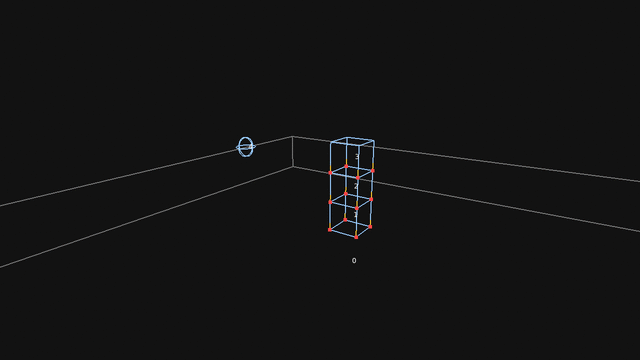
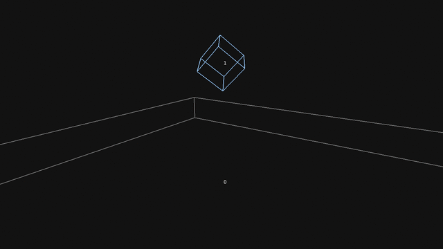
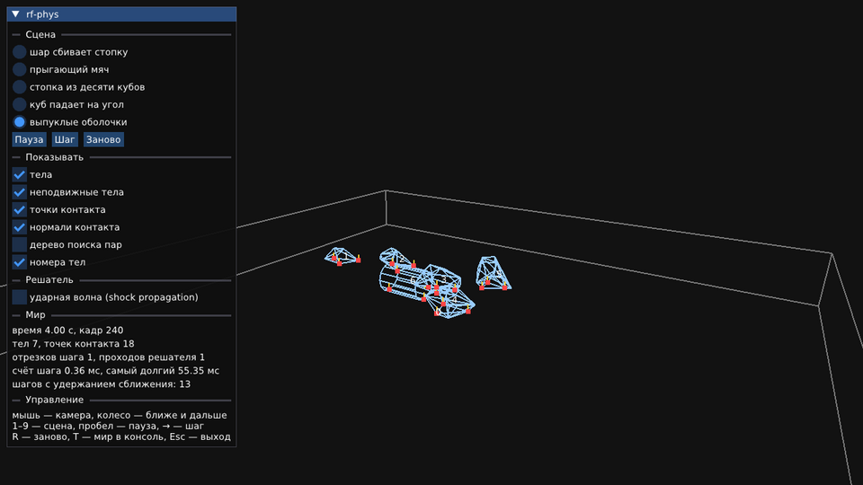
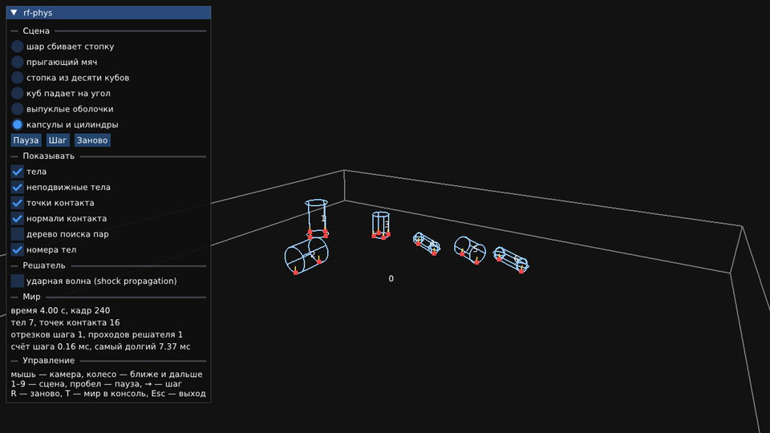
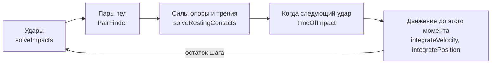

# kinetica-physics — движок твёрдых тел

Физический движок твёрдых тел для робототехники, симуляции и игр. Три требования, от которых он
не отступает: **точные столкновения на любой скорости**, **точные контакты** и **побитово
повторяемый результат**. Код маленький и написан так, чтобы его можно было прочитать целиком.



| | |
|---|---|
| Язык | C++17, только стандартная библиотека |
| Размер движка | около 8 500 строк |
| Библиотека | `libkinetica-physics.a`, пространство имён `kp` |
| Состояние | тела простые и составные, контакты, удары, трение, сочленения с приводами и пределами хода, неподвижный мир из треугольников (в том числе рельеф по карте высот), сон островов по флагу |

## Содержание

1. [Установка](#установка)
2. [Первый пример](#первый-пример)
3. [Окно просмотра](#окно-просмотра)
4. [Как работает движок](#как-работает-движок)
5. [Примеры](#примеры)
6. [Что где лежит](#что-где-лежит)
7. [Насколько он точен](#насколько-он-точен)
8. [Чего ещё нет](#чего-ещё-нет)
9. [Документация](#документация)

## Установка

Движку нужны только компилятор C++17 и CMake 3.16 или новее. Проверено на Ubuntu 22.04, g++ 11.4.

```
sudo apt install build-essential cmake       # компилятор и сборка
git clone <адрес репозитория> && cd kinetica-physics
cmake -B build && cmake --build build -j     # библиотека, проверки, примеры
ctest --test-dir build                       # 15 136 проверок и 30 лемм
```

Окну просмотра дополнительно нужны OpenGL и две библиотеки. Ставить руками можно только первую:

| Библиотека | Зачем | Как попадает |
|---|---|---|
| [GLFW](https://www.glfw.org) | окно и ввод | `sudo apt install libglfw3-dev`; если не поставить — сборка скачает сама |
| [Dear ImGui](https://github.com/ocornut/imgui) | панель с кнопками и текстом | сборка скачивает сама |

```
cmake -B build -DKP_VIEWER=ON && cmake --build build -j
./build/viewer/viewer
```

Скачанное закреплено версией и контрольной суммой; перечень и лицензии — в
[`THIRD_PARTY_NOTICES.md`](THIRD_PARTY_NOTICES.md). Сам движок от этих библиотек не зависит.

## Первый пример

Куб падает на пол — [`examples/05_world/FallingBox.cpp`](examples/05_world/FallingBox.cpp):

```cpp
#include <world/World.h>
using namespace kp;

int main() {
    World world;                                              // тяжесть 9,81 м/с² вниз по оси Y

    world.addBody(Body::box({10, 0.5, 10}, 0, {0, -0.5, 0})); // пол: плотность 0 — неподвижное тело
    const BodyId cube = world.addBody(Body::box({0.5, 0.5, 0.5}, 1000, {0, 3, 0}));

    for (int frame = 0; frame < 120; ++frame) world.step(1.0 / 60);

    world.body(cube).position;                                // куб лежит на полу: высота центра 0,5 м
}
```

Тело задаётся формой, плотностью и положением. `Body::box` принимает полуразмеры бруска,
`Body::sphere` — радиус, `Body::capsule` и `Body::cylinder` — половину длины и радиус,
`Body::hull` — облако точек: тело получает форму их выпуклой оболочки,
а масса, центр масс и главные оси находятся сами. Единицы — метры, килограммы, секунды.

Подключить движок к своей программе на CMake:

```cmake
add_subdirectory(kinetica-physics/src)
target_link_libraries(my_program PRIVATE kinetica-physics)
```

## Окно просмотра


Слева панель: выбор сцены, пуск и пауза, галочки «что показывать» (в том числе узлы дерева
поиска пар), выключатель прохода shock propagation в решателе и числа о мире — время, число
контактов, сколько проходов сделал решатель и сколько занял счёт шага. Цифры рядом с телами —
их номера, те же, что в текстовом выводе.

| Клавиша | Действие |
|---|---|
| `1`–`9` | первые девять сцен (остальные — в панели) |
| пробел, `→` | пауза, один шаг |
| `R` | сцена заново |
| `T` | состояние мира текстом в консоль |
| мышь, колесо | вращение камеры, приближение |
| `Esc` | выход |

Синим нарисованы тела, серым — неподвижные, красные точки — точки контакта, жёлтые чёрточки —
нормали контакта.







Снимок и запись кадров — ключами: `viewer --scene 4 --frames 150 --record кадр` пишет файлы
`кадр-0001.ppm`, …; анимации на этой странице собраны из них.

Движок сам ничего не рисует. Он отдаёт список точек и отрезков — `debugGeometry(world)` — и текст
— `debugText(world)`; рисует тот, кто список получил. Поэтому рядом с окном на OpenGL есть второй
рендер, [`examples/HtmlViewer.h`](examples/HtmlViewer.h): он пишет кадры в один файл HTML,
который открывается в любом браузере.

## Как работает движок

Один вызов `world.step(dt)` продвигает мир на `dt`. Шаг делится на отрезки в моменты ударов:
удар решается тогда, когда он произошёл, а не в конце кадра. Отрезок — пять стадий:



1. **Удары.** Тела, которые касаются и сближаются, мгновенно меняют скорости; коэффициент
   восстановления задаёт, какая доля скорости возвращается.
2. **Пары тел.** Отбираются пары, которые касаются или успеют коснуться за отрезок.
3. **Силы опоры и трения.** Для всех контактов разом решается система: тела не проникают друг в
   друга, сила трения не больше `μN`. Силы опоры и трение покоя находятся точно, одной системой.
4. **Время следующего удара.** Для пар, которые ещё не касаются, ищется момент касания — поэтому
   быстрое тело не пролетает сквозь тонкую стенку.
5. **Движение.** Тела летят до найденного момента под действием найденных сил.

Перед этими стадиями есть ещё одна, обычно пустая: если тела оказались друг в друге — например,
так созданы, — их раздвигает, не придавая скорости.

Код разложен по слоям; нижний слой не знает о верхнем:

| Раздел | Что в нём | Главные имена |
|---|---|---|
| `math/` | вектор, кватернион, матрицы, преобразование, луч, свои синус и косинус | `Vector3`, `Quaternion`, `Matrix3x3`, `Transform`, `Ray`, `sinCos` |
| `collision/shapes/` | выпуклые формы | `ConvexShape`, `ConvexHull`, `Sphere`, `Capsule`, `Cylinder` |
| `collision/narrowphase/` | расстояние и точки контакта пары форм | `closestPoints`, `NarrowPhaseAlgorithm`, `HullVsHullAlgorithm`, `HullVsRoundAlgorithm`, `RoundVsRoundAlgorithm`, `timeOfImpact` |
| `collision/broadphase/`, `collision/` | поиск пар тел, луч | `DynamicTree`, `PairFinder`, `ContactPair`, `castRay` |
| `body/` | тело, масса, составные тела | `Body`, `MassProperties`, `CompoundBodyBuilder` |
| `joints/` | сочленения | `Joint`, `HingeJoint`, `SliderJoint`, `BallAndSocketJoint`, `FixedJoint`, `TetherJoint`, `JointSet` |
| `dynamics/event_driven/` | шаг по событиям (точный): отрезки между ударами, прямой решатель сил | `ExactStep`, `EventSearch`, `ContactSolver`, `ActiveSet` |
| `dynamics/time_stepping/` | шаг с подшагами (быстрый): постоянная цена кадра | `SoftStep`, `SoftContact`, `SoftJoint` |
| `world/` | мир и сон островов | `World::step`, `IslandSleep` |
| `debug/` | мир точками, отрезками и текстом | `debugGeometry`, `debugText` |

Откуда взято каждое решение и какими замерами оно выбрано — в
[`docs/DEVELOPMENT.md`](docs/DEVELOPMENT.md).

## Примеры

Примеры идут по слоям снизу вверх; каждый печатает результат рядом с точным ответом. После
сборки они лежат в `build/examples/`.

| Пример | Что показывает |
|---|---|
| [`01_math/Rotation`](examples/01_math/Rotation.cpp) | поворот вектора кватернионом, поза тела |
| [`02_geometry/Distance`](examples/02_geometry/Distance.cpp) | расстояние между бруском и шаром, ближайшие точки |
| [`02_geometry/Contact`](examples/02_geometry/Contact.cpp) | точки контакта двух брусков |
| [`02_geometry/Hull`](examples/02_geometry/Hull.cpp) | выпуклая оболочка облака точек; тело произвольной формы |
| [`02_geometry/TimeOfImpact`](examples/02_geometry/TimeOfImpact.cpp) | момент удара шара о плиту в 1 мм на скорости 1 км/с |
| [`03_collision/Pairs`](examples/03_collision/Pairs.cpp) | какие тела касаются или коснутся за шаг |
| [`04_dynamics/FreeSpin`](examples/04_dynamics/FreeSpin.cpp) | свободное вращение: момент импульса и энергия сохраняются |
| [`05_world/FallingBox`](examples/05_world/FallingBox.cpp) | куб падает на пол |
| [`05_world/BouncingBall`](examples/05_world/BouncingBall.cpp) | высоты отскоков совпадают с формулой |
| [`05_world/BoxStack`](examples/05_world/BoxStack.cpp) | стопка из десяти кубов стоит минуту |
| [`05_world/DebugView`](examples/05_world/DebugView.cpp) | шар сбивает стопку: мир текстом в консоль и кадрами в HTML |

## Что где лежит

| Каталог | Что там |
|---|---|
| `include/` | заголовки движка по разделам; всё сразу — `#include <physics.h>` |
| `src/` | исходный код движка по тем же разделам; собирается в библиотеку `libkinetica-physics.a` |
| `examples/` | короткие программы-примеры по слоям движка; `examples/scenes` — стандартный набор сцен |
| `viewer/` | окно просмотра на OpenGL |
| `tests/` | модульные проверки: каждая сверяет одну функцию с точным ответом |
| `validation/` | испытания точности: сцены с ответом по формуле, сравнение со старым ядром, замеры |
| `docs/` | документация: цель и решения, описание испытаний, разборы экспериментов |
| `research/` | исследование чужих движков, из которого выведены решения |

## Насколько он точен

Движок принимается испытаниями, у которых есть точный ответ. Рядом — прежнее ядро `phys_realflow`,
которое он должен заменить. Полный отчёт — [`validation/README.md`](validation/README.md).

| Испытание | kinetica-physics | прежнее ядро |
|---|---|---|
| Отношение масс до 1 : 10⁶ | 6 из 6 | 6 из 6 |
| Брусок на склоне у предела трения, три направления | 27 из 27 | 14 из 27 |
| Высота отскока при разных коэффициентах восстановления | 5 из 5 | 5 из 5 |
| Шар на плиту в 1 мм, от 1 м/с до 10 км/с | 5 из 5 | 5 из 5 |
| Свободное вращение 1 000 с: энергия и момент импульса | 3 из 3 | 0 из 3 |
| Стопка кубов | 800 кубов стоят неподвижно: сдвиг 7·10⁻¹² м | до 400 |
| 400 случайных падений куба с трением: прирост энергии | 8·10⁻¹⁴ от начальной | не измерялось |
| Быстрые столкновения, 35 пар фигур, 1–10 000 м/с | пролётов сквозь мишень нет | не измерялось |
| Столкновения от одного вращения, 15 пар фигур, 10–10 000 рад/с | пропусков нет, перекрытие до 0,001 мм | не измерялось |
| Тяжёлый куб на лёгком, 1 : 10⁶: остаточная скорость | 1,5·10⁻¹⁰ м/с | не измерялось |

Результат повторяется побитово от запуска к запуску. На другом компиляторе и другой машине это
ещё не проверялось.

## Чего ещё нет

- Скорость на сценах с десятками событий за кадр: шаг обрывается на каждом ударе и каждой
  остановке скольжения, и стена из 33 кирпичей под ударом шара считается 1,8 с на кадр
  ([`docs/reports/standard-scenes.md`](docs/reports/standard-scenes.md)). Качающаяся цепь из
  десяти звеньев на сочленениях считается 110 мс на кадр.
- Привод, предел хода, трение, демпфер и пружина есть только у шарнира и ползуна.
- Запросы сцены (луч, область) и постоянное дерево: сейчас дерево поиска пар строится заново на каждом шаге.
- Конус. Разбиение невыпуклой сетки плохо передаёт стенки тоньше двух вокселей (ведро со стенкой
  в сантиметр выходит на 56–96 % объёмнее); тела вращения задаются точно (`CompoundBodyBuilder::revolved`).
- Чередование «нормали — трение» в решателе не сходится при скольжении: в домино 60 % решений
  кончаются с невязкой скорости больше 10⁻⁹ м/с. Покоящиеся кучи (пирамида, стена вплотную)
  решаются точно и за один круг.
- Тела с неравными моментами инерции получают при ударах лишнюю энергию до 10⁻⁶ начальной;
  у куба, шара и капсулы она на уровне округления.
- Глубина перекрытия двух круглых форм, когда перекрылись их ядра: после удара на 100 м/с капсула
  входит в капсулу до 3,6 мм.
- Шаг, в котором тело после удара на 10 км/с вращается со скоростью 10⁵ рад/с и остаётся в
  контакте, делится на десятки тысяч отрезков и считается секунды.
- Плата за выталкивание тел из перекрытия — прирост энергии и уход момента импульса; шаг без
  конца в 16 клетках полной таблицы случаев из 7 425
  ([`docs/reports/case-table.md`](docs/reports/case-table.md)). Сами перекрытия закрыты: глубже
  допуска 0,01 мм тела входят друг в друга в 2 клетках.
- У цилиндра кромка всегда скруглена не меньше чем на 0,032 мм.
- Раздельный счёт островов: событие в одном острове обрывает шаг всем. Сон островов есть
  (`World::sleeping`), но выключен по умолчанию и помогает только сценам, пришедшим в покой.
- Быстрая усадка высоких стопок: покоящаяся стопка из 200 кубов считается за 13 мс на шаг, но
  пока по ней идёт волна ударов, шаг занимает секунды.
- Проверка повторяемости между компиляторами и платформами.

## Документация

| Документ | О чём |
|---|---|
| [`docs/DEVELOPMENT.md`](docs/DEVELOPMENT.md) | цель, стандарт кода, имена, решения по подсистемам, этапы |
| [`docs/ROADMAP.md`](docs/ROADMAP.md) | сверхцели с порогами и командами замера, очередь оптимизаций от памяти до сборки |
| [`docs/JOURNAL.md`](docs/JOURNAL.md) | журнал разработки: как движок делался, по датам — что хотели, что вышло, что нет |
| [`docs/reports/engine-comparison.md`](docs/reports/engine-comparison.md) | табло против Box3D: 16 вариантов каждой сцены, критерий знаков, дрожь |
| [`docs/VALIDATION.md`](docs/VALIDATION.md) | испытания точности и их допуски |
| [`docs/reports/case-table.md`](docs/reports/case-table.md) | полная таблица случаев контакта: где движок ошибается, с рисунками |
| [`docs/reports/standard-scenes.md`](docs/reports/standard-scenes.md) | стандартный набор сцен: пирамида, домино, цепь из торов, ведро в ведре и другие — чем кончаются и чего стоят |
| [`proofs/`](proofs) | леммы площадки касания, проверяемые решателем Z3 (`proofs/check.sh`) |
| [`docs/experiments/`](docs/experiments) | разборы: опись прежнего ядра, отказ цепи, ошибки геометрии, выбор решателя, мигание сна |
| [`research/README.md`](research/README.md) | исследование MuJoCo, Box3D, Jolt, Rapier, PhysX, Bepu и Bullet по исходникам |
| [`THIRD_PARTY_NOTICES.md`](THIRD_PARTY_NOTICES.md) | чужие библиотеки и их лицензии |
