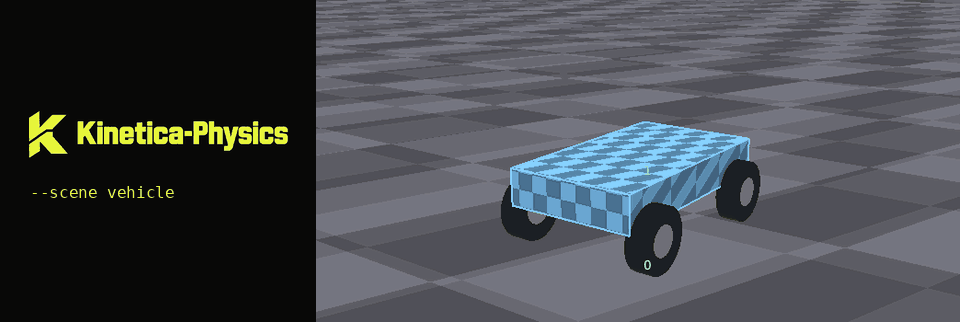
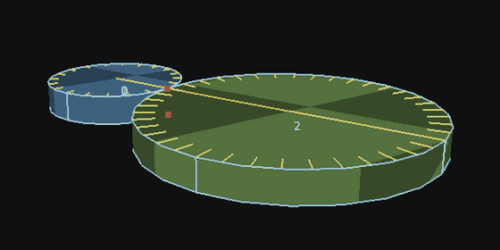
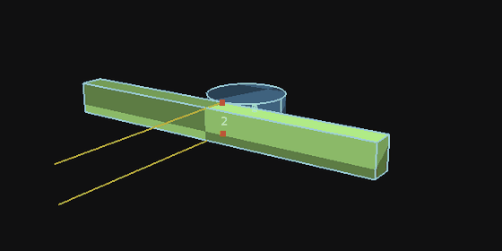
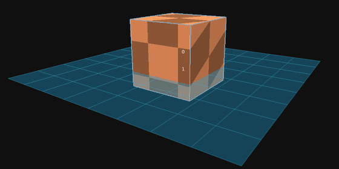
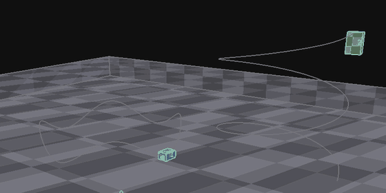
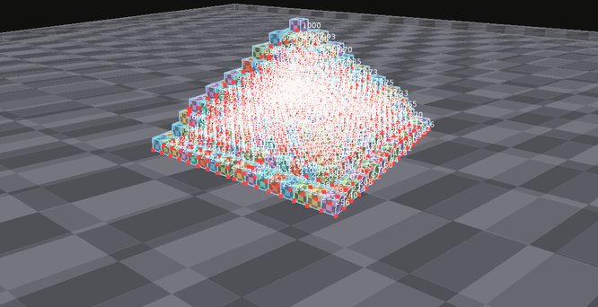

# Kinetica Physics

Движок твёрдых тел на C++17 для робототехники. У каждой учебной сцены есть физический вопрос. На сколько сдвинется рейка за четверть оборота? Удержат ли две губки груз на пределе трения? Сцену можно открыть, потянуть тело мышью, затем сравнить движение с расчётом.



В сцене `vehicle` четыре луча измеряют расстояние от шасси до опоры. Пружины и демпферы передают силы кузову массой 80 кг. **W / S** задают ход, **A / D** поворачивают передние колёса. [Сборка автомобиля](examples/scenes/Vehicle.h) · [Расчёт сил колёс](src/world/VehicleConstraint.cpp)

## Запустить и поиграть

Для окна просмотра понадобятся компилятор C++17, CMake 3.24+ и OpenGL. На Ubuntu пакеты GLFW и OpenGL устанавливаются командой `sudo apt install libglfw3-dev libgl1-mesa-dev`. CMake загрузит закреплённую версию Dear ImGui при первом конфигурировании. Команды ниже рассчитаны на Linux или WSL с графическим сеансом.

```sh
git clone --branch dev https://github.com/Kinetica-Labs/kinetica-physics.git
cd kinetica-physics
cmake -S . -B build -DCMAKE_BUILD_TYPE=Release -DKP_VIEWER=ON
cmake --build build --parallel
./build/viewer/viewer --scene vehicle
```

Любую сцену из галереи можно открыть по ключу после `--scene` или выбрать в боковой панели. **Левая кнопка мыши** тянет тело за указанную точку, **правая** вращает камеру, **средняя** перемещает её, колесо меняет масштаб. **Пробел** ставит опыт на паузу, **→** выполняет один шаг, **R** начинает заново. [Все сцены в коде](viewer/Scenes.cpp)

## Механика в движении

| Зубчатая передача · `gear-train` | Реечная передача · `rack-pinion` |
|---|---|
|  |  |
| У ведущего колеса 20 зубьев, у ведомого 40. По меткам видно, что большой диск вращается в другую сторону и вдвое медленнее. [Сцена](examples/scenes/GearTrain.h) | Радиус шестерни 20 мм. За четверть оборота рейка проходит 31,4 мм, затем привод меняет направление. [Сцена](examples/scenes/RackDrive.h) |

Для двух внешних шестерён числа зубьев $z_A,z_B$ задают отношение угловых скоростей. В реечной передаче угол $\theta$ в радианах превращается в ход $s$ вдоль направляющей.

$$
\omega_B=-\frac{z_A}{z_B}\,\omega_A=-\frac{1}{2}\,\omega_A,
\qquad s=r\theta=20\,\mathrm{mm}\cdot\frac{\pi}{2}\approx31.4\,\mathrm{mm}.
$$

| Плавучесть · `floating-box` | Движение по сплайну · `rail` |
|---|---|
|  |  |
| Куб со стороной 20 см движется по вертикальной направляющей. Плоскость отмечает поверхность спокойной воды. [Сила Архимеда в коде](examples/scenes/FloatingBox.h) | Привод ведёт вагонетку по замкнутому кольцу со скоростью 1,5 м/с. Второй груз спускается по спирали под действием тяжести. [Пример с путевым сочленением](examples/05_world/Rail.cpp) |

Почему куб колеблется вокруг половины своей высоты? В равновесии вес равен силе Архимеда. Для ребра $a$ и осадки $d$ погружённый объём равен $a^2d$. При плотности куба 500 кг/м³ и воды 1000 кг/м³ получаем

$$
\rho_{\mathrm{water}} g a^2 d=\rho_{\mathrm{box}} g a^3,
\qquad d=a\,\frac{\rho_{\mathrm{box}}}{\rho_{\mathrm{water}}}=0.10\,\mathrm{m}.
$$

## Тысяча кубиков



В `pyramid1000` кубики разлетаются во все стороны. Можно остановить кадр и рассмотреть контакты. В опыте на 120 кадров с проходом по опорам максимальное проникновение в пол составило **1,323 мм**, между кубами — **4,388 мм**. При допусках 2 и 5 мм за предел вышли **0 из 120** кадров с проходом и **5 из 120** с выключенным проходом. Переключатель в коде — `world.shockPropagation`, по умолчанию включён. [Методика, условия и исходные измерения](docs/reports/stress-1000-2026-11-24.md)

## Сколько стоит точность

Две губки сцены `threshold-grip` прижимают куб с силой $N=10$ Н каждая. Коэффициент трения $\mu=0.5$, внешняя нагрузка $F=10$ Н. Захват находится ровно на границе сцепления

$$
F_{\max}=2\mu N=10\,\mathrm{N}.
$$

На Windows-стенде 24 ноября 2026 года сравнили один нагруженный кадр при 60 Гц и восьми вызовах обновления за кадр. Допуск смещения — **0,5 мм**. Время — медиана по 12 блокам, ошибка — максимум на траектории этого захвата.

| Движок и режим | Время кадра, мкс | Ошибка, мм | В допуске |
|---|---:|---:|:---:|
| Kinetica, совместное трение двух контактов | 129,95 | 0,0434 | Да |
| ReactPhysics3D, double | 47,98 | 0,2792 | Да |
| Box3D | 47,46 | 2,9092 | Нет |

В этом опыте Kinetica дала наименьшее смещение. При общем допуске RP3D быстрее в **2,74 раза** по медиане парных отношений. Для Box3D время при этом допуске ещё предстоит измерить. В более широкой проверке контактов 863 из 7 425 случаев нарушили хотя бы один критерий. [Протокол и сырые данные](docs/reports/dev-ablation-2026-11-24.md) · [Код сцены захвата](viewer/ThresholdGrip.h)

## От первого примера до решателя

Первый пример — метровый куб, падающий с высоты 3 м. Когда нижняя грань касается пола, геометрическая высота центра равна **0,5000 м**. При шаге 1/60 с через две секунды программа на Windows напечатала **0,5001 м**. В коде порог регистрации контакта равен 0,1 мм, а высота печатается до четвёртого знака в метрах. Единицы движка — метры, килограммы и секунды. [FallingBox.cpp](examples/05_world/FallingBox.cpp) · [Порог контакта](include/collision/ContactPair.h) · [Вывод по кадрам](docs/reports/data/falling-box-windows-2026-11-24.txt)

```sh
./build/examples/FallingBox
ctest --test-dir build --output-on-failure
```

| Если хочется понять… | Где читать |
|---|---|
| Как мир продвигается на $\Delta t$ | [World::step](src/world/World.cpp) выбирает [событийный шаг](src/dynamics/event_driven/ExactStep.cpp) или [шаг с подшагами](src/dynamics/time_stepping/SoftStep.cpp). Новый `World` использует событийный шаг, просмотрщик обычно начинает с быстрого. |
| Откуда берутся точки контакта | [Поиск пар](src/collision/PairFinder.cpp), [геометрия контактной площадки](src/collision/narrowphase/ContactPatch.cpp) и [перенос сохранённых точек](src/collision/ManifoldMemory.cpp). |
| Как устроены связи тел | [Сочленения](include/joints) задают разрешённые движения. [Подвеска одного колеса](examples/scenes/WheelBench.h) связывает просадку пружины с нагрузкой. |
| Как проверить результат | [Стандартные сцены и их критерии](examples/scenes/StandardScenes.cpp), [модульные проверки](tests) и [проверяемые леммы](proofs). |

Для встраивания достаточно библиотеки C++17. Если исходники лежат в каталоге `kinetica-physics` рядом с вашим `CMakeLists.txt`, подключите существующую цель приложения после её объявления.

```cmake
add_subdirectory(kinetica-physics/src kinetica-build)
target_link_libraries(my_program PRIVATE kinetica-physics)
```

## Чего ещё нет

Гарантия непроникновения для произвольной геометрии остаётся открытой. В таблице контактов худшее измеренное проникновение составило 1,526 мм. Побитовая повторяемость подтверждена на проверенных сборках x86-64. Для переноса этого вывода на ARM нужен отдельный прогон тех же сцен. [Результаты и границы проверок](docs/reports/dev-ablation-2026-11-24.md)

## Документация

- [Устройство и решения](docs/DEVELOPMENT.md) · [План работ](docs/ROADMAP.md) · [Журнал разработки](docs/JOURNAL.md)
- [Проверка точности для робототехники](docs/reports/robotics-accuracy-2026-11-22.md) · [Стандартные сцены](docs/reports/standard-scenes.md) · [Таблица случаев контакта](docs/reports/case-table.md)
- [Разбор других движков](research/README.md) · [Заимствования и лицензии](THIRD_PARTY_NOTICES.md) · [Лицензия MIT](LICENSE)
- [Удар шара по стопке](docs/images/ball-hits-stack.gif) · [Падение куба на угол](docs/images/cube-on-corner.gif) · [Выпуклые оболочки](docs/images/hulls.png) · [Капсулы и цилиндры](docs/images/round-shapes.png)
