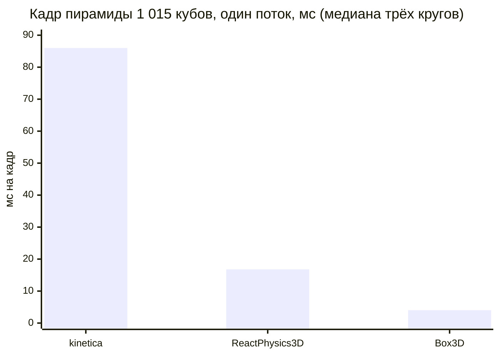

# Сверхцели и очередь оптимизаций

Цель словами автора: красиво устроенный, легко читаемый объектный код, а физика на одном потоке
быстрее и точнее, чем у Box3D и ReactPhysics3D. Здесь она записана числами: у каждой цели порог и
команда замера, у каждой правки — где сейчас потеря и чем проверить. Пороги предложены мной, их
можно менять; оценки отмечены словом «оценка», всё остальное — замеры.

## 1. Где мы: сначала отказы

Замер 2026-11-20, трёхмерная пирамида 14 × 14 (1 015 кубов, 6 930 контактов), один поток, три круга
попеременно, машина нагружена чужим процессом (сравнивать отношения, а не миллисекунды):

| Движок | мс на кадр (наименьшее – наибольшее, медиана) | мы медленнее в |
|---|---|---|
| kinetica, быстрый шаг, 8 подшагов | 76,1 – 105,2, медиана 86,0 | — |
| ReactPhysics3D, свои умолчания | 16,3 – 18,0, медиана 16,8 | **5,1 раза** |
| Box3D, 8 подшагов | 3,94 – 4,44, медиана 4,03 | **21 раз** |

- **Скорость — отказ.** До шага H55 отставание от Box3D было 26 раз (утром того же дня — 43); H55 снял
  13–24 % кадра. После правок копирования (раздел 3) кадр в спокойных кругах 72,9–74,2 мс против
  76,3–79,4 мс; отношение к Box3D в четырёх кругах 18–21 — на шумной машине это в пределах разброса.
- **Точность — два отказа из 102.** Осадка пирамиды из 55 кубов (`sink_mm`): 13,5 мм против 9,46 мм
  при 4 подшагах и 5,31 мм против 4,29 мм при 8 подшагах, когда Box3D даны наши жёсткости. В
  остальных строках [табло](reports/engine-comparison.md) — лучше 91, ничья 9.
- **Память — близко.** Обращений к куче на кадр: пирамида 24, стена 13 (было 61 тыс. и 46 тыс.).
- **Красота и повторяемость — выполнено.** `code_metrics.py --check` — 0 нарушений; хэш состояния
  совпадает при 1, 4 и 12 потоках.

## 2. Сверхцели

| № | Цель | Сейчас | Порог | Команда |
|---|---|---|---|---|
| С1 | Быстрее ReactPhysics3D на одном потоке | медленнее в 5,1 раза | отношение ≤ 1 | `KP_THREADS=1 BENCH=14 build/validation/engines/compare-ours realtime 8` против `BENCH=14 build/rp3d/compare-rp3d` |
| С2 | Быстрее Box3D на одном потоке | медленнее в 21 раз | вехи 10 → 5 → 2 → ≤ 1 | то же против `BENCH=14 build/box3d/compare-box3d 8` |
| С3 | Точнее Box3D | хуже в 2 строках из 102 | хуже в 0 строках | `python3 validation/run.py run && python3 validation/run.py report` |
| С4 | Повторяемость | бит в бит при 1, 4, 12 потоках | то же плюс скалярная и векторная сборки, второй компилятор | `KP_THREADS=N build/validation/studies/study-state-hash 60 \| diff - docs/reports/data/state-hash.txt` |
| С5 | Память | 13–24 обращения к куче на кадр; контакт из 4 точек — 1 416 Б | 0 обращений в установившемся кадре; контакт ≤ 512 Б | `build/validation/studies/study-allocations pyramid 2` |
| С6 | Красота | 0 нарушений, 10 552 строки | 0 нарушений, не больше 12 000 строк | `python3 validation/code_metrics.py --check` |

Что из этого можно обещать. Box3D тратит около 60 нс на контакт в подшаге (замер 2026-11-20,
[журнал попыток](../validation/attempts.jsonl)) — это примерно 250 тактов процессора при восьми
контактах на одну команду AVX2. Сделать ту же работу заметно быстрее на одном потоке нельзя.
Обогнать его можно, только делая меньше работы: не считать то, что покоится (раздел Д), брать меньше
подшагов при той же точности (Г6), не строить заново то, что не изменилось (Б1, Г4). С1 достижима
правками из очереди. По С2 моя оценка — отставание в 3–5 раз на бурной сцене и паритет или выигрыш
на сценах, где большая часть тел покоится; это оценка, а не замер.

## 3. Куда уходит кадр

Кадр по стадиям шага — прибор `KP_THREADS=1 build/validation/studies/study-frame-stages pyramid3d`
(та же пирамида; спокойные круги после правок H55 и копирования):

| Стадия | мс на кадр | доля | из чего состоит (замер временной разметкой) |
|---|---|---|---|
| Нормали | 26,3 – 26,7 | 36 % | два решения за подшаг: с поправкой положения и без |
| Поиск пар и точек | 16,5 – 16,7 | 23 % | до правки 18,1: дерево и кандидаты 4,6, проверка пар 8,5 (99 % — перенос площадки из памяти), склейка ответа 4,2 |
| Постройка контактов | 9,6 – 9,7 | 13 % | до правки 11,5: сами контакты 6,9, `MissedContacts` 2,8, тела решателя и `PairReach` 1,6 |
| Сдвиг тел и `follow` | 6,9 – 7,0 | 9 % | |
| Трение | 4,4 – 4,5 | 6 % | |
| Тёплый старт | 4,3 – 4,4 | 6 % | |
| Доиск пропущенных контактов | 2,5 – 2,6 | 3 % | |
| Силы в память | 2,1 | 3 % | |
| Сочленения, прочее | 0,15 | 0,2 % | |
| **Кадр** | **72,9 – 73,6** | | до правок копирования 76,3 – 79,4 |

| Величина | kinetica | Box3D |
|---|---|---|
| Контакт в подшаге | 955 нс при 140 контактах, 1 200–1 700 нс при тысячах | 60 нс |
| Поиск пар / точек контакта | вместе 16,6 мс | 0,03 мс / 0,7 мс |
| Решение (всё, кроме поиска) | 56 мс | 3,0–3,5 мс |
| Число и ширина | `double`, по одному контакту | `float`, по восемь |
| Что живёт между кадрами | силы точек, площадки простых пар | дерево, пары, контакты |

Внутри решения нормалей (счётчик тактов, 237 нс на вызов, 110 880 вызовов на кадр): отклик площадки
`respond` 31 %, правая часть 22 %, задача дополнительности 34 %, импульсы к телам 13 %. Две догадки о
причине опровергнуты замером — деления (Г1) и разброс полей точки по памяти (А2). Гадать дальше
незачем: нужен профиль по командам процессора (`perf`), а он на этой машине закрыт настройкой ядра
`kernel.perf_event_paranoid=4`.

Размеры: `SoftContact` 712 Б + 176 Б на точку, `ContactPair` 616 Б, `ManifoldMemory::Entry` 408 Б.
Пробел равномерный (геометрия ×25, решение ×23): одного горячего места нет, поэтому очередь длинная.

## 4. Очередь оптимизаций

«Ответ»: **бит** — хэш состояния обязан совпасть; **меняется** — проверять табло, 16 вариантами
(`study-overlap-spread`) и стандартными сценами. Ожидание — доля кадра пирамиды; где стоит «оценка»,
до правки нужен замер прибором.

### А. Память и раскладка данных

| № | Что | Где потеря сейчас | Ожидание | Ответ |
|---|---|---|---|---|
| А1 | ✔ Силы пары — отрезком массива, место под массивы заранее (H55) | двоичный поиск на каждую точку, рост массивов | сделано: −13…−24 % | бит |
| А2 | Горячие данные контакта — отдельным плотным массивом | решатель читает нормаль, плечи, импульс, зазор, а контакт занимает 1 416 Б. Перестановка полей внутри точки (горячие подряд) проверена: нормали 26,5 → 26,1–26,3 мс, в пределах разброса — не принята | только вместе с Г5: один массив на все контакты островка | бит |
| А3 | ✔ Пары и записи памяти площадок не копируются лишний раз | было: пара копировалась в `MissedContacts` и дважды в `PairFinder`, запись памяти площадок — трижды, около 40 МБ на кадр | сделано: поиск пар −1,5…−2 мс, постройка −1,7…−2,3 мс (−4,5…−5 % кадра) | бит |
| А3б | Проверка пишет пару сразу в ответ | осталась одна копия пары (616 Б) из `Found` в ответ `PairFinder` | оценка −1 % | бит |
| А4 | `Body::part()` отдаёт вид, а не копию тела | в `MissedContacts` простое тело уже не копируется; у составных копия на каждую пару частей осталась | замерить на вёдрах и цепи | бит |
| А7 | Масса трения качения — только при ненулевом плече | `RollingFriction::prepare` обращает матрицу 2 × 2 для каждого контакта, а плечо по умолчанию 0 | оценка −1 % | бит |
| А5 | Строки сочленений — в памяти шага | `std::vector<Bond>`: сцены с сочленениями обращаются к куче в 5–19 раз чаще остальных | до 0 обращений (С5) | бит |
| А6 | Тела решателя: скорости отдельно от поз и инерции | `SolverBody` читается целиком ради `v` и `w` | замерить после А2 | бит |

### Б. Поиск пар

| № | Что | Где потеря сейчас | Ожидание | Ответ |
|---|---|---|---|---|
| Б1 | Дерево живёт между кадрами; пара находится один раз | замер: бруски 0,4 мс, вставка в дерево 0,75, запросы и сортировка 2,6 мс на кадр. Постоянное дерево снимает только вставку (1 % кадра); запрос находит каждую пару дважды — обход дерева против самого себя нашёл бы один раз | оценка −1…−1,5 мс; после Г4 | бит, если порядок пар тот же |
| Б2 | Сетка для массы одинаковых тел | не начато; широкая фаза сейчас ~2 % кадра | не раньше, чем Б1 упрётся в дерево | бит |

### В. Точки контакта

| № | Что | Где потеря сейчас | Ожидание | Ответ |
|---|---|---|---|---|
| В1 | Наибольшая глубина контакта запоминается в `follow` | `deepest` пересчитывает её в `MissedContacts::note`; зазор точки меняют четыре места (создание, два пути `follow`, `matchTrial`) — инвариант на четырёх писателей | до −2 % | бит |
| В2 | Память площадок для частей составных тел | `ManifoldMemory` ведёт только простые пары многогранников с контактом по грани | замерить на вёдрах и цепи | меняется |
| В3 | Память оси SAT для движущихся пар | при промахе памяти площадок — полный перебор осей | оценка: большая часть остатка 18 мс на бурной сцене | меняется |

### Г. Решатель

| № | Что | Где потеря сейчас | Ожидание | Ответ |
|---|---|---|---|---|
| Г1 | ✘ Блок площадки без лишних делений | проверено (H57): деление на диагональ раз на строку, дальше умножения — 8 медленных операций вместо 18. Нормали 26,7 → 26,9 мс: выигрыша нет, цена нормалей не в делениях. Полная замена на LDLᵀ с переделкой модели Why3 снята | — | — |
| Г2 | Матрица отклика площадки — раз за подшаг | `respond` строит её дважды за подшаг; между решением без поправки и решением следующего подшага позы не меняются, и матрицу можно запомнить — ценой +512 Б на контакт | замерить: счёт против памяти | бит |
| Г3 | Силы пишутся в память на месте | `remember` перекладывает их в конце шага (3,5 %) | вместе с Г4 | бит |
| Г4 | Контакты живут между обновлениями и кадрами | `SoftContact` строится заново 4 раза за кадр | оценка −8…−12 % | меняется |
| Г7 | ✘ Два обновления контактов на кадр вместо четырёх | замер `KP_UPDATES=2 study-overlap-spread pile`: перекрытие кучи 2,24 → 3,26 мм в медиане (+46 %), наибольшее 4,70 → 6,35 — не принято; постройка стоит 26 мс на кадр, снимать её надо не реже, а дешевле (Г4) | — | — |
| Г5 | Широкий решатель крупных островков: данные `float`, восемь контактов за команду, по цветам | по одному контакту на `double`; раскраска замерена: 16 цветов по 287–605 контактов | оценка: решение в 3–6 раз быстрее — главный шаг к С2 | меняется |
| Г6 | Меньше подшагов при той же точности | замер по журналу табло, 16 вариантов: наш шаг при 4 подшагах против Box3D при 8 — лучше 29 строк, ничья 4, хуже 1 (осадка пирамиды из 55 кубов, 13,5 против 8,95 мм). Кадр пирамиды 1 015 кубов: 51,9 мс при 4 подшагах против 71,5 при 8 | −27 % кадра, как только закрыта З1 | — |

### Д. Считать только то, что движется

| № | Что | Где потеря сейчас | Ожидание | Ответ |
|---|---|---|---|---|
| Д1 | Сон островов включён по умолчанию | `World::sleeping` выключен по умолчанию | покоящаяся сцена — около нуля | меняется |
| Д2 | Сон части островка и слияние покоящихся тел (Coevoet, Benchekroun, Kry, 2020) | островок считается целиком, пока движется хоть одно тело | единственный путь к выигрышу в разы; прибора нет | меняется |

### Е. Арифметика и сборка

| № | Что | Замер или оценка | Ответ |
|---|---|---|---|
| Е1 | `float` для данных пути на пружинах | общая замена `Real` отклонена (H54): кадр −27 %, но ломаются `IslandNormals`, `QuickHull` и 5 878 проверок; `float` — только вместе с Г5 | меняется |
| Е2 | Флаг `-mavx2` | замер H54: не даёт ничего ни одной точности — скалярный код от ширины регистров не выигрывает | бит |
| Е3 | ✘ Оптимизация при компоновке (`-flto`) | замер: хэш совпал, кадр 70,3–76,5 мс без флага и 75,1–81,2 с ним — выигрыша нет | бит |
| Е4 | FMA и `rsqrt` | запрещены правилом детерминизма и останутся запрещены | — |

### Ж. Потоки

Отложены, пока действует условие «один поток». Задел есть: островки уже решаются заданиями пула, а
цвет из 450 контактов шестью ядрами считается в 4–6 раз быстрее (замер 2026-11-20).

### З. Точность

| № | Что | Сейчас | Порог |
|---|---|---|---|
| З1 | Осадка пирамиды из 55 кубов | 13,5 мм при 4 подшагах (Box3D 9,46), 5,31 мм при 8 (Box3D на наших жёсткостях 4,29) | не хуже Box3D в 16 вариантах |
| З2 | Перечень «чего ещё нет» | [README](../README.md#чего-ещё-нет): чередование нормалей и трения при скольжении, перекрытие круглых форм после удара, раздельный счёт островов в точном шаге | по строке на правку |

## 5. Структура и паттерны

Правило развилки. Объект на элемент и виртуальный вызов — там, где элементов десятки: формы,
сочленения, наблюдатели, сцена. Там, где их тысячи на подшаг — точки контакта, тела решателя, —
класс владеет массивом значений и его инвариантом, а цикл по массиву один и невиртуальный. Объект на
каждый контакт с методами `respond`, `follow`, `solveNormals` — ровно то, что стоит нам 1 000 нс
против 60 нс.

Что уже есть в коде:

| Паттерн | Где |
|---|---|
| Фасад | `World`, общий заголовок `<physics.h>` |
| Стратегия | `NarrowPhaseAlgorithm`: три алгоритма по паре видов форм |
| Шаблонный метод | `Joint::build`, `SingleFreedomJoint::coordinate` |
| Прототип | `Joint::clone` |
| Строитель | `CompoundBodyBuilder` |
| Наблюдатель | `StepObserver` |
| Приспособленец | одна `ConvexShape` на много тел (`std::shared_ptr<const ConvexShape>`) |
| Пул и арена | `WorkerPool`, `StepMemory` со `StepArray` |
| Сильные типы | `BodyId` |

Что добавить ради скорости, не теряя читаемости:

| Паттерн | Зачем | Какая правка очереди |
|---|---|---|
| Класс — механизм над массивом (раскладка «структура массивов») | цикл решателя идёт по плотным одинаковым данным | А2, А6, Г5 |
| Постоянные номера с поколением | контакт и пара переживают кадр, ссылка на них не висит | Б1, Г4 |
| Конвейер стадий: каждая берёт значение и возвращает значение | стадию можно замерить, заменить и проверить отдельно; нет скрытых правок общего состояния | Б1, Г3, Г4 |
| Статический полиморфизм: ядро решателя — шаблон по виду числа | один текст алгоритма для `Real` и для пакета из восьми `float`; условие С4 проверяется хэшем | Г5, Е1 |

Паттерн ставится там, где есть вторая реализация или измеренная цена. Паттерн «на будущее» —
строки без нагрузки: он ухудшает и С6, и чтение.

## 6. Порядок работ

1. ✔ Прибор кадра по этапам: `study-frame-stages` (2026-11-20).
2. ✔ Правки с ответом бит в бит сделаны, пока давали больше разброса замера: H55, А3, `follow`. Остаток
   (А3б, А7, В1, Г2, Б1) — по 0,5–1 % каждая, ниже разброса; брать попутно, когда правится то же место.
3. ✔ Замеры без правок: Г6 — 4 подшага дают −27 % кадра при одной худшей строке; Е3 и Г7 отклонены.
3а. Закрыть З1 (осадка пирамиды из 55 кубов при 4 подшагах): это единственное, что мешает считать с
   4 подшагами. Признак: наш шаг при 4 подшагах не хуже Box3D при 8 во всех 34 строках.
4. Постоянные пары и контакты: Б1, Г4, Г3. Признак: табло не хуже нынешнего, кадр ≤ 50 мс.
5. Широкий решатель: А2, Г5, Е1. Признак: С1 выполнена (быстрее ReactPhysics3D), отставание от
   Box3D ≤ 5 раз.
6. Только движущееся: Д1, Д2. Признак: сцена, где покоится 90 % тел, считается быстрее, чем у Box3D.

После каждого шага — запись в [журнал разработки](JOURNAL.md) и строка в журнал попыток; эта
страница обновляется, когда меняется число в разделе 1 или порядок в разделе 6.
