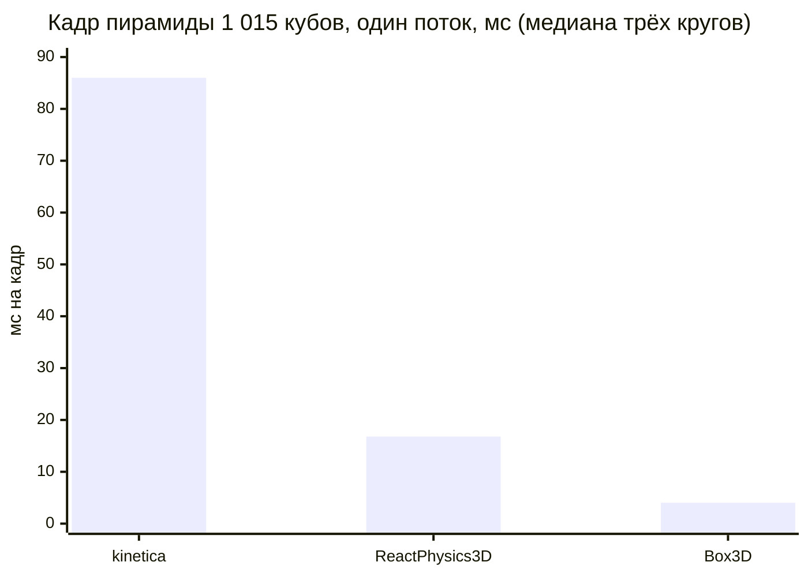

# Сверхцели и очередь оптимизаций

Цель словами автора: красиво устроенный, легко читаемый объектный код, а физика на одном потоке
быстрее и точнее, чем у Box3D и ReactPhysics3D. Здесь она записана числами: у каждой цели порог и
команда замера, у каждой правки — где сейчас потеря и чем проверить. Пороги предложены мной, их
можно менять; оценки отмечены словом «оценка», всё остальное — замеры.

## 0. Главная цель с 2026-11-20: точность, повторяемость, покрытие

Таблица фиксирует исходное состояние на 20 ноября. В прогоне от 24 ноября нарушения остались в 863 из 7 425 клеток. [Результаты ветки dev и архивы замеров](reports/dev-ablation-2026-11-24.md)

Слова автора: «очень точная детерминированная физика со 100 % покрытием всех возможных коллизий на
поле суммы всех геометрий». Скорость (разделы 1–6) — вторая. Мерки у этой цели уже есть:

| № | Цель | Сейчас | Порог | Команда |
|---|---|---|---|---|
| Т1 | В полной таблице случаев контакта нет нарушений | 893 клетки из 7 425: прирост энергии 890, перекрытие 5, пролёт 1, шаг без конца 1 | 0 | `python3 validation/case_table.py --check` |
| Т2 | Таблица покрывает все геометрии движка | 6 фигур: шар, капсула, цилиндр, скруглённый цилиндр, брусок, оболочка. Нет составных тел, неподвижной сетки из треугольников и рельефа; конуса нет в самом движке | все формы × все формы | оси таблицы — `validation/studies/CaseTable.cpp` |
| Т3 | Повторяемость бит в бит | при 1, 4, 12 потоках и у трёх компиляторов (g++ 11, g++ 12, clang++ 14) на одной машине | то же на другой системе и на ARM | `study-state-hash 60 \| diff - docs/reports/data/state-hash.txt` |
| Т4 | Сцены с точным ответом | маятник 7,4·10⁻³ рад, конический маятник 2,2·10⁻⁴ м, кривошип 1,1·10⁻¹¹ м за 2 с | не хуже этих чисел | `build/validation/studies/study-exact-scenes` |

Что найдено при первом же замере (2026-11-20):

- **Таблицу случаев не гоняли с 17 ноября, и за это время точный шаг ухудшился.** Виновен один коммит
  `b27472a` (19 ноября): он убрал уход момента импульса (1 701 клетка → 0), но поднял прирост энергии с 520
  до 890 клеток и дал один пролёт и один шаг без конца. Это первая работа по Т1.
- **Память шага не возвращалась, когда шагают несколько миров в потоках** — прибор занимал 13 ГБ и
  был убит системой. Исправлено: 0,9 ГБ и 43 с.
- **Сцена «чаша» строилась по-разному у g++ и clang++**: постройка сцен звала `sin` из libm, а g++
  считает его от постоянного угла сам и округляет иначе. Исправлено, тест `no-libm` теперь проверяет и сцены.
- Оба прибора поставлены в CI храповиком: счёт нарушений и хэш у второго компилятора ухудшиться не могут.
- **Окно в точном шаге «зависало»** (приёмка руками, 2026-11-20): кадр длился секунды. Причин две.
  Расходящийся подбор сил сочленений интегрировал пробный поворот в сотни тысяч радиан — исправлено
  (H61): «цепь, груз 100:1» 55 с → 0,7 с на 60 кадров. Вторая не исправлена: перебор активного набора
  на каждое изменение заново раскладывает всю систему — 365 полных решений на отрезок у столбика из 400
  кубов, 1 058 у стены из 33 кирпичей, кадр 1–5 с. Это работа Л1 (обновление разложения), и для
  главной цели она важнее, чем для скорости: без неё точный шаг на больших сценах нельзя даже смотреть.
- **Рывок за куб пирамиды из 55 в точном шаге не считается** (`KP_SEGMENTS=8 study-pull-cube exact 14 2 1 0 0`):
  120 кадров дольше 120 с; за 40 с — 188 650 разложений системы до 970 линий, 959 «надёжных спусков» по 121
  разложению. Память исправлена (H62: 2,76 → 0,45 ГБ), время нет. Мерка готовности Л1: эти 120 кадров
  за 10 с при том же ответе таблицы случаев. Обновление разложения в спуске (H88, 2026-11-21) дало на
  пирамиде из 36 только 1,6 → 1,0 с на кадр: две трети времени точного шага теперь — перестановки с полным
  разложением перед спуском (`solveCholesky` 54 %). Следующая проба — точный шаг на том же спуске без перестановок.
- **Тот же рывок в быстром шаге стоит 11,1 мс на кадр, из них 9,5 мс — жёсткая задача островка**
  (`study-pull-cube realtime 14 2 1 0 0`, один поток): 143 разложения системы на кадр. Только на пружинах
  кадр 1,6 мс, но перекрытие 5,9 мм вместо 3,0. Значит, Л1 — первая работа и по скорости: матрица
  островка один раз на решение набора, обновление разложения вместо пересчёта, спуск с прошлого
  решения. Мерка: 11,1 → 3 мс на кадр при перекрытии не больше 3,02 мм. Сделано частично (H88): разложение идёт
  за набором, спуск с прошлого решения — 13,9 → 5,9 мс на кадр, худший кадр 43 → 17 мс, перекрытие 3,041 мм
  прежнее. Осталась матрица островка: она строится заново в каждом решении.
- **Сцена «цепь, груз 100:1» не держит энергию в точном шаге**: ошибка 0,38 Дж за 0,75 с и 0,89 Дж за 1 с
  (`study-exact-scenes 1`). Это отказ по Т4, причина не разобрана.

Порядок: (1) вернуть энергию к 520 клеткам, не потеряв момент импульса, убрать пролёт и шаг без конца;
(2) остальные 520 клеток по худшим группам — покой 278, волчок 256, склон 214 клеток; цилиндры дают
больше всех; (3) расширить оси таблицы на составные тела и неподвижную сетку (Т2).

## 1. Где мы: сначала отказы

Разбор отставания по стадиям против Box3D и порядок работ по скорости — `docs/reports/gap-analysis.md`
(2026-11-20): отстаём на каждой стадии в 8–32 раза, упущены постоянство контактов, широкий решатель,
зазор в цикле решателя и плотная раскладка данных. Первый результат — H69: в тихом кадре контакты ищутся
один раз, кадр 64,7 → 45,9 мс при тех же числах табло. Второй — H71: в тихом кадре нет второго решения
нормалей, кадр 47,3 → 39,5 мс при осадке пирамиды из 55 на 1 % больше. Отставание от Box3D — в 10,9 раза.
Третий — H72: второе решение нормалей только контактам движущихся тел; пирамида с падающим рядом шаром
64,7 → 54,3 мс. Следующая крупная работа — раздельный счёт стоящих и движущихся островков (раздел 7 отчёта).

Замер 2026-11-20, трёхмерная пирамида 14 × 14 (1 015 кубов, 6 930 контактов), один поток, три круга
попеременно, машина нагружена чужим процессом (сравнивать отношения, а не миллисекунды):

| Движок | мс на кадр (наименьшее – наибольшее, медиана) | мы медленнее в |
|---|---|---|
| kinetica, быстрый шаг, 8 подшагов | 76,1 – 105,2, медиана 86,0 | — |
| ReactPhysics3D, свои умолчания | 16,3 – 18,0, медиана 16,8 | **5,1 раза** |
| Box3D, 8 подшагов | 3,94 – 4,44, медиана 4,03 | **21 раз** |

- **Скорость — отказ.** До шага H55 отставание от Box3D было 26 раз (утром того же дня — 43); H55 снял
  13–24 % кадра. После правок копирования (раздел 3) кадр в спокойных кругах 72,9–74,2 мс против
  76,3–79,4 мс; отношение к Box3D в четырёх кругах 18–21 — на шумной машине это в пределах разброса.
- **Точность — два отказа из 102.** Осадка пирамиды из 55 кубов (`sink_mm`): 13,5 мм против 9,46 мм
  при 4 подшагах и 5,31 мм против 4,29 мм при 8 подшагах, когда Box3D даны наши жёсткости. В
  остальных строках [табло](reports/engine-comparison.md) — лучше 91, ничья 9.
- **Память — близко.** Обращений к куче на кадр: пирамида 24, стена 13 (было 61 тыс. и 46 тыс.).
- **Красота и повторяемость — выполнено.** `code_metrics.py --check` — 0 нарушений; хэш состояния
  совпадает при 1, 4 и 12 потоках.

## 2. Сверхцели

| № | Цель | Сейчас | Порог | Команда |
|---|---|---|---|---|
| С1 | Быстрее ReactPhysics3D на одном потоке | медленнее в 1,27 раза (33,5 против 26,4 мс); на всех ядрах — 23,3 мс | отношение ≤ 1 | `KP_THREADS=1 BENCH=14 build/validation/engines/compare-ours realtime 8` против `BENCH=14 build/rp3d/compare-rp3d` |
| С2 | Быстрее Box3D на одном потоке | медленнее в 9,2 раза (33,5 против 3,65 мс) | вехи 10 → 5 → 2 → ≤ 1 | то же против `BENCH=14 build/box3d/compare-box3d 8` |
| С3 | Точнее Box3D | хуже в 2 строках из 102 | хуже в 0 строках | `python3 validation/run.py run && python3 validation/run.py report` |
| С4 | Повторяемость | бит в бит при 1, 4, 12 потоках | то же плюс скалярная и векторная сборки, второй компилятор | `KP_THREADS=N build/validation/studies/study-state-hash 60 \| diff - docs/reports/data/state-hash.txt` |
| С5 | Память | 13–24 обращения к куче на кадр; контакт из 4 точек — 1 416 Б | 0 обращений в установившемся кадре; контакт ≤ 512 Б | `build/validation/studies/study-allocations pyramid 2` |
| С6 | Красота | 0 нарушений, 10 552 строки | 0 нарушений, не больше 12 000 строк | `python3 validation/code_metrics.py --check` |

Что из этого можно обещать. Box3D тратит около 60 нс на контакт в подшаге (замер 2026-11-20,
[журнал попыток](../validation/attempts.jsonl)) — это примерно 250 тактов процессора при восьми
контактах на одну команду AVX2. Сделать ту же работу заметно быстрее на одном потоке нельзя.
Обогнать его можно, только делая меньше работы: не считать то, что покоится (раздел Д), брать меньше
подшагов при той же точности (Г6), не строить заново то, что не изменилось (Б1, Г4). С1 достижима
правками из очереди. По С2 моя оценка — отставание в 3–5 раз на бурной сцене и паритет или выигрыш
на сценах, где большая часть тел покоится; это оценка, а не замер.

## 3. Куда уходит кадр

Кадр по стадиям шага — прибор `KP_THREADS=1 build/validation/studies/study-frame-stages pyramid3d`
(та же пирамида; спокойные круги после правок H55 и копирования):

| Стадия | мс на кадр | доля | из чего состоит (замер временной разметкой) |
|---|---|---|---|
| Нормали | 26,3 – 26,7 | 36 % | два решения за подшаг: с поправкой положения и без |
| Поиск пар и точек | 16,5 – 16,7 | 23 % | до правки 18,1: дерево и кандидаты 4,6, проверка пар 8,5 (99 % — перенос площадки из памяти), склейка ответа 4,2 |
| Постройка контактов | 9,6 – 9,7 | 13 % | до правки 11,5: сами контакты 6,9, `MissedContacts` 2,8, тела решателя и `PairReach` 1,6 |
| Сдвиг тел и `follow` | 6,9 – 7,0 | 9 % | |
| Трение | 4,4 – 4,5 | 6 % | |
| Тёплый старт | 4,3 – 4,4 | 6 % | |
| Доиск пропущенных контактов | 2,5 – 2,6 | 3 % | |
| Силы в память | 2,1 | 3 % | |
| Сочленения, прочее | 0,15 | 0,2 % | |
| **Кадр** | **72,9 – 73,6** | | до правок копирования 76,3 – 79,4 |

| Величина | kinetica | Box3D |
|---|---|---|
| Контакт в подшаге | 955 нс при 140 контактах, 1 200–1 700 нс при тысячах | 60 нс |
| Поиск пар / точек контакта | вместе 16,6 мс | 0,03 мс / 0,7 мс |
| Решение (всё, кроме поиска) | 56 мс | 3,0–3,5 мс |
| Число и ширина | `double`, по одному контакту | `float`, по восемь |
| Что живёт между кадрами | силы точек, площадки простых пар | дерево, пары, контакты |

Профиль `perf` (открыт 2026-11-20 командой `sudo sysctl kernel.perf_event_paranoid=1`, до перезагрузки):

| Счётчик на кадр | значение | что значит |
|---|---|---|
| команд процессора | 610 млн — около 8 000 на контакт в подшаге | у Box3D сотни: наш блочный решатель площадки считает в 6–8 раз больше арифметики и по одному контакту, а не по восемь |
| тактов | 319–321 млн, 1,6–1,9 команды на такт | счёт идёт вдвое медленнее, чем мог бы: мешает память |
| промахов кэша третьего уровня | 261 тыс. (было 320 тыс.) | контакты — 10 МБ, и за подшаг по ним идёт пять проходов (было семь) |
| промахов ветвлений | 0,9 % | не причина |

Профиль плоский: `solveComplementarity` 13,8 %, `solveNormals` 11,2 %, `respond` 8,6 %, `follow` 6,7 %,
`solveFriction` 6,0 %, `warmStart` 5,6 %, `takePoints` 4,7 %, остальное — по 1–4 %. Одной дорогой команды
нет: деления и корни в задаче дополнительности — около 4 % кадра (поэтому Г1 выигрыша не дала).
Вывод: мелкими правками порядок величины не взять — нужны плотные массивы горячих данных, меньше
проходов и контакты, живущие между обновлениями (А2, Г4, Г5).

Надёжная мерка для правок без изменения ответа — счётчики, а не время:
`KP_THREADS=1 BENCH=14 perf stat -e cycles:u,instructions:u,LLC-load-misses:u build/validation/engines/compare-ours realtime 8`.

Размеры: `SoftContact` 712 Б + 176 Б на точку, `ContactPair` 616 Б, `ManifoldMemory::Entry` 408 Б.
Пробел равномерный (геометрия ×25, решение ×23): одного горячего места нет, поэтому очередь длинная.

## 4. Очередь оптимизаций

«Ответ»: **бит** — хэш состояния обязан совпасть; **меняется** — проверять табло, 16 вариантами
(`study-overlap-spread`) и стандартными сценами. Ожидание — доля кадра пирамиды; где стоит «оценка»,
до правки нужен замер прибором.

### А. Память и раскладка данных

| № | Что | Где потеря сейчас | Ожидание | Ответ |
|---|---|---|---|---|
| А1 | ✔ Силы пары — отрезком массива, место под массивы заранее (H55) | двоичный поиск на каждую точку, рост массивов | сделано: −13…−24 % | бит |
| А2 | Горячие данные контакта — отдельным плотным массивом | решатель читает нормаль, плечи, импульс, зазор, а контакт занимает 1 416 Б. Перестановка полей внутри точки (горячие подряд) проверена: нормали 26,5 → 26,1–26,3 мс, в пределах разброса — не принята | только вместе с Г5: один массив на все контакты островка | бит |
| А3 | ✔ Пары и записи памяти площадок не копируются лишний раз | было: пара копировалась в `MissedContacts` и дважды в `PairFinder`, запись памяти площадок — трижды, около 40 МБ на кадр | сделано: поиск пар −1,5…−2 мс, постройка −1,7…−2,3 мс (−4,5…−5 % кадра) | бит |
| А3б | Проверка пишет пару сразу в ответ | осталась одна копия пары (616 Б) из `Found` в ответ `PairFinder` | оценка −1 % | бит |
| А4 | `Body::part()` отдаёт вид, а не копию тела | в `MissedContacts` простое тело уже не копируется; у составных копия на каждую пару частей осталась | замерить на вёдрах и цепи | бит |
| А7 | Масса трения качения — только при ненулевом плече | `RollingFriction::prepare` обращает матрицу 2 × 2 для каждого контакта, а плечо по умолчанию 0 | оценка −1 % | бит |
| А5 | Строки сочленений — в памяти шага | `std::vector<Bond>`: сцены с сочленениями обращаются к куче в 5–19 раз чаще остальных | до 0 обращений (С5) | бит |
| А6 | Тела решателя: скорости отдельно от поз и инерции | `SolverBody` читается целиком ради `v` и `w` | замерить после А2 | бит |

### Б. Поиск пар

| № | Что | Где потеря сейчас | Ожидание | Ответ |
|---|---|---|---|---|
| Б1 | Дерево живёт между кадрами; пара находится один раз | замер: бруски 0,4 мс, вставка в дерево 0,75, запросы и сортировка 2,6 мс на кадр. Постоянное дерево снимает только вставку (1 % кадра); запрос находит каждую пару дважды — обход дерева против самого себя нашёл бы один раз | оценка −1…−1,5 мс; после Г4 | бит, если порядок пар тот же |
| Б2 | Сетка для массы одинаковых тел | не начато; широкая фаза сейчас ~2 % кадра | не раньше, чем Б1 упрётся в дерево | бит |

### В. Точки контакта

| № | Что | Где потеря сейчас | Ожидание | Ответ |
|---|---|---|---|---|
| В1 | ✔ Наибольшая глубина контакта берётся в том же проходе, что `follow` | было: отдельный проход по всем точкам (12 % промахов кэша третьего уровня при 1 % счёта) | сделано вместе с Г8: промахов −18…−19 %, тактов −2…−3 % | бит |
| В2 | Память площадок для частей составных тел | `ManifoldMemory` ведёт только простые пары многогранников с контактом по грани | замерить на вёдрах и цепи | меняется |
| В3 | Память оси SAT для движущихся пар | при промахе памяти площадок — полный перебор осей | оценка: большая часть остатка 18 мс на бурной сцене | меняется |

### Г. Решатель

| № | Что | Где потеря сейчас | Ожидание | Ответ |
|---|---|---|---|---|
| Г1 | ✘ Блок площадки без лишних делений | проверено (H57): деление на диагональ раз на строку, дальше умножения — 8 медленных операций вместо 18. Нормали 26,7 → 26,9 мс: выигрыша нет, цена нормалей не в делениях. Полная замена на LDLᵀ с переделкой модели Why3 снята | — | — |
| Г2 | Матрица отклика площадки — раз за подшаг | `respond` строит её дважды за подшаг; между решением без поправки и решением следующего подшага позы не меняются, и матрицу можно запомнить — ценой +512 Б на контакт | замерить: счёт против памяти | бит |
| Г3 | Силы пишутся в память на месте | `remember` перекладывает их в конце шага (3,5 %) | вместе с Г4 | бит |
| Г4 | Контакты живут между обновлениями и кадрами | `SoftContact` строится заново 4 раза за кадр | оценка −8…−12 % | меняется |
| Г7 | ✘ Два обновления контактов на кадр вместо четырёх | замер `KP_UPDATES=2 study-overlap-spread pile`: перекрытие кучи 2,24 → 3,26 мм в медиане (+46 %), наибольшее 4,70 → 6,35 — не принято; постройка стоит 26 мс на кадр, снимать её надо не реже, а дешевле (Г4) | — | — |
| Г8 | ✔ Проход отскока пропускается, когда отскока нет ни у одного тела | было: проход по всем контактам ради проверки одного поля | сделано, см. В1 | бит |
| Г5 | Широкий решатель крупных островков: данные `float`, восемь контактов за команду, по цветам | по одному контакту на `double`; раскраска замерена: 16 цветов по 287–605 контактов | оценка: решение в 3–6 раз быстрее — главный шаг к С2 | меняется |
| Г6 | Меньше подшагов при той же точности | замер по журналу табло, 16 вариантов: наш шаг при 4 подшагах против Box3D при 8 — лучше 29 строк, ничья 4, хуже 1 (осадка пирамиды из 55 кубов, 13,5 против 8,95 мм). Кадр пирамиды 1 015 кубов: 51,9 мс при 4 подшагах против 71,5 при 8 | −27 % кадра, как только закрыта З1 | — |

### Д. Считать только то, что движется

| № | Что | Где потеря сейчас | Ожидание | Ответ |
|---|---|---|---|---|
| Д1 | Сон островов включён по умолчанию | `World::sleeping` выключен по умолчанию | покоящаяся сцена — около нуля | меняется |
| Д2 | Сон части островка и слияние покоящихся тел (Coevoet, Benchekroun, Kry, 2020) | островок считается целиком, пока движется хоть одно тело | единственный путь к выигрышу в разы; прибора нет | меняется |

### Е. Арифметика и сборка

| № | Что | Замер или оценка | Ответ |
|---|---|---|---|
| Е1 | `float` для данных пути на пружинах | общая замена `Real` отклонена (H54): кадр −27 %, но ломаются `IslandNormals`, `QuickHull` и 5 878 проверок; `float` — только вместе с Г5 | меняется |
| Е2 | Флаг `-mavx2` | замер H54: не даёт ничего ни одной точности — скалярный код от ширины регистров не выигрывает | бит |
| Е3 | ✘ Оптимизация при компоновке (`-flto`) | замер: хэш совпал, кадр 70,3–76,5 мс без флага и 75,1–81,2 с ним — выигрыша нет | бит |
| Е4 | FMA и `rsqrt` | запрещены правилом детерминизма и останутся запрещены | — |

### Ж. Потоки

Отложены, пока действует условие «один поток». Задел есть: островки уже решаются заданиями пула, а
цвет из 450 контактов шестью ядрами считается в 4–6 раз быстрее (замер 2026-11-20).

### З. Точность

| № | Что | Сейчас | Порог |
|---|---|---|---|
| З1 | Осадка пирамиды из 55 кубов | 13,5 мм при 4 подшагах (Box3D 9,46), 5,31 мм при 8 (Box3D на наших жёсткостях 4,29). Причина найдена пробой: островок в 580 строк чуть больше предела жёсткой задачи (`soft.directContactRows` = 512) и решается на пружинах. С пределом 1024 — осадка 2,56 мм и уход 4·10⁻⁶ мм при любом числе подшагов, но кадр 0,77 → 4,4 мс | не хуже Box3D в 16 вариантах; выбор — поднять предел (точность ценой времени) или удешевить жёсткую задачу |
| З2 | Перечень «чего ещё нет» | [README](../README.md#чего-ещё-нет): чередование нормалей и трения при скольжении, перекрытие круглых форм после удара, раздельный счёт островов в точном шаге | по строке на правку |
| З3 | Точный шаг: остановка скольжения внутри отрезка (H112, часть 1). Часть 2 — опора, которая вращается, — ✔ 2026-11-21 (H113): пара с остатком скольжения меньше четверти ухода точки касания за отрезок считается прилипшей; ящик на поворотном столе за оборот уходит на 0,40 мм вместо 5,5 см, второй порядок по шагу | остановку шаг событием не считает, если трения хватает до конца отрезка: пара останавливается «в среднем», путь ошибается до μ g h² / 8 = 0,17 мм на остановку (ящик на плите, пошедшей рывком: 1,2e-3 отн.) | отставание на рывке плиты — 1e-5 отн.; таблица случаев не хуже; отрезков на шаг в сценах с кучами не больше |

### И. Опыты по литературе

Обзор со ссылками и степенью проверки каждой работы — [`research/papers.md`](../research/papers.md).

| № | Что | Откуда | Ожидание | Ответ |
|---|---|---|---|---|
| Л1 | Жёсткая задача островка: блочные повороты и обновление разложения | Enzenhöfer, Lefebvre, Andrews, 2019 | дешевле жёсткая задача → предел выше 512 строк → закрыта З1 | меняется в пределах допуска решения |
| Л2 | ✘ Прототип AVBD прибором вне движка (`compare-avbd`; убран, код — коммит `df859f0`) | Giles, Diaz, Yuksel, 2025 | замер H59: при 4 проходах дёшево (решение 21,8 мс против наших 56), но дрожит (524 разворота скорости); при 10 проходах осадка 4,62 мм и цена уже как у нас; дрожи нашего уровня нет ни при каком числе проходов, при 40 разваливается | не принят |
| Л4 | ✘ Разделение масс вместо раскраски (все пары считаются независимо) | Tonge, Benevolenski, Voroshilov, 2012 | замер H60: осадка пирамиды из 55 кубов 5,31 → 17,4 мм и не убывает с подшагами — мягкий контакт становится мягче во столько раз, на сколько делится масса | не принят; для ширины — раскраска |
| Л3 | Слияние тел, движущихся как одно целое | Coevoet, Benchekroun, Kry, 2020 | покоящаяся часть островка не считается (Д2) | меняется |

## 5. Структура и паттерны

Правило развилки. Объект на элемент и виртуальный вызов — там, где элементов десятки: формы,
сочленения, наблюдатели, сцена. Там, где их тысячи на подшаг — точки контакта, тела решателя, —
класс владеет массивом значений и его инвариантом, а цикл по массиву один и невиртуальный. Объект на
каждый контакт с методами `respond`, `follow`, `solveNormals` — ровно то, что стоит нам 1 000 нс
против 60 нс.

Что уже есть в коде:

| Паттерн | Где |
|---|---|
| Фасад | `World`, общий заголовок `<physics.h>` |
| Стратегия | `NarrowPhaseAlgorithm`: три алгоритма по паре видов форм |
| Шаблонный метод | `Joint::build`, `SingleFreedomJoint::coordinate` |
| Прототип | `Joint::clone` |
| Строитель | `CompoundBodyBuilder` |
| Наблюдатель | `StepObserver` |
| Приспособленец | одна `ConvexShape` на много тел (`std::shared_ptr<const ConvexShape>`) |
| Пул и арена | `WorkerPool`, `StepMemory` со `StepArray` |
| Сильные типы | `BodyId` |

Что добавить ради скорости, не теряя читаемости:

| Паттерн | Зачем | Какая правка очереди |
|---|---|---|
| Класс — механизм над массивом (раскладка «структура массивов») | цикл решателя идёт по плотным одинаковым данным | А2, А6, Г5 |
| Постоянные номера с поколением | контакт и пара переживают кадр, ссылка на них не висит | Б1, Г4 |
| Конвейер стадий: каждая берёт значение и возвращает значение | стадию можно замерить, заменить и проверить отдельно; нет скрытых правок общего состояния | Б1, Г3, Г4 |
| Статический полиморфизм: ядро решателя — шаблон по виду числа | один текст алгоритма для `Real` и для пакета из восьми `float`; условие С4 проверяется хэшем | Г5, Е1 |

Паттерн ставится там, где есть вторая реализация или измеренная цена. Паттерн «на будущее» —
строки без нагрузки: он ухудшает и С6, и чтение.

## 6. Порядок работ

1. ✔ Прибор кадра по этапам: `study-frame-stages` (2026-11-20).
2. ✔ Правки с ответом бит в бит сделаны, пока давали больше разброса замера: H55, А3, `follow`, В1 и Г8. Остаток
   (А3б, А7, В1, Г2, Б1) — по 0,5–1 % каждая, ниже разброса; брать попутно, когда правится то же место.
3. ✔ Замеры без правок: Г6 — 4 подшага дают −27 % кадра при одной худшей строке; Е3 и Г7 отклонены.
3а. Закрыть З1 (осадка пирамиды из 55 кубов при 4 подшагах): это единственное, что мешает считать с
   4 подшагами. Признак: наш шаг при 4 подшагах не хуже Box3D при 8 во всех 34 строках.
   Проба показала лекарство и его цену (З1): жёсткая задача островка даёт осадку 2,56 мм вместо 13,5,
   но стоит в 5,7 раза дороже. Сначала прибор «цена жёсткой задачи от числа строк», потом выбор предела.
3б. ✔ Опыт Л2 (AVBD) сделан: планку не прошёл — широкий решатель пишется для нынешнего блочного.
3в. **Решение пользователя 2026-11-21: шаги 4 и 5 делать** («по скорости близко к Box3D», точность при этом
   первая: «мы робототехника»). Кадр пирамиды из 1 015 кубов одним потоком на свободной машине — 64,9 мс:
   нормали 23,2 (36 %), сдвиг тел с пересчётом точек 13,1 (20 %), поиск пар 7,6 (12 %), трение 6,9 (11 %),
   тёплый старт 6,6 (10 %), постройка контактов 6,0 (9 %). У Box3D весь кадр 7,0 мс: каждая наша стадия в
   одиночку сравнима с ним, поэтому одной правкой отставание не снять. Общая замена `Real` на `float`
   повторно предложена и повторно не берётся (H54: в 1,38 раза быстрее, но ломает оболочки, точный шаг и
   жёсткую задачу островка): `float` — только в горячих данных широкого решателя (Г5).
4. Постоянные пары и контакты: Б1 (✔ частью: H101, H102), Г4, Г3. Признак: табло не хуже нынешнего, кадр ≤ 50 мс.
5. Широкий решатель: А2, Г5, Е1. Признак: С1 выполнена (быстрее ReactPhysics3D), отставание от
   Box3D ≤ 5 раз.
   Порядок внутри шага по замеру H109 (332 нс на точку и подшаг против 30–36 у Box3D; лишней арифметики в
   2–4 раза, остальное — ширина счёта). Независимые наборы контактов уже есть — уровни `ContactLevels`:
   - 5а. Тела решателя и строки контакта — плотными массивами в порядке уровней. Признак: хэш прежний, кадр не хуже.
     Устройство (записано 2026-11-21, до кода). Контакты шага лежат в массиве не в порядке пар, а по
     уровням зависимости; уровень дополнен пустыми местами до кратного четырём — четвёрка соседних мест
     не делит подвижных тел, её и будет считать одна команда на шаге 5б. Контакт, найденный посреди шага,
     дописывается в хвост: он позже всех, поэтому хвост обходится по порядку после уровней. Прежний
     порядок (пары, затем дописанные) хранится списком и нужен трём местам, где от порядка зависит ответ
     или память: выбору островков и строк их жёсткой задачи (`IslandNormals::choose`), записи сил в память
     (`SoftContact::remember`) и чтению прошлых сил при постройке. Проходы решателя идут по массиву
     подряд и одним потоком, и всеми: порядок зависимых контактов тот же, ответ обязан совпасть бит в
     бит. Риск: соседние места уровня не делят тел, и тела решателя читаются вразброс, а не подряд, как
     при обходе по парам, — на одном потоке кадр может стать дольше; мерить воротами (порог 3 %).
     **Замер (H114, 2026-11-21): отдельным шагом не принято.** Ответ бит в бит тот же, но кадр пирамиды из
     1 015 кубов дольше: одним потоком 66,7 → 70,0 мс (+5 %), всеми — 32,7 → 34,1 (+4 %). Постройка контактов
     +1,6 мс (пары и тела читаются вразброс), проходы решателя +3…4 % (тела вразброс), запись сил +0,25 мс.
     Порядок по уровням сам ничего не даёт: он входит в шаг 5б и обязан окупиться счётом четвёрками. Строить
     контакты по-прежнему в порядке пар; по уровням класть только то, что читают проходы. Заплата шага —
     `build/probe/h114-5a.patch` (вне git).
   - 5б. Тёплый старт и трение — четвёрками `double` по уровню (AVX2, без FMA), ответ бит в бит со скалярным.
     Признак: хэш прежний у сборок с AVX2 и без него; эти две стадии (13,5 мс) быстрее не меньше чем вдвое.
   - 5в. Нормали площадки (матрица отклика и задача дополнительности) четвёрками. Признак: 23 → не больше 10 мс.
   - 5г. Сдвиг тел и `follow` четвёрками. Признак: 13 → не больше 6 мс.
   - 5д. Ряды `float` по восемь — только островкам на пружинах и только после 5а–5г: меняет ответ, приёмка табло.
6. Только движущееся: Д1, Д2. Признак: сцена, где покоится 90 % тел, считается быстрее, чем у Box3D.

После каждого шага — запись в [журнал разработки](JOURNAL.md) и строка в журнал попыток; эта
страница обновляется, когда меняется число в разделе 1 или порядок в разделе 6.

## 7. Очередь возможностей: чего не хватает проекту, который строят на нас

Слова пользователя 2026-11-21: «нам нужно быть точнее и быстрее других движков и возможно добавить трюки и
возможности с Jolt — там их больше; там даже есть сочленение тела с точкой на траектории сплайна». Точность
и скорость остаются первыми (разделы 0–6, ворота `validation/gate.py`); эта очередь — про то, без чего
движок нельзя вставить в игру или редактор. Сверено с исходниками Jolt (`research/refs/jolt`,
каталоги `Jolt/Physics/Body`, `Constraints`, `Collision/Shape`) и нашими заголовками (`body/Body.h`,
`world/World.h`, `joints/`, `collision/RayCast.h`).

### О. Объект сцены и мир

| № | Чего нет | Зачем | В Jolt |
|---|---|---|---|
| О1 | Удаление тела и сочленения, устойчивый номер тела | снаряды, разрушение, подгрузка уровня; сейчас номер — место в массиве | `BodyID`, `BodyInterface::RemoveBody` |
| О2 | ✔ (2026-11-21): тело без массы с заданными скоростями — `Body::drivenVelocity`, `drivenSpin`; оба шага, сцена `platforms`. Не сделано: «довести до позы за шаг» одной функцией. Точный шаг на вращающейся опоре исправлен в тот же день (H113) | платформы, двери, персонаж от анимации, захват робота | `EMotionType::Kinematic`; в RP3D — `BodyType::KINEMATIC` |
| О3 | Фильтр столкновений: слой, маска, «не сталкивать эту пару» | свой снаряд, части куклы, слои | `mObjectLayer`, `mCollisionGroup` |
| О4 | События контакта: начало, конец, сила удара | звук, урон, логика | `ContactListener` |
| О5 | Датчик — форма без отклика | зоны, триггеры | `mIsSensor` |
| О6 | Запросы к миру, кроме луча: кто в области, протяжка формы, ближайшая точка | контроллер персонажа, прицеливание | `NarrowPhaseQuery` |
| О7 | Метка владельца на теле | связать тело с объектом проекта | `mUserData` |
| О8 | Запрет движения и поворота по осям | капсула персонажа, 2,5D | `mAllowedDOFs` |
| О9 | ✔ частью (2026-11-21): сила и момент с накоплением — `Body::force`, `torque`, `applyForce`, `applyTorque`; действуют один шаг мира, оба шага, сцена `thrust`. Не сделано: задание скорости одной функцией. Не берётся: множитель тяжести (заменяется силой −m g) и предел скорости (не физика) | управление телом без пересчёта импульса руками | `AddForce`, `mGravityFactor`, `mMaxLinearVelocity`; в RP3D — `applyWorldForceAtWorldPosition`, `applyWorldTorque` |
| О10 | Выключение тела без удаления, запрет сна на тело | пул объектов | `DeactivateBody`, `mAllowSleeping` |
| О11 | Снимок и восстановление мира | сохранение, откат в сети; повторяемость бит в бит у нас есть, наружу не выведена | `StateRecorder` |
| О12 | Свойства материала на часть составного тела | разное трение у частей | материал формы |

Первые шесть — условие пригодности; порядок такой же. О1 самый объёмный: номер тела используется как
место в массиве по всему коду.

### К. Сочленения, формы, готовые системы

| № | Чего нет | В Jolt | Заметка |
|---|---|---|---|
| К1 | ✔ Сочленение по траектории: тело идёт вдоль кривой, с приводом и пределом (`PathJoint`, 2026-11-21) | `PathConstraint`, `PathConstraintPathHermite` | сделано на одной свободе `SingleFreedomJoint`; цена сборки связей не растёт с числом точек (H105); три вида поворота тела — свободен, заперт, вслед за кривой (H106); сплайн с непрерывной кривизной (H107) |
| К2 | Жёсткая связь на расстоянии с пределами | `DistanceConstraint` | `TetherJoint` — пружина, не предел |
| К3 | Конус и «качание-кручение» для суставов | `ConeConstraint`, `SwingTwistConstraint` | нужны куклам |
| К4 | Шесть свобод с пределами и приводами по каждой | `SixDOFConstraint` | у нас отдельно кардан и цилиндрическое |
| К5 | Шестерня, рейка, блок | `GearConstraint`, `RackAndPinionConstraint`, `PulleyConstraint` | связи между сочленениями |
| К6 | Неподвижная сетка треугольников и плоскость | `MeshShape`, `PlaneShape`, `TriangleShape` | рельеф у нас есть (призмы по карте высот), произвольного уровня нет |
| К7 | Усечённые капсула и цилиндр, масштаб формы, смещённый центр масс | `TaperedCapsuleShape`, `ScaledShape`, `OffsetCenterOfMassShape` | составное тело со смещением частей у нас есть |
| К8 | Контроллер персонажа | `Character`, `CharacterVirtual` | после О2, О6, О8 |
| К9 | Колёсная и гусеничная машина | `Vehicle` | после К1–К5 |
| К10 | Кукла по скелету | `Ragdoll` | после К3, О3 |
| К11 | Мягкие тела, ткань, волосы | `SoftBody`, `Hair` | другая модель; не раньше остального |

Чего у Jolt нет, а у нас есть: точный шаг по событиям как эталон, таблица случаев контакта на 7 425
клеток с храповиком, совпадение хэша бит в бит на трёх платформах под проверкой при каждой правке.

### Образцы из ReactPhysics3D

Слова пользователя 2026-11-21: «ну бери, кради как художник, твори». Сверено с исходниками 0.10.2
(`research/refs/reactphysics3d`). Для точности и скорости брать нечего: решатель — проходы по точкам, сочленений
четыре, потоков и SIMD нет. Берётся устройство свойств тела и мира — оно там самое простое.

| Что | Как в RP3D | Наша очередь |
|---|---|---|
| ✔ сила и момент с накоплением | `applyWorldForceAtWorldPosition`, `applyWorldTorque`, сброс после шага | О9 |
| ✔ тело, движимое извне | `BodyType`: static, kinematic, dynamic; у нас — тело без массы с заданной скоростью, без отдельного вида тела | О2 |
| события контакта и датчика | `ContactStart / Stay / Exit`, `OverlapStart / Stay / Exit`, один `EventListener` | О4, О5 |
| три флага формы | `isTrigger`, `isSimulationCollider`, `isWorldQueryCollider` | О5, О6 |
| фильтр столкновений | 16 бит категории и 16 бит маски на форму | О3 |
| устойчивый номер тела | `Entity`: 24 бита места и 8 бит поколения | О1 |
| запрет осей | `setLinearLockAxisFactor`: вектор из 0 и 1 на обратную массу | О8 |
| запросы к миру | `testOverlap`, `testCollision`, `testPointInside`, луч с маской | О6 |
| сглаженная нормаль сетки треугольников | `computeSmoothMeshContact`: по нормалям вершин, тело не цепляется за внутренние рёбра | К6 |
| спящие тела в хвосте массива | `mDisabledStartIndex`: проходы спящих не читают | О10 |
| конус у шарового шарнира | `enableConeLimit` | часть К3 |

Не берётся: память разделяющей оси с прошлого кадра (мерили, H96: 3,3 % при пороге 4 %). Под вопросом, без
замера не брать: узкая фаза пачками по виду пары форм (`NarrowPhaseInfoBatch`).

Правило очереди: возможность принимается теми же воротами — хэш прежних сцен не меняется, новая сцена
с эталоном входит в стандартные, и цена кадра сцен без этой возможности не растёт.

