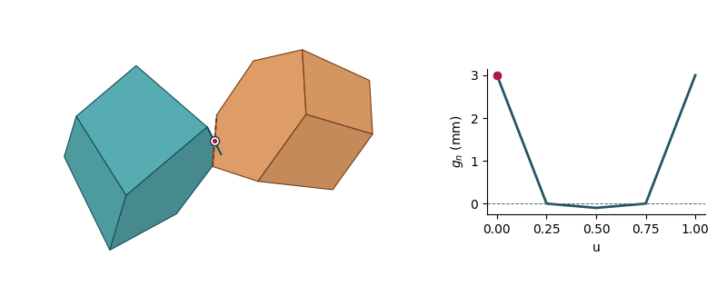

# Как устроен шаг симуляции

У тела есть форма, поза и распределение массы. Положение центра масс выражено в метрах в мировых осях. Ориентация переводит векторы из локальных осей тела в мировые. Сила задаётся в ньютонах, импульс — в Н·с. Сила, приложенная в течение интервала $h$, меняет линейный импульс на $\Delta p=Fh$. [Тело](../include/body/Body.h) · [Преобразование координат](../include/math/Transform.h)

| Вопрос | Где найти ответ |
|---|---|
| Какие тела могут столкнуться за время шага? | [Поиск пар и граница перемещения](../src/collision/PairFinder.cpp) |
| Какие тела не сталкиваются никогда? | Тела одной группы `Body::group > 0` и тела, у которых `ignoreBits` одного пересекается с `categoryBits` другого ([`mayTouch`](../include/body/Body.h)). Такие пары поиск отбрасывает до геометрии; луч с исключённым телом их тоже не видит. Так звенья одного робота не мешают друг другу, а датчик машины не видит другие машины. Нули — тело касается всего, шаг прежний бит в бит. |
| Где находятся ближайшие точки и площадка контакта? | [Узкая фаза](../src/collision/narrowphase) |
| Можно ли перенести точки предыдущего шага? | [Память площадки](../src/collision/ManifoldMemory.cpp) проверяет относительное смещение и поворот тел. |
| Как соединяются тела? | [Сочленения](../include/joints) задают ограничения на относительное движение. |
| Откуда просмотрщик получает силы подвески? | [Колёсная модель](../src/world/VehicleConstraint.cpp) использует результаты запросов лучом. |

## Два способа продвинуть время

`World::step(dt)` получает время в секундах. В новом мире работает событийный решатель. Он собирает контакты, находит силы опоры и выбирает интервал до следующего события. Ограничение числа отрезков наблюдается через `World::report().unfinished`. [Мир](../src/world/World.cpp) · [Событийный шаг](../src/dynamics/event_driven/ExactStep.cpp)

Для интерактивных сцен просмотрщик обычно включает `world.realtime`. В этом режиме кадр делится на подшаги. Параметры `world.soft` задают число подшагов и частоту обновления контактов. Сон островов в новом мире выключен. Проход по опорам `world.shockPropagation` включён по умолчанию. [Настройки мира](../include/world/World.h) · [Решение подшага](../src/dynamics/time_stepping/SoftStep.cpp)

## Откуда берутся данные для картинки

Просмотрщик читает состояние мира после шага. В сцене `hull-events` начальные позы для девяти пар геометрических признаков берутся из приложенной таблицы. Для каждой пары записано 25 поз. Форма и контакты вычисляются средствами библиотеки. Ключ `--hull-data` позволяет выбрать другой файл той же структуры. [Геометрия сцены](../examples/scenes/HullSweepShapes.h) · [Поза и воспроизведение](../viewer/HullEventsScene.h) · [Таблица поз](../viewer/data/hull-events.csv)

На рисунке $u$ — параметр записанной траектории, $g_n$ — зазор вдоль нормали между выбранными рёбрами. Отрицательное значение соответствует перекрытию вдоль этой нормали.
