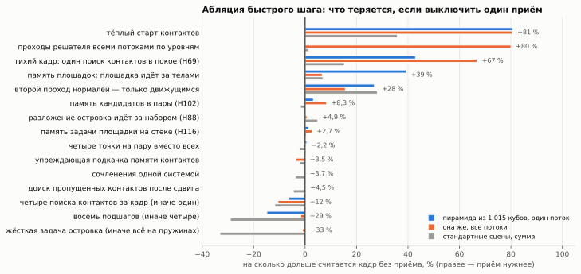

# Абляция быстрого шага: что даёт каждый приём

**Вывод.** Из пятнадцати приёмов быстрого шага пять держат скорость — без любого из них кадр большой
пирамиды дольше на 27–81 %; пять держат качество — они стоят времени, но без них сцены перестают проходить;
два оказались лишними на спокойной машине: упреждающая подкачка памяти и отбор четырёх точек на пару.
Правка этого дня — память задачи площадки на стеке (H116) — даёт 1,5–2,7 % и ответа не меняет.

## Как мерилось

Приём выключается один, остальные включены; сравнение — с тем же прогоном без переключателя.

- Переключатели — переменные окружения в отдельной копии кода (`validation/ablation.py prepare`); в
  библиотеку они не попадают. Без переключателей копия даёт эталонный хэш.
- Большая пирамида (1 015 кубов, `compare-ours realtime 8`): три пары прогонов «включён / выключен»
  попеременно, берётся наименьшее; одним потоком на закреплённом ядре и всеми потоками.
- Стандартные сцены быстрым шагом (21 сцена): сумма мс на кадр, сколько сцен прошло, наибольшее перекрытие.
- «Ответ изменился» — в скольких из 27 строк «быстрый» хэша состояния ответ стал другим.
- Свободная машина, 2026-11-21. Расхождение одинаковых сборок в этом замере — 0,11 %. Пять приёмов
  (память площадок, тихий кадр, второй проход, уровни, разложение) первый раз мерились, пока машину
  грузил её владелец, и перемерены на тихой; в таблице — перемер.

## Что теряется без приёма

| Приём (выключен) | кадр, один поток | кадр, все потоки | стандартные сцены, сумма | сцен прошло | наибольшее перекрытие | ответ изменился |
|---|---|---|---|---|---|---|
| тёплый старт контактов | +81 % | +80 % | +36 % | 18 из 21 | 2,17 мм | в 20 из 27 |
| проходы решателя всеми потоками по уровням | −0,1 % | +80 % | +1,5 % | 20 из 21 | 4,70 мм | нет |
| тихий кадр: один поиск контактов в покое (H69) | +43 % | +67 % | +15 % | 20 из 21 | 4,70 мм | в 14 из 27 |
| память площадок: площадка идёт за телами | +39 % | +6,7 % | +6,9 % | 20 из 21 | 4,73 мм | в 16 из 27 |
| второй проход нормалей — только движущимся | +27 % | +16 % | +28 % | 20 из 21 | 4,71 мм | в 17 из 27 |
| память кандидатов в пары (H102) | +3,2 % | +8,3 % | −1,8 % | 20 из 21 | 4,70 мм | нет |
| разложение островка идёт за набором (H88) | +0,3 % | +0,7 % | +4,9 % | 20 из 21 | 4,71 мм | в 12 из 27 |
| память задачи площадки на стеке (H116) | +1,5 % | +2,7 % | +0,5 % | 20 из 21 | 4,70 мм | нет |
| четыре точки на пару вместо всех | +0,6 % | −0,6 % | −2,2 % | 20 из 21 | 3,77 мм | в 6 из 27 |
| упреждающая подкачка памяти контактов | −0,1 % | −3,5 % | −2,1 % | 20 из 21 | 4,70 мм | нет |
| сочленения одной системой | −0 % | −0,4 % | −3,7 % | 19 из 21 | 4,70 мм | в 9 из 27 |
| доиск пропущенных контактов после сдвига | +0,2 % | −0,2 % | −4,5 % | 19 из 21 | 20,21 мм | в 8 из 27 |
| четыре поиска контактов за кадр (иначе один) | −6,3 % | −11 % | −12 % | 18 из 21 | 4,47 мм | в 23 из 27 |
| восемь подшагов (иначе четыре) | −15 % | −1,7 % | −29 % | 19 из 21 | 6,34 мм | в 27 из 27 |
| жёсткая задача островка (иначе всё на пружинах) | +0,3 % | −1 % | −33 % | 15 из 21 | 345,80 мм | в 20 из 27 |
| *всё включено* | 63,37 мс | 31,25 мс | 25,20 мс | 20 из 21 | 4,70 мм | — |

Плюс — без приёма дольше, то есть приём ускоряет; минус — без приёма быстрее, приём стоит времени.

## Что из этого следует

**Держат скорость** (выключать нельзя):

- *Тёплый старт* — без него кадр почти вдвое дольше и перестают проходить арка и захват: решатель каждый
  подшаг начинает с нуля, и сцена не приходит в покой.
- *Проходы всеми потоками по уровням* — весь выигрыш от потоков в решателе: без них кадр всеми потоками
  дольше на 80 %.
- *Тихий кадр*, *память площадок*, *второй проход только движущимся* — три приёма покоя: каждый даёт от 27
  до 43 % на одном потоке.

**Держат качество** (стоят времени, но без них хуже):

- *Жёсткая задача островка* — самая дорогая: без неё стандартные сцены на треть быстрее, но проходят 15 из
  21 и перекрытие 346 мм вместо 4,7.
- *Восемь подшагов* и *четыре поиска контактов* — без них на 12–29 % быстрее, но перестают проходить маятник
  Ньютона и холмы.
- *Доиск пропущенных контактов* и *сочленения одной системой* — 4 % времени; без них не проходят вёдра и
  маятник Ньютона.

**Лишние на спокойной машине** (кандидаты на упрощение):

- *Упреждающая подкачка памяти.* Без неё кадр всеми потоками на 3,5 % быстрее, одним потоком — тот же. Опыт
  H115 в тот же день показал обратное (без подкачки на 4–8 % дольше) — но тогда машину грузили другие
  программы и кэш был общим. Вывод: подкачка помогает, только когда кэш делят с соседями; сама по себе она
  стоит 2–3 %. Убирать её целиком нельзя, облегчить — следующий опыт.
- *Четыре точки на пару вместо всех.* На этих сценах скорости не даёт (−2,2 % — без отбора быстрее), а ответ
  меняет в 6 сценах. Отбор задумывался для составных тел с сотнями точек; проверить на них, прежде чем
  трогать.

**Малые, но настоящие:** память кандидатов в пары — 3–8 % на большой пирамиде; разложение островка, идущее
за набором, — 5 % на стандартных сценах; память задачи площадки на стеке — 1,5–2,7 %.

## Чего абляция не показывает

Приём выключается один — взаимного действия приёмов здесь нет: три приёма покоя вместе дают не сумму своих
долей. И сцен с ударами в мерке скорости мало: большая пирамида стоит, поэтому доиск контактов и жёсткая
задача на ней ничего не стоят, а в куче стоили бы.
