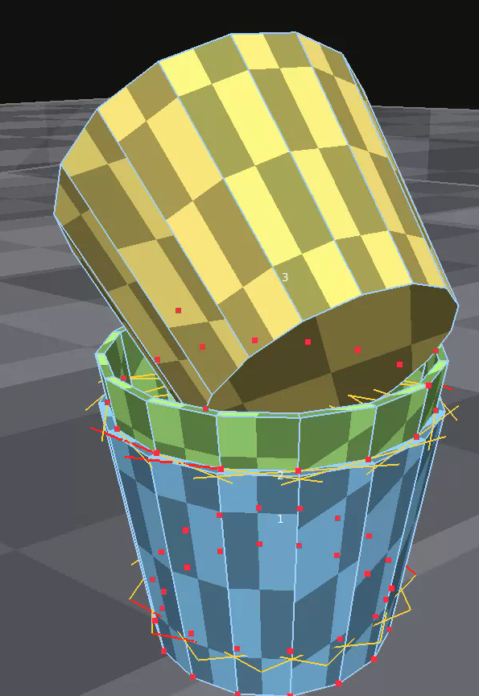
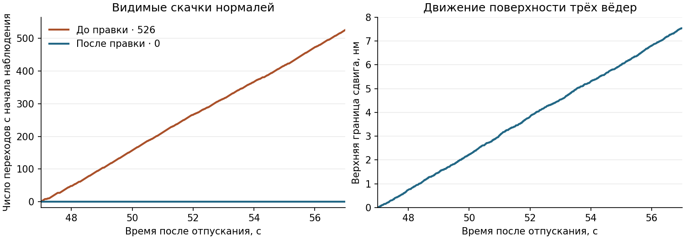
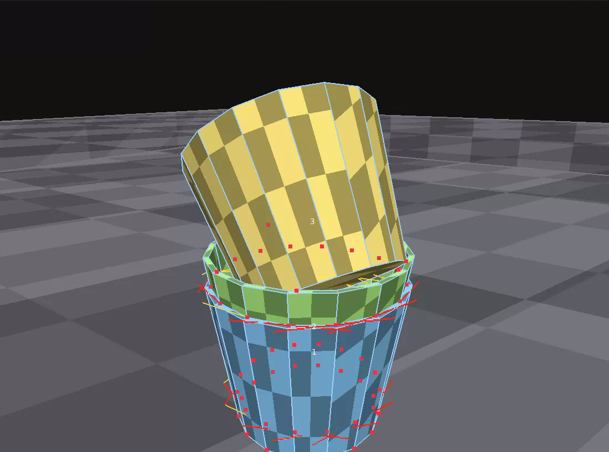
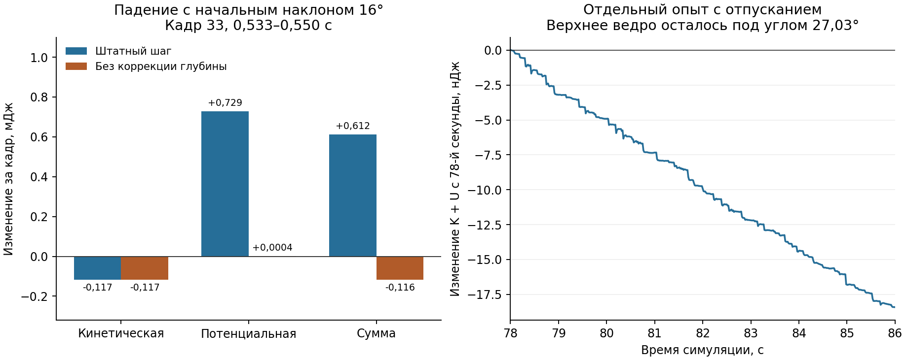

# Почему мерцают вёдра и может ли контакт прибавить энергию

На двух записях 23 ноября мерцают **жёлтые стрелки контактных нормалей** у нижних вёдер. На Windows при наклоне верхнего ведра 31,13° исправление просмотрщика уменьшило число видимых скачков с **526 до 0 за 600 шагов**. Движение тел и энергобаланс измерены отдельно. [Парные данные до правки](data/verification-2026-11-23/bucket-energy/tilted-before.csv.gz) · [После правки](data/verification-2026-11-23/bucket-energy/tilted-after.csv.gz)

## Когда верхнее ведро передвинули и положили на кромку

В записи **21:51:36** верхнее ведро уже наклонено. На четвёртой секунде ролика панель показывает кадр 3085 и 51,42 с симуляции. За 293 видеокадра медианный сдвиг 100 точек рисунка верхнего ведра относительно неподвижного пола достиг всего **0,012 пикселя**. При независимой проверке края силуэта 99-й процентиль расстояния между контурами составил до 1 пикселя, максимум — 2 пикселя. В области нижних вёдер заметные изменения жёлтых линий обнаружены в **105 из 292** переходов. Красные тонкие линии на рисунке отмечают изменившиеся пиксели, красные квадраты присутствовали в исходном кадре. [Покадровые измерения](data/verification-2026-11-23/bucket-energy/tilted-video.csv) · [Метод анализа](data/verification-2026-11-23/bucket-energy/tilted_video.py)

Для физического опыта два нижних ведра сначала оседали. Верхнее сместили на 20 мм, наклонили на 16° и отпустили из покоя у первого контакта. Оно остановилось на кромке под углом **31,13°**. Это воспроизводимая постановка по мотивам записи. Координаты захвата мыши и импульс отпускания в видео не сохранены. На одном Windows-ПК использованы двойная точность, шаг 1/60 с, 8 подшагов, настройка обновления контактов 4, один поток. Сон, сопротивление воздуха, сопротивление качению и проход ударной волны выключены. [Постановка сцены](../../examples/scenes/BucketRim.h) · [Параметры и контрольные суммы](data/verification-2026-11-23/bucket-energy/tilted-protocol.json)

| Окно 47–57 с после отпускания | До правки | После правки |
|---|---:|---:|
| Переходы с видимым скачком показанной нормали, допуск 1 мм для каждого конца стрелки | 526 / 600 | **0 / 600** |
| Те же переходы при свежем запросе геометрии контактов | 526 / 600 | 526 / 600 |
| Верхняя граница смещения поверхности любого из трёх вёдер от позы при 47 с | 7,54 нм | 7,54 нм |
| Максимальная кинетическая энергия трёх тел | 6,34 × 10⁻¹⁸ Дж | 6,34 × 10⁻¹⁸ Дж |
| Изменение полной механической энергии за 10 с | +11,67 нДж | +11,67 нДж |

Просмотрщик раньше пересчитывал все стрелки, как только любое тело выходило за предел округления. У почти совпадающих рёбер новый поиск мог выбрать другую допустимую нормаль. Теперь каждая пара тел хранит собственные отметки. При движении поз проверяется, существует ли пара. Отрыв убирает её отметки сразу. Для продолжающегося контакта направления обновляются, когда любая точка формы могла пройти больше **0,1 мкм** от позы предыдущего выбора. Предел вычисляется по радиусу формы $R$, перемещению её центра и углу поворота $\theta$ в радианах. [Реализация](../../viewer/ContactOverlay.h)

$$d_{\max}=\lVert\Delta p\rVert+2R\,|\sin(\theta/2)|.$$

Все 601 строки с наклоном, границей смещения, скоростью, энергиями и сырыми контактными показаниями совпали в двух прогонах. Наибольшая положительная прибавка $K+U$ за один кадр составила $7,42\times10^{-11}$ Дж. Состояние без сна продолжает понемногу меняться. Для просмотра доступны сцена «Наклонное ведро на кромке» и флажок «Пересчёт отметок в покое», который показывает результаты свежего геометрического поиска. [Прибор](../../validation/studies/anatomy/tilted_overlay.cpp) · [График по сырым данным](data/verification-2026-11-23/bucket-energy/plot_tilted.py)

Четыре выбранные проверки CTest прошли на Windows. Среди граничных случаев — выход за границу касания при сдвиге на 20 нм и возврат, накопление малых поворотов и перемещение одного тела рядом с другой опорой. В сцене падения каждая из шести возможных пар была отдельно отрисована в тех же позах. Объединённая картинка совпала с общей сценой во всех проверенных кадрах. Для движущихся контактных пар выполнена 61 проверка. Во всех случаях отметки совпали со свежей геометрией. [Вывод CTest](data/verification-2026-11-23/bucket-energy/tilted-ctest.txt)

## Первая запись в 20:55

В ролике «Запись экрана от 23.11.2026 20:55:44.webm» 228 видеокадров за 7,95 с. Выбрана сцена № 26. На отметке 3,5 с от начала видео панель показывает 81,53 с симуляции. Красным на изображении ниже выделены пиксели сцены, яркость хотя бы одного канала которых за запись изменилась более чем на 86 из 255.

| Наблюдаемая величина | Результат |
|---|---:|
| Переходы с заметным изменением жёлтых линий в области нижних вёдер | 109 из 227 |
| Максимальный сдвиг рисунка верхнего ведра относительно первого кадра, медиана по отслеженным признакам | 0,0141 пикселя |
| Та же оценка для неподвижного пола | 0,0123 пикселя |
| Размах координат и размеров рамки вокруг верхней части жёлтого силуэта | 0 пикселей |

Для жёлтых линий засчитывалась смена более восьми ярких пикселей дальше двух пикселей от жёлтых линий соседнего кадра, в любом направлении сравнения. Текстуру проверяли двусторонним оптическим потоком. При проверке нормалей просмотрщик заново запрашивает геометрию пар. У совпадающих рёбер возможны разные направления нормали, а длину стрелки задаёт отрисовщик. Масштаб стрелки не показывает контактную силу в ньютонах. [Измерение исходного видео](data/verification-2026-11-23/bucket-energy/measure_video.py) · [Геометрия стрелки](../../src/debug/DebugGeometry.cpp) · [Условия пересчёта](../../viewer/ContactOverlay.h)

## Куда переходит энергия при посадке

Воспроизводимый опыт выполнен на Windows x64, Xeon E5-2690 v3, в двойной точности. Три составных ведра падают на неподвижный пол в поле тяжести. Сон и демпфирование выключены, коэффициент восстановления нулевой, приводы и мышь отсутствуют. В кадре 1/60 с восемь подшагов. Для каждого динамического тела учтены скорость центра масс, вращение и высота в поле тяжести. [Условия и хэши](data/verification-2026-11-23/bucket-energy/protocol.json) · [Прибор](../../validation/studies/anatomy/bucket_energy.cpp)

$$
K=\sum_i \tfrac12\left(m_i\|v_i\|^2+\omega_i\cdot L_i\right),\qquad
U=-\sum_i m_i\,\mathbf g\cdot x_i,\qquad E=K+U.
$$

При начальном наклоне верхнего ведра 16° на кадре 33 центры масс поднялись. Геометрия контактов содержала перекрытие. Для глубины $d=-\mathrm{gap}>0$ нормальный решатель может задать скорость разделения $v_{\rm target}=\min(\beta d,v_{\max})$, где $\beta$ имеет размерность с⁻¹. Такой шаг раздвигает тела и способен увеличить их высоту. В контрольной копии этот целевой член выключили только на выбранном кадре. Все записанные до него состояния совпали. Отдельная сборка с измерениями по стадиям воспроизвела все 15 483 строки исходного опыта. [Уравнение в решателе](../../src/dynamics/time_stepping/IslandNormals.cpp) · [Показания стадий](data/verification-2026-11-23/bucket-energy/stages.csv) · [Контрольный опыт](data/verification-2026-11-23/bucket-energy/frames-without-bias.csv)

| Кадр 33, от 0,533 до 0,550 с | ΔK, мДж | ΔU, мДж | Δ(K+U), мДж |
|---|---:|---:|---:|
| Штатное решение | −0,116665 | +0,729052 | **+0,612387** |
| Поправка глубины выключена на этом кадре | −0,116587 | +0,000391 | **−0,116196** |

Это численная работа по устранению перекрытия. При данном входе она меняет знак энергобаланса кадра. Кинетическая энергия в обоих вариантах уменьшается. У вертикального входа на кадре 28 после такой же подмены сохранилась прибавка **0,519089 мДж**. Её происхождение требует отдельного разбора. Контрольный опыт действует на один кадр и не служит основанием выключать коррекцию у всего движка. [Исходные кадры, CSV в gzip](data/verification-2026-11-23/bucket-energy/frames.csv.gz) · [Рецепт измерения и подмены](data/verification-2026-11-23/bucket-energy/prepare_trace.py)

## Сколько стоит кадр после установки ведра на кромку

24 ноября на Windows измерены 600 кадров движения трёх вёдер с 47-й по 57-ю секунду. Для каждого из 12 блоков использовалась копия одного состояния после 46 с и секунда прогрева. Три режима чередовались. Разрешение таймера в строках — 0,1 мкс. Все 600 хешей поз и импульсов покадрово совпали во всех 36 прогонах. [Все 21 600 строк](data/verification-2026-11-23/bucket-energy/tilted-timing.csv.gz) · [Прибор](data/verification-2026-11-23/bucket-energy/tilted_timing.cpp)

| Режим | Физика, мкс/кадр | Подготовка контактных стрелок, мкс/кадр |
|---|---:|---:|
| Только шаг мира | 826,15 | 0 |
| Со стрелками до исправления | 850,81 | 706,68 |
| Со стабилизированными стрелками | 839,75 | 677,84 |

Приведены медианы двенадцати средних по 600 кадрам. У исправленного просмотра p99 составил **939,0 мкс** для физики и **751,7 мкс** для подготовки отметок. Видеокарта и вывод окна в этих интервалах не измерялись.

## Что происходит между 78-й и 86-й секундами

До чтения ряда установлен критерий заметной покадровой прибавки $\Delta E>10^{-8}$ Дж. В каждом опыте 480 соседних интервалов. В первых трёх случаях свободно упавшее верхнее ведро к этому времени почти выпрямилось. Для четвёртого опыта верхнее ведро отпустили над уже осевшими нижними вёдрами из покоя, с зазором 10 мкм от первой обнаруживаемой границы контакта. Из семи начальных смещений выбрано давшее через восемь секунд наклон, ближайший к заданным 16°. Получилось 27,03°. Эта сцена воспроизводит наклон под нагрузкой, точная история действий мышью в видео неизвестна. [Метод отпускания](data/verification-2026-11-23/bucket-energy/release.cpp) · [Все семь исходов и поздняя траектория](data/verification-2026-11-23/bucket-energy/release.csv)

| Исходная постановка | Наклон в конце | Максимум K, Дж | Прибавка выше порога за кадр | ΔE за 8 с, нДж |
|---|---:|---:|---:|---:|
| Вертикальное падение | 0,020° | 2,90 × 10⁻¹⁸ | 0/480 | +12,31 |
| Падение с +16° | 0,181° | 1,15 × 10⁻¹⁹ | 0/480 | +0,0011 |
| Падение с −16° | 0,179° | 6,17 × 10⁻²⁰ | 0/480 | +0,0085 |
| Отпускание на кромке | **27,028°** | **2,36 × 10⁻¹³** | **0/480** | **−18,42** |

**⚠️ Стресс-тест.** В опытах с постановкой на кромку проверены два установившихся угла, 27,03° и 31,13°. Поздний дрейф измерим. В отдельном опыте при первом приземлении остаётся численная прибавка энергии. Для отрисовки проверены три динамических тела и пол. Оценка памяти для $B$ тел, $P$ активных пар тел и $M$ отображаемых отметок — $O(B+P+M)$ сверх самого поиска контактов. Это прогноз. Прогоны на $10^4$–$10^6$ телах и точное воспроизведение действий мышью остаются открытыми.
