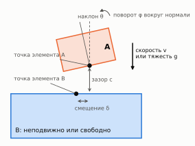
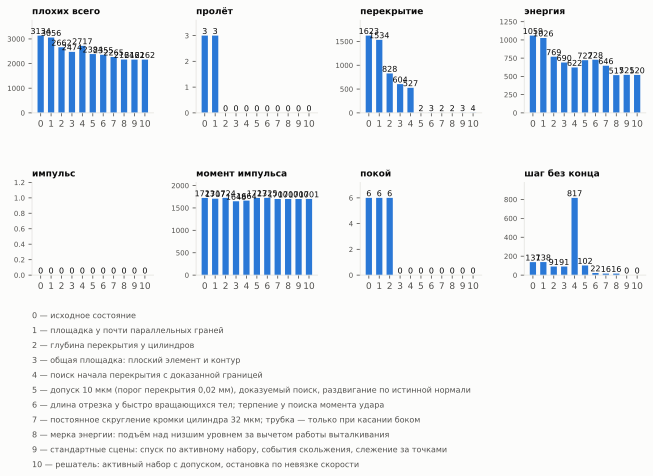
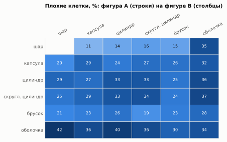
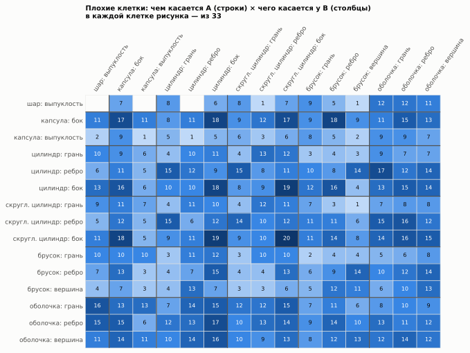
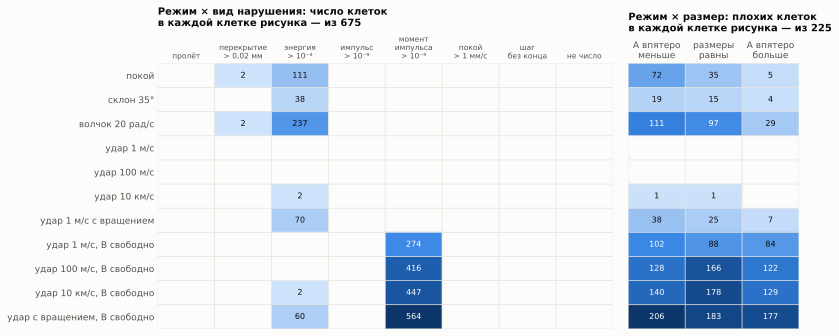
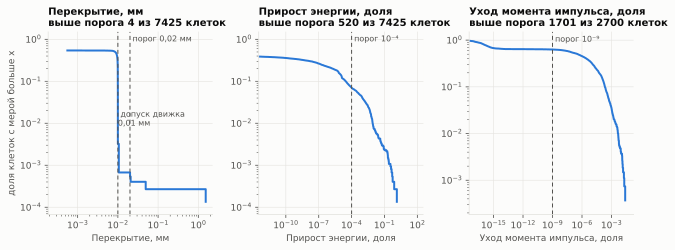
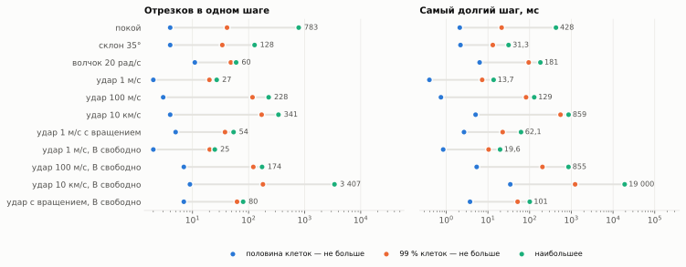

# Полная таблица случаев контакта

**Вывод.** Тела больше не входят друг в друга глубже допуска: из 7 425 клеток таблицы перекрытие
больше двух допусков осталось в 4 (было в 1 614), а 99,95 % клеток не выходят за два допуска (0,02 мм).
Пролётов насквозь, отказов покоя и шагов без конца нет (шагов без конца было 137), вся таблица
считается за 57 с. Остались прирост энергии (520 клеток) и уход момента импульса (443).

Состояние на 17.11.2026, после исправлений, найденных [стандартными сценами](standard-scenes.md). Рисунки строит
`validation/studies/case_table_figures.py` из строк прибора `study-case-table`; ход исправлений —
журнал `case-table-history.jsonl`.

## 1. Что перебирается

Клетка — одно сочетание значений четырёх независимых осей; перебираются все:

$$N = \underbrace{15}_{\text{чем касается A}} \times \underbrace{15}_{\text{чего касается у B}} \times \underbrace{3}_{\text{размер}} \times \underbrace{11}_{\text{режим}} = 7425 \text{ клеток}, \quad 4 \text{ пробы на клетку} = 29\,700 \text{ проб}.$$

| Ось | Значения |
|---|---|
| Фигура и её элемент (15) | шар; капсула: конец, бок; цилиндр и скруглённый цилиндр: торец, кромка, бок; брусок и оболочка: грань, ребро, вершина |
| Размер A относительно B (3) | впятеро меньше, равны, впятеро больше |
| Режим (11) | покой; склон 35°; волчок 20 рад/с; удар 1 м/с, 100 м/с, 10 км/с, 1 м/с с вращением 30 рад/с — по неподвижному B и по свободному B |



Первая проба клетки — точное совмещение: $\delta = 0,\ \theta = 0,\ \varphi = 0$ (грань строго на
грани, вершина строго в вершину). В остальных $\varphi$ случаен, $\delta$ — до 1/20 меньшего тела,
$\theta$ от $10^{-16}$ до $0{,}3$ рад. Зазор $c$: 0,05 мм у лежащих тел, 0,5 м у ударов — на
100 м/с тело за шаг 1/60 с пролетает 1,7 м, то есть без поиска момента удара прошло бы B насквозь.

## 2. Мерки

Одни и те же у всех клеток; ни одна не требует знать ответ заранее.

| Мерка | Определение | Нарушение |
|---|---|---|
| Перекрытие | $d = \max\limits_{\text{отрезки шага}} \operatorname{depth}(A, B)$ | $d > 2\cdot10^{-5}$ м (два допуска движка) |
| Энергия | $E = \sum_i \left(T_i - m_i\,\mathbf g\cdot\mathbf x_i\right),\quad \varepsilon_E = \dfrac{\max_k \left(E_k - \min_{j<k} E_j\right) - m g\cdot 2\delta}{T_0 + m_A g R_A}$ | $\varepsilon_E > 10^{-4}$ |
| Импульс | $\varepsilon_p = \dfrac{\lvert\Delta \sum_i \mathbf p_i\rvert}{\lvert\mathbf p_0\rvert}$ (B свободно, тяжести нет) | $\varepsilon_p > 10^{-9}$ |
| Момент импульса | $\mathbf J = \sum_i \left(\mathbf L_i + \mathbf x_i \times \mathbf p_i\right),\quad \varepsilon_J = \dfrac{\lvert\Delta\mathbf J\rvert}{\lvert\mathbf p_0\rvert (R_A + R_B) + \lvert\mathbf J_0\rvert}$ | $\varepsilon_J > 10^{-9}$ |
| Пролёт | при шаге 1/60 с удара нет, а у эталона с шагом $h = 2\ \text{мм} / v_{\max}$ — есть | хотя бы одна проба |
| Покой | $\lvert\mathbf v\rvert + \lvert\boldsymbol\omega\rvert R_A$ через секунду у устойчиво поставленного тела | $> 1$ мм/с |
| Конец шага | число отрезков в шаге | $> 10\,000$ |
| Числа | бесконечности и «не числа» в состоянии | есть |

Восстановление нулевое, поэтому энергия обязана только убывать. Мерка энергии — наибольший
подъём над самым низким уровнем, до которого она уже опускалась, за вычетом работы выталкивания
из допуска $m g\cdot 2\delta$: движок вправе поднять тело на глубину, на которую вправе его впустить.
Первая мерка складывала все приращения и была неверна: у свободно вращающейся оболочки энергия
колеблется в пределах $10^{-4}$ и не растёт, а сумма набирала $2{,}7\cdot10^{-4}$ без единого
контакта. Колонка «исходно» посчитана старой меркой; новая даёт на нынешнем коде 517 клеток
против 646 по старой. Порог $10^{-4}$ для лежащего тела — это подъём на $10^{-4} R_A$.
Покой судится только там, где он заведомо устойчив: шар, бок или грань на плоской грани бруска или
цилиндра (63 клетки).

## 3. Итог и ход исправлений



| Клеток с нарушением, из 7 425 | исходно | сейчас |
|---|---:|---:|
| перекрытие больше 0,02 мм (двух допусков) | 1 614 | **4** |
| перекрытие больше 1 мм | 1 499 | **1** |
| пролёт насквозь | 3 | **0** |
| покой | 6 | **0** |
| шаг без конца | 137 | **0** |
| прирост энергии | 1 059 | **520** |
| уход момента импульса больше $10^{-4}$ | 565 | **443** |
| любое грубое нарушение | 2 250 | **916** |

Допуск перекрытия поднят с 1 до 10 мкм (шаг 5 ниже), поэтому порог «перекрытие» в журнале
сменился с 0,01 на 0,02 мм; в этой таблице обе колонки пересчитаны по новому порогу.

Два оставшихся перекрытия: капсула концом на вершине оболочки в покое (0,049 мм) и кромка
цилиндра на вершине оболочки в режиме волчка (1,5 мм).

## 4. Где нарушения





Карты показывают долю клеток с любым нарушением. Перекрытий на них почти нет; рисунок теперь
определяют прирост энергии и уход момента импульса при выталкивании.



Шагов без конца почти не осталось; энергия растёт у лежащих и вращающихся тел; момент
импульса уходит там, где он проверяется (B свободно).

## 5. Насколько велики нарушения



Кривая — доля клеток, у которых мерка больше $x$. Перекрытие обрывается на допуске: 99,96 %
клеток не выходят за 0,01 мм. У энергии и момента импульса спектр сплошной.

## 6. Цена шага



В половине клеток шаг делится не больше чем на четыре отрезка, в 99 % — не больше чем на 110.
Шагов, которые не кончились бы («обрыв на 10 000»), больше нет; наибольшее число отрезков — 3 412.
Самый долгий шаг — 19 с; дольше секунды шаг считается в 11 клетках.

## 7. Что исправлено

**1. Одна точка контакта у почти параллельных граней.** Ось наименьшего перекрытия — пара рёбер,
она даёт одну точку; удар останавливал сближение только в ней, и два бруска на 100 м/с входили
друг в друга на 36 см. Теперь при $s_{\text{рёбра}} - s_{\text{грань}} \le 10^{-4}$ м контакт
строится по грани. Так же поступают Box3D (порог 5 мм) и ReactPhysics3D (0,5 мм).

**2. Глубина перекрытия у цилиндра.** Ядро цилиндра — он сам, и глубина пропадала при первом же
касании. Теперь расстояние считается между ужатыми ядрами.

**3. Общий алгоритм площадки.** Два выпуклых тела касаются по пересечению опорных элементов,
$P = S_A(\mathbf n) \cap S_B(-\mathbf n)$. Один путь вместо кода на каждую пару фигур: плоский
элемент одного тела (грань или торец) и обращённый к нему контур другого. В решатель идут все
вершины площадки, а не четыре. Куб на торце цилиндра шире себя теперь стоит.

**4. Поиск начала перекрытия с доказанной границей.** Вместо деления пополам отрезок проходится
участками, каждый из которых заверен: зазор на концах не ниже порога, а прогиб между ними не
больше допуска (лемма 11),

$$f(\tau) \ge \min(f_0, f_1) - \frac{M\Delta^2}{8}.$$

Участок заверяет любая из четырёх проверок: зазор вдоль направления, вмороженного в тело A или
B; вдоль направления, поворачивающегося от нормали начала к нормали конца; само расстояние. Удар —
жёсткая граница отрезка.

**5. Допуск перекрытия 10 мкм.** При допуске в микрон шаг дробился вдесятеро чаще. Пока
перекрытие мельче допуска, шаг идёт дальше, а тела раздвигаются псевдоскоростями — сдвигом и
поворотом без изменения настоящих скоростей. На выборке таблицы:

| Допуск | перекрытие больше двух допусков | шаг без конца | прирост энергии |
|---|---:|---:|---:|
| 1 мкм | 168 | 127 | 132 |
| 10 мкм | 81 | 89 | 146 |
| 100 мкм | 28 | 72 | 156 |

**6. Точка касания у цилиндров крест-накрест.** В контакт шли две точки на концах общего участка
осей, а самой точки касания не было: ни опоры, ни того, чем раздвигать.

**7. Порог поиска — от истинного расстояния.** Нормаль у почти касающихся тел — направление
вектора длиной в микроны, она шумит на тысячные радиана. У длинного цилиндра это 0,2 мм: порог
«не идти глубже» оказывался на 0,2 мм ниже нужного. Теперь порог берётся от самого расстояния, а
к нормали примеряются естественные направления тел — радиус и ось цилиндра, нормаль грани.

**8. Раздвигание по истинной нормали.** Точки контакта меряют зазор от плоскости грани; у её
края истинная глубина больше. Раздвигание по таким точкам не срабатывало, и шаг вставал.

**9. Длина отрезка у быстро вращающегося тела.** После удара на 10 км/с малое тело вращается со
скоростью $10^5$ рад/с. Ограничение «в контакте не больше радиана за отрезок» делило длину на то,
во сколько раз превышен предел, а поворот от сил растёт быстрее времени: отрезок падал с 1/60 с на
пикосекунды. Теперь он не делается короче половины времени, за которое тело повернётся на радиан
при нынешней скорости. Шагов без конца на 10 км/с было 88, стало 5.

**10. Терпение у поиска момента удара.** Продвижение «расстояние, делённое на скорость» у тел,
летящих вплотную и быстро вращающихся, шло миллионами шагов: шаг считался 16 с. После 48 шагов
остаток интервала теперь проходит поиск с доказанной границей — тот же, что у касающихся тел.

**11. Постоянное скругление кромки цилиндра.** Расстояние между телами считалось для цилиндра
с кромкой, скруглённой «по глубине» (1, 8 или 64 мкм), а его нижняя оценка — для острого. У
кромки они расходились на 26 мкм при допуске 10 мкм, быстрые проверки участка не срабатывали, и
поиск шёл микросекундными шагами: шаг считался до 72 с. Теперь у цилиндра одно скругление кромки,
32 мкм, во всех расчётах. Клеток с шагом дольше секунды было 128, стало 11; вся таблица считается
46 с вместо 7,5 мин.

**12. Трубка — только при касании боком.** Цилиндр, упёртый кромкой под 45°, считался трубкой и
получал две точки контакта с зазором −7 см, которых нет; выталкивание по ним подбрасывало тело
вверх на каждом отрезке. Теперь цилиндр — трубка, только когда нормаль касания перпендикулярна
его оси, и ни одна точка контакта не бывает ближе ближайших точек тел.

**13. Прирост энергии — причина найдена, не исправлено.** Учёт по стадиям шага на простом случае
(брусок качается на шаре): за секунду раздвигание добавляет $+5{,}9\cdot10^{-3}$ масштаба энергии,
движение отнимает $1{,}3\cdot10^{-3}$. Тело на каждом отрезке проседает на микроны, и его
поднимают обратно, не отнимая скорости. Проседает оно потому, что сила опоры находится по
геометрии начала отрезка, а точка касания за отрезок перекатывается. Две попытки не помогли и
откачены: подбор силы по положению точки в конце отрезка убрал раздвигание, но ту же энергию
стало добавлять движение; перенос силы опоры в первую половину толчка ничего не изменил.

**14. Момент импульса уходит при раздвигании — не исправлено.** Раздвигание сдвигает тела, не
меняя импульсов: $\Delta\mathbf J = \sum_i \Delta\mathbf x_i \times \mathbf p_i$. Оно же
добавляет энергию: тело поднимается, не теряя скорости. Это цена допуска.

## 8. Что доказано решателем Z3

Леммы, на которых стоит общий алгоритм, записаны задачами для Z3 в `proofs/` и проверяются
вместе с набором (`ctest`, 0,5 с). Каждая задача — посылки и отрицание вывода; лемма доказана,
когда вместе они невыполнимы, а одни посылки выполнимы (иначе доказательство было бы пустым).

| Лемма | Утверждение |
|---|---|
| 1 | зазор плоскости не больше расстояния между телами: $g \le d$ |
| 2а | опорная функция цилиндра: $h(\mathbf d) = R\sqrt{d_x^2 + d_z^2} + H\lvert d_y\rvert$ |
| 2б | наклонно к оси цилиндр упирается единственной точкой — точкой кромки |
| 2в | поперёк оси — образующей |
| 2г | вдоль оси — всем кругом торца |
| 3 | формула пересечения отрезка с окружностью даёт точку окружности |
| 4 | формула пересечения окружности со стороной грани даёт настоящий угол и решает уравнение |

Леммы 2а–2г вместе — полнота: в любом направлении опорный элемент цилиндра есть точка, отрезок
или круг, четвёртого не бывает.

Чего это **не** доказывает. Леммы — о вещественных числах и о формулах, а не о коде с плавающей
точкой и не о шаге движка целиком. «Тела не проваливаются никогда» решателем не доказать: это
свойство всей программы, и таблица показывает 604 клетки, где оно пока нарушено. Доказательство
закрывает математику алгоритма; соответствие кода ей проверяет таблица.

## 9. Сочленения

Шаровое, шарнир, ползун, цилиндрическое и жёсткое — один набор запертых свобод (`dynamics/Joint.h`).
Запертая свобода — линия связи; связи решаются той же точной системой, что и контакты. Сила связи
на отрезке подбирается так, чтобы связь была выполнена в его конце, а скорость вдоль связей
обнуляется в новом положении (схема SHAKE + RATTLE): она симметрична во времени.

| Проверка | Результат |
|---|---|
| маятник, шаг 1/60: ошибка периода | $1{,}5\cdot10^{-4}$; при шаге 1/120 — в 4,01 раза меньше (второй порядок) |
| маятник: энергия | колеблется в пределах $10^{-4}$, не растёт |
| длина плеча маятника | уходит на $10^{-11}$ м |
| ползун под 30° к вертикали: путь за секунду | совпал с $\tfrac12 g\cos30°$ до 9 знаков |
| жёсткое сочленение: смещение консоли | $10^{-16}$ м |
| серия E, висящая цепь 10–200 звеньев, груз до ×100 | 8 из 8 (старое ядро — 3 из 8) |
| серия E2, качающаяся цепь 10–100 звеньев | 3 из 3 (старое ядро — 0 из 3); разрыв $10^{-8}$ мм |
| серия E3, маятник | 1 из 1 |
| привод шарнира моментом: маховик без тяжести, 1 с | угловая скорость и угол совпали с $M t / I$ и $M t^2 / 2I$ до $10^{-9}$ |
| привод шарнира скоростью 2 рад/с, брусок под тяжестью | отклонение скорости меньше $10^{-9}$ рад/с |
| привод ползуна силой, равной весу и вдвое большей | груз стоит; поднимается с ускорением $g$, путь до $10^{-9}$ м |
| привод положения (скорость пропорциональна отклонению угла) | приходит к нужному углу до $10^{-6}$ рад |

Привод есть у шарнира и ползуна: заданный момент или сила — либо заданная скорость, которую он
держит любой ценой. Угол шарнира считается собственным арктангенсом без библиотеки (ошибка
$10^{-15}$). Есть пределы хода (предел — событие шага, удар о него неупругий), предел силы привода и
карданное сочленение; их проверки и сцены с ними — в [отчёте о наборе сцен](standard-scenes.md).

Первая версия силу связи брала по положению начала отрезка, и маятник за 20 с набирал полторы
своей энергии; ошибка найдена замером и исправлена сменой схемы. Качающаяся цепь считается
медленно: 110 мс на кадр при десяти звеньях.

## 10. Что дальше

1. Прирост энергии у тел, которые качаются и катятся по кривой опоре, — 520 клеток; уход момента
   импульса — 443.
2. Четыре оставшихся перекрытия (три из них — на 0,02–0,05 мм); 11 клеток с шагом дольше секунды. Шагов без конца больше нет: их
   убрали исправления, найденные стандартными сценами.
4. Скорость сцен с сотнями событий за кадр и тела, уложенные вплотную без нагрузки
   ([отчёт о наборе сцен](standard-scenes.md)).
5. Трение внутри одной задачи вместо чередования «нормали — трение» ([отчёт о наборе сцен](standard-scenes.md)).
6. Чистка кода: опорные элементы — методами классов фигур.

## Границы проверки

- Четыре пробы на клетку: редкий отказ внутри клетки может не попасться.
- Тел всегда два; стопки и кучи проверяют другие приборы (`docs/reports/standard-scenes.md`, `docs/reports/engine-comparison.md`).
- Перекрытие у двух круглых фигур с перекрывшимися ядрами записано условно — суммой радиусов.
- Покой оболочек не судится: у случайной оболочки центр масс бывает не над гранью.

## Как повторить

```
cmake -B build && cmake --build build -j
build/validation/studies/study-case-table 4 build/case-table.jsonl      # 5 минут на 12 потоках
python3 validation/studies/case_table_figures.py build/case-table.jsonl "что изменилось"
build/validation/studies/study-case-table 4 3 9 1 2                     # одна клетка по пробам
```
