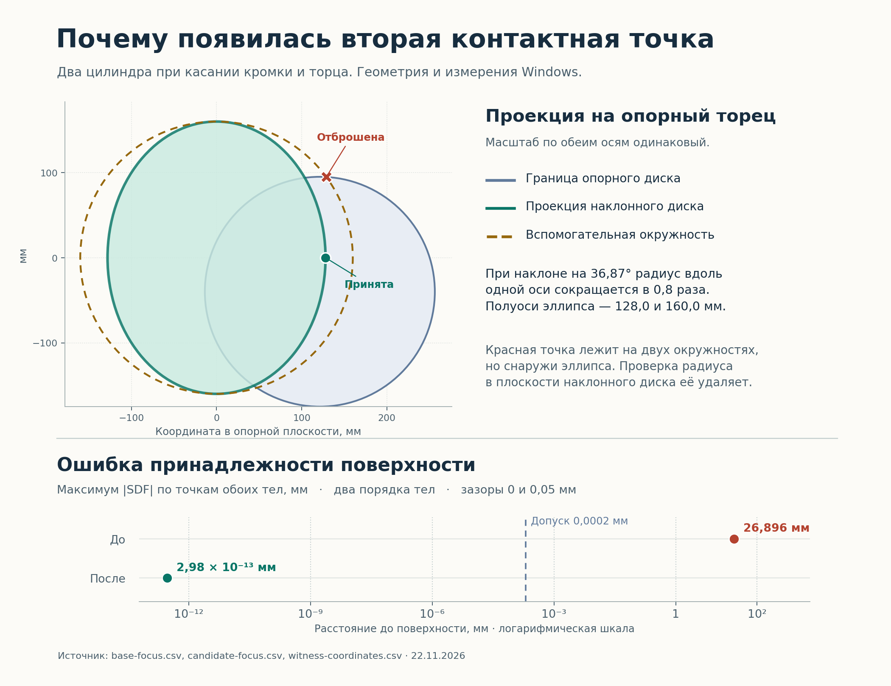
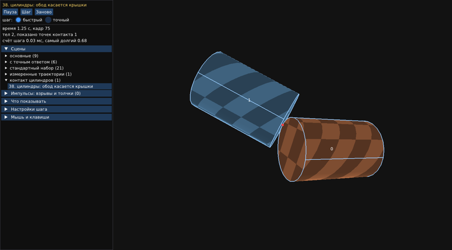
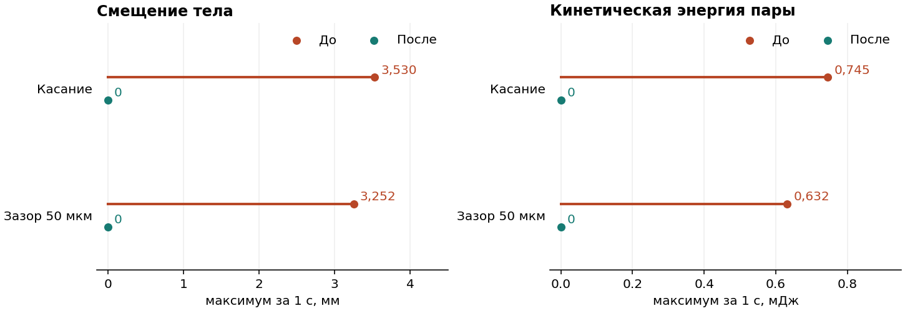
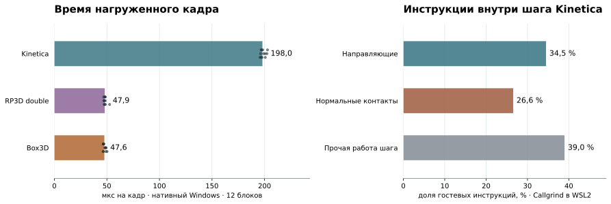
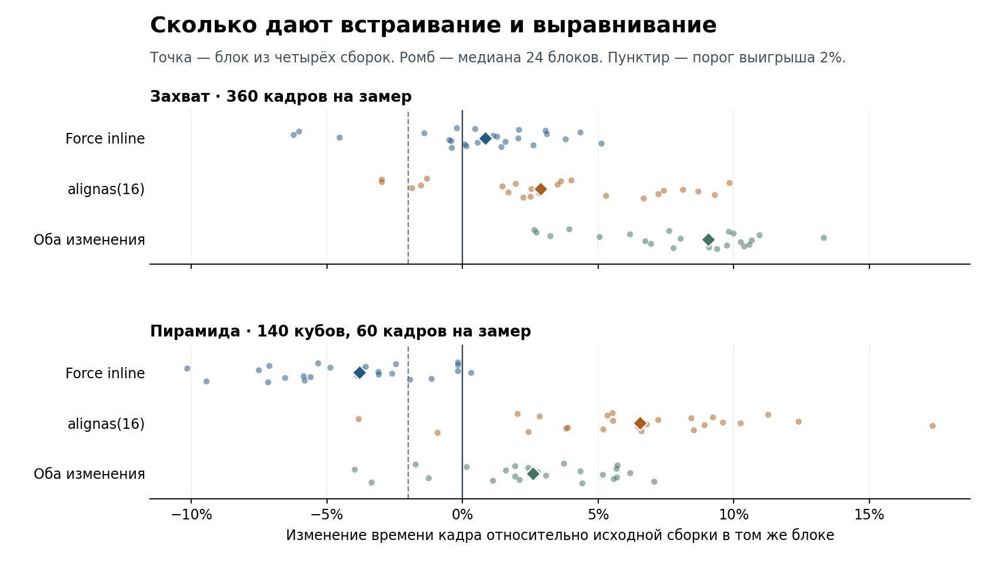

# Почему два неподвижных цилиндра разъезжались

**22 ноября 2026 · Kinetica Physics · нативный Windows x64**

При точном касании кромки и наклонного торца движок добавлял вторую точку в **26,896 мм от поверхности** одного из цилиндров. Решатель получал ложное проникновение **0,633 мм** и раздвигал тела. За секунду без сил смещение достигало **3,530 мм**. Исправление построителя контактов вошло в рабочее ядро. На исправленной сборке в восьми повторах смещение и кинетическая энергия остались нулевыми.



В просмотрщике этот опыт доступен в сцене **«цилиндры: обод касается крышки»**. Левой кнопкой можно тянуть любое тело, пробел ставит движение на паузу, клавиша R возвращает начальное касание.



## Откуда взялся толчок

1. Поиск ближайших точек правильно определил касание. Одна из настоящих опорных точек лежала на обеих поверхностях с погрешностью округления.
2. Построитель площадки искал дополнительные опоры. При наклоне торца на 36,87° его проекция стала эллипсом. Вспомогательная окружность охватывала этот эллипс. Пересечение двух окружностей дало точку за пределами настоящего диска.
3. После переноса кандидата $p$ обратно в плоскость наклонного диска ядро теперь проверяет расстояние до его центра $c$. Используются радиус ядра торца $R$ и существующий геометрический допуск $\varepsilon$, оба в метрах.

$$
\lVert p-c\rVert \le R+\varepsilon .
$$

Для ошибочной точки превышение радиуса ядра составляло **26,912 мм**. Расстояние до физической поверхности с учётом скругления — **26,896 мм**. Решатель использовал знаковую глубину вдоль нормали для расчёта импульса. [Координаты двух точек](data/engine-anatomy-2026-11-22/raw-collision/cap-manifold/witness-coordinates.csv) · [Изменение в построителе](../../src/collision/narrowphase/ContactPatch.cpp)

## Изменилось ли движение тел

Два свободных цилиндра начинают из покоя. Гравитация и внешние силы равны нулю. При касании без сближения или при положительном зазоре физический ответ — сохранение покоя. Проверили два положения пары в мире, оба порядка добавления тел и два зазора. Каждый прогон выполнил 480 вызовов $\mathrm{World.step}$ с шагом $1/480$ с. Сон выключен.



| Максимум за одну секунду | Касание, до | Касание, после | Зазор 50 мкм, до | Зазор 50 мкм, после |
|---|---:|---:|---:|---:|
| Смещение центра одного из тел, мм | 3,530 | **0** | 3,252 | **0** |
| Линейная скорость, мм/с | 3,530 | **0** | 3,252 | **0** |
| Угловая скорость, рад/с | 0,02049 | **0** | 0,01887 | **0** |
| Суммарная кинетическая энергия, мДж | 0,7447 | **0** | 0,6317 | **0** |

Для каждой метрики взят максимум по всем шагам и перестановкам. Для пары суммируются поступательная и вращательная энергия каждого тела, $E=\sum_i (m_i\|v_i\|^2+\omega_i\cdot L_i)/2$. [До исправления](data/engine-anatomy-2026-11-22/raw-collision/caps-at-rest/before.csv) · [После исправления](data/engine-anatomy-2026-11-22/raw-collision/caps-at-rest/after-final.csv) · [Исходник опыта](data/engine-anatomy-2026-11-22/raw-collision/caps-at-rest/caps-at-rest.cpp)

## Какие опоры сохранились

| Проверка на Windows | Результат рабочего ядра |
|---|---|
| Кромка касается наклонного торца | 1 действительная точка в обоих порядках тел |
| Два параллельных торца с широкой опорой | Сохранились 6 точек |
| Узкая линза, перекрытие контуров 1 мм | Сохранились 3 точки и ненулевая площадь |
| Исходные 1 440 поз примитивов | 1 412 прошли до и после, все строки измерений совпали |
| Другие положения и взаимные повороты, ещё 1 440 поз | **1 406 → 1 414** прошли. Все 8 воспроизведений ошибки исправлены |
| Базовые геометрические контракты | 14 992/14 992 до и после |
| Постоянный тест на дефект и общий CTest | Старое ядро нарушает 8 условий нового теста, исправленное проходит все. В итоговом CTest **22/22** |

[До](data/engine-anatomy-2026-11-22/raw-collision/cap-manifold/base-focus.csv) · [После](data/engine-anatomy-2026-11-22/raw-collision/cap-manifold/candidate-focus.csv) · [Попарная сверка](data/engine-anatomy-2026-11-22/raw-collision/cap-manifold/paired.json) · [Протокол CTest](data/engine-anatomy-2026-11-22/raw-collision/cap-manifold/final-ctest.txt) · [Регрессия в исходном коде](../../tests/GeometryTests.cpp)

## Где мы относительно RP3D и Box3D

Отдельная серия на том же процессоре измеряет захват куба между двумя губками. Это снимок ядра **до правки торцов**. Восемь публичных шагов на кадр, один логический процессор, по 360 нагруженных кадров в каждом измерении. У Kinetica включено совместное трение. Внутренние алгоритмы движков различаются.

| Движок | Дрейф за 0,25 с при предельной нагрузке, мм | Медиана кадра, мкс | Пройдено условий из 36 |
|---|---:|---:|---:|
| Kinetica | **0,0434** | 197,96 | **33** |
| ReactPhysics3D double | 0,2792 | 47,90 | 27 |
| Box3D | 2,9092 | **47,59** | 23 |



На этой нагрузке Kinetica удержала груз точнее обоих соперников. По времени кадра отставание остаётся примерно четырёхкратным. В рабочем ядре повторное использование матрицы направляющих сократило время захвата на **3,65%** по медиане 20 пар. Повторное использование самого разложения в упрощённом варианте сократило время с **200,81 до 192,68 мкс** в отдельной серии. Парная медиана улучшилась на **3,94%**, захват ускорился в 18 из 20 пар. На пирамиде из 140 кубов в той же серии парная медиана уменьшилась на 1,43%, ускорились 12 пар из 20. [Сравнение движков](data/engine-anatomy-2026-11-22/raw-collision/accepted-core/competitors/summary.csv) · [Первое ускорение](data/engine-anatomy-2026-11-22/raw-collision/guide-promotion/paired-timing/summary.csv) · [Упрощённое разложение](data/engine-anatomy-2026-11-22/raw-collision/factor-simple/paired-timing/summary.csv)

**Финальный повтор на объединённом ядре** включал и исправленные торцы, и новое разложение направляющих. В 12 блоках медианы кадра составили **191,23 мкс** у Kinetica, **49,29 мкс** у RP3D и **48,08 мкс** у Box3D. Медианные отношения внутри одного блока — **3,86×** и **3,94×**. У Kinetica сохранились 33/36 и дрейф 0,0434 мм. В отдельном нативном профиле VTune с 15 000 измеряемых кадров около 6,33% CPU-времени всего процесса пришлись непосредственно на выдачу временной памяти, 3,81% — на построение контактной матрицы. Профиль охватывает также создание и обжатие. [Сырые времена](data/engine-anatomy-2026-11-22/raw-collision/combined-core/competitors/timing.csv) · [Сравнение по блокам](data/engine-anatomy-2026-11-22/raw-collision/combined-core/competitors/summary.csv) · [VTune](data/engine-anatomy-2026-11-22/raw-collision/combined-core/vtune/resolved.csv)

## Что дали принудительное встраивание и выравнивание

**Принудительное встраивание сократило время кадра пирамиды на 3,79%. На захвате выигрыша нет.** В исходной сборке отношение времени Kinetica к времени RP3D на захвате лежало между 3,73 и 3,96, к времени Box3D — между 3,77 и 4,22. Это диапазоны 12 парных замеров. [Сравнение с другими движками по блокам](data/engine-anatomy-2026-11-22/raw-collision/combined-core/competitors/paired-time.csv)

На том же Xeon под Windows собрали четыре варианта с Clang 23.1.6, `-O3`, `Real = double` и выключенной свёрткой в FMA. Меняли две вещи — способ встраивания 11 операций `Vector3` и четырёх операций `SolverBody`, а также выравнивание типа `Vector3`. На одной логической нити проверили все 24 порядка запуска четырёх сборок. Захват получил восемь шагов по 1/480 с, коэффициент трения 0,5, прижим по 10 Н на губку и груз 10 Н. На пирамиде измеряли 60 кадров со 140 динамическими кубами. [Настройки](data/engine-anatomy-2026-11-22/raw-collision/inline-layout/method.json) · [Исходники эксперимента и способ сборки](data/engine-anatomy-2026-11-22/raw-collision/inline-layout/build.py) · [Хэши сборок](data/engine-anatomy-2026-11-22/raw-collision/inline-layout/manifest.csv)

| Вариант | Захват, мкс/кадр | Изменение, быстрее в парах | Пирамида, мс/кадр | Изменение, быстрее в парах |
|---|---:|---:|---:|---:|
| Обычный `inline` | 189,98 | база | 6,195 | база |
| Принудительный `inline` | 191,38 | +0,85% · 8/24 | 6,035 | **−3,79% · 23/24** |
| `alignas(16)` у `Vector3` | 196,30 | +2,88% · 5/24 | 6,695 | +6,54% · 2/24 |
| Оба изменения | 205,96 | +9,06% · 0/24 | 6,350 | +2,61% · 4/24 |

Время в таблице — медиана по сборке. Процент вычислен внутри каждого блока и затем взята медиана, $\Delta=100\,\mathrm{median}_i(t_{\mathrm{вариант},i}/t_{\mathrm{база},i}-1)$. Для включения в общее ядро до измерений задали порог в 2% и не менее 18 побед из 24 на каждой сцене при совпадающей физике. Этот порог прошёл принудительный `inline` на пирамиде. Для общего ядра оставили обычное встраивание. [Все 192 замера](data/engine-anatomy-2026-11-22/raw-collision/inline-layout/timings.csv) · [Парные результаты](data/engine-anatomy-2026-11-22/raw-collision/inline-layout/summary.csv)



**Что сделал компилятор.** В исходном исполняемом файле захвата осталось шесть мест прямого вызова `SolverBody::push` и пять — `SolverBody::twist`. Отдельных прямых вызовов выбранных операций `Vector3` в нём уже не было. С атрибутом `always_inline` все 11 мест вызова исчезли, а секция машинного кода выросла с 470 086 до 472 726 байт. Это статический подсчёт адресов в файле. Число исполнений каждого адреса за кадр зависит от сцены. [Адреса вызовов и вызывающие функции](data/engine-anatomy-2026-11-22/raw-collision/inline-layout/sites.csv) · [Размер машинного кода](data/engine-anatomy-2026-11-22/raw-collision/inline-layout/assembly.csv)

**Что занимает память.** В исходной сборке `Vector3` занимает ровно $3\times8=24$ байта, `Matrix3x3` — 72, `SolverBody` — 184. При `alignas(16)` они занимают 32, 96 и 240 байт соответственно. В массиве из миллиона векторов такое выравнивание добавило бы ровно 8 МБ к памяти элементов. На стенде проверены начало массива, переход через границу блока арены в 4 МиБ и повторное выделение после его возврата. Промахи кэша в этом опыте аппаратно не измерялись. [Штатная раскладка](data/engine-anatomy-2026-11-22/raw-collision/inline-layout/stock-layout.csv) · [С выравниванием](data/engine-anatomy-2026-11-22/raw-collision/inline-layout/align-layout.csv) · [Проверка арены](data/engine-anatomy-2026-11-22/raw-collision/inline-layout/layout.cpp)

**Что измерил VTune.** На 15 000 кадрах под нагрузкой, с включёнными в профиль созданием миров и предварительным прижимом, на саму функцию выделения памяти `StepMemory::take` пришлось 6,33% выборочного CPU-времени в базе и 6,07% с принудительным встраиванием. В отдельном более раннем прогоне под Callgrind на Windows через WSL на направляющие пришлось 34,49% инструкций внутри `World::step`, на решение нормальных ограничений — 26,55%. Это два конкретных участка для сокращения объёма работы. Сколько процентов нынешнего нативного времени они займут после следующей правки, покажет новый парный замер. [VTune исходной сборки](data/engine-anatomy-2026-11-22/raw-collision/combined-core/vtune/resolved.csv) · [VTune с принудительным inline](data/engine-anatomy-2026-11-22/raw-collision/inline-layout/vtune-force/resolved.csv) · [Разбор вызовов Callgrind](data/engine-anatomy-2026-11-22/callgrind/grip-costs.csv)

Для такого опыта достаточно одного макроса и флага сборки. Препроцессор подставляет запись, которую понимает компилятор. В C++17 методы, определённые внутри класса, уже являются `inline`. Clang с атрибутом `always_inline` пытается встроить вызов независимо от своих обычных эвристик. [Clang](https://clang.llvm.org/docs/AttributeReference.html#always-inline-force-inline) · [Microsoft C++](https://learn.microsoft.com/en-us/cpp/cpp/inline-functions-cpp?view=msvc-170)

```cpp
#if defined(KP_TRY_FORCE_INLINE) && KP_TRY_FORCE_INLINE && defined(_MSC_VER)
#  define KP_MATH_INLINE __forceinline
#elif defined(KP_TRY_FORCE_INLINE) && KP_TRY_FORCE_INLINE && (defined(__clang__) || defined(__GNUC__))
#  define KP_MATH_INLINE inline __attribute__((always_inline))
#else
#  define KP_MATH_INLINE inline
#endif
```

**⚠️ Стресс-тест.** Для каждой экспериментальной сборки с базой побайтно совпали выходные данные всех 17 наборов, по 3 539 строк, включая хэши положений, ориентаций и импульсов в 27 сценах после 60 кадров. В захвате проверены нулевое трение, раскрытие губок и смена знака груза. В совместном решателе физический допуск выдержали прежние 33 из 36 случаев. Скорость измерялась на одном процессоре в двух сценах. [Физическая сетка](data/engine-anatomy-2026-11-22/raw-collision/inline-layout/physical.csv) · [Сверка inline](data/engine-anatomy-2026-11-22/raw-collision/inline-layout/verify-force/parity.csv) · [Сверка выравнивания](data/engine-anatomy-2026-11-22/raw-collision/inline-layout/verify-align/parity.csv) · [Сверка обоих изменений](data/engine-anatomy-2026-11-22/raw-collision/inline-layout/verify-both/parity.csv)

## Какие приёмы Jolt нужны для скорости

В отдельной сопоставительной серии Jolt в режиме float выполнил нагруженный кадр за **45,0 мкс**, Kinetica с совместным трением — за **209,4 мкс**. При предельной нагрузке дрейф составил **2,241 мм** и **0,043 мм** соответственно. Три тела обновлялись восемь раз за кадр на одном потоке. Вычисления у Jolt шли с одним проходом скорости и положения, у Kinetica использовалось прямое решение части ограничений. [14 блоков испытания и настройки](engine-anatomy-2026-11-22.md#насколько-точно-робот-удерживает-груз)

**Проверили кэш на самом Jolt.** Один Windows-бинарник с переключателем памяти пар прошёл 20 пар в чередующемся порядке. Остальные настройки были одинаковы. Включённый кэш сократил медиану **с 79,35 до 45,38 мкс/кадр**, парное уменьшение времени составило **42,65%**, быстрее все **20/20** пар. Дрейф при предельной нагрузке изменился с 2,24165 до 2,24092 мм. В обоих режимах прошли 26 из 36 условий, численные значения различались в 29 строках. [Все времена и настройки](data/engine-anatomy-2026-11-22/raw-collision/jolt-cache-ab/paired-summary.json) · [Попарные физические измерения](data/engine-anatomy-2026-11-22/raw-collision/jolt-cache-ab/accuracy-pairs.csv)

Отдельно инструментировали Kinetica. При нагрузке 10 Н в совместном режиме **240/240** запросов двух контактных пар обслужил существующий кэш. При скольжении с 12 Н он обслужил **30/240**. Поэтому рост числа попаданий в прогретом удержании уже исчерпан. Ещё можно удешевить восстановление площадки и подготовку ограничений. При скольжении цена пропусков и геометрическая пригодность старых точек требуют отдельной проверки. [Счётчики по фазам и нагрузкам](data/engine-anatomy-2026-11-22/raw-collision/grip-cache-hits/summary.csv)

| Механизм | Что уже делает Kinetica | Как оценить следующий шаг |
|---|---|---|
| Память контактов | Сохраняет локальные опорные точки многогранников и пересчитывает зазор, пока допустим относительный сдвиг и поворот. Тёплый старт использует накопленные импульсы. | Измерить стоимость восстановления двух площадок; для скольжения проследить, когда меняются опорные элементы. |
| Подготовка ограничений | Одно разложение матрицы обслуживает несколько нагрузок при той же геометрии. | Считать, сколько раз за кадр действительно меняются строки, массы или ориентации. Проверять силы и дрейф после устранения каждого повторения. |
| Параллелизм по независимым ограничениям | Кинетически независимые острова можно решать отдельно. Обе губки воздействуют на один куб. | Для большой стопки изучать разбиение связанного острова на группы без общих подвижных тел. Для захвата на одном потоке такой способ не уменьшает число необходимых вычислений. |

[Архитектура Jolt](https://github.com/jrouwe/JoltPhysics/blob/master/Docs/Architecture.md) · [Настройки кэша Jolt](https://jrouwe.github.io/JoltPhysicsDocs/5.7.0/struct_physics_settings.html) · [Память площадок Kinetica](../../src/collision/ManifoldMemory.cpp) · [Проверка сборки с обоими исправлениями](data/engine-anatomy-2026-11-22/raw-collision/combined-core/verification/parity.csv)

## Что делаем с результатом

**Оставляем проверку торца и постоянный регрессионный тест.** Следующий геометрический вопрос — какие ещё положения кромок нарушают допуск. Быстрый экспериментальный вариант GJK перепроверяет только геометрически сомнительные ответы. Его проверили вместе с исправлением торцов на тех же входах. Получили **1 436/1 440** и **1 432/1 440**, то есть ещё 42 исправленных позы без новых отказов относительно сборки с исправленными торцами. Повторный расчёт потребовался в 61 и 35 запросах соответственно. Все 12 оставшихся строгих отказов относятся к контактным точкам многогранников при зазоре 50 мкм. Для включения этого исследовательского варианта GJK в ядро требуется отдельно измерить время. [Парная сверка одной сборки](data/engine-anatomy-2026-11-22/raw-collision/gjk-gate/cap-paired/paired.csv) · [12 оставшихся поз](data/engine-anatomy-2026-11-22/raw-collision/gjk-gate/cap-paired/remaining.csv)

**⚠️ Стресс-тест.** Для выявленного контакта проверены и геометрия, и движение тел через публичный API. В двух строгих геометрических наборах рабочей сборки остаются 28 и 26 строк за пределами допуска. Полнота контактной площадки для произвольной пары наклонных торцов остаётся открытым вопросом.
