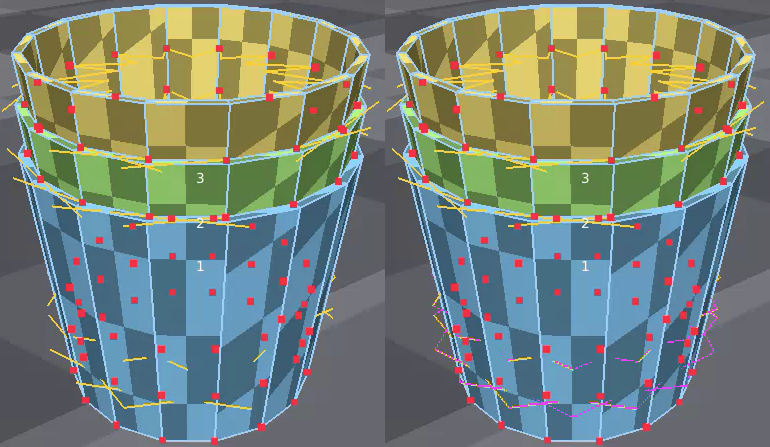
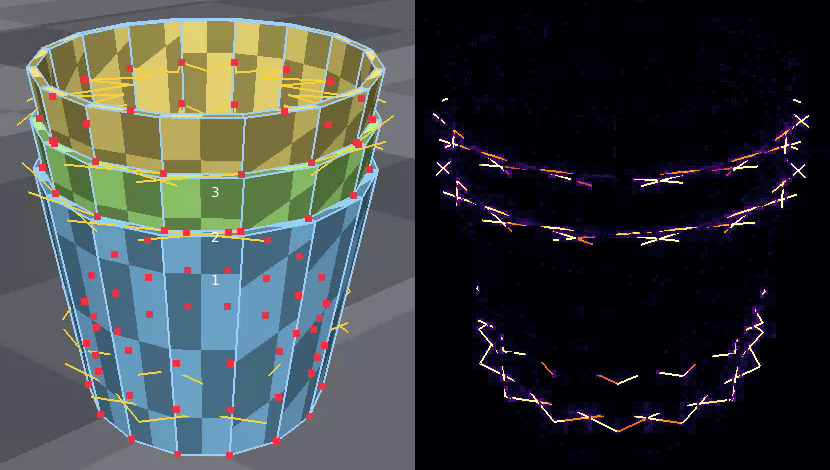

# Почему мерцают три вложенных ведра

**Ведра в этой сцене сохраняют покой. На записи мерцают главным образом жёлтые нормали контактов. Есть отдельный дефект воспроизведения — за одну секунду экранного времени в показанном окне проходило около 2,62 секунды симуляции.**

Запись «Запись экрана от 22.11.2026 13:45:15.webm» содержит 157 кадров. Счётчик мира вырос с 3578 до 4411 за 5,309 с видео. При шаге $1/60$ с это 833 шага, или $833/(60\times5{,}309)=2{,}615$ от реального темпа. [Покадровые измерения записи](video-frames.csv)

| Что проверяли | Что наблюдали |
|---|---|
| Сдвигаются ли края ведер относительно пола в записи? | Верхняя кромка осталась в том же пикселе в 218 из 221 колонки. В остальных трёх разброс составил 1 пиксель. Нижняя кромка во всех 36 центральных колонках сохранила положение. Контрольная область пола дала кажущийся сдвиг до 0,10 пикселя. |
| Что именно мерцает? | На синем ведре жёлтые штрихи занимали от 189 до 739 пикселей. Их площадь менялась во всех 156 переходах между кадрами. У 78 различимых красных отметок медианный сдвиг центров составил 0 пикселей, наибольший — 0,50 пикселя. |
| Меняется ли число точек при покоящихся телах? | Да. На панели в видео было 404–417 геометрических точек. В отдельном прогоне на Windows за 60–74 с получено 403–418 в обоих режимах решателя. Нормаль рисуется от каждой геометрической точки контакта. |
| Двигаются ли тела на Windows? | В 841 отсчёте на каждое из трёх ведер максимальное смещение центра относительно 60-й секунды составило $7{,}85\times10^{-13}$ мм, поворот — $7{,}88\times10^{-14}$ градуса. Во всех отсчётах выполнены критерии 1 мм и 1°. Результаты штатного и связанного решателей совпали по этим величинам. |

На Windows использовались один поток, 64-битный скаляр, восемь подшагов, четыре обновления контактов, отключённые сон и сопротивление среды. Исходные строки содержат координаты центров, ориентации, скорости и число точек. [Прибор](../../../../../validation/studies/anatomy/bucket_rest.cpp) · [Штатный решатель](stock.csv) · [Связанный решатель](coupled.csv) · [Сводка штатного](stock-summary.txt) · [Сводка связанного](coupled-summary.txt) · [Отрисовка нормали](../../../../../src/debug/DebugGeometry.cpp)

## Как исправлено мерцание

У соприкасающихся рёбер малое изменение входных координат может переключить геометрическую нормаль между заметно разными направлениями. Теперь просмотрщик запоминает набор показанных отметок и позы, для которых они были построены. Пока все позы остаются в пределах округления, на экране остаются те же отметки. Для координат в данной сборке порог равен $64\epsilon\approx1{,}42\times10^{-14}$ м. Отсчёт ведётся от последнего обновления. Мелкие последовательные смещения складываются, и как только порог пройден, геометрия пересчитывается. Закрашенные поверхности следуют текущим позам на каждом кадре. В панели «Что показывать» флажок «пересчёт отметок в покое» включает исходную диагностику для сравнения. [Реализация в просмотрщике](../../../../../viewer/ContactOverlay.h)

Изменением считали исчезновение точки или направленного отрезка, для которого в соседнем кадре не нашлось соответствия с точностью 1 мм по концам. Последовательность строк и дубли не влияют на эту метрику. На 60–74 с старый режим показал изменения нормалей в **840 из 840** интервалов, новый — в **0 из 840**. На 47 кадрах заметного движения сырые и показанные данные совпали точно. Отдельно прошли проверки отрыва тела, сдвига, поворота, накопления микродвижений и сброса при смене сцены. [Сырые и отображаемые отметки по кадрам](../overlay-validation/frames.csv) · [Итог проверок](../overlay-validation/tests.txt)

Сборку с этой правкой открыли на рабочем ПК в сцене № 26. Пользователь подтвердил, что видимое дрожание исчезло. Для этой сцены оснований переписывать решатель нет. Проверки покоя и движения вошли в CTest вместе с проверкой темпа воспроизведения. [Протокол CTest на Windows](../overlay-validation/ctest.txt)

В исправленном окне часы накапливают прошедшее реальное время. На каждый интервал $1/60$ с выполняется шаг мира. После долгой задержки окно выполняет до четырёх шагов за перерисовку. Режим покадровой записи сохраняет один шаг на кадр. В проверке при 30, 60, 120, 144, 165 и 240 Гц за 10 секунд получено ровно 600 физических кадров на каждой частоте. [Часы воспроизведения](../../../../../viewer/PlaybackClock.h) · [Проверка шести частот](clock.csv)

**⚠️ Стресс-тест.** Видео охватывает 59,63–73,52 с симуляции, а окно численной проверки — 60–74 с. Сцена и периоды сопоставимы, исполняемые файлы разные. Показания времени вычисления шага на панели характеризуют быстродействие. Для оценки покоя использованы положения и ориентации внутри симуляции. У записи нет калибровки в миллиметрах, а между её кадрами проходило несколько шагов. Физическая точность сил контакта в этом опыте остаётся открытой.
