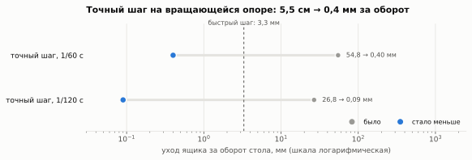
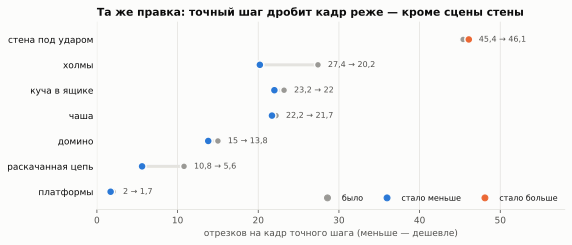
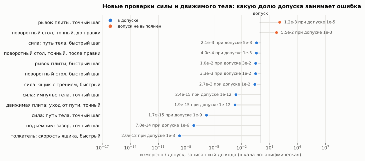
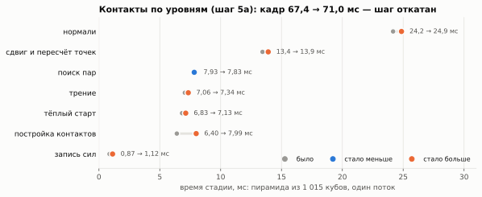
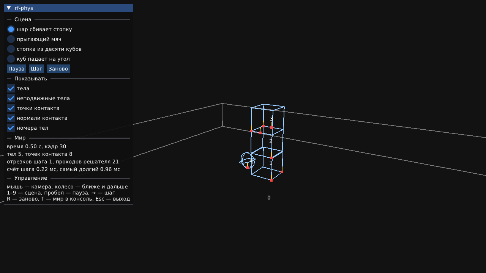

# День 2026-11-21 после утреннего отчёта: что сделано и что не вышло

**Вывод.** Скорость не выросла: первый шаг перестройки решателя дал тот же ответ, но кадр на 5 % дольше, и
он откатан; от Box3D мы отстаём по-прежнему в 3–13 раз. Точность выросла там, где нашлась ошибка: точный шаг
на вращающейся опоре уводил тело на 5,5 см за оборот, теперь на 0,4 мм. Из очереди возможностей сделаны две —
сила и момент на теле и тело, движимое извне; добавлены пять примеров, панель окна переделана. Утренний отчёт —
[status-2026-11-21.md](status-2026-11-21.md); рисунки этого строит `validation/studies/day_figures.py`.

## 1. Что не вышло и что открыто

| Что | Число | Что с этим |
|---|---|---|
| Шаг 5а: контакты по уровням | кадр 66,7 → 70,0 мс одним потоком, 32,7 → 34,1 всеми | откатан; порядок по уровням войдёт в шаг 5б вместе со счётом четвёрками |
| Отставание от Box3D | в 2,9–12,9 раза, как утром | перестройка решателя, шаг 5б |
| Остановка скольжения внутри шага точного шага | путь ошибается на 0,12 мм (допуск был 1 мкм) | задача З3, не чинилось |
| Сцена `slope` быстрым шагом | 1,6063 м вместо 1,6029 | не проходит, как и раньше |
| Таблица случаев контакта | 892 плохие клетки из 7 425 | было 893 |
| Кнопки панели окна | мышью не нажимались | проверены только снимками кадра |

Два прогноза за день не сбылись: допуск точного шага на поворотном столе (записан 1 мм, вышло 5,5 см — так
ошибка и нашлась) и скорость шага 5а (ожидалось не хуже +3 % одним потоком и выигрыш всеми, вышло +5 % и +4 %).

## 2. Точный шаг на вращающейся опоре

Ящик стоит на столе, который вращается с 1 рад/с, на радиусе 0,5 м; трение держит его с запасом. За оборот
он обязан вернуться на место. Точный шаг решал пару «ящик — стол» через шаг без поправки на вращение опоры:
после шага, на котором пара прилипла, у неё остаётся скольжение порядка h²ω³r (здесь 6,9·10⁻⁵ м/с), и
следующий шаг считал её скользящей. Каждый такой шаг терял a·h²/2 пути. Теперь пара считается прилипшей,
пока этот остаток меньше четверти того, что точка касания проходит за шаг из-за вращения.

| Шаг | было | стало |
|---|---|---|
| точный, 1/60 с | 54,8 мм | 0,40 мм |
| точный, 1/120 с | 26,8 мм | 0,09 мм |
| быстрый, подшаг 1/480 с | 3,3 мм | 3,3 мм |

Ошибка была первого порядка по шагу (вдвое меньше шаг — вдвое меньше уход), стала второго (в 4,4 раза).

Та же правка уменьшила число отрезков, на которые точный шаг делит кадр: пары больше не переходят туда-сюда
между «прилипла» и «скользит». В сцене стены под ударом отрезков стало на 1,5 % больше.

| Мерка таблицы случаев (7 425 клеток) | было | стало |
|---|---|---|
| перекрытие больше 0,02 мм | 5 | 4 |
| прирост энергии больше 10⁻⁴ | 890 | 889 |
| шаг без конца | 1 | 1 |
| пролёт | 1 | 1 |
| плохих клеток всего | 893 | 892 |

По отдельным клеткам это перераспределение у порога: 26 клеток по энергии стали плохими, 27 — хорошими.
Первая, более широкая версия правки (поправка и у скользящих пар) таблицу не прошла: в режиме «волчок»
энергия росла в 60 новых клетках — она выброшена.

## 3. Новые возможности: сила на теле и тело, движимое извне

| Возможность | Как пользоваться | Зачем |
|---|---|---|
| сила и момент | `applyForce(тело, сила, точка)`, `applyTorque(тело, момент)`; действуют один шаг мира | управлять телом без пересчёта импульса руками: тяга, моторы |
| тело, движимое извне | у тела без массы задать `drivenVelocity` и `drivenSpin` | платформы, двери, конвейеры, захват робота от программы |

Допуск каждой проверки записан до кода. Точка левее черты — ошибка меньше допуска:

Две оранжевые точки — точный шаг: поворотный стол до правки (раздел 2) и отставание ящика на плите, пошедшей
рывком. Второе не исправлено: остановку скольжения внутри шага точный шаг не считает событием, если трения
хватает до конца шага, и путь ошибается на 0,12 мм.

Ответ прежних сцен обе возможности не изменили ни в одном бите: хэш состояния совпал на двух компиляторах,
при 1, 4 и 12 потоках. Стандартных сцен теперь 21 (добавлены `thrust` и `platforms`), быстрым шагом проходят
20 — не проходит прежняя `slope`.

## 4. Скорость: первый шаг перестройки решателя

Замысел шага 5а: положить контакты в массив не в порядке пар, а по уровням зависимости — так, чтобы
соседние не делили подвижных тел и четвёрку можно было считать одной командой процессора. Ответ остался тем
же бит в бит, а кадр стал дольше:

| Пирамида из 1 015 кубов | было | стало |
|---|---|---|
| один поток, наименьшее из шести пар прогонов | 66,68 мс | 69,99 мс (+5,0 %) |
| все потоки, наименьшее из пяти пар | 32,72 мс | 34,10 мс (+4,2 %) |

Причина одна: при обходе по парам соседние контакты делят тело, и оно уже в кэше; по уровням соседи тел не
делят по определению. Больше всех потеряла постройка контактов (+1,6 мс). Шаг откатан. Порядок по уровням —
не подготовка к счёту четвёрками, а его цена, и платить её можно только вместе с ним.

Для сравнения: кадр этой сцены у Box3D — 7,0 мс на том же процессоре.

## 5. Окно и примеры

Панель окна была одним списком из 36 сцен шириной в пол-экрана; пуск, выбор шага и настройки лежали под
ним. Теперь сверху — название сцены, пуск, пауза, шаг и выбор «быстрый или точный», под ними числа о мире и
строка «проверка сцены: как должно» или что не так. Сцены разложены по трём группам, остальное сворачивается.
Сцена рисуется правее панели.

| Пример (`examples/05_world/`) | Что печатает |
|---|---|
| `Pendulum` | период маятника 1,63827 с — по формуле 1,63827 с |
| `PushedBox` | ящик под силой прошёл 2,6900 м — по формуле 2,6900 м |
| `Platform` | ящик на плите отстал на рывке на 2,56 см — по формуле 2,55 см |
| `Rail` | вагонетка по кривой: 1,000 м за секунду при заданной скорости 1 м/с |
| `Explosion` | взрыв задел 4 куба из 5 |

## 6. Коммиты ветки `performance` за это время

| Коммит | Что |
|---|---|
| `3e094e2` | сила и момент на теле, сцена `thrust` |
| `f9b0345` | тело, движимое извне, сцена `platforms` |
| `8c0bbfa` | пять примеров и боковая панель окна |
| `5e530df` | точный шаг: пара на вращающейся опоре — прилипшая |
| `db2aab0` | журнал: шаг 5а измерен и откатан |

Ворота прошли полностью дважды — после силы с движимым телом и после правки точного шага; оба раза итог
«НЕ ХУЖЕ». Всё лежит локально, ничего не отправлено.

## 7. Что дальше

1. **Скорость.** Шаг 5б: счёт тёплого старта и трения четвёрками вместе с порядком по уровням. Порог — эти
   две стадии (13,9 мс) быстрее не меньше чем вдвое, кадр в целом не хуже.
2. **Точность.** Остановка скольжения внутри шага точного шага (З3).
3. **Возможности из ReactPhysics3D.** События контакта и датчик, затем фильтр столкновений.
