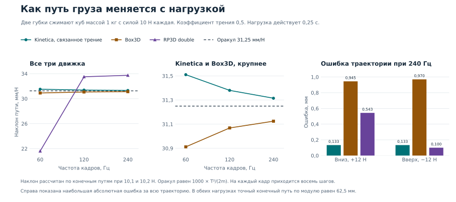
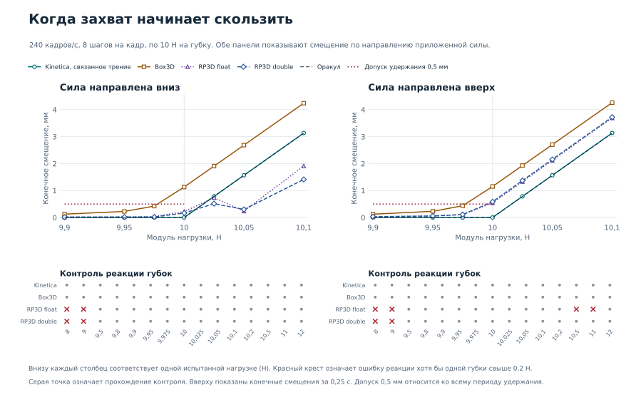
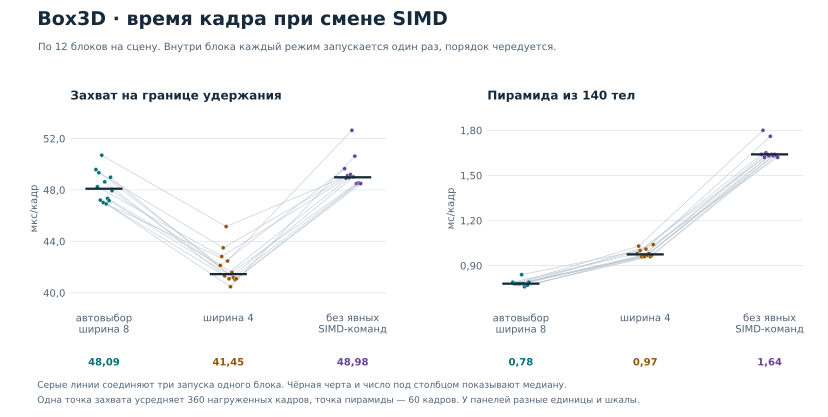
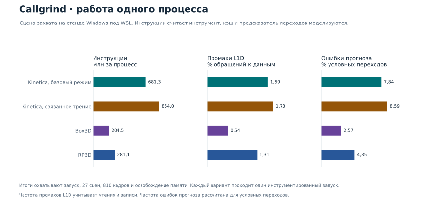

# Анатомия физических движков. Чему учит один захват

**22 ноября 2026 · Kinetica Physics · робототехника · Windows, Xeon E5-2690 v3**

**Новый опыт с двумя вращающимися деталями** охватывает 1 216 пар вершин, рёбер и граней и содержит анимацию. По результатам исправлены выбор нормали в ядре и контакт на шве секторов ведра. [Геометрия, визуализации и открытые случаи](hull-events-2026-11-22.md)

**Разобрали запись сцены № 26.** На интервале 60–74 с центры трёх вёдер в воспроизведённой Windows-сцене сохранили положение с изменениями порядка машинного округления. На записи мерцают главным образом геометрические нормали. В испытании нового просмотрщика они сохранились во всех 840 интервалах покоя. Старый режим менял отметки в 840 из 840. Нашли отдельный дефект просмотрщика — за 5,309 с записи прошло 13,883 с физического времени. Исправленные часы прошли проверку на шести частотах отрисовки. [Кадры, измерения и разбор](data/engine-anatomy-2026-11-22/bucket-rest/recording.md) · [Проверка часов](data/engine-anatomy-2026-11-22/bucket-rest/clock.csv)

**В захвате мы уже сопоставимы с ведущими движками по точности. По времени кадра остаётся разрыв.** При нагрузке ровно на пределе сцепления Kinetica с совместным решением трения дала дрейф **0,043 мм**. Ближайший из испытанных режимов, RP3D double, дал **0,279 мм**. В той же сцене нагруженный кадр Kinetica занимал **209,4 мкс**, Box3D — **49,6 мкс**. Оба вывода относятся к этой геометрии и указанным настройкам. [Сырые времена](data/engine-anatomy-2026-11-22/native-timing.csv) · [Данные Kinetica](data/engine-anatomy-2026-11-22/kinetica-on/grip.csv) · [Данные RP3D](data/engine-anatomy-2026-11-22/rp3d-f64/grip.csv)

## Насколько точно робот удерживает груз

Две губки сжимают куб массой 1 кг с силой 10 Н каждая. Коэффициент трения 0,5. Через 0,25 с обжатия включается вертикальная нагрузка ещё на 0,25 с. Измеряем путь куба относительно середины губок и проверяем фактическую нормальную реакцию каждой губки по изменению её импульса. Общая сетка содержит 36 условий. Допуск на реакцию равен 0,2 Н, на ход при удержании — 0,5 мм, на максимальную ошибку пути при скольжении — 2 мм. [Оракул и определение допуска](../../validation/studies/GripLimit.h)

| Движок и режим | В пределах всех допусков, из 36 | Дрейф на пределе, 60 Гц, мм | Медиана нагруженного кадра, мкс | Диапазон 14 замеров, мкс |
|---|---:|---:|---:|---:|
| Kinetica, совместное трение, double | **33** | **0,043** | 209,4 | 204,3–219,8 |
| Kinetica, штатный, double | 31 | 1,443 | 166,8 | 162,5–180,3 |
| ReactPhysics3D, float | 28 | 0,947 | 46,9 | 45,1–53,2 |
| ReactPhysics3D, double | 27 | 0,279 | 49,6 | 48,1–53,1 |
| Jolt, float | 26 | 2,241 | 45,0 | 44,1–46,4 |
| Box3D, float | 23 | 2,909 | 49,6 | 46,8–51,1 |
| Bullet, float | 9 | 2,385 | **43,5** | 42,5–46,3 |

Все 252 расчёта завершились. Для времени использованы 14 сбалансированных блоков на одном логическом процессоре. В каждом измерении 360 нагруженных кадров после прогрева, создание мира и предварительное обжатие вынесены за таймер. В захвате у всех восемь публичных обновлений на кадр и повторная подача сил. Сохранены настройки алгоритмов движков. Например, у Bullet одна итерация и множитель тёплого старта 0,85, у Jolt и RP3D по одному проходу скорости и положения, у Kinetica есть локальное совместное решение трения. Равный физический шаг оставляет разный объём внутренней работы. [Порядок запусков](../../validation/studies/anatomy/time_all.ps1) · [Bullet](../../validation/engines/grip_bullet.cpp) · [Jolt](../../validation/engines/grip_jolt.cpp) · [Предыдущая серия и результаты шарового захвата](physics-sieve-2026-11-22.md)

## Что означает «линейнее»

В идеальной симметричной сцене порог $F_c=2\mu N=10$ Н. Время нагрузки $T=0{,}25$ с. Знак «плюс» соответствует движению вниз. Решение с начальной скоростью ноль даёт конечный путь в метрах

$$s(F)=\operatorname{sgn}(F)\,\max(0,|F|-F_c)\frac{T^2}{2m}.$$

Пока груз держится, наклон равен нулю. При скольжении на каждой ветви прибавка 1 Н меняет путь на **31,25 мм**. Для оценки точности нужны положение излома, наклон каждой ветви и отклонение пути от оракула. Например, идеально прямая ветвь с наклоном 62,5 мм/Н удваивает отклик на силу.

При 240 Гц между 10,1 и 10,2 Н измерены **31,3151 мм/Н** у Kinetica, **31,1248** у Box3D и **33,7374** у RP3D double. При 12 Н вверх наиболее точен RP3D double по максимальной ошибке траектории, 0,100 мм против 0,133 мм у Kinetica. В зеркальном опыте вниз получены 0,543 и 0,133 мм соответственно. Именно такой разворот выявляет ошибку, которую теряет среднее по двум направлениям. [Формула, все три частоты и исходные строки](data/engine-anatomy-2026-11-22/grip-linearity.md)

Расширенная сетка содержит **372 наблюдения**. Четыре режима, три частоты, 31 знаковая нагрузка от −12 до +12 Н. Фактический прижим выдержан в 93/93 точках у Kinetica и Box3D, 77/93 у RP3D float и 71/93 у RP3D double. При 60 Гц ветвь Kinetica от 10,1 до 12 Н прямая до точности печати на пяти силах. Её наклон 31,5104 мм/Н систематически выше эталона. У RP3D double при нагрузке вниз наклон прямой, построенной по этим пяти точкам, равен 31,2473 мм/Н, однако максимальная конечная ошибка на них достигает 3,374 мм. Так средний наклон скрывает смещение и местные отклонения. [Код сетки](../../validation/studies/anatomy/force_grid.cpp) · [Kinetica](data/engine-anatomy-2026-11-22/force-grid/kinetica-on.csv) · [Box3D](data/engine-anatomy-2026-11-22/force-grid/box3d.csv) · [RP3D float](data/engine-anatomy-2026-11-22/force-grid/rp3d-f32.csv) · [RP3D double](data/engine-anatomy-2026-11-22/force-grid/rp3d-f64.csv)

При 240 Гц и обеих ориентациях силы у Kinetica конечный путь впервые превысил 0,5 мм между 10,000 и 10,025 Н, у Box3D — между 9,975 и 10,000 Н. Это интервал обнаружения заданного смещения за четверть секунды. По аналитической формуле путь 0,5 мм достигается при 10,016 Н, хотя механическое скольжение начинается сразу после 10 Н.

На первом нагруженном подшаге при 60 Гц Kinetica уже выдала импульс трения 0,0208333333324 Н·с при требуемых 0,0208333333333 Н·с. Конечная скорость практически нулевая, но позиция успела сместиться на 0,043403 мм. При скольжении в данных видны вклад порядка $h$ от суммирования перемещений по конечной скорости и вклад порядка $h^2$ при включении нагрузки. При 12 Н и 240 Гц это 0,130208 и 0,002713 мм. Отсюда следует точечный опыт для точности — изменить интегрирование позиции на гладком участке, отдельно проверив момент возникновения контакта и удар. [Первый подшаг](data/friction-islands-2026-11-22/gate02/disks/jaws.csv) · [Порядок стадий Kinetica](../../src/dynamics/time_stepping/SoftStep.cpp) · [Порядок стадий RP3D](https://github.com/DanielChappuis/reactphysics3d/blob/7000610a244ea85377e4f4c9bcdf68af0159b595/src/engine/PhysicsWorld.cpp#L268-L281)

## Что дал опыт с переносом центра масс

В отдельной сборке заменили поступательный сдвиг на среднее начальной и предшествующей переносу скорости. Столкновения в этой сборке пересчитывались для новой позы. При 240 Гц и нагрузке ±12 Н ошибка траектории захвата уменьшилась **с 0,132921 до 0,001356 мм**, на всей сетке пройдены **36/36** условий вместо 33/36. Две серии с шаром остались 48/48, обе серии в жёлобе — 32/32. [Захват до](data/engine-anatomy-2026-11-22/mid-results/grip-base.csv) · [Захват после](data/engine-anatomy-2026-11-22/mid-results/grip-mid.csv) · [Вариант переноса](data/engine-anatomy-2026-11-22/transport-midpoint.patch)

**Контрпример остановил включение этого варианта в SDK.** При упругом ударе в начале шага скорость мгновенно меняется с −3 на +3 м/с. Усреднение даёт нулевое перемещение на первом шаге вместо отскока. В 60-герцевом кадре с восемью подшагами появляется ошибка **6,25 мм** при корректной конечной скорости. В отдельном опыте с ударом внутри шага у исходной сборки при тех же 60 Гц также обнаружилась потеря отскока. Это отдельный открытый дефект быстрого шага при настройках этого опыта. Для объединения точного гладкого движения и удара требуется учесть момент скачка скорости. [Свободное движение, падение и два удара до](data/engine-anatomy-2026-11-22/mid-results/oracles-base.csv) · [Те же восемь опытов после](data/engine-anatomy-2026-11-22/mid-results/oracles-mid.csv)

## Сколько дают векторные инструкции в двух сценах Box3D

В Windows-библиотеке Box3D процессор автоматически выбрал восемь полос. VTune зафиксировал работу функции подготовки контактов W8. В соответствующем ей участке бинарного файла есть инструкции сложения и умножения восьми чисел float в регистрах YMM. Чтобы измерить эффект, на том же бинарном файле переключили восемь полос на четыре. Третий вариант использует переносимую реализацию с отключёнными явными SIMD-инструкциями. Компилятор всё ещё может векторизовать её. [Дизассемблирование](data/engine-anatomy-2026-11-22/box3d/instructions.csv) · [Режимы и хэши](data/engine-anatomy-2026-11-22/box-width/measurements.json)

| Медиана 12 замеров, мкс/кадр | Авто, 8 полос | 4 полосы | Без явных SIMD-инструкций |
|---|---:|---:|---:|
| Один захват | 48,09 | **41,45** | 48,98 |
| Пирамида, 140 подвижных кубов | **780** | 975 | 1 640 |

Четыре полосы выиграли все 12 пар на захвате. Восемь выиграли все 12 на пирамиде. У двух губок одно общее динамическое тело, поэтому эти две пары расходятся по разным цветам графа Box3D. Долю занятых полос в каждом пакете мы непосредственно не измеряли. Все три сборки выдали одинаковые 36 строк наблюдений захвата с точностью печати. Для пирамиды измерено время 60 кадров, точность траектории в этом опыте не записывалась. [Захват](data/engine-anatomy-2026-11-22/box-width/grip-timing.csv) · [Пирамида](data/engine-anatomy-2026-11-22/box-width/pyramid-timing.csv) · [Раскраска ограничений Box3D](https://github.com/erincatto/box3d/blob/be8c7318901dbb14b9fbb26fe0a7a48850f53b0e/src/constraint_graph.c#L93-L110)

## На что уходит время и память

**VTune, нативные Windows-программы.** Профиль охватывает создание, обжатие, 15 000 измеряемых кадров нагрузки и завершение. Программные выборки дают оценку времени в функции. В Kinetica функция выдачи временной памяти заняла около 8,3% процессорного времени всего опыта. Даже устранение всех этих затрат при прочих равных сократило бы время примерно на одну двенадцатую. Четырёхкратный разрыв требует искать и другие причины.

| Движок | Функция в профиле | CPU-время функции / всего процесса, с |
|---|---|---:|
| Kinetica, совместное трение | Выдача памяти шага, StepMemory::take | 0,714 / 8,611 |
| Box3D | Подготовка контактов, ConvexW8 | 0,234 / 1,951 |
| RP3D float | Подготовка контактов острова | 0,232 / 2,502 |
| RP3D double | Подготовка контактов острова | 0,152 / 2,388 |
| Bullet | Подготовка строки контакта | 0,174 / 3,230 |
| Jolt | Восстановление контактов пары из кэша | 0,108 / 1,450 |

Первичные таблицы содержат адреса, имена функций и привязку к хэшу бинарного файла. [Kinetica](data/engine-anatomy-2026-11-22/kinetica-on/resolved.csv) · [Box3D](data/engine-anatomy-2026-11-22/box3d/resolved.csv) · [RP3D float](data/engine-anatomy-2026-11-22/rp3d-f32/resolved.csv) · [RP3D double](data/engine-anatomy-2026-11-22/rp3d-f64/resolved.csv) · [Bullet](data/engine-anatomy-2026-11-22/bullet/resolved.csv) · [Jolt](data/engine-anatomy-2026-11-22/jolt/resolved.csv)

За 15 нагруженных кадров у Kinetica штатный режим вызвал глобальный C++ new **842 раза** на **755 008 байт**, режим совместного трения — **1 560 раз** на **1 383 360 байт**. Это суммарно запрошенные байты за окно. Выдачи внутри арены и прямой malloc её блоков имеют другие счётчики. На своих наблюдаемых интерфейсах Box3D и RP3D за то же окно сделали ноль внешних запросов, Jolt сделал 238 обычных запросов на 7 140 байт. Уровни перехвата различаются. Следующий вопрос к Kinetica — какие конкретно объекты вынуждены вновь запрашивать память в уже прогретом мире. [Kinetica](data/engine-anatomy-2026-11-22/memory/kinetica-coupled.csv) · [Box3D](data/engine-anatomy-2026-11-22/memory/box3d.csv) · [RP3D](data/engine-anatomy-2026-11-22/memory/rp3d-double.csv) · [Jolt](data/engine-anatomy-2026-11-22/memory/jolt.csv)

**Valgrind удалось запустить на том же физическом Windows-ПК через WSL2.** Для Callgrind 3.26 отдельно собрали Linux-программы GCC 15. За весь процесс из 810 кадров счётчик инструкций дал **854,0 млн** у совместного режима Kinetica, **681,3 млн** у штатного, **281,1 млн** у RP3D double и **204,5 млн** у Box3D. Kinetica с совместным трением исполнила в 4,18 раза больше гостевых инструкций, чем Box3D. Из этого числа нельзя восстановить такты Windows или загрузку полос SIMD. Кэш и предсказатель ветвлений здесь моделируются. Для Box3D в WSL отключена сборочная валидация, нативная сборка использует свои флаги. [События Callgrind](data/engine-anatomy-2026-11-22/callgrind/events.csv) · [Среда опыта](data/engine-anatomy-2026-11-22/callgrind/config.txt) · [Поддерживаемые платформы Valgrind](https://valgrind.org/info/platforms.html)

## Разделяй по физической зависимости

Два захвата без общих подвижных тел можно решать отдельно. Две губки, удерживающие один куб, должны согласовать импульсы через скорость этого куба. Эта граница объясняет и архитектуру, и тест для студента. Если добавить вдали второй независимый робот, путь первого должен сохраниться. Если отпустить одну из двух губок, распределение реакций должно измениться.

Для производительности проверяем одно упрощение. На фиксированной позе матрица отклика направляющих равна $A=JM^{-1}J^\mathsf{T}$. Если остров содержит те же строки в том же порядке, локальная перенумерация тел оставляет $A$ прежней. В экспериментальном варианте остров копирует уже вычисленную матрицу. Если набор строк другой, он собирает свой блок. Из равенства матриц следует гипотеза о совпадении результата. Время копирования и выигрыш кадра устанавливаются опытом. [Экспериментальная правка](data/engine-anatomy-2026-11-22/reuse-guide-matrix.patch)

В 17 наборах выходные строки и хэши совпали побайтно, включая независимые захваты и 27 стандартных сцен. В 20 парах медианы составили **205,32 → 200,21 мкс**, медианное парное изменение **−2,58%**, ускорились 17 из 20 пар. Восемь нативных тестов CTest прошли. Два запуска проверок shell из CTest под Windows вернули BAD_COMMAND. Для обеих библиотек отдельно проверили полный список запрещённых символов через llvm-nm, совпадений ноль. Эксперимент показывает небольшой выигрыш на захвате. [Проверка парности](data/engine-anatomy-2026-11-22/guide-reuse/parity.csv) · [40 замеров](data/engine-anatomy-2026-11-22/guide-reuse/timing.csv) · [CTest](data/engine-anatomy-2026-11-22/guide-reuse/ctest.log) · [Символы двух библиотек](data/engine-anatomy-2026-11-22/guide-reuse/libm-check.txt)

Подробная таблица учёта памяти показывает создание, обжатие, нагрузку и уничтожение мира, а также какие вызовы видит каждый механизм перехвата. [Данные семи конфигураций](data/engine-anatomy-2026-11-22/memory-observations.md)

## Где смотреть реализацию

Разобраны **13 деревьев исходного кода** с привязкой к ревизиям. Нативный профиль в этой серии получен для пяти движков, включая Kinetica. Геометрическая библиотека Parry, двумерная лаборатория Solver2D и GPU-реализация MuJoCo Warp отвечают на разные инженерные вопросы.

| Что интересует | Что даёт чтение кода |
|---|---|
| Как упаковать независимые контакты или геометрию | [Box3D, Jolt и Bullet](data/engine-anatomy-2026-11-22/box-jolt-bullet.md) |
| Где применять импульсы и как хранить данные одного шага | [ReactPhysics3D, PhysX, MuJoCo и Drake](data/engine-anatomy-2026-11-22/rp3d-physx-mujoco.md) |
| Как хранить однотипные ограничения и восстанавливать площадки | [Bepu, Rapier и Parry](data/engine-anatomy-2026-11-22/bepu-rapier.md) |
| Как меняется задача в 2D и при одновременном моделировании тысяч миров | [Box2D, Solver2D и MuJoCo Warp](data/engine-anatomy-2026-11-22/box2d-mjwarp.md) |

**⚠️ Стресс-тест.** Проверены обе стороны границы сцепления, разворот нагрузки, частоты 60 / 120 / 240 Гц и смена победителя SIMD при переходе от трёх движущихся тел к 140. Здесь нет измерения реального робота, миллиона тел или GPU. Для вывода о мировом уровне по другим задачам нужны собственные физические оракулы для ударов, длинных цепей и вращения, а также время кадра при выполнении их допусков.
