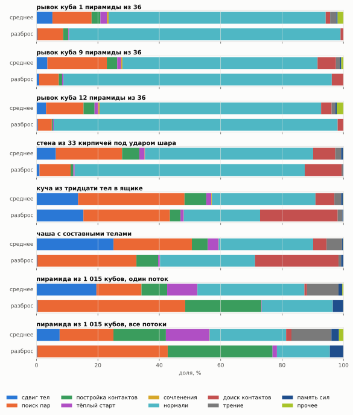
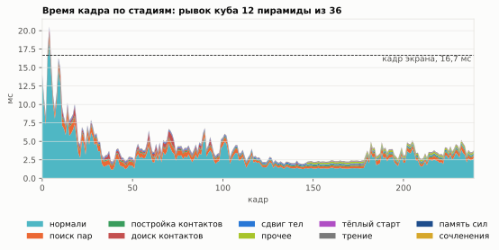
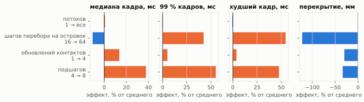

# Время кадра через ковариации

Сгенерировано `validation/frame_covariance.py --remote` 21.11.2026; руками не править.
Где мерили: свободная машина (Windows, clang, закреплённое ядро у опытов одного потока). Время каждой стадии каждого кадра — наименьшее из пяти прогонов.

## Главное

- **рывок куба 1 пирамиды из 36:** разброс делает стадия «нормали» — 88 % дисперсии при 71 % среднего.
- **рывок куба 9 пирамиды из 36:** разброс делает стадия «нормали» — 87 % дисперсии при 64 % среднего.
- **рывок куба 12 пирамиды из 36:** разброс делает стадия «нормали» — 92 % дисперсии при 72 % среднего.
- **стена из 33 кирпичей под ударом шара:** разброс делает стадия «нормали» — 75 % дисперсии при 55 % среднего.
- **куча из тридцати тел в ящике:** разброс делает стадия «поиск пар» — 28 % дисперсии при 35 % среднего; рывки при малой средней доле — доиск контактов.
- **чаша с составными телами:** разброс делает стадия «поиск пар» — 32 % дисперсии при 26 % среднего; рывки при малой средней доле — доиск контактов; постоянная цена — сдвиг тел.
- **пирамида из 1 015 кубов, один поток:** разброс делает стадия «поиск пар» — 48 % дисперсии при 15 % среднего; рывки при малой средней доле — поиск пар, постройка контактов; постоянная цена — сдвиг тел, трение.
- **пирамида из 1 015 кубов, все потоки:** разброс делает стадия «поиск пар» — 42 % дисперсии при 18 % среднего; рывки при малой средней доле — поиск пар; постоянная цена — тёплый старт, трение.

## Что считается

Шаг сообщает наблюдателю о стадиях, и время кадра есть сумма времён стадий: $T = \sum_k s_k$. Поэтому разброс времени кадра
раскладывается по стадиям без остатка:

$$ \operatorname{Var}(T) = \sum_k \operatorname{Cov}(s_k, T), \qquad d_k = \frac{\operatorname{Cov}(s_k, T)}{\operatorname{Var}(T)}, \qquad \sum_k d_k = 1. $$

Доля среднего $m_k = \bar s_k / \bar T$ говорит, куда уходит время; доля разброса $d_k$ — из-за чего кадры бывают долгими. Стадия с $d_k \gg m_k$
делает рывки; стадия с $d_k \ll m_k$ — постоянная цена. Цена единицы работы — наклон прямой $s_k \approx a + b\,n$ по счётчику кадра $n$:
$b = \operatorname{Cov}(s_k, n) / \operatorname{Var}(n)$; показана, только если прямая объясняет не меньше половины разброса стадии ($r^2 \ge 0{,}5$).
Эффект настройки — разность средних отклика на двух её уровнях в полном плане $2^4$: $2 \operatorname{Cov}(x, y)$ при $x = \pm 1$.

## Стадии по опытам

### рывок куба 1 пирамиды из 36

Кадр в среднем 3,08 мс; потоков 24, подшагов 8, повторов 5.

| Стадия | Среднее, мс | Доля среднего | Доля разброса | Корреляция с кадром | Доля в 5 % долгих кадров |
|---|---|---|---|---|---|
| нормали | 2,176 | 70,7 % | 88,5 % | 0,99 | 88,6 % |
| поиск пар | 0,393 | 12,8 % | 8,4 % | 0,68 | 6,0 % |
| постройка контактов | 0,088 | 2,9 % | 1,7 % | 0,78 | 1,4 % |
| доиск контактов | 0,045 | 1,5 % | 1,3 % | 0,64 | 1,0 % |
| сдвиг тел | 0,160 | 5,2 % | 0,3 % | 0,56 | 1,4 % |
| память сил | 0,012 | 0,4 % | 0,2 % | 0,79 | 0,2 % |
| тёплый старт | 0,065 | 2,1 % | 0,2 % | 0,65 | 0,6 % |
| трение | 0,062 | 2,0 % | 0,2 % | 0,65 | 0,6 % |
| сочленения | 0,017 | 0,6 % | 0,0 % | 0,66 | 0,1 % |
| прочее | 0,059 | 1,9 % | -0,8 % | -0,29 | 0,0 % |

| Стадия | Счётчик | Цена единицы, мкс | Постоянная часть, мс | r² |
|---|---|---|---|---|
| поиск пар | наибольшая скорость, м/с | 465,5 | 0,210 | 0,76 |

### рывок куба 9 пирамиды из 36

Кадр в среднем 4,06 мс; потоков 24, подшагов 8, повторов 5.

| Стадия | Среднее, мс | Доля среднего | Доля разброса | Корреляция с кадром | Доля в 5 % долгих кадров |
|---|---|---|---|---|---|
| нормали | 2,579 | 63,6 % | 87,4 % | 0,98 | 83,0 % |
| поиск пар | 0,786 | 19,4 % | 6,4 % | 0,55 | 8,4 % |
| доиск контактов | 0,243 | 6,0 % | 4,2 % | 0,37 | 3,5 % |
| постройка контактов | 0,137 | 3,4 % | 1,1 % | 0,62 | 1,6 % |
| сдвиг тел | 0,144 | 3,5 % | 0,9 % | 0,78 | 1,7 % |
| тёплый старт | 0,051 | 1,3 % | 0,4 % | 0,78 | 0,7 % |
| трение | 0,053 | 1,3 % | 0,3 % | 0,77 | 0,6 % |
| память сил | 0,017 | 0,4 % | 0,2 % | 0,69 | 0,2 % |
| сочленения | 0,018 | 0,4 % | 0,0 % | 0,75 | 0,2 % |
| прочее | 0,030 | 0,7 % | -0,9 % | -0,31 | 0,0 % |

### рывок куба 12 пирамиды из 36

Кадр в среднем 4,25 мс; потоков 24, подшагов 8, повторов 5.

| Стадия | Среднее, мс | Доля среднего | Доля разброса | Корреляция с кадром | Доля в 5 % долгих кадров |
|---|---|---|---|---|---|
| нормали | 3,066 | 72,2 % | 92,5 % | 0,99 | 87,7 % |
| поиск пар | 0,519 | 12,2 % | 4,6 % | 0,59 | 5,6 % |
| доиск контактов | 0,145 | 3,4 % | 2,8 % | 0,35 | 2,5 % |
| сдвиг тел | 0,133 | 3,1 % | 0,4 % | 0,83 | 1,3 % |
| постройка контактов | 0,152 | 3,6 % | 0,4 % | 0,64 | 1,4 % |
| тёплый старт | 0,053 | 1,2 % | 0,2 % | 0,85 | 0,6 % |
| трение | 0,052 | 1,2 % | 0,2 % | 0,83 | 0,5 % |
| память сил | 0,019 | 0,4 % | 0,1 % | 0,72 | 0,2 % |
| сочленения | 0,017 | 0,4 % | 0,0 % | 0,51 | 0,1 % |
| прочее | 0,094 | 2,2 % | -1,2 % | -0,28 | 0,0 % |

### стена из 33 кирпичей под ударом шара

Кадр в среднем 2,31 мс; потоков 24, подшагов 8, повторов 5.

| Стадия | Среднее, мс | Доля среднего | Доля разброса | Корреляция с кадром | Доля в 5 % долгих кадров |
|---|---|---|---|---|---|
| нормали | 1,264 | 54,8 % | 74,9 % | 0,98 | 73,0 % |
| доиск контактов | 0,166 | 7,2 % | 12,0 % | 0,77 | 8,8 % |
| поиск пар | 0,498 | 21,6 % | 10,1 % | 0,75 | 12,4 % |
| сдвиг тел | 0,145 | 6,3 % | 1,0 % | 0,75 | 2,1 % |
| постройка контактов | 0,130 | 5,6 % | 0,9 % | 0,70 | 1,9 % |
| трение | 0,044 | 1,9 % | 0,4 % | 0,65 | 0,7 % |
| тёплый старт | 0,040 | 1,7 % | 0,4 % | 0,60 | 0,6 % |
| память сил | 0,016 | 0,7 % | 0,2 % | 0,57 | 0,3 % |
| сочленения | 0,002 | 0,1 % | 0,0 % | 0,71 | 0,0 % |
| прочее | 0,002 | 0,1 % | 0,0 % | 0,75 | 0,0 % |

| Стадия | Счётчик | Цена единицы, мкс | Постоянная часть, мс | r² |
|---|---|---|---|---|
| сдвиг тел | наибольшая скорость, м/с | 9,0 | 0,128 | 0,56 |
| постройка контактов | наибольшая скорость, м/с | 9,0 | 0,112 | 0,62 |

### куча из тридцати тел в ящике

Кадр в среднем 1,24 мс; потоков 24, подшагов 8, повторов 5.

| Стадия | Среднее, мс | Доля среднего | Доля разброса | Корреляция с кадром | Доля в 5 % долгих кадров |
|---|---|---|---|---|---|
| поиск пар | 0,431 | 34,7 % | 28,2 % | 0,96 | 28,9 % |
| доиск контактов | 0,077 | 6,2 % | 25,3 % | 0,69 | 26,8 % |
| нормали | 0,420 | 33,8 % | 24,8 % | 0,77 | 21,0 % |
| сдвиг тел | 0,169 | 13,6 % | 15,3 % | 0,91 | 16,4 % |
| постройка контактов | 0,088 | 7,1 % | 3,5 % | 0,77 | 4,1 % |
| трение | 0,028 | 2,2 % | 1,6 % | 0,77 | 1,4 % |
| тёплый старт | 0,020 | 1,6 % | 1,0 % | 0,74 | 1,0 % |
| память сил | 0,008 | 0,6 % | 0,3 % | 0,62 | 0,3 % |
| прочее | 0,001 | 0,1 % | 0,0 % | 0,60 | 0,1 % |
| сочленения | 0,002 | 0,2 % | 0,0 % | 0,79 | 0,1 % |

| Стадия | Счётчик | Цена единицы, мкс | Постоянная часть, мс | r² |
|---|---|---|---|---|
| постройка контактов | пар в касании | 1,5 | 0,042 | 0,78 |
| нормали | пар в касании | 10,8 | 0,091 | 0,76 |
| доиск контактов | наибольшая скорость, м/с | 47,6 | 0,002 | 0,55 |

### чаша с составными телами

Кадр в среднем 2,86 мс; потоков 24, подшагов 8, повторов 5.

| Стадия | Среднее, мс | Доля среднего | Доля разброса | Корреляция с кадром | Доля в 5 % долгих кадров |
|---|---|---|---|---|---|
| поиск пар | 0,729 | 25,5 % | 32,3 % | 0,85 | 29,8 % |
| нормали | 0,879 | 30,8 % | 30,9 % | 0,83 | 29,9 % |
| доиск контактов | 0,125 | 4,4 % | 27,2 % | 0,70 | 21,7 % |
| постройка контактов | 0,148 | 5,2 % | 7,1 % | 0,94 | 6,5 % |
| трение | 0,144 | 5,0 % | 0,8 % | 0,23 | 2,2 % |
| память сил | 0,010 | 0,4 % | 0,7 % | 0,81 | 0,6 % |
| тёплый старт | 0,099 | 3,5 % | 0,6 % | 0,24 | 1,5 % |
| сдвиг тел | 0,717 | 25,1 % | 0,3 % | 0,02 | 7,7 % |
| сочленения | 0,003 | 0,1 % | 0,0 % | 0,82 | 0,1 % |
| прочее | 0,003 | 0,1 % | 0,0 % | 0,34 | 0,0 % |

| Стадия | Счётчик | Цена единицы, мкс | Постоянная часть, мс | r² |
|---|---|---|---|---|
| сдвиг тел | точек контакта | 5,6 | 0,097 | 0,91 |
| тёплый старт | пар в касании | 0,7 | 0,031 | 0,67 |
| трение | пар в касании | 1,1 | 0,040 | 0,71 |

### пирамида из 1 015 кубов, один поток

Кадр в среднем 59,38 мс; потоков 1, подшагов 8, повторов 5.

| Стадия | Среднее, мс | Доля среднего | Доля разброса | Корреляция с кадром | Доля в 5 % долгих кадров |
|---|---|---|---|---|---|
| поиск пар | 8,722 | 14,7 % | 48,1 % | 0,99 | 27,0 % |
| постройка контактов | 4,967 | 8,4 % | 24,8 % | 0,94 | 15,0 % |
| нормали | 20,696 | 34,9 % | 23,1 % | 0,85 | 31,9 % |
| память сил | 0,723 | 1,2 % | 3,4 % | 0,98 | 2,0 % |
| сдвиг тел | 11,589 | 19,5 % | 0,4 % | 0,52 | 11,5 % |
| тёплый старт | 5,824 | 9,8 % | 0,1 % | 0,29 | 5,7 % |
| прочее | 0,232 | 0,4 % | 0,0 % | 0,52 | 0,3 % |
| трение | 6,104 | 10,3 % | 0,0 % | 0,08 | 6,0 % |
| доиск контактов | 0,500 | 0,8 % | 0,0 % | 0,45 | 0,5 % |
| сочленения | 0,027 | 0,0 % | 0,0 % | 0,76 | 0,0 % |

| Стадия | Счётчик | Цена единицы, мкс | Постоянная часть, мс | r² |
|---|---|---|---|---|
| нормали | наибольшая скорость, м/с | 315311,0 | 18,819 | 0,92 |

### пирамида из 1 015 кубов, все потоки

Кадр в среднем 33,81 мс; потоков 24, подшагов 8, повторов 5.

| Стадия | Среднее, мс | Доля среднего | Доля разброса | Корреляция с кадром | Доля в 5 % долгих кадров |
|---|---|---|---|---|---|
| поиск пар | 5,924 | 17,5 % | 42,5 % | 1,00 | 29,9 % |
| постройка контактов | 5,774 | 17,1 % | 34,1 % | 0,99 | 25,0 % |
| нормали | 8,414 | 24,9 % | 17,2 % | 0,92 | 21,7 % |
| память сил | 0,830 | 2,5 % | 4,7 % | 0,98 | 3,4 % |
| тёплый старт | 4,791 | 14,2 % | 1,4 % | 0,96 | 7,7 % |
| сдвиг тел | 2,550 | 7,5 % | 0,3 % | 0,56 | 3,9 % |
| доиск контактов | 0,588 | 1,7 % | 0,0 % | 0,12 | 0,9 % |
| сочленения | 0,033 | 0,1 % | 0,0 % | 0,42 | 0,1 % |
| трение | 4,402 | 13,0 % | -0,1 % | -0,25 | 6,6 % |
| прочее | 0,499 | 1,5 % | -0,2 % | -0,47 | 0,7 % |

| Стадия | Счётчик | Цена единицы, мкс | Постоянная часть, мс | r² |
|---|---|---|---|---|
| нормали | наибольшая скорость, м/с | 149005,0 | 7,527 | 0,70 |

## Потоки: что ускоряется

пирамида из 1 015 кубов: один поток против 24.

| Стадия | Один поток, мс | Все потоки, мс | Ускорение |
|---|---|---|---|
| нормали | 20,70 | 8,41 | в 2,46 раза |
| поиск пар | 8,72 | 5,92 | в 1,47 раза |
| постройка контактов | 4,97 | 5,77 | в 0,86 раза |
| тёплый старт | 5,82 | 4,79 | в 1,22 раза |
| трение | 6,10 | 4,40 | в 1,39 раза |
| сдвиг тел | 11,59 | 2,55 | в 4,54 раза |
| память сил | 0,72 | 0,83 | в 0,87 раза |
| доиск контактов | 0,50 | 0,59 | в 0,85 раза |
| прочее | 0,23 | 0,50 | в 0,47 раза |
| **кадр** | 59,38 | 33,81 | в 1,76 раза |

## Настройки шага: время и точность вместе

Рывок куба 12 пирамиды из 36 (`study-window-pull`), полный план $2^4$. Эффект — на сколько процентов от среднего по плану
меняется отклик при переходе фактора с нижнего уровня на верхний.

| Фактор | Уровни | медиана кадра, мс | 99 % кадров, мс | худший кадр, мс | перекрытие, мм |
|---|---|---|---|---|---|
| подшагов | 4 → 8 | +38 % | +55 % | +48 % | −34 % |
| обновлений контактов | 1 → 4 | +14 % | +5 % | +4 % | −30 % |
| шагов перебора на островок | 16 → 64 | −10 % | +42 % | +54 % | −122 % |
| потоков | 1 → все | +1 % | −0 % | −1 % | −0 % |
| среднее по плану | | 2,87 | 9,69 | 11,80 | 1,696 |

Корреляция времени (99 % кадров) и перекрытия по шестнадцати прогонам плана: r = -0,59.

Все прогоны плана:

| подшагов | обновлений контактов | шагов перебора на островок | потоков | медиана кадра, мс | 99 % кадров, мс | худший кадр, мс | перекрытие, мм |
|---|---|---|---|---|---|---|---|
| 4 | 1 | 16 | 1 | 2,23 | 6,31 | 7,72 | 3,196 |
| 4 | 1 | 16 | все | 2,43 | 6,47 | 7,83 | 3,196 |
| 4 | 1 | 64 | 1 | 2,02 | 6,90 | 9,58 | 0,926 |
| 4 | 1 | 64 | все | 2,04 | 6,90 | 9,52 | 0,926 |
| 4 | 4 | 16 | 1 | 2,62 | 7,34 | 9,06 | 3,217 |
| 4 | 4 | 16 | все | 2,53 | 7,01 | 8,56 | 3,217 |
| 4 | 4 | 64 | 1 | 2,32 | 7,48 | 9,57 | 0,584 |
| 4 | 4 | 64 | все | 2,42 | 7,80 | 10,12 | 0,584 |
| 8 | 1 | 16 | 1 | 3,39 | 8,11 | 8,65 | 2,731 |
| 8 | 1 | 16 | все | 3,43 | 8,04 | 8,58 | 2,731 |
| 8 | 1 | 64 | 1 | 2,94 | 16,56 | 20,33 | 0,945 |
| 8 | 1 | 64 | все | 2,88 | 16,31 | 20,41 | 0,945 |
| 8 | 4 | 16 | 1 | 3,76 | 8,93 | 9,34 | 1,786 |
| 8 | 4 | 16 | все | 3,74 | 8,86 | 9,02 | 1,786 |
| 8 | 4 | 64 | 1 | 3,55 | 15,99 | 20,46 | 0,182 |
| 8 | 4 | 64 | все | 3,56 | 16,03 | 20,09 | 0,182 |
