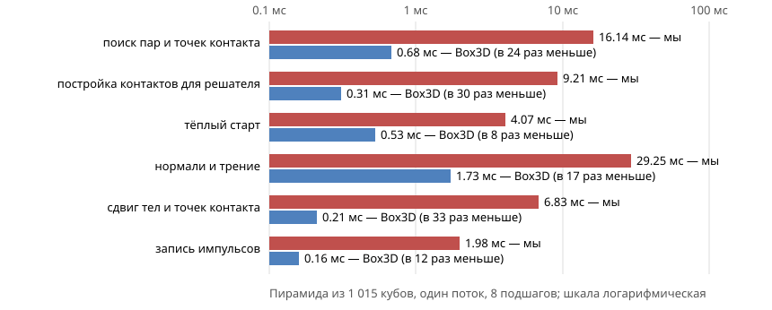

# Что мы упускаем: кадр по стадиям против Box3D

Замер 2026-11-20. Пирамида 14 × 14 из 1 015 кубов, один поток, 8 подшагов, быстрый шаг. Наши стадии —
`KP_THREADS=1 study-frame-stages pyramid3d`; стадии Box3D — его собственный счёт `b3World_GetProfile`
(временная копия `validation/engines/box3d.cpp` с печатью профиля). Кадр: мы 68,95 мс, Box3D 3,64 мс,
ReactPhysics3D 26,4 мс.

## 1. Где теряется время

| Стадия | Мы, мс | Box3D, мс | Во сколько раз | Что считается у Box3D |
|---|---|---|---|---|
| поиск пар и точек контакта | 16,14 | 0,68 | 24 | `pairs` 0,03 + `collide` 0,65 |
| постройка контактов для решателя | 9,21 | 0,31 | 30 | `prepareConstraints` |
| тёплый старт | 4,07 | 0,53 | 8 | `warmStart` |
| нормали и трение | 29,25 | 1,73 | 17 | `solveImpulses` 0,75 + `relaxImpulses` 0,98 |
| сдвиг тел и точек контакта | 6,83 | 0,21 | 32 | `integrateVelocities`, `integratePositions`, `transforms` |
| запись импульсов | 1,98 | 0,16 | 12 | `storeImpulses` |
| доиск пропущенных контактов | 1,34 | — | — | у Box3D такого прохода нет |
| **кадр** | **68,95** | **3,64** | **19** | |

Главное наблюдение: отставание не сидит в одном месте. На каждой стадии оно от 8 до 32 раз, поэтому ни одна
точечная правка порядок не меняет. Упущены не приёмы внутри функций, а четыре решения об устройстве данных.

## 2. Четыре вещи, которых у нас нет

### 2.1. Постоянство: пары, контакты и строки решателя живут между кадрами

- **Box3D.** Пары ищутся только для тел, чей расширенный объём сдвинулся (`broad_phase.c`): у стоящей
  пирамиды это 0,03 мс. Контакт живёт, пока тела рядом; на кадр его площадка только обновляется по
  запомненным признакам прошлого решения (`contact.c`, `convex_manifold.c`). Строки решателя готовятся один
  раз на кадр.
- **Мы.** Пары ищутся заново на каждом из четырёх обновлений контактов за кадр (`PairFinder`), контакты
  решателя строятся заново четыре раза: 6 930 построений `SoftContact` на кадр при 1 732 парах. Площадка
  идёт за телами (`ManifoldMemory`), но сам контакт решателя не переживает обновления.
- **Цена.** Поиск и постройка — 25,3 мс, 37 % кадра; у Box3D те же стадии — 1,0 мс.

### 2.2. Широкий решатель: восемь контактов за одну команду, по цветам графа

- **Box3D.** Контакты красятся так, чтобы в одном цвете не было двух контактов одного тела
  (`constraint_graph.c`); цвет решается пачками по 8 в `float` на AVX2 (`contact_solver_wide.inl`,
  `simd_avx2.h`). На точку контакта в подшаге — около 8,5 нс.
- **Мы.** Пара за парой, блок 4 × 4 в `double` (`SoftContact::solveNormals` → `solveComplementarity`): на
  точку в подшаге — около 143 нс. Профиль по функциям: `solveNormals` 13,7 %, `solveComplementarity` 10,5 %,
  `respond` 8,1 %, `solveFriction` 7,9 %, `warmStart` 4,9 %.
- **Цена.** 29,25 мс против 1,73 мс.

### 2.3. Зазор обновляется внутри решателя, а не отдельным проходом

- **Box3D.** Точка контакта хранится в осях тел, а в состоянии тела лежит сдвиг и поворот с начала шага
  (`b3BodyState`: скорости, `deltaPosition`, `deltaRotation`). Зазор на подшаге — одна формула в цикле
  решателя; отдельного прохода по контактам нет.
- **Мы.** После каждого сдвига тел идёт проход по всем контактам (`SoftContact::follow` 6,4 %,
  `deepest` 3,2 %, `Moving::advance`).
- **Цена.** 6,83 мс против 0,21 мс.

### 2.4. Раскладка данных под кэш

- **Box3D.** Горячее состояние тела — отдельная плотная структура в 48 байт; строки контактов лежат массивами
  по цветам, поле за полем; спящие, бодрствующие и неподвижные тела — в разных массивах (`solver_set.c`).
- **Мы.** `SoftContact` — крупный объект со своими массивами; решатель читает его целиком ради нескольких
  чисел. Замер счётчиков утром: 610 млн команд и 261 тыс. промахов кэша L3 на кадр.

## 3. Чего нет у Box3D и есть у нас

- **Жёсткая задача островка** (`IslandNormals`): столбик из 100 кубов и отношение масс без провисания. Это
  наша точность, и она стоит дорого только на потревоженных кучах (замеры H63–H68).
- **Доиск пропущенных контактов** и четыре обновления контактов за кадр: меньше перекрытие при ударах.
- **Точный шаг** как эталон и побитовая повторяемость у трёх компиляторов.

Эти вещи не мешают пунктам раздела 2: массовый путь на пружинах можно сделать постоянным и широким, не
трогая жёсткую задачу.

## 4. Источники

Список статей с пометками, что прочитано, — `research/papers.md`; разбор Box3D по исходникам —
`research/engines/box3d.md`.

| Что перенять | Источник |
|---|---|
| раскраска графа и широкий решатель | Catto, «SIMD Matters» (2024); исходники `constraint_graph.c`, `contact_solver_wide.inl` |
| мягкий шаг с подшагами, зазор в цикле решателя | Catto, «Solver2D / Soft Step» (2024); Macklin и др., «Small Steps in Physics Simulation» (2019) |
| векторный счёт площадок | Catto, «SIMD for Collision» (2026); `convex_manifold_wide.inl` |
| постоянные островки и сон | Catto, «Simulation Islands» (2023); `island.c`, `solver_set.c` |
| параллельный решатель без раскраски | Tonge и др., «Mass Splitting» (2012) — у нас отклонено замером H60 |

## 5. Порядок работ и мерки

Оценки — мои, не замеры; мерка каждого шага — стадия в `study-frame-stages pyramid3d`.

| Шаг | Что делаем | Стадии | Сейчас, мс | Мерка, мс |
|---|---|---|---|---|
| 1 | контакт решателя живёт между обновлениями и кадрами | постройка контактов, запись импульсов | 11,2 | 3 |
| 2 | пары ищутся только для сдвинувшихся тел | поиск пар и точек | 16,1 | 5 |
| 3 | зазор считается в цикле решателя, проход `follow` уходит | сдвиг тел и точек | 6,8 | 2 |
| 4 | горячие данные контакта плотным массивом, раскраска, решатель по 4 в `double` на AVX2 | нормали, трение, тёплый старт | 33,3 | 9 |
| | **кадр** | | **69** | **около 20** |

Условие каждого шага — прежние правила: хэш состояния одинаков у скалярной и векторной сборок, у трёх
компиляторов и при любом числе потоков; табло против Box3D не хуже.

До Box3D после этого останется около пяти раз: он считает в `float` по 8 контактов и не решает жёсткую
задачу. Сокращать этот остаток — отдельное решение о точности.
