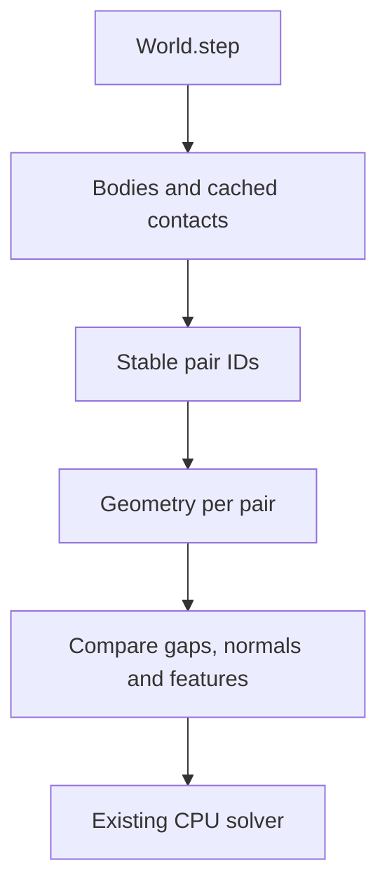

# Динамика твёрдых тел на GPU: от одного захвата до тысячи контактов

**Исследование ветки `dev_cuda`, 24 ноября 2026 года.** Предлагаем начать с OpenCL C 1.2 и первого ядра в двойной точности. Сначала проверяем геометрию на замороженных входах CPU. Затем на той же RTX 3050 сравниваем OpenCL с CUDA. Переход к контактному решателю оправдан, когда известны цена обмена и доля работы, доступная для параллельного выполнения. Для TensorRT рассматриваем отдельную гипотезу об обученной начальной оценке. Состояние движка, на котором основан разбор, закреплено в [ревизии `ae7004e`](https://github.com/Kinetica-Labs/kinetica-physics/tree/ae7004ec8f032ed1f4b4d432568789a68e2aa19e).

Есть два разных заказа на скорость. Контроллер робота ждёт **один следующий шаг одного мира**, поэтому ему важны задержка и её верхний хвост. При обучении политики можно запускать тысячи независимых захватов, поэтому там полезно **число завершённых шагов всех миров в секунду**. Если пакет из $W$ миров завершил шаг за $T$ секунд, его производительность $Q=W/T$. Величина $1/Q$ сама по себе не определяет задержку обратной связи одного робота.

## Кто уже решил какую часть задачи

| Работа | Полученный авторами результат | Как использовать его в Kinetica |
|---|---|---|
| **Takahiro Harada, 2007.** Форму представляют набором частиц, соседей находят по равномерной сетке, силы и моменты суммируют по телу. | GeForce 8800 GTX, 16 384 шахматные фигуры, 65 536 частиц. Автор получил **168 итераций симуляции/с**, при отрисовке каждой итерации — **44 кадра/с**. Это дискретизация формы и контактная модель с отталкиванием. | Заимствовать организацию поиска соседей для однородных тел. У тонкой кромки ведра и у губок необходимо отдельно оценить изменение геометрии и проникновения. [Глава автора, §29.2.9](https://developer.nvidia.com/gpugems/gpugems3/part-v-physics-simulation/chapter-29-real-time-rigid-body-simulation-gpus) |
| **Alessandro Tasora, Dan Negrut, Mihai Anitescu, 2009.** Контакты с трением решают как задачу конусной комплементарности. | В опыте с **128 000 сферами** среднее время шага улучшилось примерно **в 10 раз** относительно одного потока Xeon E5430. Шаг 0,01 с, 150 итераций. Поиск столкновений шёл на GeForce 8800 GT, решение ограничений — на отдельной Tesla C870. Опыт с 1,1 млн тел в этой статье — другая демонстрация. | Профилировать и геометрию, и решатель. В статье по ходу заполнения сосуда растут число контактов и цена шага. Число тел без числа активных контактов плохо описывает нагрузку. [Статья, рис. 7, 9–10](https://web.cels.anl.gov/~anitescu/PUBLICATIONS/2009/tasora%20neg%20anitescu%2009%20ECCOMAS.pdf) |
| **Richard Tonge, Feodor Benevolenski, Anton Voroshilov, 2012.** Метод *mass splitting* меняет локальную оценку эффективной массы при параллельном решении контактов. | В тесте коробок на GTX 580 за бюджет около **4 мс** помещались **5 итераций параллельного PGS** или **30 итераций mass splitting**. Авторы измеряли нарушение ограничений и кинетическую энергию покоящихся объектов. Также показана стопка из 5000 тел с 40 000 контактами при частоте выше 60 кадров/с. Остаточная энергия в тестах дрожания измерима. | Сохранить массу тела в модели. Эксперимент с другим итерационным методом провести отдельно от переноса текущего решателя. Сравнить и при одинаковом числе итераций, и при одной погрешности. [Статья, рис. 6 и табл. 1](https://www.richardtonge.com/papers/Tonge-2012-MassSplittingForJitterFreeParallelRigidBodySimulation-preprint.pdf) · [Математическое приложение](https://www.richardtonge.com/papers/Tonge-2012-MassSplittingForJitterFreeParallelRigidBodySimulation-supplement.pdf) |
| **Erwin Coumans и Bullet, GDC 2013.** Реализован конвейер на OpenCL с отбором пар, SAT для выпуклых форм, обрезкой площадки и группированием ограничений. | На слайдах показаны AMD Tahiti и GeForce GTX 680. В отдельном профиле для **100 000 объектов и 0,5 млн пар** весь `stepSimulation` занял **73,233 мс**, решение контактов — **33,319 мс**, составление групп — **10,099 мс**. Модель GPU для этого отдельного профиля на слайде не указана. | Прямой прецедент для OpenCL на разных производителях. Подготовка групп сама стоит времени. Снять её отдельной строкой в Kinetica. Переносить порядок операций и физические допуски нужно проверяемыми частями. [Доклад, страницы 60–61 PDF](https://media.gdcvault.com/gdc2013/slides/822773Coumans_Erwin_GPU.pdf) · [Открытая реализация Bullet 3.25](https://github.com/bulletphysics/bullet3/blob/2c204c49e56ed15ec5fcfa71d199ab6d6570b3f5/src/Bullet3OpenCL/RigidBody/b3GpuRigidBodyPipeline.cpp) |
| **Viktor Makoviychuk и соавторы, Isaac Gym, 2021.** Физика, наблюдения и политика используют данные на одном GPU. | Для задачи Ant авторы указывают в среднем **540 000 шагов сред/с** во время обучения на A100 при **4096 параллельных агентах**. Это суммарная производительность пакета. В опыте с переориентацией куба в роботизированной кисти измерялось также время обучения задаче. | Собрать пакет независимых миров для перебора захватов. Отдельно измерить один мир с чтением состояния CPU на каждом шаге робота. [Статья, §6.1](https://ar5iv.labs.arxiv.org/html/2108.10470) · [Архив публикации](https://arxiv.org/abs/2108.10470) |

Ближайший современный открытый пример для робототехники — **MuJoCo Warp**. Его авторы документируют применение `float32` и возможное различие порядка операций между запусками GPU. Это важные условия при воспроизведении результатов на Kinetica, где `Real=double`, а совпадение хэшей входит в контракт. Для отдельного опыта с перестроением дерева есть алгоритм Tero Karras, который строит иерархию по отсортированным пространственным ключам. Его публикация измеряет построение дерева. Эффект на полный шаг движка предстоит измерить вместе с обходом и узкой фазой. [Документация MuJoCo Warp](https://mujoco.readthedocs.io/en/stable/mjwarp/index.html) · [MuJoCo Warp на GitHub](https://github.com/google-deepmind/mujoco_warp) · [Karras, HPG 2012](https://research.nvidia.com/publication/2012-06_maximizing-parallelism-construction-bvhs-octrees-and-k-d-trees)

## Что проверено на нашем стенде

На выделенном Windows 10 Pro через SSH драйвер сообщил **GeForce RTX 3050, 6144 MiB, 616.92, compute capability 8.6**. Запросы `clGetPlatformIDs` и `clGetDeviceInfo` вернули одну платформу NVIDIA, `OpenCL 3.0 CUDA`, `OpenCL C 1.2`, 18 вычислительных блоков, `cl_khr_fp64` и `CL_DEVICE_DOUBLE_FP_CONFIG=63`. Значение для языка взято из `CL_DEVICE_OPENCL_C_VERSION`. Максимум 1024 рабочих элемента на группу является пределом устройства. Оптимальный размер группы устанавливается измерением конкретного ядра. В данном сеансе `nvcc` найден в каталоге 11.8, `CUDA_PATH` указывает на 12.6. `trtexec` и `nsys` отсутствовали в `PATH`, `ncu` найден. Проба CUDA использовала API драйвера и PTX. [Запрос возможностей OpenCL](https://registry.khronos.org/OpenCL/specs/unified/html/OpenCL_API.html)

**Минимальный воспроизводимый опыт.** Две осевые коробки имеют полуразмеры по 0,5 м, центр $B$ находится правее центра $A$. Вход — их координаты $a,b$ в метрах. Выход — знаковый зазор $s=(b-a)-1$ м между обращёнными друг к другу гранями. В OpenCL запущены четыре рабочих элемента, по одному на строку. В CUDA запущен один блок из четырёх потоков. Обе реализации выполнили два вычитания в FP64. Выходные буферы считаны в память CPU и побитово сравнены с независимо заданными ответами. Все числа двоично представимы.

| $a$, м | $b$, м | Ожидаемый $s$, м | Почему этот случай важен |
|---:|---:|---:|---|
| 0 | 1,25 | +0,25 | Зазор |
| 10 | 11 | 0 | Точное касание |
| −2 | −1,25 | −0,25 | Перекрытие |
| $2^{30}$ | $2^{30}+1+2^{-10}$ | $2^{-10}$ | Малый зазор далеко от начала координат |

Сырые строки вывода Windows после синхронизации и чтения результата

```text
OpenCL-C1.2-FP64 out_m=0.25,0,-0.25,0.0009765625 bit_matches=4/4
CUDA-Driver-PTX-FP64 out_m=0.25,0,-0.25,0.0009765625 bit_matches=4/4
```

**Да** — обе среды исполняют этот контракт на RTX 3050. **Не проверено** — быстродействие полного `World::step`, паритет траектории и запуск на AMD или Intel. Четыре операции сравнения ответов одинаковой точности ещё не дают данных для оценки скорости или вероятности отказа.

## Где в Kinetica есть параллельная работа

В существующем CPU-пути одна реальная оптимизация уже показала разный эффект на разных сценах. При падении переносилось 99,71 % многоточечных площадок, при распаде пирамиды — 37,06 %. Хороший GPU-код должен уметь пропустить уже решённую работу. Для пирамиды из 1000 кубов сохранено 109,69 **мс** по медиане шести средних времён кадра. Для малого захвата с совместным трением при 60 Гц, восьми обновлениях и нагрузке 10 Н сохранено 129,95 **мкс** при ошибке 0,0434 мм. Это разные сцены, разные масштабы и сохранённые замеры CPU. [Парные времена пирамиды](data/stress-1000-2026-11-24/tree-time-pairs.csv) · [Опыт с площадками](stress-1000-2026-11-24.md) · [Условия и сырые данные захвата](dev-ablation-2026-11-24.md)

| Стадия | Единица независимой работы | Зависимость, которую нужно сохранить |
|---|---|---|
| Границы движения и отбор пар | Тело или запрос к дереву. Вычислить AABB, затем подсчитать и разместить кандидаты. | Ключ пары канонический, включает тела и части. При равенстве пространственных ключей нужен второй ключ — ID. Вывод переменной длины через счёт, префиксную сумму и запись в свой диапазон. Сохранить фильтрацию сочленённых тел. [PairFinder::collect](https://github.com/Kinetica-Labs/kinetica-physics/blob/ae7004ec8f032ed1f4b4d432568789a68e2aa19e/src/collision/PairFinder.cpp#L156-L198) |
| Перенос площадок и свежая геометрия | Пара частей. Сначала проверить прошлую площадку. Остальные пары можно собирать в группы по типам форм для GJK, SAT и обрезки. | Возвращать исходные нормаль, зазор, точки с признаками и порядок. Перенос зависит от относительного поворота и дальности запроса. Одинаковый общий сдвиг мира не должен изменить зазор. [ManifoldMemory::valid](https://github.com/Kinetica-Labs/kinetica-physics/blob/ae7004ec8f032ed1f4b4d432568789a68e2aa19e/src/collision/ManifoldMemory.cpp#L30-L46) · [GJK](https://github.com/Kinetica-Labs/kinetica-physics/blob/ae7004ec8f032ed1f4b4d432568789a68e2aa19e/src/collision/narrowphase/Gjk.cpp#L248) |
| Контактные импульсы и шарниры | Независимый остров либо группа ограничений, у которых нет общего изменяемого тела. Много статических опор могут быть только для чтения. | Два контакта, пишущие скорость одного куба, зависят от порядка. `ContactLevels` уже строит уровни с сохранением этого порядка. Между уровнями нужен барьер всей очереди. Совместное трение пары губок учитывает обе опоры. [Построение уровней](https://github.com/Kinetica-Labs/kinetica-physics/blob/ae7004ec8f032ed1f4b4d432568789a68e2aa19e/src/dynamics/time_stepping/ContactLevels.cpp#L41-L59) · [Острова трения](https://github.com/Kinetica-Labs/kinetica-physics/blob/ae7004ec8f032ed1f4b4d432568789a68e2aa19e/src/dynamics/time_stepping/FrictionIslands.cpp#L116) |
| Опора, сон, событийный шаг | Независимые компоненты и независимые миры. Начать с быстрого пути `SoftStep`. | У прохода по опорам есть прямой и обратный порядок. `ExactStep` работает с ближайшим событием в общем интервале. Параллельный поиск может выдать кандидатов, но выбор времени и порядок равных событий должны быть определены. [Граф опор](https://github.com/Kinetica-Labs/kinetica-physics/blob/ae7004ec8f032ed1f4b4d432568789a68e2aa19e/src/dynamics/SupportGraph.h#L59) · [ExactStep::run](https://github.com/Kinetica-Labs/kinetica-physics/blob/ae7004ec8f032ed1f4b4d432568789a68e2aa19e/src/dynamics/event_driven/ExactStep.cpp#L41) · [World::step](https://github.com/Kinetica-Labs/kinetica-physics/blob/ae7004ec8f032ed1f4b4d432568789a68e2aa19e/src/world/World.cpp#L18) |

Упрощённая схема первого переноса. Сплошной цикл с подшагами станет отдельным опытом после проверки геометрии.



## Как сделать код проще

Студент должен уметь пройти от `World::step` до величины $s$ и объяснить её знак. Первое изменение предлагаем ограничить **одной пакетной операцией**. Её вход — неизменяемые позы, полуразмеры и список ID пар. Выход на месте $i$ принадлежит входной паре $i$. Код физики задаёт направление нормали, единицы, допуски и правило равенства. Код исполнения выбирает буфер, ставит работу в очередь и возвращает завершённый результат.

| Ответственность | Что увидит читатель | Как проверим простоту |
|---|---|---|
| Физика | Одна спецификация в метрах и эталонная функция C++ на CPU. Для более сложной площадки добавляются признаки формы и нормаль. | Студент подставляет четыре строки опыта выше и получает те же знаки. Смена устройства не меняет значения допусков. |
| Представление данных | Один внутренний формат пакета с массивами координат и ID, явно заданными смещениями и шириной. Владельцем памяти остаётся мир или исполнитель шага. | Две сцены подряд используют буферы повторно. Для пустого пакета результат пуст. Размеры и смещения полей устройства проверяются при сборке или чтении контрольной записи. |
| Исполнение | Сначала CPU и один адаптер OpenCL. CUDA добавляется после парного опыта. Общий план стадий и критерии принятия результата определены в одном месте. | Число включений CUDA/OpenCL/TensorRT в публичных заголовках физики равно **нулю**. CPU-пример собирается без GPU SDK. Измеряем число копий формулы и мест, где задан физический допуск. |
| Обслуживание | Имена `pair`, `gap`, `normal` сохраняют смысл от примера до ядра. Если нужны две версии короткой формулы на разных языках, они проходят один набор независимых оракулов. | Пределы проекта — до 40 строк на функцию, 300 на класс, 12 публичных методов. Для C++ запускается существующий `validation/code_metrics.py --check`. Объём и сложность ядер OpenCL/CUDA проверяют отдельно. [Правила кода](../../CLAUDE.md) · [Проверка метрик](../../validation/code_metrics.py) |

Извлечение зависимости должно упрощать и CPU-путь. Первая проверка архитектуры — существующий студентский пример с прежним `World::step`, собранный только с C++17. Создавать иерархию «GPU-тело», «GPU-мир», «GPU-шарнир» для одной пакетной операции было бы преждевременно. На устройстве хранится компактное представление чисел и индексов. Объекты `Body` с указателями и владением памятью остаются частью интерфейса CPU. Объединять формулы с предписаниями драйверу в одну систему макросов дороже для чтения и проверки.

## Почему сначала OpenCL, затем CUDA

1. **OpenCL.** Начальная цель — устройства NVIDIA, AMD и Intel с рабочим OpenCL и необходимой FP64. На старте запросить `CL_DEVICE_DOUBLE_FP_CONFIG`, поддержку языка и возможность компиляции. При отсутствии подходящей точности маршрут остаётся на CPU. На OpenCL 3.x наличие одной версии API не гарантирует все необязательные функции. Для первой версии достаточно OpenCL C 1.2 с `cl_khr_fp64`. Проверять порядок вычислений, запрет слияния умножения со сложением и граничные значения отдельно на каждом драйвере. [Спецификация OpenCL C](https://registry.khronos.org/OpenCL/specs/unified/html/OpenCL_C.html) · [Руководство Khronos на GitHub](https://github.com/KhronosGroup/OpenCL-Guide)
2. **CUDA.** На той же NVIDIA повторить вычисления с теми же данными, порядком проходов, FP64 и трафиком. Сначала измерить простую версию. Затем отдельно попробовать граф повторяющихся запусков или изменить размещение полей. Инварианты детерминизма требуют явного режима округления, запрета нежелательного FMA и одинаковых правил редукции. Для `double3` в OpenCL нельзя предполагать размер ровно трёх `double`. Используем скалярные массивы либо явно дополненный формат с проверяемым шагом элементов. [CUDA Best Practices](https://docs.nvidia.com/cuda/cuda-c-best-practices-guide/index.html) · [Размещение векторных типов OpenCL](https://registry.khronos.org/OpenCL/specs/unified/html/OpenCL_C.html)
3. **TensorRT.** Это среда вывода обученной модели на поддерживаемом оборудовании NVIDIA. Сначала нужна гипотеза с обучающими данными. Пример — предложить начальные импульсы для многоконтактного острова. Сравнить с уже работающим тёплым стартом. Решатель проецирует импульсы на допустимые множества и проверяет невязки, насыщение и завершение. При отказе численного контроля используется штатная оценка с повторным решением от исходного состояния подшага. Тестовые формы, массы и траектории отделяются от обучающих. Измерять также время инференса и долю таких повторов. [TensorRT на GitHub](https://github.com/NVIDIA/TensorRT) · [Матрица поддержки NVIDIA](https://docs.nvidia.com/deeplearning/tensorrt/latest/getting-started/support-matrix.html)

На дискретной карте повторные передачи через PCIe могут стоить дороже самого ядра. В первом опыте перенос данных намеренно виден в результатах. В следующем держим на устройстве геометрию, площадки и импульсы между подшагами. Копируем только изменённые входы и результат, который запросил вызывающий код. Переполнение буфера пар или ошибка драйвера должны привести к явному отказу или повтору из сохранённого состояния. Частично записанный кадр нельзя считать завершённым. [Передача данных и организация памяти CUDA](https://docs.nvidia.com/cuda/cuda-c-best-practices-guide/index.html#data-transfer-between-host-and-device)

## Опыт, который решит вопрос о скорости

Пусть $f$ — измеренная доля исходного времени CPU в переносимой части, $s$ — её ускорение на устройстве, а $o$ — дополнительное неперекрытое время обмена, очередей и синхронизации. Для последовательного критического пути оценка

$$
T_\mathrm{new}=T_\mathrm{CPU}(1-f+f/s)+o,\qquad
S=\frac{T_\mathrm{CPU}}{T_\mathrm{new}}.
$$

При исторических 129,95 мкс достижение 50 мкс требует устранить **как минимум 61,5 %** времени даже при бесконечном ускорении этой части и нулевых накладных расходах. Для десятикратного ускорения предел при тех же идеальных предпосылках — 90 %. Эти числа — необходимые условия модели. Долю времени нельзя переносить из профиля пирамиды в профиль захвата. В сохранённом профиле пирамиды даже при полном исключении двух стадий поиска оставалось 30,74 мс, что выше целевых 10,76 мс той серии. [Профиль стадий и условия пирамиды](stress-1000-2026-11-24.md) · [Сырые времена стадий](data/stress-1000-2026-11-24/stage-cost.csv)

**Сцены и входы.** Один захват, один мир `pyramid1000`, один мир `rain1000`, затем пакеты по 1, 16, 256 и 4096 независимых захватов до измеренного предела памяти. Прогон с одним миром всегда публикуется отдельно. Фиксируем снимок, компилятор и драйвер, физическое время, шаг, подшаги, итерации, начальное состояние, seed, тёплый старт, сон, проход опор и число потоков CPU. Полезные отдельные счётчики — тела, кандидаты, реальные контакты, строки связей, число последовательных уровней, самый широкий уровень, объём передач в байтах и пиковая память устройства.

**Часы и статистика.** Задержка — время от входа в `World::step` до готового результата для прежнего вызывающего кода. Отдельно записываем время ядра по событиям OpenCL/CUDA, H2D, D2H и ожидание. При перекрытии операций полное время берём по настенным часам. Первый запуск с компиляцией, прогрев и устоявшийся режим записываем отдельно. Для CPU — Intel VTune, для устройства — очередь с `CL_QUEUE_PROFILING_ENABLE` или события CUDA, затем профиль интересного ядра. Предлагаемый минимум — 12 парных блоков с чередованием порядка, одинаковые массивы на входе и достаточно кадров для p99. Публикуем сырые пары, медиану по блокам и доверительный интервал парного ускорения с повторной выборкой **блоков**, отдельно p95/p99 и число кадров. Интервал Уилсона относится к доле успехов на независимых испытаниях. Последовательные кадры одной пирамиды коррелированы. [Профилирование команд OpenCL](https://registry.khronos.org/OpenCL/specs/unified/html/OpenCL_API.html) · [Измерители проекта](../../validation/CLAUDE.md)

**Когда переключать исполнителя?** Для каждого размера сцены и пакета сначала применить физические допуски. Затем построить интервал для парного отношения времени полного шага GPU к CPU. Если верхняя 95-процентная граница ниже 1 и p99 укладывается в бюджет контроллера, выигрыш подтверждён для этой конфигурации. Если интервал пересекает 1, результат по скорости остаётся неопределённым. CUDA сравнивается с OpenCL тем же способом на одной карте. Универсального порога числа тел до опыта у нас нет.

| Инвариант и область | Величина, допуск, ответ «да» | Нынешнее состояние |
|---|---|---|
| Полнота отбора на аналитических траекториях и фиксированных позах выпуклых пар | Число пропущенных подтверждённых пар **0**. Для режима точного воспроизведения фиксируем и сравниваем упорядоченные ключи и признаки. Лишние кандидаты широкой фазы считаем отдельно. | Проверены четыре знаковых зазора. Полный набор контактов GPU ещё предстоит проверить. |
| Физический результат при одинаковом бюджете | Для порогового захвата максимум ошибки траектории ≤0,5 мм при удержании и ≤2 мм при скольжении, силы губок в пределах 0,2 Н по условиям прибора. Для каждой сцены сохраняется её оракул. У уже проваливавшихся клеток фиксируем исходную ошибку и отдельно проверяем исходный контрпример. | У исторического CPU 33/36 на сетке захвата. Статус всего GPU-решателя открыт. [Протокол и данные](data/dev-ablation-2026-11-24/grip.tar.gz) |
| Повторяемость при фиксированном устройстве, сборке и входе | Предложенная серия из 20 повторов — **0** различных битовых хэшей относительно первого. Для заявления о штатной замене CPU дополнительно проверяем существующие эталонные снимки, второй компилятор и порядок при изменении ширины групп. | Побитовое сравнение четырёх скаляров прошло на двух API. Длинная траектория и другие драйверы открыты. |

**⚠️ Стресс-тест.** Нулевая нагрузка и открытые губки, лёгкое тело при отношении масс $10^6$, почти параллельные рёбра, общий сдвиг на $2^{30}$ м, переполнение пространства пар, узкий последовательный остров и многие независимые миры дают разные контрпримеры. При $N$ телах и $P$ кандидатах массивы пар требуют $O(P)$ памяти. Для разреженных сцен полезно измерять рост $P/N$, в плотном худшем случае $P=N(N-1)/2$. Переход от $10^4$ к $10^6$ тел не обещает линейности или размещения в 6 ГиБ. Число 50 мкс, ускорение в десять раз, одинаковая точность разных производителей и польза TensorRT для Kinetica остаются **не проверены**.
