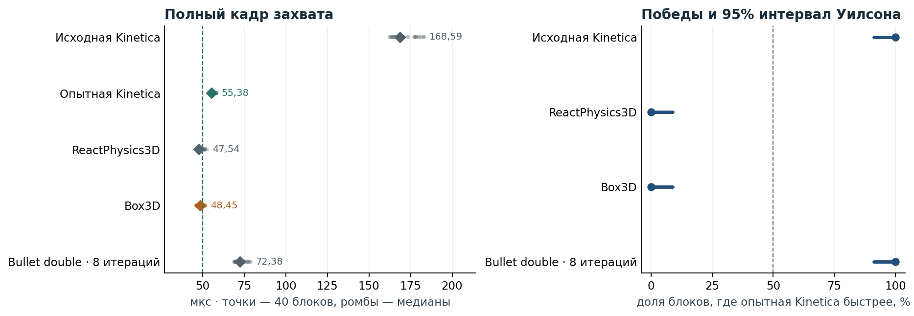

# Захват куба — исходная и опытная Kinetica

**168,59 мкс у исходной Kinetica и 55,38 мкс у опытной.** Обе программы рассчитали один и тот же полный кадр на одном Windows-ПК. В этом опыте Kinetica стала быстрее Bullet, а RP3D сохранил преимущество. Средняя скорость по другим сценам пока не установлена. [Все 200 показаний таймера](data/engine-anatomy-2026-11-22/raw-collision/residual-budget/wilson/timing.csv)

| Программа в одном опыте | Медиана, мкс | Среднее, мкс | Сдвиг при 10 Н, мм | Допуск на захват | Случаи в допуске |
|---|---:|---:|---:|:---:|---:|
| Исходная Kinetica | 168,59 | 170,85 | 0,0434 | Да | 33/36 |
| **Опытная Kinetica** | **55,38** | **55,85** | **0,0434** | **Да** | **33/36** |
| ReactPhysics3D, double | 47,54 | 48,46 | 0,2792 | Да | 27/36 |
| Bullet, double, 8 итераций | 72,38 | 72,83 | 0,4786 | Да | 30/36 |
| Box3D, float | 48,45 | 48,41 | 2,9092 | Нет | 23/36 |

**Что значит «опытная».** В сравнении 40 блоков это отдельная программа с новым решателем. Она переносит прежние контактные силы в текущую плоскость и проверяет равновесие до повторной сборки системы ограничений. При нарушении условий работает полный решатель. Обе версии собраны в двойной точности. Опытная собрана с оптимизацией при компоновке под Haswell. Отношение медиан включает все эти отличия. [Хэши и аргументы программ](data/engine-anatomy-2026-11-22/raw-collision/residual-budget/wilson/inputs.json)

В исходниках проекта быстрый путь теперь доступен через `World::step` при включённых `soft.coupledFriction` и `soft.reuseEquilibrium`. Сцена № 41 «Пороговый захват куба, 10 Н» выбирает оба параметра. В отдельной парной сверке на Windows медиана собранного из рабочего дерева решателя составила **57,63 мкс**, прототипа — **57,67 мкс** за 12 блоков. Все 36 решений о допуске совпали, 33 прошли. При разжатии губок, смене направления нагрузки и обнулении трения позы, импульсы и память контактных сил после первого изменённого подшага совпали с полным решателем. [Парная сверка](data/verification-2026-11-23/bucket-energy/timing.csv) · [Физические измерения](data/verification-2026-11-23/bucket-energy/balanced-grip.csv) · [Семь выбранных проверок Windows](data/verification-2026-11-23/bucket-energy/core-ctest.txt)

## Что показали 40 парных блоков

Победа означает, что полный кадр опытной Kinetica занял строго меньше времени. Каждый блок содержит отдельный запуск каждой из пяти программ. Порядок заново случайно перемешивался в каждом блоке. Семя 2026112307. В одном показании усреднены 360 кадров. Интервал Уилсона описывает долю побед при повторе сопоставимых блоков. Разницу во времени оцениваем отдельно. [Заранее заданный протокол](data/engine-anatomy-2026-11-22/raw-collision/residual-budget/wilson-protocol.md) · [Расчёт по блокам](data/engine-anatomy-2026-11-22/raw-collision/residual-budget/wilson/paired-statistics.csv)

| С чем сравниваем опытную Kinetica | Победы | Доля побед, 95% Уилсон | Медиана парной разницы, мкс | Интервал медианы, мкс |
|---|---:|---:|---:|---:|
| Исходная Kinetica | 40/40 | 91,2–100% | −113,26 | −115,01…−111,45 |
| ReactPhysics3D | 0/40 | 0–8,8% | +7,52 | +7,09…+8,02 |
| Bullet double, 8 итераций | 40/40 | 91,2–100% | −16,61 | −17,46…−16,06 |
| Box3D, сырое время | 0/40 | 0–8,8% | +7,62 | +6,60…+8,45 |

У RP3D обе программы прошли физический допуск. Опытная Kinetica занимала **на 15,5% больше времени**, интервал для медианного парного отношения — от 14,5 до 16,8% больше. Относительно Bullet — **на 23,1% меньше**, интервал от 22,3 до 23,8% меньше. Для Box3D сравнение при той же точности остаётся открытым. Медианные интервалы основаны на порядковых статистиках и имеют покрытие 96,15% при независимых блоках. [Медианы, отношения и границы](data/engine-anatomy-2026-11-22/raw-collision/residual-budget/wilson/paired-statistics.csv)

Для $k$ побед в $n$ блоках, $\hat p=k/n$ и $z=1{,}96$ границы Уилсона равны

$$
\frac{\hat p+z^2/(2n)\ \pm\ z\sqrt{\hat p(1-\hat p)/n+z^2/(4n^2)}}{1+z^2/n}.
$$

Двусторонний тест знаков дал для каждого из четырёх сравнений $p=1{,}82\cdot10^{-12}$, после поправки Холма $p=7{,}28\cdot10^{-12}$. Повторы сделаны на одном ПК. Чтобы оценить влияние соседних запусков, объединили по пять блоков подряд. Направление каждого из четырёх результатов сохранилось во всех восьми группах. Для 8/8 интервал Уилсона шире — 67,6–100%, для 0/8 — 0–32,4%. [Метод Уилсона, NIST](https://www.itl.nist.gov/div898/handbook/prc/section2/prc241.htm) · [Тест знаков, NIST](https://www.itl.nist.gov/div898/software/dataplot/refman1/auxillar/signtest.htm)

## Что было проверено физически

Куб массой 1 кг, прижим по 10 Н на губку, нагрузка вниз 10 Н, трение 0,5. Один кадр при 60 Гц включает восемь активных шагов по 1/480 с, один поток и выключенный сон. Допуски — 0,5 мм для удержания, 2 мм ошибки пути при скольжении, 0,2 Н ошибки реакции каждой губки. На фиксированной сетке Kinetica прошла все 27 входов, пройденных RP3D, и ещё шесть. На трёх входах отказали обе. Частоты 60, 120 и 240 Гц входят в проверку точности. Время измерялось только для порогового захвата при 60 Гц. [Сырые физические измерения](data/engine-anatomy-2026-11-22/raw-collision/residual-budget/wilson/accuracy.csv) · [Совпадения и расхождения по входам](data/engine-anatomy-2026-11-22/raw-collision/residual-budget/wilson/grid-pairs.csv)

## Сколько машинных инструкций приходится на кадр

В двух повторах на том же Windows-ПК Callgrind под WSL насчитал по 69 461 016 исполненных инструкций на 360 нагруженных кадров опытной Kinetica. Получается **192 947 инструкций на кадр** при восьми шагах. Это результат отдельной сборки GCC для Linux. Счётчик аппаратных инструкций исполняемого файла Windows под VTune на этом стенде с Hyper-V получить не удалось. Нативная сборка прошла шесть выбранных проверок CTest, включая наклонный захват и независимость островов. [Исходные показания](data/engine-anatomy-2026-11-22/raw-collision/residual-budget/wilson-instructions/events.csv) · [Хэши исходников и границы счёта](data/engine-anatomy-2026-11-22/raw-collision/residual-budget/wilson-instructions/scope.json) · [Журнал CTest](data/engine-anatomy-2026-11-22/raw-collision/residual-budget/wilson/ctest.log)

## Почему в архиве есть 189,80 мкс

Это исходная сборка отдельного опыта с направляющими. Тогда она дала 189,80 мкс, после той правки — 178,75 мкс. Все цифры в первой таблице этой страницы относятся к единому более позднему прогону. [Архивный замер](data/engine-anatomy-2026-11-22/raw-collision/sparse-guides/timings.csv) · [Таблица текущего прогона](data/engine-anatomy-2026-11-22/raw-collision/residual-budget/wilson/timing-summary.csv)

В открытом на рабочем Linux-ПК просмотрщике на 55-м кадре панель показала **0,18 мс** за восемь вызовов шага и **0,04340 мм** смещения куба. Это единичное экранное показание другой программы. Число 55,38 мкс в таблице получено на Windows как медиана 40 блоков по 360 нагруженных кадров. [Снимок отображённого кадра](figures/threshold-grip-play-2026-11-23.png)

**⚠️ Стресс-тест.** Опытная Kinetica выдержала сдвиг 0,043403 мм. В 40 блоках лучшее время составило 54,23 мкс, худшее — 58,43 мкс. В бюджет 50 мкс попало 0/40 блоков. До цели по медиане остаётся 5,38 мкс. Эти данные характеризуют среднее по 360 нагруженным кадрам, отдельные кадры для p99 не записывались. Сетка из 36 заданных условий и этот стенд ограничивают область вывода. [Исходные данные и бюджет](data/engine-anatomy-2026-11-22/raw-collision/residual-budget/wilson/timing-summary.csv)
