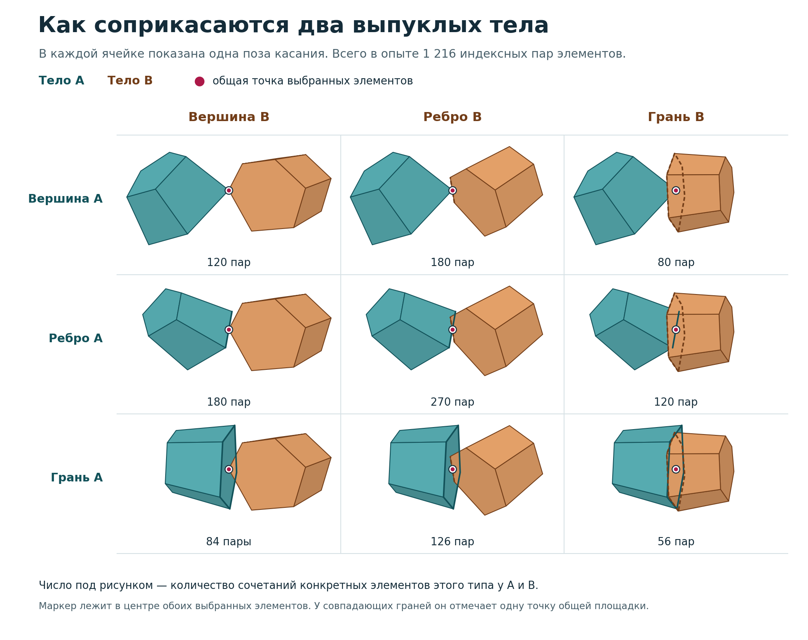
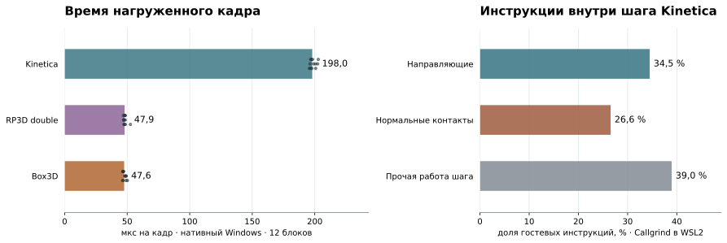
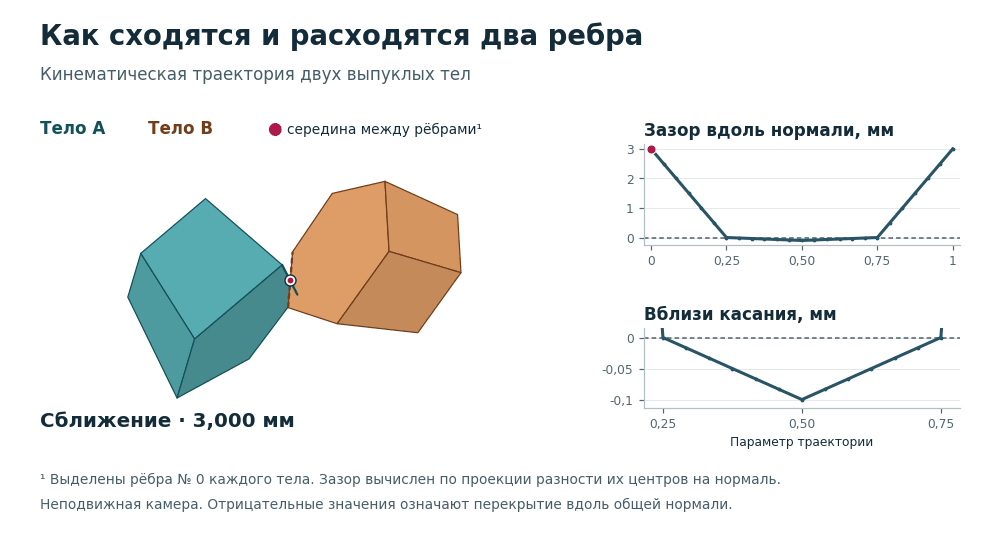

# Что обнаружили две вращающиеся выпуклые детали

**22 ноября 2026 года · нативный Windows x64 · Kinetica Physics**

Две разные асимметричные детали прошли через все **1 216 пар их вершин, рёбер и граней**. При первом прогоне одна поза выявила ошибку направления контактной реакции. Исправленный детектор прошёл **17 024 позы в обоих порядках аргументов, всего 34 048 запросов**. Для этих двух деталей покрытие по номерам элементов составило 100%. Ориентации и траектории образуют непрерывное множество, для которого здесь взята конечная выборка. [Все позы A–B](data/engine-anatomy-2026-11-22/raw-collision/sweep-final.csv) · [Те же позы B–A](data/engine-anatomy-2026-11-22/raw-collision/sweep-swapped.csv)

Новый опыт связал ошибку одной точки контакта цилиндров с измеренным самопроизвольным движением. [Отчёт с геометрией, движением двух тел и сравнением процессорных движков](cylinder-contact-2026-11-22.md)

## Сравнение захвата на одном логическом процессоре

Свежая серия на Windows и Xeon E5-2690 v3 включала 12 блоков. Все шесть порядков запуска повторили дважды. Измерялся нагруженный шаг после обжатия, по 360 кадров на измерение. На кадр приходилось восемь публичных шагов, внутренние алгоритмы и их число операций различаются. У Kinetica включено совместное решение трения. При 60 Гц, коэффициенте трения 0,5 и сжатии по 10 Н на губку нагрузка 10 Н лежит ровно на теоретическом пределе удержания. Ожидаемый ход груза равен нулю.

| Движок | Дрейф за 0,25 с, мм | Медиана, мкс/кадр | Пройдено проверок захвата |
|---|---:|---:|---:|
| Kinetica, совместное трение | 0,0434 | 203,48 | 33/36 |
| ReactPhysics3D, double | 0,2792 | 48,84 | 27/36 |
| Box3D | 2,9092 | 49,67 | 23/36 |

Kinetica и RP3D выдержали допуск удержания 0,5 мм. В этой сцене наибольшую точность показала Kinetica. Во всех 12 блоках оба соперника быстрее. Медиана парного отношения времени Kinetica к RP3D равна 4,18, к Box3D — 4,15. На других нагрузках порядок по ошибке меняется. [Методика и настройки](data/engine-anatomy-2026-11-22/raw-collision/bench/method.json) · [Сырые времена](data/engine-anatomy-2026-11-22/raw-collision/bench/timing.csv) · [Попарная точность](data/engine-anatomy-2026-11-22/raw-collision/bench/paired-accuracy.csv)

**Откуда берётся разрыв во времени.** В отдельной серии из 14 блоков RP3D double тратил 49,6 мкс на кадр, Kinetica со штатным трением — 166,8 мкс, с совместным — 209,4 мкс. Из разницы медиан 159,8 мкс около 117,2 мкс уже присутствуют в штатном режиме. Дополнительные 42,6 мкс сопровождаются уменьшением дрейфа с 1,443 до 0,043 мм. Это разности медиан всей сцены. Чтобы приписать конкретной функции часть этих микросекунд, требуется парный эксперимент с одним изменением. [Все 14 блоков](data/engine-anatomy-2026-11-22/native-timing.csv) · [VTune, Callgrind, память и ширина SIMD](engine-anatomy-2026-11-22.md#на-что-уходит-время-и-память)

Один такой эксперимент уже проведён. В неподвижной позе направляющие губок используют одну и ту же матрицу отклика для нескольких нагрузок. Повторное использование матрицы при совпадении всех строк ускорило захват на **3,65%** по медиане 20 пар. Время снизилось в 17 парах. На пирамиде из 140 кубов изменение составило 0,48%, выигрыш обнаружен в 12 из 20 пар. Правка вошла в рабочее ядро. [Сырые парные времена](data/engine-anatomy-2026-11-22/raw-collision/guide-promotion/paired-timing/paired.csv) · [Код острова](../../src/dynamics/time_stepping/FrictionIslands.cpp)

В той же рабочей сборке исправили обработку пустой строки контактной матрицы для двух неподвижных тел. Регрессия проверяет пустую строку и все девять коэффициентов соседнего блока. На Windows прошли **20/20** тестов и проверка символов двух библиотек. В 17 сравнениях с исходной сборкой байты полного вывода совпали для 3 539 строк данных, включая конечные хэши 27 сцен после 60 кадров. SHA-256 всех 216 файлов из манифеста Windows совпали с рабочей копией. [CTest](data/engine-anatomy-2026-11-22/raw-collision/accepted-core/ctest.txt) · [Сверка физики](data/engine-anatomy-2026-11-22/raw-collision/accepted-core/parity/parity.csv) · [Символы](data/engine-anatomy-2026-11-22/raw-collision/accepted-core/libm.txt) · [Исходные файлы](data/engine-anatomy-2026-11-22/raw-collision/accepted-core/source-hashes.csv)

После 600 кадров по 1/60 с конечные хэши совпали во всех **54/54** сравнениях двух сборок. Использовался один поток, 27 сцен и два режима трения. В исходном драйвере переключатель окружения игнорировался. Исправленный измерительный драйвер задаёт режим явно. Семь сцен действительно изменили хэш при его переключении. [Хэши по сценам](data/engine-anatomy-2026-11-22/raw-collision/accepted-core/long-hashes/comparison.csv) · [Одинаковый драйвер и параметры обеих сборок](data/engine-anatomy-2026-11-22/raw-collision/accepted-core/long-hashes/manifest.json)

### Сколько работы остаётся внутри шага

С рабочей сборкой провели новую серию из 12 блоков. Медианы составили **197,96 мкс** у Kinetica, **47,90 мкс** у RP3D double и **47,59 мкс** у Box3D. Медианы парных отношений — 4,15 и 4,14 соответственно. Дрейф и все 36 физических исходов каждого движка воспроизвелись. На рис. слева показаны эти нативные времена. Справа приведён независимый разбор более ранней сборки Kinetica под Callgrind в WSL2 на том же компьютере. В 6 480 вызовах шага из 850,23 млн гостевых инструкций 293,23 млн ушли на направляющие, 225,77 млн — на решение нормальных контактов. Эти две группы вызовов не пересекаются. При отключении совместного трения нормальные контакты по-прежнему потребовали 225,77 млн инструкций. [Нативные измерения](data/engine-anatomy-2026-11-22/raw-collision/accepted-core/competitors/timing.csv) · [Сравнение с оракулом](data/engine-anatomy-2026-11-22/raw-collision/accepted-core/competitors/paired-accuracy.csv) · [Дуги графа вызовов и знаменатели](data/engine-anatomy-2026-11-22/callgrind/grip-costs.csv)

В отдельном эксперименте изменили обработку нескольких нагрузок при неизменном положении губок. Разложение одной матрицы направляющих теперь используется для всех этих нагрузок. Время кадра захвата снизилось **с 198,80 до 192,88 мкс**, медианное парное снижение **3,25%**, быстрее 18 из 20 пар. Для пирамиды из 140 кубов отношение времён увеличилось на 0,65%, быстрее 8 из 20 пар. Во всех 17 наборах, включая силы и отпечатки сцен, выход совпал побайтно. [Пары и порядок запуска](data/engine-anatomy-2026-11-22/raw-collision/factor-once/paired-timing/paired.csv) · [Численная сверка](data/engine-anatomy-2026-11-22/raw-collision/factor-once/verification/parity.csv)

## Гарантия на интервале движения

Для твёрдых тел цель формулируется на каждом мгновении шага. При допустимой начальной позе внутренности каждой пары тел должны быть непересекающимися для всех $t$ на принятой траектории. Пространство относительных поз двух тел — $SE(3)$. Среднеквадратичная ошибка по объёму поз может равняться нулю даже при пропуске каждого одиночного касания. Для сравнения с этим требованием авторы **Rigid IPC** используют барьер и непрерывную проверку криволинейной траектории во время поиска шага. [Статья Intersection-free Rigid Body Dynamics](https://ipc-sim.github.io/rigid-ipc/assets/rigid_ipc_paper.pdf)

| Где получена гарантия | Что проверено на Windows |
|---|---|
| Любые два заданных полноразмерных выпуклых многогранника при постоянных ориентациях и равномерном переносе | Рациональный оракул пересекает допустимые интервалы всех осей и вычисляет все моменты касания и проникновения. Прошла 21 проверка, включая столкновение целиком между двумя отсчётами 60 Гц. Для двух экспериментальных деталей пересечение длится от 1,146534 до 2,822385 с из 4 с. Точные концы сохранены дробями. |
| Две выпуклые оболочки, заданный линейный перенос и заданная кривая вращения | Рациональный сертификат разрешает путь при строгом разделении на каждом подынтервале. Для испытанной пары на всём шаге зазор по мировой оси Z не меньше 0,7726 м с округлением. Между двумя свободными концами другой траектории скрыто столкновение. Программа вернула UNKNOWN и не разрешила шаг. Этот ответ возможен и для безопасной траектории при недостаточном бюджете. |
| Общий динамический шаг Kinetica | Оба прибора работают отдельно от интегратора SDK. Гарантия для произвольного вращения, контакта с трением и цепочки нескольких ударов остаётся открытой. |

Z3 дал восемь ответов UNSAT для поиска контрпримеров к формулировкам точной интервальной модели и SAT для явного касания в $t=3/8$, пропущенного пятью снимками. Регрессионный набор с новыми двумя приборами дал 20/20 в нативном Windows CTest. [Интервалы переноса](data/engine-anatomy-2026-11-22/continuous-coverage/translation-tests.json) · [Сертификат переноса](data/engine-anatomy-2026-11-22/continuous-coverage/translation-certificate.json) · [Сертификат вращения](data/engine-anatomy-2026-11-22/continuous-coverage/rotation-certificate.json) · [Стресс-тест вращения](data/engine-anatomy-2026-11-22/continuous-coverage/rotation-tests.csv) · [Ответы Z3](data/engine-anatomy-2026-11-22/continuous-coverage/z3.txt) · [CTest](data/engine-anatomy-2026-11-22/continuous-coverage/ctest.txt)

## Как двигались детали

У первой детали 10 вершин, 15 рёбер и 7 граней, у второй — 12 вершин, 18 рёбер и 8 граней. Программа направляет выбранные элементы друг к другу, совмещает их опорные точки и вращает **обе** детали. Для каждой пары использованы два взаимных угла закрутки. Номинальная последовательность начинается с зазора 3 мм, проходит через касание, сближение на 0,1 мм, повторное касание и заканчивается зазором 3 мм. Ещё в двух позах добавлены относительный боковой сдвиг и наклоны. В 4 384 таких позах сменился набор опорных вершин вдоль контрольного направления. [Вершины и грани](data/engine-anatomy-2026-11-22/raw-collision/geometry.csv) · [Параметры траекторий](../../validation/studies/anatomy/hull_event_sweep.cpp)

Анимация показывает 25 экспортированных кинематических поз одной пары рёбер. Красная отметка задаёт место встречи, график показывает знаковый зазор по контрольному направлению. [Данные анимации](data/engine-anatomy-2026-11-22/raw-collision/animation.csv)

## Какие утверждения проверялись

1. В назначенной позе перечисленные вершины действительно лежат на общей опорной плоскости. Тест сверяет их индексы с требуемой вершиной, ребром или гранью.
2. У разделённых многогранников существует разделяющая ось. Независимая программа проецирует все вершины на нормали всех граней и ненулевые векторные произведения всех пар рёбер. Использована арифметика с 64 значащими двоичными разрядами, у движка — 53. Для оси единичной длины максимальный зазор проекций по всем осям даёт знак состояния. Полоса числового касания в опыте ±1 нм. На каждую перестановку получены 7 870 раздельных поз, 5 240 касаний и 3 914 перекрытий.
3. Обе точки контакта должны лежать на своих поверхностях. Для единичной нормали от A к B разность точек должна давать записанный знаковый зазор. При точном касании допускаются разные нормали, каждая должна задавать опорную плоскость. Геометрический допуск этих проверок — 0,1 мкм.

$$
s = \mathbf n\cdot(\mathbf p_B-\mathbf p_A),\qquad
g(\mathbf n)=\min_{b\in B}\mathbf n\cdot b-\max_{a\in A}\mathbf n\cdot a .
$$

Первая формула проверяет внутреннюю согласованность ответа. Вторая использует целые тела. Именно эта независимая проверка обнаружила ошибку, которую пропустила бы проверка расстояния между двумя выданными точками. [Независимый оракул и критерии](../../validation/studies/anatomy/hull_event_sweep.cpp)

## Почему ядро ошибалось

**Ребро A № 13 и вершина B № 1.** При выходе из контакта независимый зазор составил $2{,}39\cdot10^{-17}$ м. SAT первоначально нашёл допустимую ось. Затем построитель площадки заменил её нормалью соседней грани, потому что та укладывалась в контактную полосу 0,1 мм. После отсечения осталась одна точка. Проекции тел на заменённую ось перекрывались на **68,28 мкм**. Теперь ядро выбирает такую грань, только когда она даёт пространственно разнесённые точки опоры. На одиночном касании сохраняется ось SAT. Обе перестановки прошли отдельный повтор по ключу отказа. [До](data/engine-anatomy-2026-11-22/raw-collision/hull-witness.csv) · [После](data/engine-anatomy-2026-11-22/raw-collision/diagnose-final.csv)

**Шов двух секторов ведра.** При равенстве зазоров до округления SAT иногда выбирал торец, закрытый соседней частью того же тела. Порядок номеров граней у соседних секторов разный. Построитель помечает оба торца известных радиальных стыков. Для реакции ядро предпочитает открытую поверхность среди численно равных граней, а для исключения разделённых тел сохраняет проверку всех осей. У четырёх сохранённых поз вертикальная составляющая нормали совпала с вычисленным по наклону стенки значением $0{,}1613231011$, при перестановке тел знак изменился. На 121 800 переходах между кадрами число поворотов сырой нормали на 5° и больше снизилось **с 12 576 до нуля**. Полный динамический прогон 74 с также прошёл, все три опорных контакта сохранялись на измеренном интервале. [Свидетели до правки](data/engine-anatomy-2026-11-22/raw-collision/before.csv) · [Проверка стенки](data/engine-anatomy-2026-11-22/raw-collision/walls.csv) · [Динамика](data/engine-anatomy-2026-11-22/raw-collision/rest-final.txt)

**Совпавшие центры сфер.** Раньше запрос возвращал пустую площадку при известной глубине $r_A+r_B$. Теперь пара точечных ядер возвращает знаковое расстояние $\lVert c_B-c_A\rVert-r_A-r_B$ и соответствующие точки на поверхностях. Проверена также капсула нулевой длины. Матрица базовых форм, зазоров, поворотов, перестановок и возврата по той же траектории прошла **14 992/14 992**. [Все результаты](data/engine-anatomy-2026-11-22/raw-collision/contracts-final.csv)

## Проверка времени события

На этих же формах выполнено **72/72** независимых проверок времени. Девять траекторий включают поступательное и вращательное сближение, касание с отходом, скольжение, промах и вход только в контактную полосу. Каждая повторена при общем движении пары, перестановке тел и обращении времени. Физический ноль и полоса CCD шириной 0,1 мм имеют разные времена. Например, при линейном пересечении ядро сообщило вход в полосу в **0,365000 с**, аналитическое касание произошло в **0,366667 с**. На чисто вращательном промахе потребовалось до сотен запросов расстояния, поэтому вывод о скорости требует отдельного профилирования. [Времена, число вызовов и границы каждой траектории](data/engine-anatomy-2026-11-22/raw-collision/motion-final.csv)

## Что ещё видно у примитивов

Более строгий стенд перебрал 15 опорных элементов, включая кромки двух вариантов цилиндра, полусферу, бок и стык капсулы, вершины и рёбра бруска. Для 120 пар проверены три зазора, две системы координат и оба порядка тел. **Все 1 440 ответов о наличии контакта совпали с оракулом**. Дополнительный критерий геометрической точности площадки выдержали **1 412/1 440**. В 14 из оставшихся строк задано точное касание, в 14 — зазор 50 мкм. В самом выраженном случае нормаль у встречи кромки и бока цилиндров дала перекрытие проекций **81,98 мкм** при истинном касании. Из 28 строк 24 относятся к цилиндрам. Их ошибка скалярного расстояния не превысила 0,172 нм. В остальных четырёх строках две вершины разделены на 50 мкм. SDK корректно возвращает евклидово расстояние 50 мкм и допустимую опорную ось с проекцией 41,486 мкм. Эта ось совместима с контрактом площадки и отличается от направления кратчайшего отрезка. Фактическое проникновение тел и величина импульса измеряются отдельно. [Все 1 440 строк с независимыми критериями](data/engine-anatomy-2026-11-22/raw-collision/primitive.csv)

В отдельной сборке заменили вычисление трёх весов симплекса GJK на алгебраически эквивалентные ориентированные площади. Число строк вне строгого допуска снизилось с 28 до 7. Все 24 первоначальных цилиндрических случая прошли, однако в трёх ранее проходивших строках появилась ошибка расстояния 0,400 мкм при допуске 0,200 мкм. Кандидат отклонён, в основной сборке осталась прежняя проекция симплекса. [Исходный прогон](data/engine-anatomy-2026-11-22/raw-collision/primitive-base.csv) · [Эксперимент](data/engine-anatomy-2026-11-22/raw-collision/primitive-area.csv) · [Проверенная замена формулы](data/engine-anatomy-2026-11-22/raw-collision/kp-gjk-triangle-area.patch)

Проверили, возникают ли те же ошибки при потере знака определителя. Фильтр использовал альтернативную формулу только при неопределённом знаке исходной. Он переключился 273 раза в 94 позах, но во всех 24 проблемных цилиндрических случаях сохранил исходную формулу и прежний результат. Те же 1 412 из 1 440 поз уложились в допуск. Гипотеза о потере знака в этих случаях не подтвердилась. [Парное сравнение](data/engine-anatomy-2026-11-22/raw-collision/filtered-gjk/paired-summary.json) · [Изменившиеся строки и контрпримеры](data/engine-anatomy-2026-11-22/raw-collision/filtered-gjk/paired-findings.csv)

**⚠️ Стресс-тест.** Покрытие по элементам вычислено для двух заданных оболочек. Внутренние швы произвольной декомпозиции, удар с передачей движения третьему телу и точность силы захвата образуют самостоятельные задачи. Историческая динамическая таблица двух тел имела нарушения хотя бы одного критерия в 891 из 7 425 клеток. В этом опыте она служит архивной исходной точкой. [Исправленный исходный подсчёт](data/friction-islands-2026-11-22/sdk/corrected-cases.json)

Сборка и все геометрические прогоны выполнены на выделенном Windows-ПК. В CTest прошли 18 нативных тестов, отдельно проверены символы двух архивов библиотеки и сцен. Пофайловые хеши различают исходную сборку и исправленный снимок. [CTest](data/engine-anatomy-2026-11-22/raw-collision/final-ctest.txt) · [Проверка архивов](data/engine-anatomy-2026-11-22/raw-collision/final-libm.txt) · [Компилятор и флаги](data/engine-anatomy-2026-11-22/raw-collision/toolchain.txt) · [Исходные файлы](data/engine-anatomy-2026-11-22/raw-collision/source-hashes.csv)
