# Kinetica Physics — точность захвата, трения и зубчатой передачи

**Инженерный отчёт · 22 ноября 2026 года · Windows, Xeon E5-2690 v3.**

Продолжение с профилями VTune и Valgrind, замерами памяти и графиками чувствительности захвата к силе. [Анатомия физических движков](engine-anatomy-2026-11-22.md)

## Что изменилось в SDK

**Для точных захватов появился режим `world.soft.coupledFriction = true` быстрого шага.** При прижиме 10 Н с каждой стороны груз массой 1 кг должен выдержать вертикальную нагрузку 10 Н. За 0,25 с дрейф уменьшился **с 1,4433 до 0,0434 мм**. В 48 опытах с шаром новый режим прошёл все допуски по скоростям и реакциям. На нагруженном кадре с кубом время выросло. [Измерения захвата](data/friction-islands-2026-11-22/gate02/disks/grip.csv) · [Реализация решателя](../../src/dynamics/time_stepping/CoupledFriction.cpp)

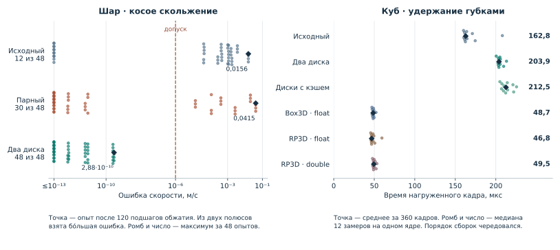

| Проверка | Штатный Kinetica | Новый режим |
|---|---:|---:|
| Захват в пределах допуска | 31 из 36 | **33 из 36** |
| Шар между двумя плоскими губками | 12 из 48 | **48 из 48** |
| Худшая ошибка скорости полюса, м/с | 0,015625 | **2,88 × 10⁻¹⁰** |
| Шар в V-образном жёлобе, основная и отложенная сетки | 24/32 и 18/32 | **32/32 и 32/32** |
| Медиана времени нагруженного кадра с кубом, мкс | **162,8** | 203,9 |

На 36 условиях захвата новый режим дал **19 выигрышей, 12 ничьих, 1 проигрыш и 4 несопоставимых результата** относительно лучшего из трёх результатов Box3D, RP3D float и RP3D double в каждом условии. У штатного режима счёт 12 / 12 / 8 / 4. Конкретный оставшийся проигрыш — при 240 Гц и нагрузке 12 Н вверх максимальная ошибка пути Kinetica равна 0,13292 мм, RP3D double — 0,09994 мм. Разница 0,03298 мм при полосе ничьей 0,001 мм. [Все 36 сравнений](data/friction-islands-2026-11-22/grip-vs-best.csv)

На одном закреплённом логическом ядре медианы времени кадра у Box3D, RP3D float и RP3D double составили **48,7 / 46,8 / 49,5 мкс**. Каждый из 12 блоков включал все шесть сборок в сбалансированном порядке. Каждое измерение охватывало 360 нагруженных кадров после прогрева. В 11 из 12 пар новый режим был медленнее штатного, медиана парного увеличения времени — 24,3%. Проверили также сохранение разложения Холецкого между решениями. Все семь файлов с физическими результатами совпали побайтно, но в 10 из 12 пар время увеличилось, медиана парного изменения +3,54%. Оставили этот вариант в истории экспериментов. [72 замера](data/friction-islands-2026-11-22/timing.csv) · [Порядок запуска](data/friction-islands-2026-11-22/time-grip.ps1) · [Вариант с сохранением разложения](data/friction-islands-2026-11-22/cache-experiment.patch)

### Как обнаружили ошибку трения

Две губки прижимают однородный шар массой 1 кг и радиусом 5 см. Начальные поступательная и угловая скорости задают разное скольжение левого и правого полюсов. За шаг $h=1/480$ с измеряем скорость обоих полюсов, скорость обеих губок и изменение их импульса. Сетка содержит четыре начальных движения, три поворота в плоскости трения и четыре сочетания покрытий. Допуски заданы до отбора — $10^{-6}$ м/с по скорости и $10^{-7}$ Н·с по нормальному импульсу. Для каждого полюса используем норму двумерного вектора, для всей сцены — максимум двух норм. [Общий прибор и независимый оракул](../../validation/studies/ObliqueGrip.h)

Для неподвижных в касательной плоскости губок отклик полюсов на касательные импульсы имеет вид

$$
W=\frac{1}{m}\begin{pmatrix}3{,}5I_2 & -1{,}5I_2\\-1{,}5I_2 & 3{,}5I_2\end{pmatrix},\qquad
p^*=\arg\min_{\lVert p_i\rVert_2\leq\mu_i N_i h}
\left(\tfrac12p^\mathsf{T}Wp+u_0^\mathsf{T}p\right),\qquad u_1=u_0+Wp^* .
$$

Здесь $u_0,u_1$ — векторы относительных скоростей, $p_i$ — касательные импульсы в Н·с, $I_2$ — единичная матрица в плоскости губки. Коэффициенты следуют из $I_\mathrm{шар}=2mR^2/5$. В оракуле попеременно решаем две задачи на дисках. Каждая полная итерация уменьшает верхнюю оценку ошибки второго импульса в $(1{,}5/3{,}5)^2$ раза. Выполнено 48 итераций. Это эталон **дискретного** закона максимальной диссипации при известном нормальном импульсе. Граница ошибки реальной траектории робота требует измерений материала и самого робота. Выбор закона контакта и проверка физических невязок опираются на исследование Le Lidec и соавторов. [Contact Models in Robotics, IEEE Transactions on Robotics](https://simple-robotics.github.io/publications/contact-models/)

Первый островной прототип обрабатывал совместно две контактные пары, ограничивая импульс по радиусу после решения со сцеплением. Он улучшил число прошедших случаев с 12 до 30, однако худшая ошибка выросла с 0,01563 до **0,04147 м/с**. Этот результат отклонили. В принятом режиме сначала исключаем жёсткие направляющие, затем минимизируем энергию на произведении двух дисков. При сцеплении достаточно решения системы $4\times4$, при скольжении предусмотрено до 128 уточнений. Режим действует на островах с двумя контактными парами и жёсткими направляющими либо без направляющих. Граница точности при произвольном числе контактов и плохой обусловленности остаётся открытой. [Три последовательных результата](data/friction-islands-2026-11-22/gate02/verdict.json)

### Где соперников удалось сопоставить

У всех движков одинаковы геометрия, массы, задаваемые силы, скорости, время предварительного прижима и один публичный шаг в опыте с шаром. За холодным стартом следует предварительное нагружение с включённым переносом импульсов, сон выключен. Число внутренних операций зависит от решателя. При длительности прижима 0,25 с у всех трёх внешних конфигураций ошибка нормального импульса превысила допуск. Из этого опыта нельзя присудить Kinetica 48 попарных побед по одному только закону трения. По полному контракту, включая фактическую силу и движение направляющей, Kinetica прошёл 48/48, внешние конфигурации — по 0/48. [Все полюса, силы и исключения](data/friction-islands-2026-11-22/peers/comparison.json)

В отдельном контроле прижимали **4 с** при прежнем шаге и прежних допусках. Обе точности RP3D достигли заданного прижима во всех 48 строках. На 12 строках без трения получились ничьи. На остальных 36 у губки появилась поперечная скорость сверх допуска $10^{-6}$ м/с. У Box3D ошибка прижима уменьшилась, но худшее отклонение составило $1{,}18\times10^{-6}$ Н·с, все 48 строк превысили допуск. В этой серии вывод о скорости скольжения при идеальном зажиме возможен только для строк с прошедшими контролями. [Матрица после длительного прижима](data/friction-islands-2026-11-22/settled/comparison.json)

### Могла ли всё объяснить одна константа

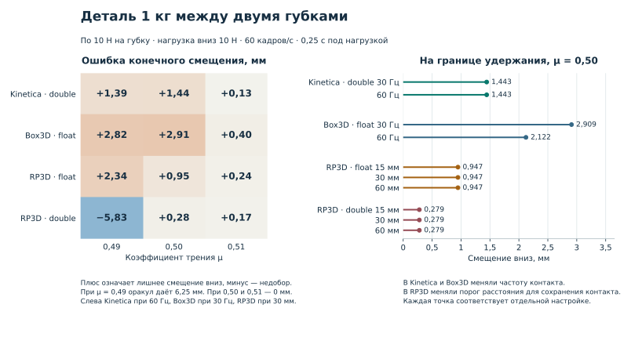

При нагрузке 10 Н, $\mu=0{,}50$ и частоте кадров 60 Гц повышение контактной частоты Box3D с 30 до 60 Гц уменьшило дрейф с **2,9092 до 2,1219 мм**. У штатного Kinetica те же настройки дали **1,44327343 и 1,44327341 мм**. В RP3D изменение расстояния сохранения контакта с 15 до 60 мм оставило дрейф в этом опыте прежним — **0,9467 мм** у float и **0,2792 мм** у double. У расстояния сохранения контакта и частоты контактной пружины разные физические смыслы. При $\mu=0{,}49$ аналитический путь уже 6,25 мм. RP3D double дал 0,419 мм, Kinetica — 7,640 мм. Малое движение полезно при удержании, а при ожидаемом скольжении само становится источником ошибки. [180 наблюдений и настройки сборок](data/friction-islands-2026-11-22/parameters)

### Проверка сборки, которую получает пользователь

В быстром шаге режим включается двумя строками.

```cpp
world.realtime = true;
world.soft.coupledFriction = true;
```

Итоговый исполняемый файл на Windows прошёл 10 из 10 зарегистрированных нативных тестов, включая независимые связи и шар. Две библиотеки также прошли проверку запрещённых символов libm. Оба режима дали побайтно те же файлы захвата, что и соответствующие экспериментальные сборки. Хэши 27 штатных сцен совпали с исходной сборкой на 1 и 12 потоках. При включённом режиме совпали все скорости и реакции на 48 строках опыта с шаром на 1 и 12 потоках. Замер переключателя внутри одной итоговой сборки дал **164,8 мкс** при выключенном режиме и **202,4 мкс** при включённом. [CTest](data/friction-islands-2026-11-22/sdk/ctest.txt) · [Оба режима и прототип](data/friction-islands-2026-11-22/sdk/verified.json) · [Хэши](data/friction-islands-2026-11-22/sdk/hash-12.txt) · [Парный замер SDK](data/friction-islands-2026-11-22/sdk/timing.csv)

VTune записал профиль сценария с 15 000 нагруженных кадров. Весь процесс, включая создание миров и предварительный прижим, занял 8,515 с, суммарное выборочное время CPU — 8,377 с. Среди функций самого движка выделились выдача временной памяти `StepMemory::take` (0,786 с), построение матрицы нормальных контактов (0,390 с) и одна специализация разложения Холецкого (0,280 с). Доля первой функции в профиле — около 9,4%. По этой доле нельзя приписать ей весь четырёхкратный разрыв по времени кадра. Аппаратный сборщик VTune на этой конфигурации Windows сообщил об ограничении Hyper-V, поэтому использовали программное семплирование. Имена функций восстановлены по адресам итогового исполняемого файла. [Профиль VTune](data/friction-islands-2026-11-22/sdk/vtune.csv) · [Расшифровка адресов](data/friction-islands-2026-11-22/sdk/vtune-resolved.csv)

Проверка структуры исходников нашла 753 функции в области измерения, ни одной длиннее проектного порога 40 строк, ни одного нарушения направления зависимостей. Понятность для студента можно проверить отдельно — сможет ли он по схеме двух губок предсказать знак скорости правого полюса после импульса слева и найти этот член в матрице. [Метрики структуры кода](data/friction-islands-2026-11-22/sdk/code-metrics.json)

**В счётчике пролётов нашли реальную ошибку.** В таблице столкновений на 7 425 клеток скрипт считал законный промах тел как прохождение сквозь препятствие. Контрпример — вершина оболочки и ребро цилиндра, первое тело впятеро крупнее, удар с вращением при 1 м/с. Мелкий шаг показал, что тела разминулись. На тех же сохранённых данных после исправления — **0 пролётов, 1 законный промах, 891 клетка хотя бы с одним нарушением**. Раньше скрипт выдавал 892. Среди оставшихся нарушений 889 клеток вышли за допуск по росту энергии. Это проверка имеющейся таблицы столкновений, а у захвата собственный прибор. [Исправленная классификация](../../validation/case_table.py) · [Исходные 7 425 клеток](data/friction-islands-2026-11-22/sdk/cases.tgz) · [Контроль счётчика](../../validation/test_case_table.py)

## Предыдущие циклы сравнения

**Где обнаружилась ошибка?** Если рядом с другой опорой в 50 м поставить ещё один куб, механически независимый захват у прототипа изменяется на **1,3999 мм**. Первый выход за допуск возникает на втором подшаге. Штатный решатель прошёл тот же контроль. Подробности и графики в разделе 8. [Новый вердикт отбора](data/contact-pair-2026-11-22/islands/verdict.json)

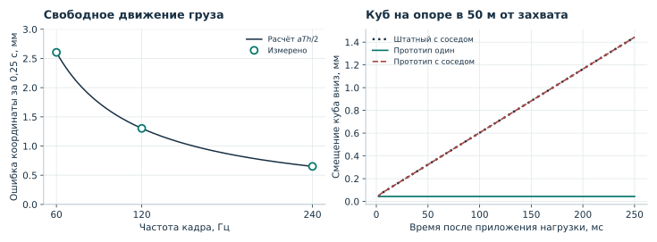

**Точнее всех в каждом опыте? Нет.** На захвате у штатного быстрого решателя **12 выигрышей, 12 ничьих, 8 проигрышей, 4 несопоставимых исхода** против лучшей из трёх сравнительных конфигураций в каждой клетке. В изолированной сцене опытная версия с совместным расчётом двух контактов достигла **19 / 12 / 1 / 4**. Независимый дальний контакт изменил этот захват, поэтому расширенный отбор отклонил прототип. При 240 Гц и силе 12 Н вверх RP3D double точнее опытной версии на 0,0330 мм. [Сравнение штатного решателя](data/grip-shared8-pairs.csv) · [Сравнение опытной версии](data/contact-pair-2026-11-22/active-vs-best.csv)

**Что дал свой аллокатор?** На нагруженном кадре штатная арена выдаёт временные данные из одного ранее полученного блока. Перевод этих данных в общую кучу увеличил время кадра примерно в 1,69 раза. Дополнительный выигрыш дала одна небольшая правка — повторное использование обычного вектора при сборке связей. В окончательной сборке сокращение времени захвата составило **9,16%** по медиане 16 пар. Разбор памяти и график находятся в разделе 7. [18 парных блоков](data/allocator-2026-11-22/timing.csv)

**Что удалось улучшить?** При прежних восьми обновлениях на кадр опытный решатель уменьшил дрейф с **1,443 до 0,0434 мм** при нагрузке 10 Н и 60 Гц. На первом подшаге совместный расчёт контактов и направляющих доставил кубу недостающий импульс. История двух циклов ниже показывает, какие правки прошли независимые проверки. [Первый цикл отбора](data/sieve-2026-11-22/verdict.json) · [Испытания двух контактов](data/contact-pair-2026-11-22/verdict.json)

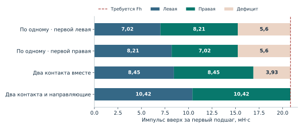

Сумма цветных участков — импульс двух губок на куб за $1/480$ с. Светлый участок показывает, сколько не хватило для удержания. Один мН·с равен 0,001 Н·с. [Исходный решатель](data/contact-pair-2026-11-22/sequential/jaws.csv) · [Два контакта](data/contact-pair-2026-11-22/block/jaws.csv) · [Контакты и направляющие](data/contact-pair-2026-11-22/guides/jaws.csv)

## 1. Что измеряет захват

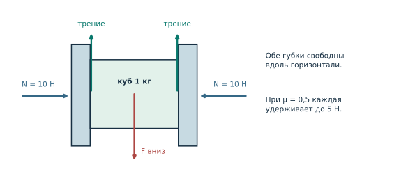

Обе губки обжимают куб 0,25 с. Затем на куб 0,25 с действует постоянная сила $F$. Вниз — положительное направление для пути. Для симметричных губок с одинаковой нормальной реакцией $N$ и одним коэффициентом $\mu$ для покоя и скольжения аналитическое решение имеет вид

$$
F_{\rm lim}=2\mu N,\qquad
a=\frac{\operatorname{sgn}(F)}{m}\max(0,|F|-F_{\rm lim}),\qquad
s(t)=\tfrac12 at^2 .
$$

При $\mu=0{,}5$, $N=10$ Н и $m=1$ кг груз под силой 10 Н должен остаться на месте. При 10,1 Н он должен опуститься на **3,125 мм**, при 12 Н — на **62,5 мм**. Для открытого захвата реакция равна нулю. Три критерия записаны до сравнения.

| Что проверяем | Наблюдаемая величина | Условие «да» |
|---|---|---|
| Реакция каждой губки | Изменение её горизонтального импульса за кадр. $N_L=N_{\rm drive}-\Delta p_{Lx}/\Delta t$, $N_R=N_{\rm drive}+\Delta p_{Rx}/\Delta t$ | Ошибка каждой реакции ≤ 0,2 Н в каждом кадре |
| Удержание | Наибольшее смещение куба относительно средней высоты губок после приложения нагрузки | При $a=0$ смещение ≤ 0,5 мм |
| Скольжение | $E_\infty=\max_k \lvert s_{\rm sim}(t_k)-s(t_k)\rvert$ по всем нагруженным кадрам | При $a\ne0$ ошибка ≤ 2 мм |

Один опыт проходит при завершении всех шагов и соблюдении всех применимых допусков. При сравнении движков выигрывает меньшая $E_\infty$. Разность до 0,001 мм включительно считается ничьей. Это выбранная для парного сравнения полоса разрешения. Её задали после исходных измерений. [Общая реализация оракула](../../validation/studies/GripLimit.h) · [Правило сравнения](../../validation/studies/grip_accuracy.py)

## 2. Где Kinetica выигрывает и сколько стоит кадр

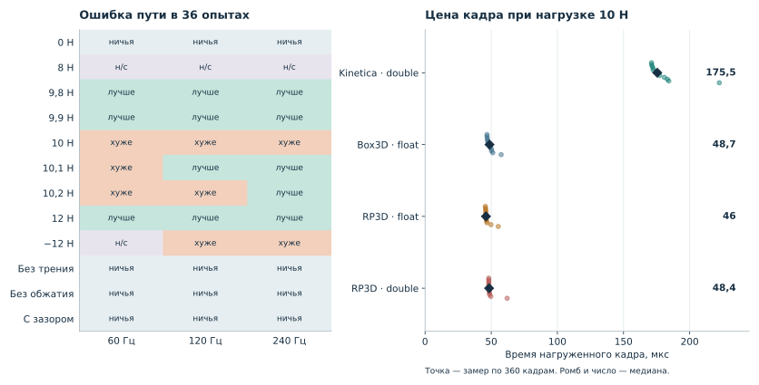

Каждая клетка слева сравнивает быстрый Kinetica с лучшим результатом Box3D, RP3D float и RP3D double в том же опыте. **«н/с»** означает, что хотя бы у одного участника не прошла проверка реакции или завершения. Все четыре таких клетки остались в знаменателе. Двенадцать условий на трёх частотах — детерминированная сетка. Процент будущих захватов робота по ней оценить нельзя. [Исходы всех 36 пар](data/grip-shared8-pairs.csv) · [144 исходные строки](data/grip-shared8.csv)

| Конфигурация | Прошло условий из 36 | Смещение при 10 Н, 60 Гц, мм | Медиана, мкс/кадр |
|---|---:|---:|---:|
| Kinetica, быстрый, double | **31** | 1,4433 | 175,50 |
| Box3D, float | 23 | 2,9092 | 48,70 |
| ReactPhysics3D, float | 28 | 0,9467 | 46,03 |
| ReactPhysics3D, double | 27 | **0,2792** | 48,38 |

У Kinetica больше прошедших условий. На самой границе удержания при 60 Гц допуск 0,5 мм выполнил только RP3D double. На этом захвате Kinetica тратит **в 3,60–3,81 раза больше времени** по отношению медиан. Замеры сделаны вне профилировщика, 12 блоков с чередованием конфигураций, по 360 нагруженных кадров на точку. [Исходные замеры времени](data/grip-shared8-timing.csv)

**Какие условия совпадают.** Восемь публичных шагов на кадр, один и тот же интервал и приложенные силы, тёплый старт включён, сон выключен. Kinetica использует один внутренний подшаг за вызов, Box3D — один, RP3D — один проход скоростей и один положений. Внутренний объём работы, порядок решения и точность чисел различаются. Результат для одинакового числа всех внутренних операций остаётся открытым. [Конфигурации и версии движков](grip-limit.md)

## 3. Как независимый опыт поймал ложное улучшение

В первом нагруженном подшаге $h=1/480$ с для удержания требуется импульс $Fh=0{,}02083333$ Н·с вверх. При добавлении левой губки первой прибор прочитал **0,00702476** Н·с у левой и **0,00820909** Н·с у правой. При обратном порядке числа поменялись местами. Их сумма осталась **0,01523385 Н·с**, дефицит составил **0,00559948 Н·с**. Для куба в 1 кг это даёт скорость вниз **5,59948 мм/с** уже после первого подшага. При смене знака нагрузки поменялись знаки обоих импульсов, при $\mu=0$ оба стали нулевыми. [Покадровые показания двух губок](data/sieve-2026-11-22/before/jaws.csv)

Вторая оценка получается независимо из изменения вертикального импульса куба. При оси $y$ вверх она даёт $J_L+J_R=\Delta p_y+Fh$. Максимальная невязка исходной сборки в 720 наблюдениях — **1,97·10⁻¹² Н·с**, допуск — $10^{-7}$ Н·с. Это подтверждает измерение дефицита. Сама перестановка губок его не устраняет.

В двух опытных сборках одним коэффициентом $\omega$ умножили поправку касательного импульса перед обычным ограничением Кулона. Число проходов сохранили. На независимой сцене сплошной шар без начального вращения скользит по горизонтальной плоскости. Для $I=2mR^2/5$ тормозящий импульс $J$ уменьшает скорость точки контакта на $(1/m+R^2/I)J$. Следовательно, за один подшаг

$$
\frac{|J|}{m}=\min\!\left(\mu gh,\frac{2}{7}|v_0|\right),\qquad
u_{\rm after}=v_0-\operatorname{sgn}(v_0)\frac{7|J|}{2m}.
$$

При $v_0=+10$ мм/с, $g=10$ м/с², $\mu=0{,}5$ и $h=1/480$ с трения достаточно для начала чистого качения. Ожидается $u_{\rm after}=0$ с допуском **0,001 мм/с**. Это предсказание проверяется по линейной и угловой скорости шара. [Измеритель перехода к качению](../../validation/studies/SlipToRoll.cpp) · [Физические критерии для контактов в робототехнике, Le Lidec и соавт.](https://arxiv.org/abs/2304.06372)

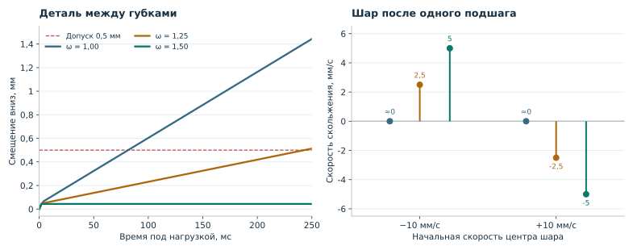

| Коэффициент $\omega$ | Макс. смещение на границе при 60 Гц, мм¹ | Захват | Шар | Скольжение при $v_0=+10$ мм/с, мм/с | Решение |
|---|---:|---:|---:|---:|---|
| 1,00 | 1,443273 | 31/36 | **8/8** | −1,64·10⁻¹¹ | Сохранена исходная формула |
| 1,25 | 0,513104 | 32/36 | 6/8 | −2,500 | Отклонена |
| 1,50 | **0,043403** | **33/36** | 6/8 | −5,000 | Отклонена |

¹ Максимум по 120 нагруженным подшагам, обоим порядкам губок и обоим направлениям нагрузки. При $\omega=1{,}50$ касательный импульс первого подшага захвата почти точно равен требуемому. На одиночном шаре та же поправка на 50 % превышает импульс, достаточный для остановки скольжения. Проверка на шаре сработала для обоих знаков скорости. [Исходная серия шара](data/sieve-2026-11-22/before/roll.csv) · [Серия при 1,25](data/sieve-2026-11-22/sor125/roll.csv) · [Серия при 1,50](data/sieve-2026-11-22/sor15/roll.csv)

### Есть ли у быстрого решателя путь дальше?

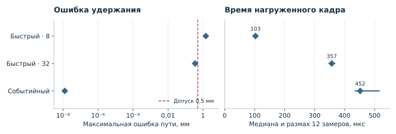

На обоих графиках одна нагрузка 10 Н и частота 60 Гц. Числа 8 и 32 обозначают внутренние подшаги. Например, переход с 8 на 32 уменьшил дрейф с 1,443 до 0,353 мм, а медианное время выросло со 103 до 357 мкс. В серии `shared8` на каждый кадр приходится восемь **публичных** обновлений. Время этой серии приведено в разделе 2.

**Да.** В отдельной серии на тех же 36 физических условиях событийный режим Kinetica уже прошёл **36/36**. Быстрый режим с 32 внутренними подшагами также прошёл **36/36** и дал **0,353 мм** на границе удержания при 60 Гц. Физическое решение достижимо в нашем движке. Открытая задача — получить его точнее при бюджете восьми обновлений. [Измерения обоих режимов](data/grip-limit-windows.csv) · [Время при разных бюджетах](data/grip-timing-windows.csv)

Для одиночного шара, когда импульс сцепления лежит внутри круга Кулона и проекция не обрезает опытную поправку, $u_{\rm after}=(1-\omega)u_0$. При $u_0=0{,}01$ м/с допуск $10^{-6}$ м/с требует $|\omega-1|\le 10^{-4}$. Это объясняет оба отказа шара и задаёт границу применимости постоянного усиления.

Для симметричного куба из баланса линейного импульса и нулевого момента относительно центра следует $J_L=J_R=Fh/2=0{,}01041667$ Н·с. Обе величины укладываются в предел одной губки $\mu Nh$. Во втором цикле это решение проверили в быстром движке под прежней нагрузкой.

### Шар между двумя наклонными стенками

При скольжении вдоль симметричного V-образного жёлоба импульс на одной стенке меняет скорость точки на другой. У сплошного шара массой $m$ с моментом инерции $2mR^2/5$ продольные касательные импульсы связаны матрицей $W$. Для наклона каждой опорной плоскости на угол $\alpha$ к горизонту и начальной скорости $v_0$ вдоль жёлоба оракул имеет вид

$$
W=\frac1m
\begin{pmatrix}3{,}5 & 1+2{,}5\cos(2\alpha)\\
1+2{,}5\cos(2\alpha) & 3{,}5\end{pmatrix},\qquad
J^*=\arg\min_{|J_i|\le\mu_i mgh/(2\cos\alpha)}
\left[\tfrac12 J^\top WJ-v_0(J_1+J_2)\right].
$$

Здесь положительный $J_i$ тормозит движение в положительном направлении. Ожидаемые скорости двух точек равны $v_0(1,1)^\top-WJ^*$. Эталон проверяет минимум внутри прямоугольника допустимых импульсов и на каждой из четырёх сторон. Из движка считываются линейная и угловая скорости. Допуск на остаток скорости в предварительном покое и на ошибку скорости каждой точки после подшага составляет $10^{-6}$ м/с. [Расчёт эталона и сцена](../../validation/studies/GrooveFriction.cpp)

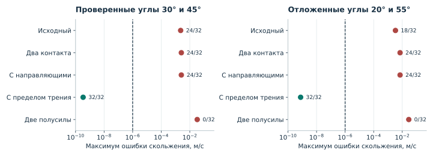

| Быстрый решатель при восьми обновлениях на кадр захвата | Захват | Одна плоскость | Жёлоб 30° и 45° | Отложенные 20° и 55° | Дрейф на границе, мм |
|---|---:|---:|---:|---:|---:|
| Штатный последовательный | 31/36 | 8/8 | 24/32 | 18/32 | 1,44327 |
| Два контакта вместе | 31/36 | 8/8 | 24/32 | 24/32 | 1,02711 |
| Добавлены связи направляющих | 33/36 | 8/8 | 24/32 | 24/32 | 0,04340 |
| Повторное решение для сцепившегося контакта после ограничения второго | **33/36** | **8/8** | **32/32** | **32/32** | **0,04340** |
| Дополнительно две половины внешнего импульса | 13/36 | 7/8 | 0/32 | 0/32 | 2,56076 |

На отложенной сетке у четвёртого варианта максимальная ошибка скорости составила $7{,}65\cdot10^{-10}$ м/с. Три отказа захвата остались при 60 Гц в режимах без трения, без сжатия и с открытыми губками. Максимальная ошибка свободного движения получилась 2,604 мм при допуске 2 мм. Перестановка частей внешнего импульса улучшила свободное движение ценой отказов на жёлобе. [Отложенная сетка](data/contact-pair-2026-11-22/active/groove-holdout.csv) · [36 траекторных сводок](data/contact-pair-2026-11-22/active/grip.csv) · [Все пять вердиктов и хэши программ](data/contact-pair-2026-11-22/verdict.json)

В отдельной серии из 14 блоков медианы составили 209,56 мкс/кадр у исходного решателя и 203,76 у четвёртого варианта. Медианное парное сокращение 2,94% ниже выбранного порога 5%. В той же серии Box3D потребовал 48,05 мкс, RP3D double — 48,68. Область прототипа ограничена ровно двумя контактами во всём шаге и общим подвижным телом. Добавленный в разделе 8 опыт с независимым островом дал контрпример. Направление следующей правки — выбор решателя по связной компоненте механической системы. Для общего случая остаются также произвольные направления скольжения. [Парные замеры](data/contact-pair-2026-11-22/timing.csv) · [Экспериментальная правка](data/contact-pair-2026-11-22/two-contact.patch)

## 4. Зубчатая передача под нагрузкой

Два цилиндра вращаются на неподвижных параллельных валах. Два шарнира держат валы, одно угловое ограничение связывает колёса. На ведущем колесе 20 зубьев, на ведомом 40. Углы отсчитываются от положения при сборке. Для внешнего зацепления $r=Z_A/Z_B=1/2$. Из кинематики и баланса моментов следует

$$
\theta_B=-r\theta_A,\qquad I_{\rm eff}=I_A+r^2I_B,\qquad
\alpha_A=\frac{\tau_A-r\tau_B}{I_{\rm eff}}.
$$

В опыте $\tau_B=+0{,}001$ Н·м противодействует движению выхода, а привод даёт $\alpha_A=\pi$ рад/с². Из состояния покоя через секунду должны получиться **+90° и −45°**. Это проверяет движение под внешним моментом и передачу нагрузки через связь. [Учебный пример](../../examples/05_world/GearTrain.cpp) · [Устройство аналогичной связи в Jolt](https://jrouwe.github.io/JoltPhysics/class_gear_constraint.html)

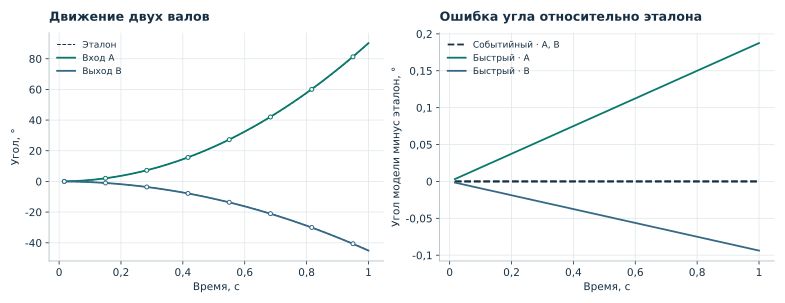

| Режим | Вход / выход через 1 с, ° | Макс. ошибка связи $\lvert\theta_B+r\theta_A\rvert$, рад | Макс. ошибка скорости вала, рад/с |
|---|---:|---:|---:|
| Событийный | +90,000000 / −45,000000 | 7,87·10⁻¹⁴ | 1,28·10⁻¹³ |
| Быстрый, 8 подшагов | +90,187500 / −45,093750 | 4,44·10⁻¹⁶ | 3,29·10⁻¹⁴ |

Оба режима выдержали допуски на связь $10^{-6}$ рад и на скорость $10^{-7}$ рад/с. При этом быстрый шаг опередил эталон по абсолютному углу входа на **0,1875°**. Для обновления угла по скорости конца подшага при постоянном ускорении ошибка равна $\alpha_A T h/2=\pi/960$ рад. Так одна сцена обнаруживает погрешность интегрирования даже при почти идеальном передаточном отношении. Точки слева на графике — событийный режим, сплошные линии — быстрый. Для невязок порядка $10^{-14}$ использованы значения из программы до округления CSV. [120 измеренных кадров](data/sieve-2026-11-22/gear-trajectory.csv) · [Максимумы до вывода траекторий](data/sieve-2026-11-22/gear-output.txt)

## 5. Что известно о других сценах и точности измерителя

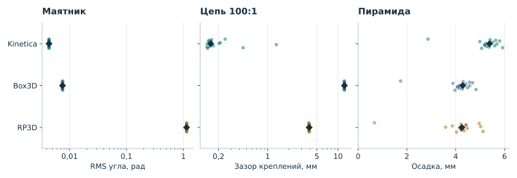

Цветные точки — 16 вариантов, чёрный ромб — медиана. На всех трёх графиках меньшее значение расположено левее. Маятник и цепь показаны на логарифмических шкалах, осадка пирамиды — на линейной. У маятника меняли только плотность однородного бруска, поэтому его точки почти совпали. Здесь у Kinetica восемь внутренних подшагов, у Box3D восемь подшагов, у RP3D восемь публичных вызовов с заводским числом итераций. Эти настройки отличаются от протокола захвата в разделе 2.

| Сцена и метрика | Kinetica | Box3D | RP3D float | Где меньше |
|---|---:|---:|---:|---|
| Маятник от 120°, RMS угловой ошибки за 600 кадров, рад | **0,004357** | 0,007520 | 1,136709 | Kinetica |
| Цепь из 10 шарниров с грузом 100:1, макс. расхождение креплений за 5 с, мм | **0,155** | 12,309 | 3,882 | Kinetica |
| Пирамида из 55 кубов, осадка за 5 с, мм | 5,385 | 4,286 | **4,253** | RP3D |

Эталон маятника задан эллиптической функцией. У цепи измерено нарушение связи, у пирамиды — смещение относительно начальной укладки. Начальные зазоры влияют на осадку. Позу каждого куба в физическом эксперименте не измеряли. [Результаты маятника](data/sieve-2026-11-22/angles.json) · [Измерения цепи и пирамиды](data/sieve-2026-11-22/scenes/) · [Методика трёх сцен](robotics-accuracy-2026-11-22.md)

**Граница Крамера–Рао относится к оценке параметра по шумным наблюдениям.** Пример проекта — оценка $g$ по 61 координате падения с независимым гауссовским шумом $\sigma=1$ мм за одну секунду. Начальные высота и скорость неизвестны. При $X_i=(1,t_i,t_i^2/2)$ имеем $\operatorname{Var}(\hat g)\geq [\sigma^2(X^\top X)^{-1}]_{gg}$. Предсказанное СКО — **0,003326 м/с²**, измеренное по **10 000** реализаций — **0,003319 м/с²**, покрытие 95-процентного интервала — **94,89 %**. Совпадение проверяет измеритель в этой модели шума. Для детерминированных траекторий выше точность оценивается непосредственно по их физическим оракулам. [Параметры и результат статистического опыта](data/sieve-2026-11-22/crlb.json)

## 6. Как отбор работает при следующей правке

Первой подаётся исходная сборка, затем опытные. В первом цикле сохраняются хэши двух бинарников, 36 траекторных сводок, 720 строк импульсов и 8 исходов шара. Режим второго цикла `--groove` добавляет третий бинарник и две серии по 32 исхода жёлоба. Кандидат становится точкой сравнения для следующего, если проходит независимые проверки, улучшает хотя бы одну траекторию более чем на 1 мкм, сохраняет все прежние допуски и ни одна траектория не ухудшается более чем на 1 мкм. Отсутствующий бинарник или оборванная серия получают статус «неполный опыт». Этот цикл проверяет механизм трения. [Сценарий отбора](../../validation/studies/grip_sieve.py) · [Вердикты и SHA-256 бинарников](data/sieve-2026-11-22/verdict.json)

Отбор проверили и при сбое. Сборка без исполняемого файла получила «неполный опыт». Следующий вариант был сопоставлен с прежней исходной сборкой. [Контроль пропущенного бинарника](data/sieve-2026-11-22/guard.txt)

В учебном API чтение сил отнесено к наблюдателю шага. Первоначальный вариант добавлял в `World` тринадцатый публичный метод при норме проекта 12. Перенос чтения в `StepObserver` вернул класс в норму. Все строки трёх физических серий по каждому из трёх вариантов совпали до и после переноса. [Первый замер структуры](data/sieve-2026-11-22/code-first.json) · [Итоговый замер](data/sieve-2026-11-22/code-current.json)

На стенде **Clang 23.1.6, CMake 4.2.0, Python 3.14.0 и Intel VTune 2024.3**. Дополнительных установок для этого исследования не потребовалось. Базовая ревизия — `2326667c3ee60b6ac47db42f35ecc5732620c68a` с рабочими изменениями. В каждой опытной сборке изменена формула касательного импульса. Для воспроизведения заменить только $M_t u$ на $\omega M_t u$ в `CentreFriction::solve` перед проекцией на круг Кулона. [Хэши снимков исходников](data/sieve-2026-11-22/source-binary-hashes.csv)

```powershell
# Каждый каталог bins содержит study-grip-limit.exe и study-slip-to-roll.exe своей сборки.
python validation/studies/grip_sieve.py --out measurements/run-02 bins/before bins/sor125 bins/sor15
.\build\examples\GearTrain.exe --csv
```

Первый профиль VTune в режиме программной выборки охватил **15 000 нагруженных кадров**, а также создание миров, обжатие и прогрев. Из 7,702 с выборочного CPU-времени **0,481 с** пришлось на `malloc_base` и **0,338 с** на `free_base`. Ещё **1,102 с** в `ucrtbase.dll` остались без имени функции. Этого профиля достаточно, чтобы обосновать отдельный замер выделений памяти именно внутри шага. Долю времени решателя в этих функциях он пока не устанавливает. [Сводка VTune](data/sieve-2026-11-22/vtune-summary.txt) · [Исходная таблица функций](data/sieve-2026-11-22/vtune-sieve.csv)

## 7. Зачем движкам свои типы и куда уходит память Kinetica

Математический вектор хранит координаты и определяет операции над ними. Динамический массив хранит последовательность элементов. Аллокатор предоставляет массиву память. Эти три решения можно менять независимо. Например, у Kinetica вектор $x,y,z$ имеет тип `Vector3`. Список строк быстрого решателя `StepArray<SoftJoint>` использует стандартный контейнер с нашим аллокатором. [Определение StepArray](../../include/math/StepMemory.h) · [Время жизни рабочих данных](../../src/math/StepMemory.cpp)

| Движок | Назначение своего типа |
|---|---|
| Bullet | Авторы связали создание `btAlignedObjectArray` с переносимостью и выравниванием данных SIMD/SSE. В классе задан аллокатор с границей 16 байт. [Исходник Bullet](https://github.com/bulletphysics/bullet3/blob/master/src/LinearMath/btAlignedObjectArray.h) |
| Jolt | При загрузке сеток и карт высот предварительное обнуление числового буфера создавало лишнюю работу. Свой `Array` позволяет сразу записать прочитанные данные. Внутри массива используются `std::move` и стандартные признаки типов. [Исходник Jolt](https://github.com/jrouwe/JoltPhysics/blob/master/Jolt/Core/Array.h) · [Выпуск 5.1.0](https://github.com/jrouwe/JoltPhysics/releases/tag/v5.1.0) |
| ReactPhysics3D | Для `Array` передаётся аллокатор. Владелец приложения может передать свой источник памяти при создании `PhysicsCommon`. Официальное руководство указывает `std::malloc` и `std::free` в качестве нижнего уровня по умолчанию. [Описание контейнеров](https://reactphysics3d.com/documentation/hierarchy.html) · [Управление памятью](https://www.reactphysics3d.com/documentation/) |
| Box3D | Ядро написано на C17. Внутри используются плотные наборы тел и рабочая арена, стандартные контейнеры C++ в языке C недоступны. [Репозиторий Box3D](https://github.com/erincatto/box3d) · [Разбор хранения тел](../../research/engines/box3d.md) |

В Kinetica тела, пары и сохранённые импульсы принадлежат миру и живут между шагами. Временные строки и матрицы получают память в арене потока. Арена растёт блоками от 4 МиБ, берёт следующий кусок сдвигом указателя и после завершения области использует место снова. Обычная граница выдачи 16 байт. Элемент с более строгим выравниванием требует отдельного контракта аллокатора. [Хранилище мира](../../include/world/World.h) · [Устройство арены](../../src/math/StepMemory.cpp)

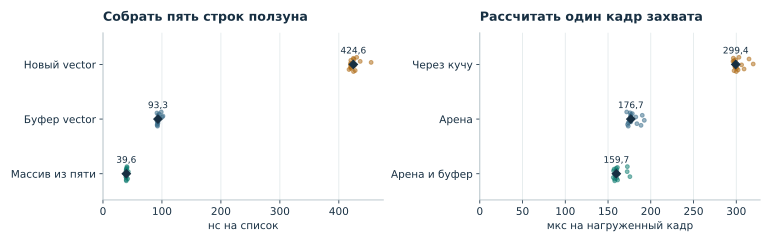

| Выбор хранения пяти уже вычисленных строк ползуна | Медиана, нс/список |
|---|---:|
| Новый std::vector, пять добавлений с ростом | 424,59 |
| Один std::vector, reserve(5) до замера, затем clear и пять добавлений | 93,26 |
| std::array из пяти элементов, прямое копирование диапазона | 39,58 |

Один поток, 15 блоков с чередованием, 150 000 списков на способ в каждом блоке. Отдельная единица трансляции читала поля строк, все 45 контрольных сумм совпали. Медианный парный выигрыш фиксированного массива против нового вектора равен **10,64 раза**, против повторно используемого вектора — **2,36 раза**. Фиксированный массив здесь опирается на заранее известное число строк и использует копирование диапазона. Для произвольного сочленения число строк может меняться. [45 сырых измерений](data/allocator-2026-11-22/vector.csv) · [Код опыта](../../validation/studies/memory/VectorRows.cpp) · [Гарантия reserve в стандарте C++](https://eel.is/c++draft/vector.capacity)

| Память в нагруженном захвате | Вызовов new за 15 кадров | На кадр | Новых блоков арены за 15 кадров | Медиана, мкс/кадр |
|---|---:|---:|---:|---:|
| Вся временная память через кучу | 28 020 | 1 868,0 | 0 | 299,37 |
| Исходная арена, отдельный вектор при каждой сборке сочленения | 2 642 | 176,1 | 0 | 176,66 |
| Та же арена, один буфер строк для последовательных сочленений | **842** | **56,1** | **0** | **159,73** |

Без предварительного прогрева на первом кадре арена получила один блок **4 194 304 байта**. Пик занятой части при последующей нагрузке — **29 376 байт**. Если взять 64 КиБ до создания мира, тот же блок выделяется заранее. После прогрева количество выдач и занятых байтов в обеих сериях совпадает. Оставшиеся 842 вызова относятся к C++ new измеряемого потока. Общая куча обслуживает также долгоживущие данные. Эти числа показывают стоимость именно данного захвата. [Холодный старт](data/allocator-2026-11-22/stock/memory.csv) · [Предвыделение](data/allocator-2026-11-22/stock/prefill.csv) · [Повторное использование](data/allocator-2026-11-22/reuse/memory.csv) · [Контроль через кучу](data/allocator-2026-11-22/heap/memory.csv)

Для времени взяты **18 парных блоков**, все шесть порядков запуска встречаются поровну. В каждом замере 360 нагруженных кадров вне профилировщика и без счётчиков. Повторное использование буфера выиграло 17 блоков из 18. Медиана отношений к исходной сборке — **0,9003**, с принудительной кучей — **1,6929**. На всех трёх конфигурациях совпали файлы 36 траекторных сводок и 720 записей импульсов в точности вывода приборов. Для студента изменение видно в одном месте. Решатель передаёт очередному сочленению тот же `std::vector<Bond>`. Метод очищает список и записывает новые связи в его прежний буфер. [Парные измерения](data/allocator-2026-11-22/timing.csv) · [Хэши бинарников](data/allocator-2026-11-22/binaries.csv)

Если операции хранения занимали долю $f$ времени кадра и ускорились в $k$ раз, при прежней цене остальных операций ускорение кадра равно $1/(1-f+f/k)$. Стократное ускорение всего шага потребовало бы $f\geq0{,}99$ даже при полном устранении этой работы. Раскладка также может менять стоимость вычислений через кэш, и тогда её вклад нужно заново измерить на целом кадре.

Профиль VTune опытного решателя двух контактов охватывает создание мира, прогрев и 15 000 нагруженных кадров. На функции malloc_base и free_base пришлось 0,389 и 0,344 с из 8,692 с выборочного процессорного времени. Счётчики фаз и отдельная серия времени выше позволяют оценить конкретную замену буфера в штатном решателе. [Сводка VTune](data/contact-pair-2026-11-22/vtune-summary.txt) · [Функции](data/contact-pair-2026-11-22/vtune-functions.csv)

**Проверка принятой правки.** В рабочем коде быстрый шаг передаёт очередному сочленению общий буфер через метод `Joint::writeBonds`. В повторной сборке из исходников медианы времени захвата составили 176,09 и 161,35 мкс/кадр. Парное сокращение времени равно **9,16%**, ускорение наблюдалось во всех **16/16** парах. На независимой пирамиде из 55 кубов медиана парных отношений равна **1,000**. Хэши состояния на 27 сценах через 60 кадров совпали с исходной сборкой при 1 и 12 потоках. Восьмой нативный тест проверяет независимость захвата. [Реализация](../../src/joints/Joint.cpp) · [Использование в быстром шаге](../../src/dynamics/time_stepping/SoftStep.cpp) · [Финальные пары, включая пирамиду](data/allocator-2026-11-22/verification/final-timing.csv) · [Отпечатки состояний](data/allocator-2026-11-22/verification/state-12.txt) · [8 из 8 CTest](data/contact-pair-2026-11-22/islands/ctest.txt)

Отдельный профиль VTune принятой правки завершил 15 000 нагруженных кадров. Прогон занял 6,999 с реального времени и 6,859 с суммарного выборочного времени CPU, из них на malloc_base пришлось 0,140 с, на free_base — 0,062 с. Первую попытку с привязкой самого профилировщика к одному логическому ядру остановили до завершения. Для опубликованного профиля разрешили профилировщику обычную маску процессоров, в движке задан один рабочий поток. Временной выигрыш 9,16% установлен в отдельной парной серии вне VTune. [Сводка](data/allocator-2026-11-22/verification/vtune-summary.txt) · [Функции](data/allocator-2026-11-22/verification/vtune-functions.csv) · [Число завершённых кадров](data/allocator-2026-11-22/verification/vtune-loaded.txt)

Исходная ревизия ядра для опытов — `2326667c3ee60b6ac47db42f35ecc5732620c68a` с исходниками приборов из этого отчёта и добавленной передачей. Для повторения сравнения памяти в Windows исходную библиотеку собирают до переноса буфера. В каталог `build/arena-study` копируют исходные `include/joints/Joint.h`, `src/joints/Joint.cpp`, `src/dynamics/time_stepping/SoftStep.cpp`, `src/math/StepMemory.cpp` и файлы `validation/studies/GripLimit.cpp` и `GripLimit.h`, сохраняя структуру путей. Для исходного `GripLimit.cpp` в копии и при сборке базового прибора используется архивная версия, указанная ниже. Из корня снимка применяют приведённый ниже патч к копии. Для ветки двух контактов патч применяется к отдельной копии исходного ядра. Варианту `active` задаются оба определения `KP_PAIR_WITH_GUIDES` и `KP_PAIR_ACTIVE`, вариант `centred` дополнительно включает `KP_CENTRED_FORCE`. [Патч измерительного стенда памяти](data/allocator-2026-11-22/arena-study.patch) · [Исходный текст драйвера для патча памяти](data/allocator-2026-11-22/GripLimit-before.cpp) · [Сценарий сборки и замера памяти](../../validation/studies/memory/run.ps1) · [Исходный код двухконтактного прототипа](data/contact-pair-2026-11-22/two-contact.patch)

```powershell
git apply --directory=build/arena-study docs/reports/data/allocator-2026-11-22/arena-study.patch
.\validation\studies\memory\run.ps1
```

## 8. Как мы нашли две разные причины ошибки

**1. Сходимость на известной траектории.** Груз массой 1 кг начинает движение из покоя при силе 10 Н и отсутствии трения. Ожидаемый путь за $T=0{,}25$ с равен $aT^2/2=312{,}5$ мм. В быстром шаге обновление скорости и координаты даёт $v_{k+1}=v_k+ah$, $x_{k+1}=x_k+h v_{k+1}$. Сумма по $T/h$ подшагам предсказывает лишний путь $aTh/2$. При 8 публичных обновлениях на кадр $h=1/(8f)$. Ошибки при 60, 120 и 240 Гц составили **2,60417 → 1,30208 → 0,65104 мм**. Наблюдаемый порядок $p=log_2(E_h/E_{h/2})=1$ совпал с выводом на обоих интервалах. Во время удара, смены контакта или перехода к скольжению последовательность событий требуется проверять отдельно. [Траектории, включая нулевое трение](data/contact-pair-2026-11-22/sequential/grip.csv) · [NASA о проверке сходимости](https://www.grc.nasa.gov/www/wind/valid/tutorial/spatconv.html)

**2. Инвариант независимых механических систем.** На захвате при 60 Гц с грузом 10 Н траектория исходного куба должна совпасть в пределах **0,001 мм** при добавлении механически независимых тел. Дальний куб массой 1 кг получает собственную силу 10 Н. В одном контроле между кубом и его опорой зазор 10 м. В двух других он касается опоры справа и слева, за 50 м от захвата. Реакция на удалённой опоре проверяется независимо из изменения вертикального импульса. За один нагруженный подшаг она составила 0,0208333 Н·с, в контроле с зазором — практически ноль. [Устройство опыта](../../validation/studies/GripIslands.h)

| Добавлено к захвату | Штатный дрейф через 0,25 с, мм | Дрейф прототипа, мм |
|---|---:|---:|
| Захват один | 1,443273 | 0,043403 |
| Два тела справа, между ними зазор | 1,443273 | 0,043403 |
| Дальний куб касается своей опоры справа | 1,443273 | 1,443273 |
| Дальний куб касается своей опоры слева | 1,443273 | 1,443273 |

На первом подшаге после приложения нагрузки координаты ещё совпадают. На **втором** разность уже **0,02333 мм**, к концу опыта — **1,39987 мм**. В прототипе выбор совместного решения проверял общее число контактов в шаге. Как только появилась третья контактирующая пара, прототип вернулся к последовательному решению и для исходного захвата. Прежний отбор присвоил ему `keep` на изолированных задачах. Расширенный отбор присвоил `reject`. В рабочей версии остаётся штатный расчёт контактов. [120 подшагов каждого контроля](data/contact-pair-2026-11-22/islands/active.csv) · [Те же сцены в штатном решателе](data/contact-pair-2026-11-22/islands/sequential.csv) · [Вердикт и хэши](data/contact-pair-2026-11-22/islands/verdict.json)

**Как искать следующие пропуски.**

| Метод | Вопрос, на который даёт ответ | Что наблюдать |
|---|---|---|
| Аналитическое решение и деление шага пополам | Совпадают ли знак, величина и порядок ошибки? | Положение в метрах, скорость в м/с и время первого события |
| Изменение сцены с известным результатом | Сохраняется ли механическая независимость, симметрия или смена системы отсчёта? | Весь путь и реакции исходных тел, первый нарушенный подшаг |
| Независимый баланс и закон контакта | Чем объясняется расхождение на этом подшаге? | Импульс из $\Delta p$, невязка непроникновения, предел $\lVert J_t\rVert\leq\mu J_n$, направление трения относительно скорости скольжения |
| Испытания около границы сцепления | Сохраняется ли улучшение при смене знака нагрузки, отношения масс и коэффициентов трения? | При одинаковом бюджете фиксировать максимальную ошибку, число отказов, начальные данные и худший воспроизводимый случай |
| Внешняя проверка на роботе | Насколько верны геометрия, трение и жёсткость принятой модели? | На повторных опытах измерить ход груза и реакции губок, оценить погрешность датчиков и разброс материалов |

Для контактных законов основания даёт раздел III работы Le Lidec и соавторов. В жёсткой статически неопределимой системе несколько распределений сил могут давать одну траекторию, поэтому поконтактный эталон требует дополнительных предпосылок. Наши детерминированные сетки подтверждают результаты только для испытанных условий. Предел Крамера–Рао относится к дисперсии оценивания параметра заданной вероятностной модели. Например, при заданном законе шума и выполнении условий регулярности он ограничивает снизу дисперсию несмещённой оценки коэффициента трения по повторным наблюдениям. Для ошибки свободного движения у нас есть точное аналитическое значение. [Contact Models in Robotics](https://arxiv.org/html/2304.06372) · [С. Р. Рао об оценке статистических параметров](https://repository.ias.ac.in/71593/)

Воспроизведение последней проверки на Windows из каталога сборок с тремя приборами каждого варианта выполняется следующей командой.

```powershell
python validation/studies/grip_sieve.py --islands --groove --out measurements/island-run bins/sequential bins/active
```

## ⚠️ Стресс-тест

| Проверка | Ответ | Основание |
|---|---|---|
| Проходит ли новая передача проверенные случаи? | **Да** | Нагрузка 20:40, свободный ход 17:31, оба направления вращения, наклонная ось, несколько оборотов и замена $q$ на $-q$. Для свободного хода проверялся относительный дрейф энергии ≤ $10^{-6}$. Нулевая или нечисловая ось, одно и то же тело и неположительные числа зубьев отклоняются. |
| Можно ли включить усиление трения 1,50 по результату захвата? | **Нет** | Два контрпримера на шаре из восьми. Совместный расчёт контактов и направляющих закрыл дефицит в этой сцене и прошёл обе сетки жёлоба. Опыт с независимым островом отклонил прототип совместного расчёта. |
| Доказал ли опыт ускорение контейнера или движка в 100 раз? | **Нет** | На пяти строках лучший специализированный вариант быстрее выделяемого заново вектора в 10,64 раза. Повторное использование вектора сократило время целого нагруженного кадра примерно на 10%. |
| Сохранились ли проверенные свойства после добавления передачи? | **Да** | 7 из 7 выбранных CTest прошли. В двух библиотеках отдельно проверены запрещённые вызовы libm. На 27 быстрых сценах после 20 кадров хэши совпали с исходной сборкой при 1, 4 и 12 потоках. Измеритель кода насчитал 719 функций, ни одной длиннее 40 строк, без включений вверх по слоям и классов с более чем 12 публичными методами. |
| Доказана ли точность для реального манипулятора или миллиона контактов? | **Не проверено** | Стенд проверяет идеальные жёсткие тела. Данных реального захвата с калиброванными датчиками, люфта зубьев и замера при $10^6$ контактов в этой серии нет. |

[Модульные примеры с контрпримерами передачи](../../tests/GearTests.cpp) · [Журнал CTest](data/sieve-2026-11-22/ctest.txt) · [Проверка библиотек](data/sieve-2026-11-22/no-libm.txt) · [Хэш исходной сборки](data/sieve-2026-11-22/state-original.txt) · [Хэш при 12 потоках](data/sieve-2026-11-22/state-12.txt) · [Метрики кода](data/sieve-2026-11-22/code-current.json) · [Построение графиков и схем](../../validation/studies/sieve_figures.py)
