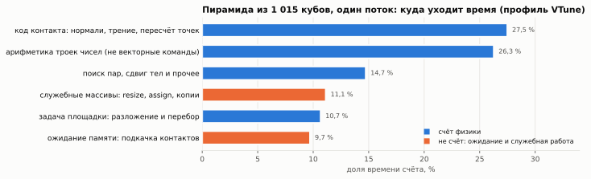

# Профиль VTune: куда уходит время кадра большой пирамиды

**Вывод.** Пятая часть времени кадра — не счёт физики: 9,7 % уходит на ожидание памяти (оно видно в командах
упреждающей подкачки контактов) и 11,1 % — на служебную работу с массивами. Первое лечится объёмом данных,
а не подкачкой: без подкачки кадр дольше — проверено опытом. Второе можно убрать, не меняя ответа.
Аппаратных счётчиков (промахи кэша, ошибки предсказания) нет: на свободной машине включён Hyper-V.

## Как снято

- Intel VTune Profiler 2024.3 на свободной машине (Xeon E5-2690 v3, Windows 10), поставлен 2026-11-21 под
  учётной записью `PC`; установщик — с сервера загрузок Intel, подпись проверена.
- Сбор «горячие места» выборкой по времени: `vtune -collect hotspots -knob sampling-mode=sw`, шаг выборки
  10 мс. Аппаратную выборку VTune не дал: «disable the Hyper-V feature» — процессор Haswell при включённом
  Hyper-V счётчики не отдаёт. Отключение Hyper-V — системная настройка с перезагрузкой, не трогалась.
- Программа — `compare-ours realtime 8`, `BENCH=14` (пирамида из 1 015 кубов, 60 кадров), один поток, шесть
  прогонов подряд: 30 с счёта, около 3 000 выборок. Сборка `build-prof` — та же Release с символами PDB
  (`-g -gcodeview`, `-Wl,--pdb=`).
- Сырьё: `docs/reports/data/vtune-pyramid-functions.csv` и `vtune-pyramid-lines.csv`; рисунок строит
  `validation/studies/profile_figures.py`.

Под профилировщиком кадр дольше (84 мс против 67), и во время сбора машину грузил пользователь (ffmpeg,
около двух ядер): доли времени верны, а абсолютным миллисекундам этого прогона верить нельзя.

## Куда уходит время

| Группа | Доля | Что это |
|---|---|---|
| код контакта | 27,5 % | `SoftContact`: нормали, трение, пересчёт точек, постройка |
| векторная арифметика | 26,3 % | `Vector3`, `Quaternion` — встроенные в тот же код сложения, произведения |
| поиск пар, сдвиг тел, прочее | 14,7 % | |
| служебные массивы | 11,1 % | `resize`, `assign`, `push_back`, копии — рабочие массивы задачи площадки и списки пар |
| задача площадки | 10,7 % | `solveDenseBlock` 8,2 %, `solveComplementarity` 2,4 % |
| ожидание памяти | 9,7 % | строка 163 `SoftContact.cpp` — цикл команд подкачки |

Самые горячие строки: цикл подкачки (`SoftContact.cpp:163`) — 9,0 %; сложение и вычитание векторов
(`Vector3.h:11–12`) — 13,0 %; чтение записи пары при постройке контакта (`SoftContact.cpp:88`) — 2,3 %.

## Что проверено опытом

**Подкачка не лишняя (H115, отклонено).** Гипотеза была: на машине с кэшем 30 МБ ожидания памяти нет, и 30
команд подкачки на обход контакта — чистая работа. Опыт — сборка без подкачки против нынешней, шесть пар
прогонов попеременно:

| | наименьшее | медиана |
|---|---|---|
| с подкачкой | 78,9 мс | 84,5 мс |
| без подкачки | 81,8 мс | 91,1 мс |

Без подкачки дольше в пяти парах из шести. Данные контактов этой сцены — 10 МБ: в кэш второго уровня
(256 КБ на ядро) они не помещаются, и каждая строка приходит из третьего. Подкачка платит это ожидание
заранее и пачкой; у потребителя оно стояло бы дольше.

## Что из этого следует

1. **Служебные массивы и задача площадки — 22 % кадра.** Рабочие массивы задачи площадки (плечи, матрица
   отклика, разложение) сейчас — векторы потока, которые на каждом вызове меняют размер. Для площадки до
   восьми точек их можно держать на стеке: ответ тот же бит в бит. Это следующий опыт (H116).
2. **Ожидание памяти — объём, а не подкачка.** Один обход контакта тянет 24 строки кэша, а проходу нужна
   треть. Плотная запись контакта (план, А2) и счёт четвёрками (шаг 5б) уменьшают именно это.
3. **Векторная арифметика — 26 %.** Это и есть работа, которую счёт четвёрками делает в четыре раза шире.
4. **Аппаратные счётчики.** Чтобы VTune показал промахи кэша и ошибки предсказания, на свободной машине нужно
   отключить Hyper-V (`bcdedit /set hypervisorlaunchtype off` и перезагрузка; вместе с ним перестанут
   работать WSL2 и виртуальные машины). Решение — за владельцем машины.
