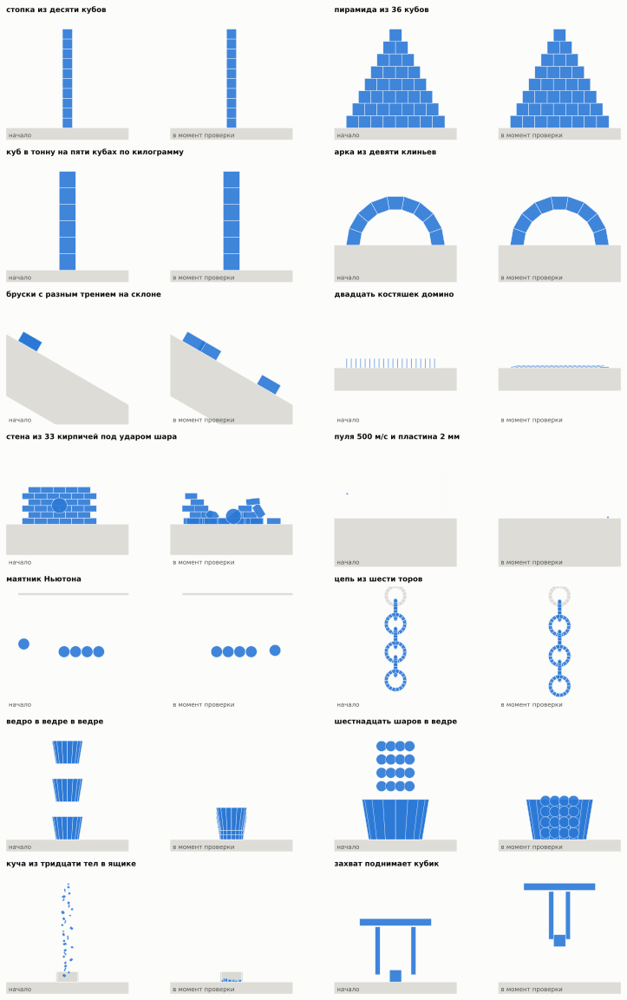
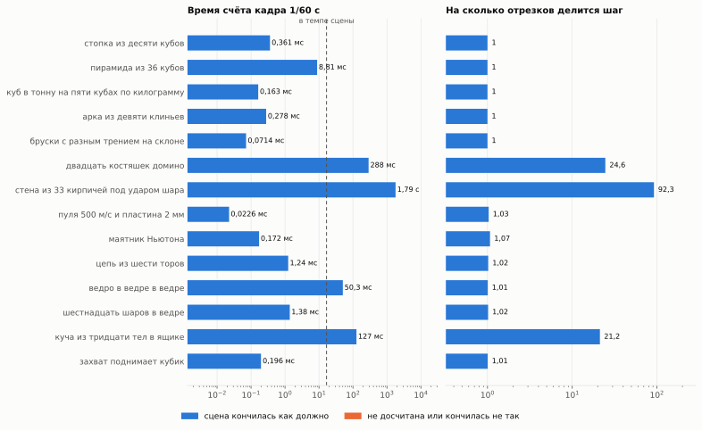

# Стандартный набор сцен

Состояние на 17.11.2026.

Четырнадцать сцен, которыми принято испытывать физические движки, собраны в `examples/scenes` и
считаются прибором `study-standard-scenes`. **Все четырнадцать кончаются как должно**; десять
считаются быстрее, чем идут, четыре — медленнее, самая дорогая — стена под ударом шара, 1,8 с на
кадр. По ходу работы сцены нашли в движке семь дефектов, которых не видела таблица случаев двух
тел; шесть исправлены, один — сходимость решателя при скольжении — остаётся.



## Что проверяется

У каждой сцены есть ответ, который известен заранее, и проверка сверяет с ним состояние мира.

| Сцена | Ответ | Допуск |
|---|---|---|
| бруски на склоне 30°, трение 0,2 / 0,5 / 0,8 | $s = \tfrac12\, g\,(\sin\theta - \mu\cos\theta)\,t^2$; при $\mu > \operatorname{tg}\theta$ брусок стоит | 0,1 % пути + 1 мм |
| маятник Ньютона, пять шаров | последний шар уходит со скоростью $v = \sqrt{2 g L (1 - \cos\varphi)}$, остальные стоят | остальные медленнее 0,1 м/с |
| цепь из торов | центры соседних звеньев отстоят на $2\,(R - r)$ | 1 см + 2 см на звено |
| ведро в ведре | стенки одинаковых конических вёдер встречаются, когда дно внутреннего выше дна наружного на $c = \dfrac{w H}{R_t - R_b} = \dfrac{0{,}01 \cdot 0{,}3}{0{,}05} = 6$ см ($w$ — толщина стенки, $H$ — высота, $R_b$, $R_t$ — радиусы дна и кромки) | 1 см |
| захват | кубик держится трением, пока $2 \mu F \ge m g$: $2 \cdot 0{,}5 \cdot 50 = 50$ Н против $9{,}81$ Н | проскальзывание меньше 2 мм |
| пуля 500 м/с, пластина 2 мм | за шаг пуля проходит 8,3 м — в четыре тысячи раз больше толщины пластины — и обязана остановиться на ней | — |
| стопка, пирамида, тяжёлое на лёгком, арка | покой: ни одно тело не сдвигается | 1–2 мм, 1 мм/с |

Данные замера лежат в `docs/reports/data/standard-scenes.jsonl`. Мерки цены и точности — те же, что в [таблице случаев](case-table.md): перекрытие — наибольшая
глубина, на которую тела вошли друг в друга; допуск движка — 10 мкм.

## Итог

| Сцена | Тел (частей) | Что обязано получиться | Итог | мс на кадр | Худший кадр, мс | Отрезков на кадр | Перекрытие, мкм |
|---|---:|---|---|---:|---:|---:|---:|
| стопка из десяти кубов | 11 | ни один куб не сдвинулся на 1 мм и не движется | как должно | 0,361 | 0,967 | 1 | < 0,01 |
| пирамида из 36 кубов | 37 | ни один куб не сдвинулся на 1 мм и не движется | как должно | 8,81 | 16,7 | 1 | < 0,01 |
| куб в тонну на пяти кубах по килограмму | 7 | стопка стоит при отношении масс 1 : 1000 | как должно | 0,163 | 0,271 | 1 | < 0,01 |
| арка из девяти клиньев | 10 | ни один клин не сдвинулся на 2 мм | как должно | 0,278 | 0,525 | 1 | < 0,01 |
| бруски с разным трением на склоне | 4 | путь за секунду — по формуле, до 0,1 % | как должно | 0,0714 | 0,085 | 1 | < 0,01 |
| двадцать костяшек домино | 21 | упали все двадцать костяшек | как должно | 288 | 825 | 24,6 | 8,7 |
| стена из 33 кирпичей под ударом шара | 35 | шар пробил стену, ничто не провалилось в пол | как должно | 1 790 | 12 890 | 92,3 | 6,8 |
| пуля 500 м/с и пластина 2 мм | 3 | шарик не прошёл сквозь пластину | как должно | 0,0226 | 0,128 | 1,03 | 0 |
| маятник Ньютона | 6 | после удара движется только последний шар | как должно | 0,172 | 1,62 | 1,07 | 0 |
| цепь из шести торов | 8 (113) | звенья висят на расстоянии 2 (R − r) и покоятся | как должно | 1,24 | 3,25 | 1,02 | 0 |
| ведро в ведре в ведре | 4 (52) | вёдра вошли друг в друга на расчётную глубину | как должно | 50,3 | 154 | 1,01 | < 0,01 |
| шестнадцать шаров в ведре | 18 (34) | все шары остались в ведре и покоятся | как должно | 1,38 | 12,3 | 1,02 | < 0,01 |
| куча из тридцати тел в ящике | 35 | все тела остались в ящике | как должно | 127 | 357 | 21,2 | 10 |
| захват поднимает кубик | 6 | кубик поднят вместе с кареткой, не выскользнул | как должно | 0,196 | 0,601 | 1,01 | < 0,01 |



Покоящиеся и «чистые» сцены считаются быстрее, чем идут: кадр 1/60 с занимает доли миллисекунды.
Дороги сцены, где за кадр происходят десятки событий — ударов и остановок скольжения: шаг
обрывается на каждом, и каждый обрыв — это заново найденные силы для всех тел.

## Сон островов

Покоящийся остров — тела, связанные касанием или сочленением, — засыпает через полсекунды покоя и
перестаёт считаться, пока к нему не сможет прикоснуться бодрствующее тело (`World::sleeping`,
выключено по умолчанию: сон останавливает тело, которое двигалось медленнее порога 0,1 мм/с, — это
допуск, а не точность). Со сном все четырнадцать сцен кончаются так же.

| Сцена | Без сна, мс на кадр | Со сном, мс на кадр | Спит тел в конце |
|---|---:|---:|---:|
| стопка из десяти кубов | 0,361 | 0,0683 | 10 из 11 |
| пирамида из 36 кубов | 8,81 | 1,18 | 36 из 37 |
| куб в тонну на пяти кубах по килограмму | 0,163 | 0,0227 | 6 из 7 |
| арка из девяти клиньев | 0,278 | 0,036 | 9 из 10 |
| бруски с разным трением на склоне | 0,0714 | 0,0658 | 1 из 4 |
| двадцать костяшек домино | 288 | 225 | 20 из 21 |
| стена из 33 кирпичей под ударом шара | 1 790 | 1 530 | 11 из 35 |
| пуля 500 м/с и пластина 2 мм | 0,0226 | 0,0191 | 0 из 3 |
| маятник Ньютона | 0,172 | 0,145 | 0 из 6 |
| цепь из шести торов | 1,24 | 0,168 | 6 из 8 |
| ведро в ведре в ведре | 50,3 | 7,33 | 3 из 4 |
| шестнадцать шаров в ведре | 1,38 | 0,272 | 17 из 18 |
| куча из тридцати тел в ящике | 127 | 92 | 6 из 35 |
| захват поднимает кубик | 0,196 | 0,187 | 0 из 6 |

Сон помогает сценам, которые приходят в покой: цепь, вёдра, шары в ведре, пирамида. Сценам, где
всё время что-то движется — домино, стена под ударом, куча, — он даёт немного.

## Что нашли сцены

**1. Перебор активного набора блуждал тысячами шагов — исправлено.** На покоящейся пирамиде из 36
кубов один кадр считался 65 с: 439 721 разложение Холецкого. В пирамиде сотни точек касаются без
нагрузки, задача вырождена, и перестановка «по одной точке» не сходилась. Запасной путь заменён
спуском по активному набору (Лоусон — Хэнсон): минимизируемая функция убывает на каждом шаге,
поэтому наборы не повторяются (лемма 20). Тот же кадр — 1,1 с, остальные — 30 мс.

**2. Плотная матрица при многих контактах между немногими телами — исправлено.** У ведра в ведре
около пятисот точек контакта на три тела: матрица 500 × 500 при ранге 18, одно разложение — 20 мс.
По тождеству Вудбери система решается в пространстве тел, размером шесть на тело (лемма 19):

$$ (P + J W J^{\mathsf T})^{-1} = P^{-1} - P^{-1} J \,(M + J^{\mathsf T} P^{-1} J)^{-1} J^{\mathsf T} P^{-1}. $$

Первая версия теряла точность — в последней формуле вычитаются близкие числа — и давала скоростям
ошибку $10^{-10}$ м/с, от которой шары в ведре дробили шаг на сотни ложных событий. Добавлено
уточнение по невязке, посчитанной в пространстве контактов. Кадр с вёдрами — 99 мс вместо 566.

**3. Поворот скольжения принимался за остановку — исправлено.** В домино шаг дробился на тысячи
отрезков, один кадр считался 194 с. Событие «скольжение остановилось» срабатывало и тогда, когда
скольжение только меняло направление: пара объявлялась неподвижной, срывалась и «останавливалась»
снова. Теперь остановка отличается от поворота, а второе такое событие у той же пары за шаг
событием не считается. Домино — 111 мс на кадр, все двадцать костяшек падают.

**4. Шаг вставал на паре капсул — исправлено.** В куче тел мир замирал на 79-м кадре: слежение за
ещё не коснувшейся точкой контакта у круглых форм мерило зазор не так, как сам контакт, и каждый
раз отвечало «касание сейчас». Таких точек слежение больше не берёт; перекрытия не допускает поиск
по истинному расстоянию. Куча досчитывается, вставших кадров нет.

**5. Швы между треугольниками рельефа ловили скользящий брусок — исправлено.** На полу из
треугольников брусок на шве останавливался и подпрыгивал на 5 см. Призма рельефа стала
односторонней: контакт с ней идёт только через сам треугольник. Путь бруска через швы теперь
совпадает с $v^2 / (2 \mu g)$ до 2 мм.

**6. Тела, уложенные вплотную без нагрузки, дробили шаг — исправлено.** Кирпичи одного ряда,
касающиеся боками, не давят друг на друга. Покоящаяся стена в шесть рядов без зазоров считалась
12 с на кадр, а покоящаяся пирамида из 36 кубов раз в несколько кадров считалась секунду. Причина
оказалась в решателе, в двух местах сразу.

- *Начальный активный набор.* Точка, которой до цели не хватало $10^{-12}$ м/с, объявлялась
  давящей, а у давящей точки скорость обязана сравняться с целью точно. Если тела заперты трением
  покоя, такому требованию не отвечает никакая сила: импульс ненагруженной точки рос на одну и ту
  же величину каждый круг.
- *Мерка сходимости.* Круги шли, пока менялись импульсы, хотя скорости были выполнены с первого
  круга: в вырожденной задаче импульсы могут меняться, не меняя скоростей.

Теперь точка давит, только если ей не хватает больше допуска, а круги кончаются, когда невязка
скорости меньше допуска. На пирамиде: решений с невязкой больше $10^{-9}$ м/с было 9 из 383 (до
$6\cdot10^{-4}$), стало 0 из 240; кругов на решение — 1 вместо 3,5. Стена без зазоров в покое —
8 мс на кадр, ни одного события.

| Сцена | Было, мс на кадр | Стало | Отрезков на кадр: было | стало |
|---|---:|---:|---:|---:|
| пирамида из 36 кубов | 30 | 8,81 | 1,01 | 1 |
| куб в тонну на пяти кубах по килограмму | 0,27 | 0,163 | 1 | 1 |
| арка из девяти клиньев | 0,451 | 0,278 | 1 | 1 |
| двадцать костяшек домино | 111 | 288 | 12,1 | 24,6 |
| цепь из шести торов | 1,88 | 1,24 | 1,02 | 1,02 |
| ведро в ведре в ведре | 98,5 | 50,3 | 1,01 | 1,01 |
| шестнадцать шаров в ведре | 3,58 | 1,38 | 1,02 | 1,02 |
| куча из тридцати тел в ящике | 232 | 127 | 29,3 | 21,2 |

**7. Чередование «нормали — трение» не сходится при скольжении — не исправлено.** В домино 60 %
решений кончаются по правилу «пять кругов без улучшения» с невязкой скорости больше $10^{-9}$ м/с,
до $8\cdot10^{-2}$. Исправление пункта 6 этого не касается, а число событий в домино с ним даже
выросло — с 12 до 25 на кадр, и сцена стала дороже. Здесь нужен другой счёт скользящих пар:
трение, связанное с нормальной силой внутри одной системы, а не обход пар по очереди.

## Что добавлено ради сцен

- **Составные тела** (`Body::compound`): невыпуклое тело — несколько выпуклых частей с общей
  динамикой; масса, центр масс и главные оси находятся по частям.
- **Разбиение невыпуклой сетки** (`Body::solid`, `convexParts`) — воксельный метод по образцу
  phys_realflow: рекурсивный разрез самой невыпуклой области через её выемку, подгонка частей к
  настоящей поверхности, слияние соседей. Тор — 12 частей, объём +3,3 %; выпуклое тело остаётся
  одной частью. Стенку тоньше двух вокселей метод передаёт плохо: ведро со стенкой 1 см выходит
  на 56–96 % объёмнее.
- **Точные тела вращения** (`Body::revolved`, `Body::torus`, `Body::bucket`): выпуклые клинья без
  приближения; масса совпадает с объёмом гранёной сетки до $10^{-9}$.
- **Неподвижный мир из треугольников** (`Body::ground`) с деревом частей: холмистый пол из
  20 000 треугольников с десятью телами считается 54 мс на кадр; пол из 3 200 — 24 мс вместо 72
  при переборе подряд. Дерево отбирает те же пары и в том же порядке, что перебор.
- **Сухое трение, демпфер и пружина в сочленении.** Пружина и демпфер считаются неявно и не
  добавляют энергии при любой жёсткости и любом шаге (лемма 21): пружина с h·ω = 17 не разносит счёт.
- **Пределы хода, предел силы привода, карданное сочленение.** Предел хода — событие шага: маховик
  на 50 000 рад/с останавливается на пределе с точностью полосы касания, $10^{-4}$ рад.

## Чего это стоит

Цена кадра складывается из двух множителей — числа отрезков и цены отрезка.

- Число отрезков: стена под ударом — 92 на кадр, домино — 25, куча тел — 21. Каждый удар и
  каждая остановка скольжения обрывают шаг для всех тел сразу, даже для тех, кого событие не
  касается.
- Цена отрезка: точное решение сил для всех тел; при скользящих парах — до сотни чередований
  «нормали — трение».

Раздельный счёт островов уберёт первое (сон островов уже есть, но помогает только покою); точный учёт скользящего трения в общей системе —
второе. Ни то, ни другое не сделано.

## Как повторить

```
cmake --build build -j
build/validation/studies/study-standard-scenes build/scenes.jsonl 900   # предел 900 с на сцену
python3 validation/studies/standard_scenes_figures.py build/scenes.jsonl
python3 validation/studies/standard_scenes_report.py build/scenes.jsonl
```

Те же сцены открываются в окне просмотра (`build/viewer/viewer`), после собственных сцен окна.
