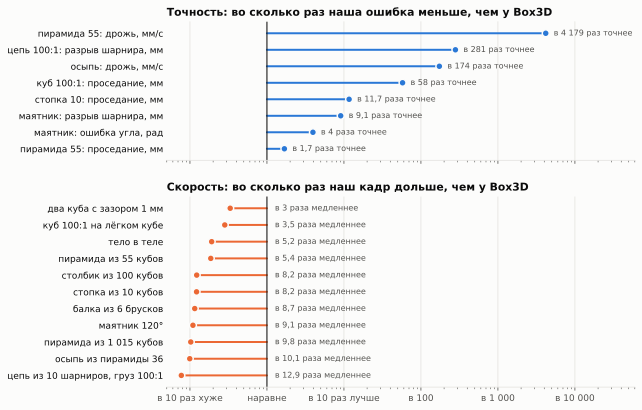
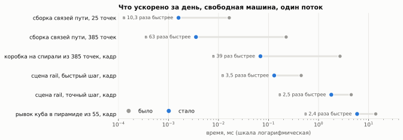
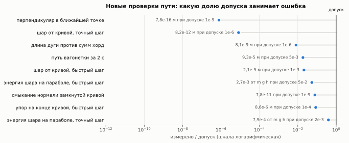
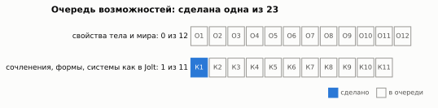

# Состояние на 2026-11-21: скорость, точность, возможности

**Вывод.** По точности быстрый шаг лучше Box3D на всех сравниваемых величинах при 8 подшагах — от 1,7 до
4 000 раз. По скорости он медленнее Box3D в 3–13 раз, и сегодняшние правки порядок отставания не изменили:
оно в устройстве решателя. Из очереди возможностей «как в Jolt» сделана одна из 23 — сочленение по
траектории; сверх очереди добавлены импульсы (взрыв и толчок) и окно для них. Повторяемость держится: хэш
состояния одинаков у двух компиляторов и при любом числе потоков.

Рисунки строит `validation/studies/status_figures.py`; числа в нём — снимок замеров, источник каждого назван
ниже.

## 1. Против Box3D

Отношение на рисунке — во сколько раз величина у Box3D больше нашей:

$$r_{\text{точность}} = \frac{\varepsilon_{\text{Box3D}}}{\varepsilon_{\text{мы}}}, \qquad r_{\text{скорость}} = \frac{t_{\text{Box3D}}}{t_{\text{мы}}}$$

**Скорость** — время кадра, свободная машина (Xeon E5-2690 v3), обе программы попеременно одним потоком на
закреплённом ядре, 2026-11-21:

| Сцена | Box3D, мс | мы, мс | отстаём |
|---|---|---|---|
| два куба с зазором 1 мм | 0,019 | 0,057 | в 2,9 раза |
| куб 100:1 на лёгком кубе | 0,017 | 0,060 | в 3,6 |
| пирамида из 55 кубов | 0,288 | 1,545 | в 5,4 |
| тело в теле | 0,018 | 0,094 | в 5,4 |
| стопка из 10 кубов | 0,034 | 0,279 | в 8,1 |
| столбик из 100 кубов | 0,345 | 2,819 | в 8,2 |
| балка из 6 брусков | 0,024 | 0,208 | в 8,5 |
| маятник 120° | 0,007 | 0,064 | в 8,7 |
| пирамида из 1 015 кубов | 6,97 | 68,0 | в 9,8 |
| осыпь из пирамиды 36 | 0,188 | 1,891 | в 10,0 |
| цепь из 10 шарниров, груз 100:1 | 0,045 | 0,582 | в 12,9 |

Box3D считает контакты четвёрками (AVX2), хранит контакт плотно и пары — между кадрами; мы считаем по
одному контакту. Это и есть остаток: перестройка решателя, а не отдельные правки.

**Точность** — табло `validation/run.py` ([engine-comparison.md](engine-comparison.md)), наш быстрый шаг и
Box3D при 8 подшагах, медиана 16 вариантов сцены с малыми возмущениями, прогоны 2026-11-18…20. Во всех
строках рисунка счёт вариантов 16 : 0 в нашу пользу. Одна величина при 4 подшагах хуже: проседание
пирамиды из 55 кубов 13,5 мм против 9,5 у Box3D.

## 2. Что ускорено за день

| Правка | Что измерено | Было → стало |
|---|---|---|
| H88: разложение идёт за набором давящих точек | рывок куба в пирамиде из 55, кадр | 13,9 → 5,9 мс |
| H89: матрица отклика без лишней памяти | стопка, осыпь, столбик | −4…10 % |
| H92: доиск контактов пропускает известные пары | стадия доиска | −34…40 % |
| H94, H95: GJK без копии симплекса и с ранним выходом | чаша / вёдра | −10,9 % / −5,6 % |
| H99: память площадок для пар частей составных тел | вёдра | −39 % |
| H101, H102: список пар и кандидаты живут между обновлениями | поиск пар пирамиды из 1 015 кубов | −8,8 % и −23 % |
| H105: поиск ближайшей точки пути с отсечением отрезков | сборка связей, 385 точек кривой | 225 → 3,6 мкс |

Отклонено замером и не повторяется в том же виде: H90, H93, H96, H97, H100 (журнал попыток).

## 3. Точность

**Повторяемость.** Хэш состояния сцен совпадает бит в бит у clang и g++ на свободной машине, при 1, 4 и 12
потоках и с затиранием памяти шага — сегодня проверено воротами четыре раза.

**Покрытие.** В полной таблице случаев контакта плохих клеток 893 из 7 425 (12 %), почти все — прирост
энергии (890); перекрытие — 5, пролёт — 1, шаг без конца — 1. Сегодня число не менялось. Стандартные сцены
быстрым шагом: проходят 18 из 19; не проходит `slope` — брусок с трением 0,2 проходит 1,6063 м вместо
1,6029.

**Новые проверки пути.** Допуск записывался до кода; рисунок показывает, какую его долю заняла ошибка:

Что замер нашёл в самой модели:

- сплайн Катмулла — Рома на окружности через 8 точек давал кривизну от 0,81 до 1,5 — центростремительная
  сила $m v^2 \kappa$ ошибалась от −19 % до +50 %. Кубический сплайн с непрерывной кривизной: 0,97…1,06;
- у связи «тело вслед за кривой» $e \cdot (\omega_b - \omega_a) - (e \cdot \Omega)\, T \cdot (v_b - v_a) = 0$ в
  уходе не хватало слагаемого $-(e \cdot d\Omega/ds)\, v^2$: ответ был верен, но точный шаг дробил кадр на
  сотню отрезков (41 537 на 420 кадров → 541);
- у упора на конце кривой быстрый шаг оставлял тело на 3,5 мм за концом — теперь 8,6e-6 м, как у ползуна.

**Открыто.** Точный шаг на качающемся теле дробит кадр на 2–10 отрезков и у шарового шарнира: подбор
связей ложно считает, что разошёлся (H104). Сцена `swing` из-за этого — 10 отрезков на кадр.

## 4. Возможности

| Сделано сегодня | Что это |
|---|---|
| `PathJoint` (К1) | точка тела идёт по сплайну; привод, трение, пружина, пределы; поворот тела — свободен, заперт или вслед за кривой |
| `Path` | кубический сплайн с непрерывной кривизной, длина дуги, нормаль без кручения, ближайшая точка |
| `applyRadialImpulse`, `applyDirectedImpulse` | взрыв и толчок телам в шаре действия, доля импульса $w = (1 - d/R)^n$ |
| окно «Импульсы» | источники списком: центр, радиус, импульс, спад, направление; шар и стрелки в сцене |

Сочленений восемь: шаровое, шарнир, ползун, цилиндрическое, жёсткое, кардан, привязь, по траектории. Из
двенадцати видов Jolt у нас пять; нет связи на расстоянии с пределами, конуса, «качания-кручения», шести
свобод, шестерни, рейки, блока. Из свойств тела и мира (О1–О12) не сделано ни одного: тела, движимого извне,
датчика, событий контакта, слоёв столкновений, силы и момента с накоплением.

## 5. Что дальше

1. **Скорость около Box3D** — перестройка решателя: плотная запись контакта, постоянные пары, счёт
   четвёрками. Недели работы и перезапись эталона хэша; точность держат ворота.
2. **Точный шаг с сочленениями** — условие расходимости подбора связей (H104).
3. **Свойства для робототехники** — сила и момент с накоплением внутри шага (О9) вместо импульса раз в
   кадр, тело, движимое извне (О2), датчик и события контакта (О4, О5).
