# Kinetica Physics · точность, опоры и новые механизмы

**На пирамиде из 1000 кубов Kinetica переносит 37,06 % многоточечных площадок, на вертикальном падении — 99,71 %.** После изменения обхода дерева средний кадр обрушения ускорился со 117,12 до 109,69 мс по медианам шести парных запусков. [Счётчики площадок на Windows](data/stress-1000-2026-11-24/manifold-counters-windows.tar.gz) · [Времена по парам](data/stress-1000-2026-11-24/tree-time-pairs.csv)

**Проход по опорам оставляем включённым по умолчанию.** При обрушении 1000 кубов число кадров за допуском снизилось с **5 до 0 из 120**. В сцене вложенных вёдер все **4440 кадров за 74 с** с включённым и выключенным проходом совпали по 13 компонентам позы и скорости каждого из четырёх тел. Штатный переключатель в окне находится в настройках шага и действует со следующего кадра. В C++ это `world.shockPropagation`. [Сырые прогоны и хеши Windows](data/stress-1000-2026-11-24/support-qualified-windows.tar.gz) · [Тест переключателя](../../validation/engines/stress/support/Drag.cpp)

| Утверждение | Ответ | Измерение |
|---|---|---|
| Обрушение проходит пределы 2 мм у пола и 5 мм между кубами | **Да, при ON** | Максимумы 1,323 и 4,388 мм. При OFF — 2,853 и 7,411 мм |
| Флаг сохраняет покой вложенных вёдер | **Да, для этой сцены** | Одинаковая траектория. В интервале 60–74 с — 112 297 стационарных переходов пар поверхностей, без разворота нормали на 5° |
| Оба решателя укладываются во все допуски для робототехники | **Нет** | При 60 Гц допуски прошли 19 из 22 показателей у событийного и 16 из 22 у быстрого |
| Есть доказательство точности контактов произвольной геометрии или реального робота | **Не проверено** | Здесь конечные сцены, аналитические расчёты и измерители геометрии симуляции |

## Скорость после изменения обхода дерева

На обрушении 1000 кубов получено **109,69 мс на кадр**. В той же серии контроль дал **117,12 мс**, проход по опорам включён у обеих сборок. Для Box3D сохранён прежний замер **10,76 мс**. Разница в сыром времени составляет **10,19 раза**. На этой сцене Box3D превысил пределы 2 мм у пола или 5 мм между кубами во всех 120 кадрах, максимумы составили 21,76 и 37,72 мм. Kinetica прошла оба допуска на каждом кадре. Время Box3D при прохождении этих допусков пока не установлено. Kinetica считала в `double`, штатный Box3D — в `float`. Геометрия, физический интервал, число внешних шагов и режим сна заданы общими. [Параметры и хеши стенда](data/stress-1000-2026-11-24/manifest.json) [Данные пяти движков](data/stress-1000-2026-11-24/summary.csv)

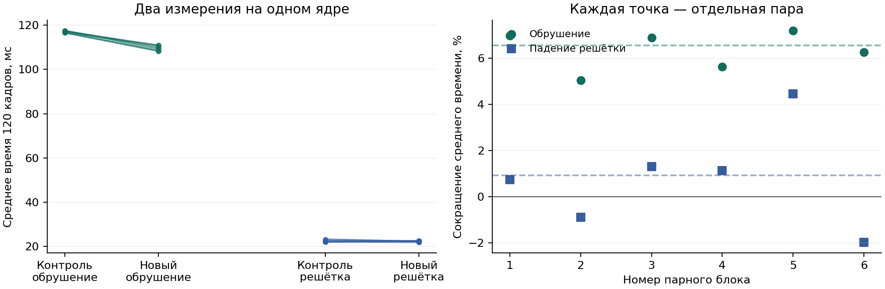

| Сцена | Контроль, мс | Новый обход, мс | Медиана парного сокращения | Выигрыши | p99 кадра до → после, мс |
|---|---:|---:|---:|---:|---:|
| Обрушение 1000 кубов | 117,12 | **109,69** | **6,58 %** | 6/6 | 262,02 → 262,83 |
| Вертикальное падение 1000 кубов | 22,36 | 22,41 | 0,94 % | 4/6 | 38,31 → 37,80 |

На Windows один поток был закреплён за одним логическим ядром Xeon E5-2690 v3. Один кадр — 1/60 с физического времени, восемь вызовов по 1/480 с. Сон выключен. В каждом блоке две отдельные серии по 120 кадров, порядок запусков чередовали. В таблице приведена медиана **среднего** времени кадра по шести запускам каждого варианта. Процент вычислен внутри каждой пары, $100(1-T_{нов}/T_{контр})$. Для пирамиды диапазон выигрыша 5,06–7,20 %, двусторонний точный знаковый тест $p=0{,}03125$, 95%-й интервал Уилсона для доли выигрышей 61–100 %. На падении $p=0{,}6875$. Ускорение редкого медленного кадра пирамиды не установлено. [Шесть пар и исходные времена](data/stress-1000-2026-11-24/tree-study-windows.tar.gz) · [Статистика](data/stress-1000-2026-11-24/tree-speed.csv)

### Какая работа исчезла

Прежний поиск начинал обход дерева от корня для каждого куба. Для любой пары листьев существует единственный ближайший общий предок. Поэтому достаточно у каждого внутреннего узла сопоставить его левую и правую ветви. Если их бруски не пересекаются, целый набор возможных пар исключается одной проверкой. Полученные пары сортируются по идентификаторам перед передачей физическому решателю. Листья с общей гранью, ребром или вершиной считаются пересекающимися. В пределе, когда пересекаются все $N$ брусков, сам список содержит $N(N-1)/2$ пар. [Обход дерева](../../include/collision/broadphase/DynamicTree.h) · [Потребитель пар](../../src/collision/PairFinder.cpp) · [Граничные случаи](../../tests/CollisionTests.cpp)

Перед замером с контролем побайтово сравнили файлы геометрии и хешей. Совпали **484 строки**: две сцены, включённые и выключенные опоры, 121 состояние от кадра 0 до 120. У оптимизации собственный оракул — полный перебор пар для сцен с известными брусками. Хеши траектории служат для обнаружения изменения результата. [Архив измерений, тесты и идентификаторы сборок](data/stress-1000-2026-11-24/tree-study-windows.tar.gz)

На расширенной проверке совпали 52 строки отпечатков за 60 кадров и 27 строк за 600 кадров быстрого шага с контрольной сборкой. Результат 60 кадров совпал при 1, 4 и 12 потоках, с очисткой временной памяти. В таблице 7 425 уникальных клеток, по четыре пробы на клетку, все записанные физические показатели совпали с контролем. В обеих сборках осталось **863 проблемных клетки**. У 861 превышен критерий энергии, у четырёх — критерий перекрытия, одна содержит незавершённый шаг. Категории могут пересекаться. Сохранённый в репозитории прежний эталон отпечатков расходится с обеими сборками в 23 из 52 строк (6 событийных и 17 быстрых). Эти различия существовали до оптимизации дерева. [Обе таблицы и выходы трёх режимов потоков](data/stress-1000-2026-11-24/tree-regression-windows.tar.gz)

### Как устроен Box3D

В исследованной версии Box3D `be8c73189` мир хранит отдельные деревья для статических, кинематических и динамических форм. Пока текущий брусок формы помещается в расширенный, обновление этого листа можно пропустить. Поиск новых пар проверяет метки изменений, при частичном перестроении пригодные поддеревья сохраняются. Уже созданные контакты учитываются отдельно. В Kinetica также есть повороты для балансировки и память списка кандидатов. Её запас равен 1 мм. Когда хотя бы одно тело выходит за запас, основной поиск строит список заново для всего мира. Обход через общего предка уменьшает цену такого поиска. [Поиск новых пар Box3D](https://github.com/erincatto/box3d/blob/be8c7318901dbb14b9fbb26fe0a7a48850f53b0e/src/broad_phase.c#L648-L690) · [Частичная перестройка Box3D](https://github.com/erincatto/box3d/blob/be8c7318901dbb14b9fbb26fe0a7a48850f53b0e/src/dynamic_tree.c#L2035-L2100) · [Проверка запаса Kinetica](../../src/collision/CandidateMemory.cpp)

На обрушении счётчики Kinetica подтвердили **0 повторных использований списка из 960 первичных поисков**. Каждый из них построил дерево, ещё 636 построений выполнил поиск дополнительных пар. На вертикальном падении тот же список выдержал 658 из 960 вызовов. Это указывает, в какой сцене имеет смысл проверять локальное обновление листьев. [Счётчики Kinetica и Box3D](data/stress-1000-2026-11-24/tree-counters.csv) · [Исходники измерителей](data/stress-1000-2026-11-24/tree-experiment-inputs.tar.gz)

У Box3D на обрушении получилось **5 329 488 повторных использований контакта на 5 681 439 обработок контактов бодрствующих тел** (93,81 %). Один физический контакт учитывается вновь на следующем подшаге. По встроенному профилю Box3D поиск новых пар занял 1,00 мс, обработка контактов — 4,57 мс, решение динамики — 5,51 мс за кадр в отдельном диагностическом прогоне. В Kinetica таймер первичного поиска включает и построение геометрии контакта. Для сравнения стадий придётся измерять одинаковые участки работы. Хеши обеих диагностических траекторий совпали с измеренными ранее, SHA-256 пяти исходных файлов Box3D на стенде совпали с ревизией `be8c73189`. [Показания за 960 вызовов на сцену](data/stress-1000-2026-11-24/tree-counters-windows.tar.gz) · [Условия повторного использования в Box3D](https://github.com/erincatto/box3d/blob/be8c7318901dbb14b9fbb26fe0a7a48850f53b0e/src/physics_world.c#L642-L700)

### Как Kinetica переносит контактную площадку

В быстром режиме Kinetica уже сохраняет локальные точки для многогранных площадок из 2–8 точек без скругления. Для опорной грани A записываются одна точка плоскости $q_A$ и нормаль $n_A$ в осях A. Для каждой точки на B записываются её локальные координаты $q_{B,i}$ и идентификатор. Передача в точный событийный решатель и геометрия одиночного контакта идут своими путями. [Запись и применение площадки](../../src/collision/ManifoldMemory.cpp) · [Путь быстрого решателя](../../src/world/World.cpp)

Для позы тела $T(q)=x+Rq$ локальные координаты задаются как $q_B=R_B^T(p_B-x_B)$. При новых позах каждое тело переносит свои точки и поворачивает нормаль. Для нормали от A к B получаем

$$
p_{B,i}'=x'_B+R'_B q_{B,i}, \qquad n'=R'_A n_A, \qquad p_0'=x'_A+R'_A q_A,
$$
$$
g_i=n'\cdot(p_{B,i}'-p_0'), \qquad p_{A,i}'=p_{B,i}'-g_i n'.
$$

Зазор $g_i$ измеряется в метрах. Те же вычисления можно вести в системе A через относительную позу $T_A^{-1} T_B$. В этих ортонормированных осях $R^{-1}=R^T$.

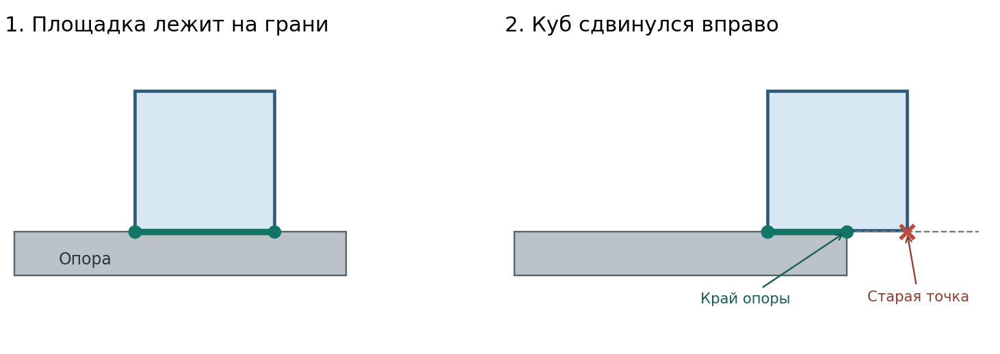

На рисунке после сдвига у старой точки всё ещё $g=0$, но опора под ней закончилась. Проверять приходится границы конечных граней, смену опорного ребра и появление новых точек. Текущий код допускает перенос, если совпадают формы и $\|\Delta x_{rel}\|+2R_{min}|\sin(\Delta\theta_{rel}/2)|+\max(0,r-r_0)\leq 0{,}2$ мм. Здесь $R_{min}$ — охватывающий радиус меньшей формы, $r$ — достижимое сближение за подшаг. Запас 1 мм у списка пар тел проверяется отдельно. [Порог контакта](../../include/dynamics/time_stepping/SoftStep.h) · [Проверка относительного движения](../../src/collision/ManifoldMemory.cpp)

Сняли показания в отдельной Windows-сборке с включёнными опорами, одним потоком и выключенным сном. Знаменатель в таблице — число многоточечных площадок, возвращённых первичным поиском пар за 120 кадров. Повторные наблюдения одной пары тел учитываются в каждом подшаге. Сравнение всех строк состояний и геометрии с контрольной сборкой прошло на обеих сценах.

| Многоточечные площадки | Перенесены | Построены заново | Доля переноса |
|---|---:|---:|---:|
| Обрушение 1000 кубов | 471 268 | 800 338 | **37,06 %** |
| Вертикальное падение 1000 кубов | 690 000 | 2 000 | **99,71 %** |

При обрушении **799 044** существующих записей вышли за порог. В **648 983** из них (81,22 %) одного поступательного смещения уже хватало для отказа. Отдельно обнаружено 567 560 свежих одноточечных контактов. У Box3D знаменатель счётчика — все обработки контактов бодрствующих тел. Сопоставление его 93,81 % с нашими 37,06 % потребует одинакового определения контакта в обоих приборах. Следующий опыт — перенос при тангенциальном скольжении с проверкой конечных границ граней и появления нового опорного элемента. Оракул — полный геометрический поиск в той же позе. [Сырые счётчики и траектории](data/stress-1000-2026-11-24/manifold-counters-windows.tar.gz) · [Исходники приборов](data/stress-1000-2026-11-24/tree-experiment-inputs.tar.gz)

#### Что произойдёт, если всегда переносить старые точки

Прибор вычисляет оба ответа для каждой отклонённой записи в одной и той же позе. Физическому решателю передаётся штатный ответ. Пределы сверки заданы заранее: прежние число и порядок идентификаторов, прежняя опорная сторона, угол нормалей до 0,05°, расхождение точек на каждой поверхности и зазоров до 0,02 мм. Эталоном здесь служит полный поиск текущей геометрии Kinetica. Это проверка эквивалентности двух алгоритмов.

| Сцена и условие | Записей | Перенос прошёл сверку | Расхождение |
|---|---:|---:|---:|
| Обрушение, все отклонённые записи | 799 044 | 168 043 (21,03 %) | **631 001** |
| Из них малый сдвиг в основном вдоль грани | 21 220 | 12 303 (57,98 %) | **8 917** |
| Вертикальное падение, все отклонённые записи | 1 000 | 1 000 | 0 |

В подвыборке малых сдвигов перемещение не больше 2 мм, его составляющая вдоль нормали, поворот на радиусе и прирост досягаемости не больше 0,02 мм каждый. В одном случае свежий поиск вернул пустую площадку. Сохранили две коробки, их позы, локальные якоря и плоскость. Отдельная Windows-программа воспроизвела этот случай без остальной пирамиды: перенос дал две точки, полный поиск — ноль. Среди всех расхождений обрушения у 486 101 записи совпали топология, идентификаторы и нормаль в допусках, но разошлась хотя бы одна координата якоря или зазор. Кандидат для следующей оптимизации — пересечение конечных граней в относительных координатах с повторным использованием проверенных признаков. Число допустимых переносов само по себе не измеряет экономию времени. [Сырые счётчики и исходный пример](data/stress-1000-2026-11-24/manifold-shadow-windows.tar.gz)

### Вопрос сообществу Box3D

В FAQ проекта для технической поддержки рекомендован общий Discord. Ниже черновик обращения. [FAQ Box3D](https://github.com/erincatto/box3d/blob/main/docs/faq.md#how-do-i-get-help) · [Discord проекта](https://discord.gg/NKYgCBP)

> Hi Erin and the Box3D community! We’re building a small C++ rigid-body engine for robotics students. We tested a collapsing 1,000-cube pyramid on one CPU thread with sleeping disabled. Each frame has eight world steps of 1/480 s. Over 120 frames, our broad phase rebuilt its entire tree on all 960 primary searches. We currently invalidate the candidate list when any body leaves its 1 mm motion allowance.
>
> We’ve read the partial rebuild in Box3D and the separate contact recycling code. If you were testing a persistent tree in this scene, which counter would you record first to tell whether updating only moved proxies is paying off? We can share the scene layout and frame-by-frame measurements. Thanks for documenting the implementation.

### Цель по скорости при сохранении точности

Цель этой сцены — не более 10,76 мс за физический кадр длительностью 1/60 с на измерительном ядре. Сегодня 109,69 мс. В первоначальном профиле даже после мысленного удаления обеих стадий поиска контактов оставалось 30,74 мс. Чтобы приблизиться к цели, придётся уменьшить и работу с ограничениями. [Профиль стадий](data/stress-1000-2026-11-24/stage-cost.csv) · [Intel VTune](data/stress-1000-2026-11-24/vtune-hotspots.csv)

| Очерёдность опытов | Что изменить | Когда принять |
|---|---|---|
| 1. Дерево между шагами | Хранить бруски тел и обновлять лист, когда его досягаемость перестала помещаться в прежний запас. Удалять устаревшие пары и находить новые | На одинаковых позах нет потерянных пар против перебора, порядок контактов и хеш каждого кадра сохранены, снижение времени воспроизводится |
| 2. Контакт при скольжении | Проверять конечный контур граней и вновь входящие вершины. Сохранять якоря и импульсы при прежних физических признаках | Новый геометрический поиск в той же позе подтверждает точки и зазоры. Обрушение, край опоры, вёдра и пороговый захват проходят свои допуски |
| 3. Решатель | Выделить стоимость сборки строк и поправок в VTune. Проверить повторное использование неизменной структуры. Пересчитывать численные коэффициенты при изменении масс, плеч или нормалей | Та же стационарность, невязки нормальных и касательных ограничений, баланс импульса и энергии. Измерить медиану и p99 кадра |

Сравнение при одинаковых входах и числе подшагов сохраняем отдельно. Для сравнения при одинаковой точности каждой сборке нужен замер с теми же допусками. Для текущего обрушения пределы — 2 мм у пола и 5 мм между кубами во всех 120 кадрах. В сохранённом опыте ReactPhysics3D получил 38,28 мс, 10,84 мм у пола и 15,86 мм между кубами. В захвате нужен отдельный оракул удержания, в падении — аналитическая траектория. [Сводка исходных измерений](data/stress-1000-2026-11-24/summary.csv)

### Сколько стоит штатный проход по опорам

Отдельный опыт переключал флаг в одном бинарном файле до изменения дерева. Столбец цены — медиана разности внутри шести пар.

| Сцена | Выключен, мс | Включён, мс | Парная цена, мс | Медленнее при включении |
|---|---:|---:|---:|---:|
| Обрушение 1000 кубов | 115,486 | 117,002 | +1,839 | 5/6 |
| Вертикальное падение 1000 кубов | 22,381 | 22,691 | +0,002 | 3/6 |
| Пирамида из 55 кубов в покое | 1,088 | 1,135 | +0,036 | 4/6 |

На обрушении медиана парной относительной цены равна 1,60 %, знаковый тест даёт $p=0{,}219$. Основание включить проход по умолчанию — пять спасённых кадров по критерию проникновения при сохранении покоя вёдер. [Исходные времена и порядок](data/stress-1000-2026-11-24/support-qualified-time.tar.gz) · [Парная сводка](data/stress-1000-2026-11-24/support-qualified-time.csv)

## Почему выбор зависит от острова

В первом варианте оба режима на вёдрах расходились на **26-м кадре**. Координата X первого ведра при OFF составляла +0,0866 мм, при безусловном проходе −0,0569 мм. На позднем интервале перестали наблюдаться стационарные переходы. Отбор только по числу строк тоже дал отказ — наблюдались 36 изменений нормали на 5° и более. В этом мире всего три подвижных тела, но сотни точек контакта. [Исходный контрпример, обе отклонённые версии и проверка исправления](data/stress-1000-2026-11-24/support-counterexamples.tar.gz)

В быстром решателе дополнительный проход теперь получает остров, у которого **и число нормальных строк, и число степеней свободы подвижных тел** превышают предел совместного решения. При штатном пределе 512 это означает как минимум 86 подвижных тел и 513 строк в одном острове. Контакты через общий неподвижный пол соединения островов не создают. В выбранном острове проход следует от неподвижной опоры вверх и обратно. Поправка включается, если за подшаг прогнозируется лишнее сближение больше 0,1 мм. В событийном решателе остаётся отдельная проверка невязки в удерживаемом контакте. [Выбор островов](../../src/dynamics/time_stepping/IslandNormals.cpp) · [Нормальные импульсы быстрого шага](../../src/dynamics/time_stepping/SupportNormals.cpp) · [Событийный шаг](../../src/dynamics/event_driven/ShockPropagation.cpp)

Для единичной нормали $n$, зазора $s$ в метрах, подшага $h$ в секундах и нормальной скорости $u$ в м/с быстрый проход вычисляет

$$
u_*=-\frac{\max(s,0)}h,\qquad j=\frac{u_*-u}{K},\qquad
\Delta T=ju+\tfrac12Kj^2\le0 .
$$

Здесь $K=JM^{-1}J^T>0$ в кг⁻¹. Последнее неравенство следует из условия применения $u<u_*\le0$. Реакции $-jn$ и $+jn$ прикладываются в общей точке, $j$ измеряется в Н·с. Это баланс отдельной пассивной поправки. Мышь, привод и движущаяся опора могут совершать внешнюю работу.

## Точность за пределами пирамиды

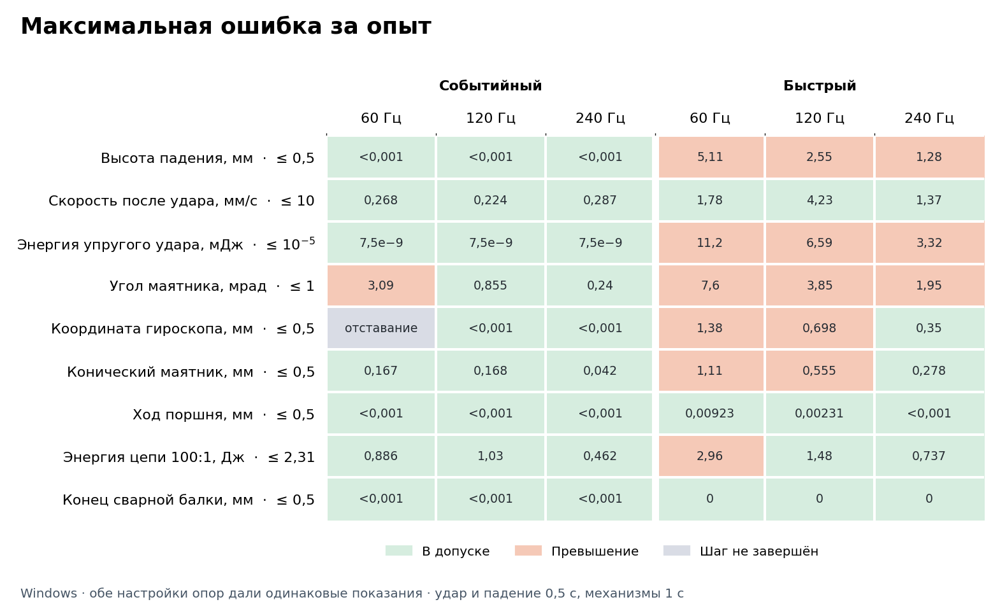

Windows, Release, clang 23.1.6, `Real=double`, один поток, сон выключен. Частоты внешнего шага 60, 120, 240 Гц. У быстрого решателя штатные 8 подшагов, у событийного предел 64 отрезка на вызов. Падение и удар длились 0,5 с, механизмы — 1 с. Геометрический прибор измеряет в мире расстояние между анкерами, у ползуна — поперечное отклонение, у шарнира — угол между осями. У цепи десять звеньев и отношение масс 100:1. Допуск изменения энергии равен 0,1 % от начальной энергии при выбранном нуле высоты. Для маятника 120° эталон — отдельное уравнение одной степени свободы, RK4 с шагом 10 мкс. [Прибор и допуски](../../validation/engines/stress/support/PhysicalAccuracy.cpp) · [Уравнения эталонных сцен](../../examples/scenes/ExactScenes.cpp)

| Допуски пройдены | 60 Гц | 120 Гц | 240 Гц |
|---|---:|---:|---:|
| Событийный решатель | 19/22 | **22/22** | **22/22** |
| Быстрый решатель | 16/22 | 17/22 | 19/22 |

Получены **264 строки**. Для каждой из 132 пар показателей ON/OFF совпали ошибка, статус завершения и вердикт. Это показатели восьми фиксированных сцен. Доля успешных строк не оценивает вероятность успеха на случайном роботе. Файл содержит единицы, допуски, первый кадр нарушения и кадр максимума. [Полный CSV](data/stress-1000-2026-11-24/support-oracles.csv)

- **Свободное падение.** Через 0,5 с при 60 Гц ошибка высоты быстрого шага равна **5,109375 мм**, при 120 и 240 Гц — 2,554688 и 1,277344 мм. Допуск 0,5 мм превышен на всех трёх частотах. При 60 Гц первый отказ на кадре 3. Формула объясняет значения без подгонки. При $v_{k+1}=v_k+gh$ и $y_{k+1}=y_k+h v_{k+1}$ ошибка $|y-y_{\rm exact}|=|g|Th/2$. Здесь $T=0,5$ с, $h=1/(8f)$. У событийного решателя на том же опыте ошибка высоты лежит в пределах $3,4\cdot10^{-15}$ м. [Шаг позы в быстром решателе](../../src/dynamics/time_stepping/StepKinematics.h)
- **Косой упругий удар.** При 60 Гц ошибка скорости после удара — **0,000268 м/с** в событийном и **0,001780 м/с** в быстром режиме, оба прошли предел 0,01 м/с. В быстром режиме максимальная ошибка кинетической энергии за опыт — **0,01120 Дж** при пределе $10^{-8}$ Дж. Одна правильная конечная скорость не устанавливает энергетическую точность всего удара. [Строки измерителя](data/stress-1000-2026-11-24/support-oracles.csv)
- **Гироскоп.** На 60 Гц первый кадр событийного решателя исчерпал бюджет отрезков. Сравнение координаты по запрошенному времени даёт расхождение около 46 мм, в него входит отставание часов. На 120 Гц шаги завершены и максимум ошибки равен **0,000520 мм**. [Строки измерителя](data/stress-1000-2026-11-24/support-oracles.csv)

## Что взяли из устройства Jolt

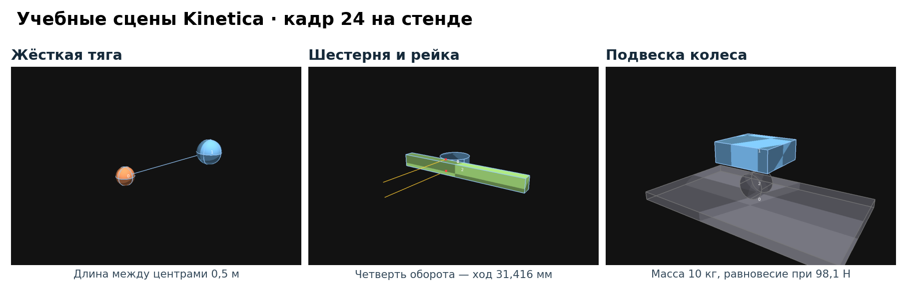

| Возможность из списка Jolt | Что доступно в Kinetica |
|---|---|
| Fixed, Point, Hinge, Slider | Сварка, шаровая опора, шарнир и ползун доступны через `World` |
| Path, Gear | Путь по сплайну, три режима ориентации. Зубчатая передача реализована для параллельных неподвижных осей |
| **Distance** | Новая жёсткая тяга фиксирует начальное положительное расстояние между анкерами. В окне — «тяга между двумя свободными телами» |
| **RackAndPinion** | Новая идеальная передача связывает рейку на ползуне с шестернёй на шарнире. В окне — «реечная передача с реверсом» |
| **Vehicle** | Доступны стенд подвески и машина с четырьмя виртуальными ведущими колёсами и рулевой передней осью. Ободам задаётся скорость. Двигатель с коробкой передач и гусеницы пока не реализованы |
| Cone, SwingTwist, SixDOF, Pulley | В текущем SDK нет отдельных реализаций этих четырёх классов. Для плеча манипулятора следующий существенный механизм — раздельные пределы наклона и кручения. Для тросового привода — блок с двумя точками направляющих |

Обе новые связи используют существующий `Joint` и передают одну скалярную строку `Bond` обоим решателям. Учебные сцены используют те же классы, что и публичный SDK. Мы взяли у Jolt постановку ограничений и разделение колеса, подвески и сцепления. Формулы и C++ написаны для представления Kinetica. [Jolt 5.3.0, Distance](https://github.com/jrouwe/JoltPhysics/blob/v5.3.0/Jolt/Physics/Constraints/DistanceConstraint.cpp) · [Jolt, реечная передача](https://jrouwe.github.io/JoltPhysicsDocs/5.3.0/class_rack_and_pinion_constraint_settings.html) · [Jolt, колёсный контроллер](https://github.com/jrouwe/JoltPhysics/blob/v5.3.0/Jolt/Physics/Vehicle/WheeledVehicleController.cpp) · [Источники и лицензия](../../THIRD_PARTY_NOTICES.md)

| Оракул новой сцены | Событийный | Быстрый |
|---|---:|---:|
| Тяга 0,5 м, максимальная ошибка длины за 1 с при 120 Гц | $1,06\cdot10^{-11}$ мм | **0,000272 мм** |
| Невязка полного момента импульса свободной пары | $4,17\cdot10^{-17}$ Н·м·с | $7,92\cdot10^{-16}$ Н·м·с |
| Рейка радиусом 20 мм, ход после четверти оборота | 31,415927 мм | 31,415927 мм |
| Рейка после реверса, модуль остаточного хода | $2,61\cdot10^{-15}$ мм | $1,05\cdot10^{-13}$ мм |
| Подвеска 10 кг, статическая реакция | 98,1 Н | 98,1 Н |
| Подвеска, максимальная ошибка высоты за 1 с при 480 Гц | 0,06283 мм | 0,06676 мм |

У тяги $C=\|p_B-p_A\|-L$ в метрах. У передачи $s=r\theta$, поэтому при $r=0,020$ м и $\theta=\pi/2$ рейка проходит 31,415927 мм. Опора колеса задаёт $N=\max(0,kx+c\dot x)$ при положительном сжатии. У критически затухающей подвески $y(t)=y_{eq}+A(1+\omega t)e^{-\omega t}$, $\omega=\sqrt{k/m}$. Касательные силы при совместном скольжении лежат в эллипсе сцепления. На стенде проверены отрыв, нулевое сцепление на одной оси, девять сочетаний знаков скольжения, реверс и переход через несколько оборотов. [Тяга](../../src/joints/DistanceJoint.cpp) · [Передача](../../src/joints/RackAndPinionJoint.cpp) · [Колесо](../../src/dynamics/WheelContact.cpp) · [Числа модульных тестов](data/stress-1000-2026-11-24/support-unit.txt) · [Кадры настоящего окна](data/stress-1000-2026-11-24/support-mechanisms-gui.tar.gz)

**Сборка тяги, рейки и одноколёсного стенда.** До добавления машины на Windows прошли **23 из 23 запущенных CTest**, в составе модульного набора **19 034 проверки, 0 отказов**. В числе CTest есть переключение флага, покой вёдер, захват, скольжение с переходом в качение и проверка контактов. Оболочечные проверки символов и внешние доказатели в эту цифру не входят. Хеш архива исходников и исполняемых файлов лежит в сыром архиве. [Журнал CTest](data/stress-1000-2026-11-24/support-ctest.txt) · [Замер структуры и проверка символов двух библиотек](data/stress-1000-2026-11-24/support-structure.tar.gz)

### Управляемая машина

Сцена **№ 50 «машина на четырёх колёсах»** открывается по ключу `--scene vehicle`. W и S задают ход вперёд и назад, A и D поворачивают передние колёса. Отпускание педали задаёт нулевую скорость обода и тормозит шасси через сцепление с дорогой. Камера следует за машиной. Каждый луч игнорирует собственное шасси и находит поверхность дороги. Силы прикладываются к обоим телам в одной точке. На следующем шаге мира сила в ньютонах действует на интервале $h$, импульс равен $Fh$ Н·с. [Модель](../../src/world/VehicleConstraint.cpp) · [Сцена](../../examples/scenes/Vehicle.h)

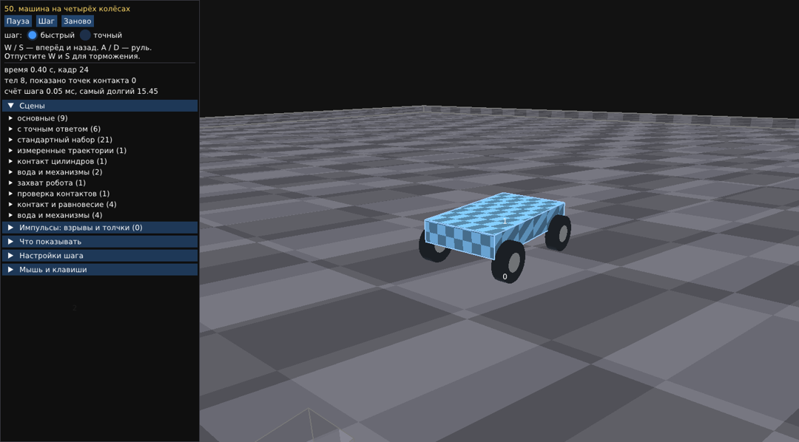

| Проверка | Результат |
|---|---|
| Вес шасси 80 кг и суммарная статическая реакция | 784,8 и 784,8 Н. Все четыре колеса в допуске 0,1 % |
| Шасси в воздухе, включён привод | Нулевая сила у всех четырёх колёс |
| Подвижная дорога под стоящим шасси | Сумма сил в пределах $10^{-9}$ Н, сумма моментов относительно общего начала в пределах $10^{-9}$ Н·м |
| Прямой ход за 0,75 с при скорости ободов 4 м/с | 2,0013 м у событийного шага, 2,0054 м у быстрого |
| Зеркальные углы передних колёс ±0,35 рад | Боковые смещения ±0,6518 м и ±0,6554 м соответственно |
| Поворот, задний ход и отпускание газа | Оба решателя прошли тесты. В окне отдельно проверены реальные нажатия W, W+A, W+D и S |

Новая сборка на Windows прошла 23 из 23 запущенных CTest и 19 068 модульных проверок. Графическое окно собрано и испытано через WSL на том же стенде. Один луч на колесо и привод с заданной скоростью — принятые упрощения этой учебной модели. Ступеньки, конечная ширина пятна шины, полная трансмиссия и соответствие конкретному роботу требуют самостоятельных опытов. [Проверки машины](../../tests/VehicleTests.cpp) · [Исходный журнал Windows](data/stress-1000-2026-11-24/vehicle-windows.tar.gz) · [Кадр и показания при нажатиях](data/stress-1000-2026-11-24/vehicle-gui-windows.tar.gz)

## Предыдущая серия на опытном проходе

**Геометрия кандидата на обрушении 1000 кубов.** Число кадров с превышением допуска снизилось с **5 до 0 из 120**. Максимальное проникновение в пол уменьшилось с **2,853 до 1,323 мм** (на 54 %), между кубами — с **7,411 до 4,388 мм** (на 41 %). При этом физический кадр стоил на **1,86 мс больше** по медиане десяти пар, или **+1,55 %**. Допуски заданы до опыта — 2 мм у пола и 5 мм между кубами. Сняты позы на границе каждого кадра. [Исходная геометрия и проверка баланса](data/stress-1000-2026-11-24/rest55-windows.tar.gz) · [Парные времена](data/stress-1000-2026-11-24/support-time-pairs.csv)

### Цена опытного прохода до отбора по размеру острова

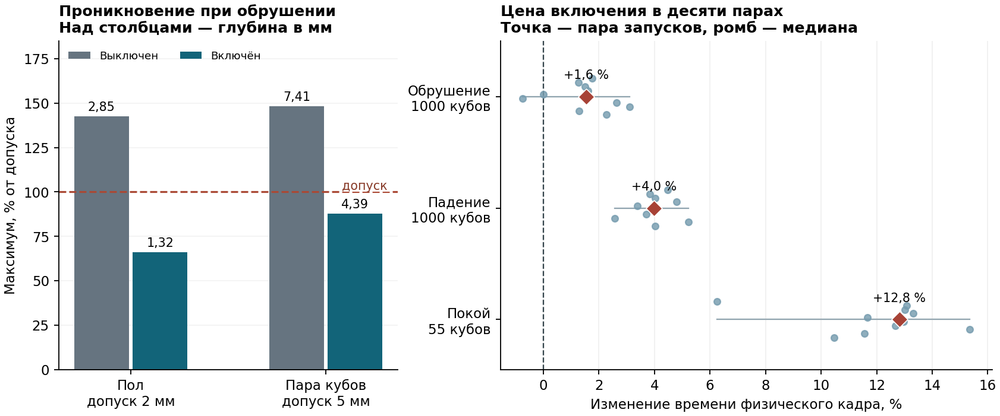

| Сцена | Выключен, мс/кадр | Включён, мс/кадр | Цена по парам | p99 кадра, выкл. → вкл., мс | Медленнее с проходом |
|---|---:|---:|---:|---:|---:|
| Обрушение 1000 кубов | 119,76 | 121,61 | **+1,55 %** | 260,08 → 262,12 | 8 из 10 |
| Вертикальное падение 1000 кубов | 22,43 | 23,38 | **+3,98 %** | 38,66 → 39,91 | 10 из 10 |
| Устоявшаяся пирамида из 55 кубов | 1,217 | 1,361 | **+12,82 %** | 1,269 → 1,436 | 10 из 10 |

Для игровой пирамиды сначала отсчитали 23 с симуляции без мыши и сна, затем измерили следующие 2 с. Обе конфигурации воспроизвели одинаковый итоговый хеш поз и скоростей. Медианная добавка по парам составила **0,151 мс за кадр**. Замедление наблюдалось во всех десяти парах, от **6,25 до 15,35 %**. На этой сцене интервал Уилсона для доли замедлений равен **72–100 %**, двусторонний критерий знаков даёт **0,00195**. [Измеритель физического шага сцены № 7](../../validation/engines/stress/support/Drag.cpp)

На обрушении разброс цены по парам составил от **−0,74 до +3,10 %**. Для доли пар с замедлением 95%-й интервал Уилсона равен **49–94 %**. Двусторонний критерий знаков даёт $p=0{,}109$. При пороге 0,05 эти десять пар оставляют направление изменения статистически неопределённым. На вертикальном падении разброс составил **+2,57…+5,23 %**, интервал Уилсона **72–100 %**, $p=0{,}00195$. Во всех 121 сохранённых геометрических отсчётах вертикального падения совпали хеши двух режимов, а счётчик дополнительных импульсов остался на нуле. Затраты на поиск подходящих опор видны даже при таком исходе. [Сводка с p99 и статистикой](data/stress-1000-2026-11-24/support-time-summary.csv)

В таблице времени каждый запуск — это 120 физических кадров, а его результат — их среднее время. Два столбца в миллисекундах показывают медианы десяти запусков каждого режима. Цену считали внутри каждой пары и брали её медиану. p99 — 99-й процентиль всех 1200 отдельных кадров режима в данной сцене. Во всех сериях порядок «включён первым» и «выключен первым» встречается по пять раз. Замеры выполнены на Windows, Xeon E5-2690 v3, в одном закреплённом потоке. В каждой паре использовали один исполняемый файл. Рисование, запись CSV и диагностика баланса вынесены из таймера. [Сценарий замера](../../validation/engines/stress/support/time-windows.ps1) · [Исходные 120-кадровые ряды и хеши](data/stress-1000-2026-11-24/support-timing-windows.tar.gz) · [Расчёт сводки](../../validation/engines/stress/support/timing.py)

$$
\bar t_i=\frac{1}{120}\sum_{f=1}^{120}t_{i,f},\qquad
C=\operatorname{median}_{i=1}^{10}\left[100\left(\frac{\bar t_{i,\mathrm{вкл}}}{\bar t_{i,\mathrm{выкл}}}-1\right)\right].
$$

Добавочный проход включается для точки, если за подшаг прогнозируется лишнее сближение больше **0,1 мм**. Пирамида продолжила рассыпаться. За две секунды вершина опустилась на **1,00 м** с проходом и **1,49 м** без него. Независимого эталона траектории после обрушения нет. Установлен выигрыш по двум заданным пределам проникновения. Исходный режим нарушил эти пределы, поэтому вопрос о скорости двух решений **при одной достигнутой точности** на этой пирамиде остаётся открытым. [Измеритель глубины](../../validation/engines/stress/StressReadings.h)

## Первоначальное сравнение пяти движков

До изменения обхода дерева и штатного прохода по опорам на Windows один физический кадр обрушения занял **118,12 мс у Kinetica, 10,76 мс у Box3D и 38,28 мс у ReactPhysics3D**. Kinetica показала наименьшее из пяти движков максимальное проникновение и в пол, и в соседний куб. Она превысила заданный допуск в **5 кадрах из 120**. На второй сцене, вертикальном падении 1000 кубов, Kinetica прошла оба допуска за **22,63 мс на кадр**. [Сводка с кадрами нарушений](data/stress-1000-2026-11-24/summary.csv) · [Исходные измерения Windows](data/stress-1000-2026-11-24/raw-windows.tar.gz)

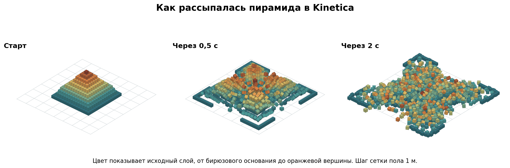

## Почему дрожала пирамида из 55 кубов

На записи от 24 ноября в 05:07 открыта сцена № 7. Куб имеет ребро 0,40 м и плотность 1000 кг/м³. Масса каждого из 55 подвижных кубов равна 64 кг во всех опытах. Через 3,1 с от начала записи на панели видны **25,45 с симуляции, кадр 1527 и 636 точек контакта**. На этом же кадре на Windows прежняя сборка дала те же 636 точек. Скорость самой быстрой вершины по всем 440 вершинам составила **8,37 мм/с**, максимальное перемещение вершины за кадр — **0,136 мм**. У исправленной сборки и контроля на этом кадре было 580 точек. Часы на панели показывают физическое время с момента запуска сцены. [Кадр записи](figures/rest55-video-frame.jpg) · [Измеритель восьми вершин каждого куба](../../validation/engines/stress/support/Rest55.cpp)

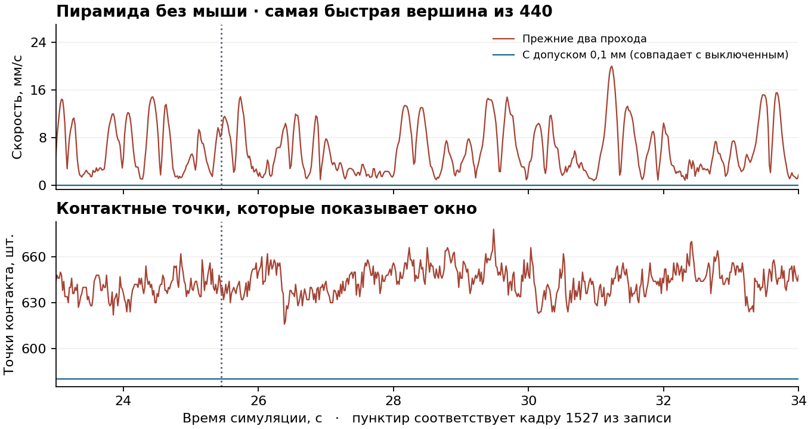

На интервале 23–34 с в прежней сборке медиана максимальной скорости вершины за кадр достигала **4,61 мм/с**, пик **20,02 мм/с**. Скорость превышала 0,1 мм/с во всех 661 отсчётах. В исправленной сборке пик составил **2,79·10⁻¹¹ мм/с**. Все 2101 строки прибора покоя побайтово совпали с отключённым проходом. Режим сна выключен. При отдельном центральном толчке верхнего куба на 32 Н·с его центр сместился на **23,96 мм**. [Исходные строки Windows](data/stress-1000-2026-11-24/rest55-windows.tar.gz)

### Можно ли вытащить опору и обрушить пирамиду

После 23 с покоя на Windows один и тот же жест провели за три разных куба. Камера строит луч по пикселю, окно создаёт привязь в точке попадания. Цель движется на 125 пикселей вправо и 65 вверх за 30 кадров, удерживается 60 кадров, затем привязь отпускают и наблюдают ещё 60 кадров. Во всех девяти опытах был выбран нужный куб. Таблица показывает **максимальное смещение центра от исходной позиции** и наибольшее одновременное число **других** кубов, чьи центры ушли дальше 5 см. Падение после отпускания входит в измерение смещения. [Прибор перетаскивания](../../validation/engines/stress/support/Drag.cpp) · [Девять строк сравнения](data/stress-1000-2026-11-24/rest55-drag.csv)

| За какой куб потянули | Проход выключен, м | Прежний, м | Исправленный, м | Других кубов дальше 5 см во всех трёх режимах |
|---|---:|---:|---:|---:|
| Верхний № 55 | 4,875 | 4,883 | 4,875 | 0 |
| Средний № 33 | 2,357 | 2,344 | 2,289 | 10 |
| Нижний № 5 | 1,645 | 1,722 | 1,630 | 44 |

При извлечении нижнего куба исправленный решатель допускает обрушение. В прежнем событийном проходе поправку получало только верхнее тело. При подвижном нижнем теле это нарушало баланс пары. Быстрый опытный проход сцены № 7 прикладывает обе реакции. В обрушении 1000 кубов измерены **38 210 внутренних** и **14 409 внешних** поправок. Максимальные невязки каждой поправки с учётом реакции пола составили **1,26·10⁻¹⁵ Н·с** по импульсу и **4,07·10⁻¹⁵ Н·м·с** по моменту. Положительного приращения кинетической энергии от отдельной поправки не наблюдалось. Баланс всего движения пирамиды при перетаскивании дополнительно включает тяжесть, реакцию пола и работу мышиной привязи. [Событийный проход](../../src/dynamics/event_driven/ShockPropagation.cpp) · [Проверка поправок](../../validation/engines/stress/support/SupportAudit.h)

### Куда попадал луч при быстром движении мыши

В настоящем окне на Windows-стенде через WSL и частный экран X11 нажали на нижний куб № 5 в пикселе (911, 506), затем сместили курсор на 125 пикселей вправо и 65 вверх. В первом случае окно успело обработать нажатие до перемещения. Во втором оба события накопились до одного опроса, кнопка оставалась зажатой. В обоих случаях действовал один и тот же исправленный физический проход. Смещение центра считали из штатной команды окна, которая выдаёт координаты с шагом 1 мм.

| Доставка событий в окно | Старый обработчик, смещение куба № 5 во время удержания | Исправленный обработчик |
|---|---:|---:|
| Нажатие обработано до первого движения | 1,522 м | 1,506 м |
| Нажатие и движение поступили в одном опросе | **0,000 м** | **1,519 м** |

Раньше окно строило первый луч после чтения всей очереди событий, по последней позиции курсора. При быстром движении привязь к исходному кубу терялась. Теперь обработчик движения сохраняет координаты по порядку доставки, а событие нажатия сразу выбирает тело. При исправленном быстром захвате через 0,45 с после отпускания центры 44 других кубов находились дальше 5 см от начальной позиции. В записи пользователя нет журнала событий кнопки. Этот опыт воспроизводит механизм отказа и его исправление. [Исходные отсчёты](data/stress-1000-2026-11-24/rest55-window-input.csv) · [Обработка нажатия](../../viewer/main.cpp) · [Документация GLFW по кнопкам мыши](https://www.glfw.org/docs/latest/input_guide.html#input_mouse_button)

В отдельной серии со старой дрожащей пирамидой получены те же два исхода. Движение после обработанного нажатия дало **1,624 м**, оба события между кадрами — **0,000 м**. В новой сборке быстрое движение снова вытянуло куб на 1,533 м. Нажатие на боковой панели и отпускание до первого движения по сцене дали по 0,000 м. [Восемь контрольных жестов](data/stress-1000-2026-11-24/rest55-window-controls.csv) · [Сценарий воспроизведения и хеши программ](data/stress-1000-2026-11-24/rest55-window-replay.tar.gz)

## Кто быстрее в парном опыте — Box3D или Jolt?

**Box3D выиграл 12 из 12 дополнительных пар на каждой сцене.** Обе программы считали одним потоком в точности float. Число пар зафиксировано до подтверждающей серии. Внутри каждой пары порядок двух программ выбирался псевдослучайно с зерном 20261124. Один результат программы — среднее время её 120 физических кадров. Пять предварительных блоков в эту проверку не входят. [Все 24 пары и порядок запуска](data/stress-1000-2026-11-24/box3d-jolt-pairs.csv)

| Сцена | Box3D, мс/кадр | Jolt, мс/кадр | Ускорение Box3D, медиана пар | Диапазон по 12 парам |
|---|---:|---:|---:|---:|
| Обрушение пирамиды | 10,55 | 28,62 | **2,73×** | 2,62–2,80× |
| Вертикальное падение | 2,81 | 8,83 | **3,16×** | 3,05–3,27× |

В первых двух столбцах — медианы 12 средних времён. Для ускорения сначала вычислено отношение Jolt/Box3D **внутри каждой пары**, затем взята медиана. Если при равной скорости порядок побед в разных парах случаен и равновероятен, двусторонний точный критерий знаков даёт $p=2/2^{12}=0{,}0004883$ для каждой сцены. При учёте обеих проверок по Бонферрони получается $p=0{,}000977$. 95%-й интервал Уилсона для доли побед при 12 из 12 составляет **75,8–100 %** в модели независимых повторов этого же опыта. На пирамиде и при вертикальном падении обе конфигурации превысили заданные допуски проникновения. [Расчёт статистики](../../validation/engines/stress/paired.py) · [Сводные числа](data/stress-1000-2026-11-24/box3d-jolt-statistics.csv)

## Какие задачи покрывают Box3D и Jolt

По официальным API, просмотренным 24 ноября 2026 года, **у Jolt шире набор готовых механических моделей**. У обоих есть твёрдые тела, непрерывное обнаружение столкновений, выпуклые формы, треугольные сетки, рельеф, сенсорные объёмы, запросы лучом и движущейся формой. Многопоточные возможности в этом опыте оценить нельзя, потому что стенд использовал один логический процессор. [Возможности Box3D](https://github.com/erincatto/box3d#features) · [Возможности Jolt](https://github.com/jrouwe/JoltPhysics#features)

| Учебная задача | Box3D | Jolt |
|---|---|---|
| Управляемое звено манипулятора | Вращательный, поступательный, сферический и жёсткий шарниры. Есть пределы хода и ограничение момента привода | Вращательный и поступательный шарниры с моторами положения или скорости. SixDOF позволяет задать пределы независимо по трём перемещениям и трём поворотам. [API Box3D](https://raw.githubusercontent.com/erincatto/box3d/main/include/box3d/box3d.h) · [Сочленения и приводы Jolt](https://jrouwe.github.io/JoltPhysics/#constraints) |
| Передача и каретка на кривой | Для прямой направляющей есть призматика. В опубликованном перечне типов отсутствуют отдельные типы для сплайна, зубчатой передачи и пары рейка–шестерня | Есть штатные PathConstraint для сплайна Эрмита, GearConstraint, RackAndPinionConstraint и PulleyConstraint. [Типы Box3D](https://raw.githubusercontent.com/erincatto/box3d/main/include/box3d/types.h) · [Перечень связей Jolt](https://jrouwe.github.io/JoltPhysics/#constraints) |
| Колёсный робот | WheelJoint связывает два тела, задаёт ход и жёсткость подвески, скорость вращения, предел момента и угол руления | VehicleConstraint моделирует виртуальные колёса или гусеницы. У колёсного контроллера есть двигатель, коробка передач и дифференциалы. [Колесо Box3D](https://github.com/erincatto/box3d/blob/main/include/box3d/box3d.h) · [Контроллер Jolt](https://jrouwe.github.io/JoltPhysics/class_wheeled_vehicle_controller_settings.html) |
| Поплавок, ткань | Для пользовательской модели плавучести можно прикладывать силы к телу. Готового расчёта плавучести или мягкого тела в проверенном публичном API не обнаружено | У твёрдого тела можно задать поверхность жидкости, её скорость, плавучесть и сопротивление. Есть модели мягких тел, включая ткань. [API Box3D](https://raw.githubusercontent.com/erincatto/box3d/main/include/box3d/box3d.h) · [Плавучесть Jolt](https://jrouwe.github.io/JoltPhysics/class_body_interface.html) · [Мягкие тела Jolt](https://jrouwe.github.io/JoltPhysics/) |

Для **Kinetica** практический ориентир по времени массового контакта — Box3D. Для разработки колёсного робота у Jolt удобно разбирать подвеску, привод и продольное и боковое скольжение шины по отдельности. В нашем коде уже есть кубический сплайн, связь идеальных зубчатых колёс и учебная сцена вертикально плавающего куба. Точность шасси проверяется собственными величинами — например, осадкой подвески под известным весом и тяговой силой при заданном моменте. [PathJoint](../../include/joints/PathJoint.h) · [GearJoint](../../include/joints/GearJoint.h) · [Плавающий куб](../../examples/scenes/FloatingBox.h) · [Модель колеса Jolt](https://jrouwe.github.io/JoltPhysicsDocs/5.7.0/class_wheel_w_v.html)

## Обрушение в четыре стороны

В пирамиде десять квадратных слоёв со сторонами 16, 14, 13, 12, 10, 8, 6, 5, 3 и 1 куб. Сумма квадратов равна 1000. Куб со стороной 25 см имеет массу 1 кг. Пирамида стоит на неподвижном полу 40 × 40 м. На старте каждый второй слой получает скорость 4 м/с наружу по каждой ненулевой горизонтальной координате. Вершина стартует из покоя. Такое начальное движение можно одинаково воспроизвести во всех пяти движках. [Построение сцены](../../validation/engines/stress/Stress1000.h)

**Обвалилась ли пирамида? Да, у всех пяти.** До опыта требовались падение вершины минимум на 25 см и расширение границы центров минимум на 12,5 см по каждой из четырёх сторон. В Kinetica вершина упала на **1,49 м**, центр масс опустился на **34,2 см**, наименьшее расширение по четырём сторонам составило **2,45 м**. Через 2 секунды центры **560 кубов** вышли за исходный квадрат хотя бы на 12,5 см. При делении полного оборота на восемь секторов по 45° даже в самом малонаселённом секторе оказалось **26** таких кубов. В этом кадре нижняя точка **488 кубов** находилась на высоте до 2 мм над полом или ниже его поверхности.

| Движок | мс/кадр | p99, мс | Самое глубокое проникновение в пол, мм | Между кубами, мм | Кадры вне допуска из 120 |
|---|---:|---:|---:|---:|---:|
| **Kinetica** | **118,12** | **247,83** | **2,85** | **7,41** | **5** |
| Box3D | 10,76 | 22,01 | 21,76 | 37,72 | 120 |
| ReactPhysics3D | 38,28 | 121,51 | 10,84 | 15,86 | 119 |
| Bullet | 35,70 | 53,92 | 13,06 | 22,17 | 100 |
| Jolt | 28,41 | 86,72 | 83,57 | 34,75 | 120 |

**Уложились ли в 2 мм для пола и 5 мм для пары кубов на всём обрушении? Нет, ни одна из пяти конфигураций.** По измеренному времени Kinetica отстаёт от Box3D в **10,97 раза**, от RP3D в **3,09 раза**. Отношение скоростей при выполнении обоих допусков на пирамиде пока не установлено. Время **около 58 мкс** в предыдущем отчёте относилось к малой сцене захвата. В таблице выше измерена работа над тысячей подвижных тел. [Условия и результаты опыта с захватом](verification-2026-11-23.md)

Первый выход Kinetica за допуск случился на **кадре 16**. Куб вошёл в пол на 2,095 мм. На **кадре 44** глубина по полу достигла 2,853 мм, а на **кадре 45** перекрытие двух кубов достигло 7,411 мм. На последнем кадре эти две величины уже уменьшились до 0,242 и 1,308 мм. Проверка только последнего кадра дала бы ложное «да». Самый тяжёлый по времени кадр был первым. Его медиана по пяти запускам составила **644,30 мс**.

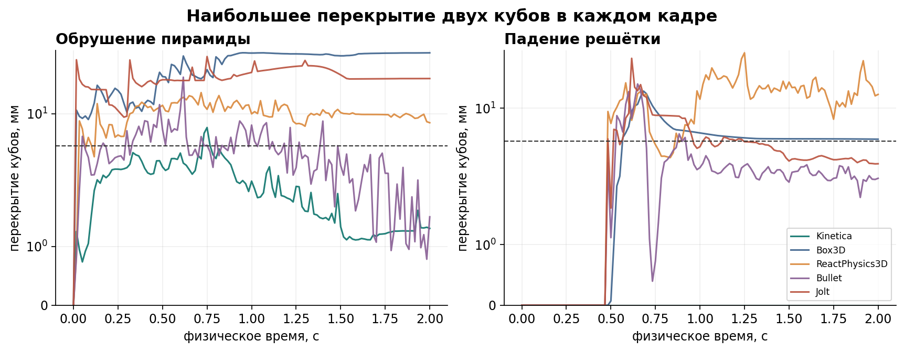

Пунктир соответствует пределу 5 мм. По вертикали малые значения показаны в линейном масштабе, большие — в логарифмическом.

## Вертикальное падение 1000 кубов

В решётке 10 × 10 × 10 между поверхностями соседних кубов оставлено 12,5 см. Нижний слой начинается в 1 м над полом. До удара можно проверить высоту каждого центра по независимому решению $y(t)=y_0-gt^2/2$, где $g=9{,}81$ м/с². На первых 12 кадрах, до $t=0{,}2$ с, у всех пяти движков наибольшая ошибка высоты составила **2,044 мм** при округлении до микрометра. Это укладывается в принятые 3 мм. Для схемы, которая сначала обновляет скорость и затем двигает тело с этой скоростью, ожидаемый модуль ошибки при постоянном ускорении равен $g h t/2=2{,}04375$ мм, где $h=1/480$ с.

| Движок | мс/кадр | p99, мс | Пол, максимум в мм | Пара кубов, максимум в мм | Все допуски |
|---|---:|---:|---:|---:|---|
| **Kinetica** | **22,63** | **38,64** | < 0,000001 | < 0,000001 | **Да** |
| Box3D | 2,84 | 3,65 | 2,86 | 14,31 | Нет |
| ReactPhysics3D | 27,79 | 45,32 | 22,93 | 32,15 | Нет |
| Bullet | 29,63 | 39,11 | 6,97 | 16,65 | Нет |
| Jolt | 8,84 | 15,44 | 5,39 | 28,64 | Нет |

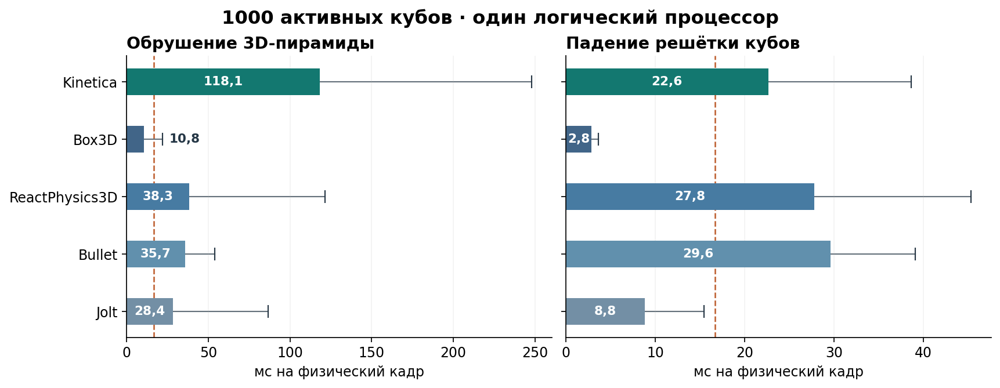

Полоса показывает медиану пяти средних времён полного прогона. Тонкая линия заканчивается на p99 всех 600 кадров, оранжевый пунктир отмечает бюджет 16,67 мс при 60 Гц. На обрушении все 600 кадров Kinetica были дольше бюджета. У Box3D дольше бюджета оказались 36 из 600.

## Где Kinetica тратит время и что означает цель 10×

Сокращение с 118,12 до **11,81 мс** дало бы десятикратный выигрыш относительно нашей исходной сборки. Паритет с Box3D в первоначальной серии требует **10,76 мс**. Отдельный опыт с таймером стадий дал 117,26 мс на кадр и тот же конечный хеш. Ниже средние по 120 кадрам, включая первый.

| Работа | мс/кадр | Доля |
|---|---:|---:|
| Первичный поиск пар и построение геометрии контакта | 64,06 | 54,6 % |
| Повторные проверки пар и глубины контактов | 22,46 | 19,2 % |
| Решение нормальных импульсов | 12,31 | 10,5 % |
| Подготовка ограничений и тел решателя | 6,94 | 5,9 % |
| Перемещение тел и обновление контактных точек | 4,66 | 4,0 % |
| Остальные стадии | 6,83 | 5,8 % |

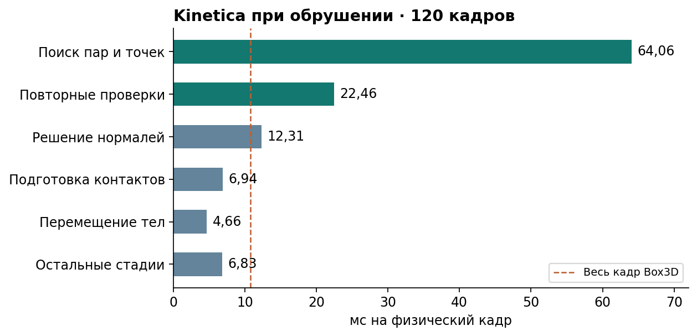

Даже если первые две строки заняли бы нулевое время, при неизменной остальной работе кадр занял бы **30,74 мс**. Это арифметический предел для такого частного изменения. Для цели 10,76 мс потребуется ускорить и решение ограничений. [Показания прибора](data/stress-1000-2026-11-24/stage-cost.csv)

Intel VTune присоединился к уже запущенной пирамиде на 5 с. Получено 4,98 с процессорного времени одного потока. На PairFinder::collect пришлось 19,7 % выборочного CPU-времени, на перебор разделяющих осей — 6,9 %, на поиск опорной вершины выпуклой оболочки — 4,7 %, на вставку в дерево широкого поиска — 4,4 %. Для функции с долей 10,0 % символ не разрешился. Часть кода компилятор встроил в вызывающие функции. Доли отдельных функций и длительности целых стадий описывают разные границы. Исходные попытки запуска под VTune зависли и были исключены. Засчитан профиль с присоединением по PID и проверенным конечным хешем. [Сводка VTune](data/stress-1000-2026-11-24/vtune-summary.txt) · [Полная таблица функций](data/stress-1000-2026-11-24/vtune-hotspots.csv)

## Что меняется при более ранней перепроверке контакта

После перемещения тел Kinetica сравнивает проникновение с глубиной, которую уже описывают контактные точки. Когда обнаруженная добавочная глубина превышает порог, решатель может повторить подшаг с обновлённым контактом. В опыте меняли только этот порог. Массы, скорости, пол, трение и восемь шагов на кадр во всех трёх прогонах остались одинаковыми. До опыта были заданы два условия для всей траектории — максимум 2 мм для пола и 5 мм между кубами. [Параметры шага](../../include/dynamics/time_stepping/SoftStep.h) · [Таблица обеих сцен](data/stress-1000-2026-11-24/accuracy-sweep.csv)

| Порог перепроверки | Пол, максимум | Между кубами, максимум | Кадры вне допуска | Время в этой серии, мс/кадр |
|---|---:|---:|---:|---:|
| 1,00 мм, основная настройка | 2,85 мм | 7,41 мм | 5 / 120 | 120,39 |
| 0,50 мм | 3,34 мм | 5,98 мм | 6 / 120 | 145,99 |
| 0,25 мм | 2,91 мм | **4,30 мм** | **3 / 120** | 186,92 |

**При пороге 0,25 мм все пары кубов прошли допуск на каждом измеренном кадре.** Все три оставшихся нарушения пришлись на пол. В кадре 41 куб № 50 вошёл в него на 2,049 мм. В кадрах 49 и 50 куб № 19 вошёл на 2,130 и 2,914 мм. На основной настройке восстанавливается другая последовательность. Первым в кадре 16 вышел за допуск куб № 46 у пола, а глубже всего друг в друга вошли кубы № 490 и № 63 в кадре 45. На второй сцене, при вертикальном падении, все три настройки дали одинаковые значения и хеши состояний в каждом кадре.

В таблице время усреднено по 120 кадрам одного запуска на настройку. Практический вывод ограничен сценой обрушения. Четырёхкратное уменьшение порога увеличило время прогона на 55 %, максимум проникновения в пол остался выше допуска. Более ранняя перепроверка изменила и траекторию. Например, финальное падение вершины составило 1,00 м вместо 1,49 м. Эталонной траектории вершины после обрушения у нас нет. Основная настройка остаётся 1 мм.

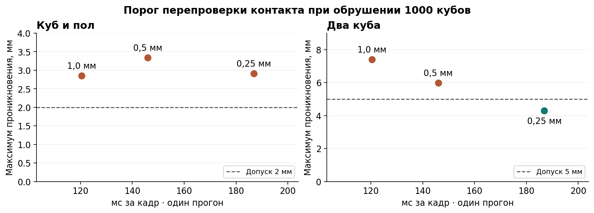

## Какие изменения ускоряют поиск пар

Для оптимизаций с той же математикой проверяли нулевое отклонение в записанных величинах. С исходной сборкой сверяли 121 строку каждой сцены, включая нулевой кадр. Строки содержат независимые геометрические измерения и хеш координат, ориентаций и скоростей всех тел. Только после совпадения засекали время в отдельном запуске. Сокращение времени вычислено внутри каждого блока как $100(1-t_\mathrm{опыт}/t_\mathrm{контроль})$ процентов.

В шести парных блоках сохранение знаков смешанных произведений при переборе рёбер дало на пирамиде **0,53 %** сокращения времени, четыре выигрыша из шести. Дополнительное исключение избыточных осей у строго выровненных оболочек дало **0,78 %**, пять выигрышей из шести. На вертикальном падении измерены 1,34 % и 0,31 % соответственно. У обоих вариантов нашлись прогоны пирамиды, в которых контроль оказался быстрее. [Все парные сравнения рёбер](data/stress-1000-2026-11-24/sat-timing.csv)

Затем проверили три способа собирать пары тел в четырёх блоках. Каждая сборка занимала каждое из четырёх мест в порядке запуска один раз. В скобках — число выигрышей из четырёх. [Парные времена и размах](data/stress-1000-2026-11-24/pair-search-timing.csv)

| Изменение | Сокращение времени на пирамиде | При вертикальном падении |
|---|---:|---:|
| Собирать результаты группами по 32 кандидата | +0,56 % (3/4) | −0,37 % (1/4) |
| Искать пересечение двух листьев дерева один раз у их ближайшего общего предка | **+6,27 % (4/4)** | +0,26 % (2/4) |
| В одном потоке сразу записывать контакты простых тел в выходной массив | +3,37 % (4/4) | **+2,30 % (4/4)** |

Медианы времени пирамиды в серии составили 118,70 мс для контроля и 111,50 мс для обхода через общего предка. Все три варианта воспроизвели исходные геометрические строки и хеши. Эффекты измерены по отдельности. В этой серии все три были опытными. Обход через общего предка впоследствии прошёл отдельную проверку со штатными опорами и включён в движок. [Исходники вариантов и их SHA-256](data/stress-1000-2026-11-24/experiment-inputs.tar.gz) · [Сохранённые строки опытов](data/stress-1000-2026-11-24/experiments-windows.tar.gz) · [Расчёт сводок](../../validation/engines/stress/experiments.py)

## Первоначальный опыт с проходами по опорам

В первой реализации событийного прохода нижнее тело временно считалось неподвижным, поправку получало только верхнее. В массовом опыте работает быстрый решатель. Для него проверили порядок от неподвижной опоры вверх, затем обратно вниз, с действительными массами обоих тел при каждой поправке. Контакты в свободно падающей группе пропускаются этим дополнительным проходом. Нормаль определяется геометрией. На неподвижной наклонной плоскости с единичной нормалью $(0{,}6;0{,}8;0)$ тело массой 1 кг при вертикальной скорости −1 м/с получает импульс $(0{,}48;0{,}64;0)$ Н·с и теряет 0,32 Дж. Эти два оракула подтверждены в Windows. В работе Xiong и соавторов (§4, рис. 2–3 на странице проекта) недостающую реакцию нижнего тела записывают и возвращают на обратном проходе. В нашем опыте реакция прикладывается сразу. [Текущий событийный проход](../../src/dynamics/event_driven/ShockPropagation.cpp) · [Метод Xiong и соавторов](https://ziyanxiong.github.io/2PSP/) · [Код опыта](../../validation/engines/stress/support/SupportSweep.h)

В закрывающемся контакте $u_n$ — относительная скорость по нормали в м/с, $K$ — изменение этой скорости на единичный импульс, $h$ — длительность подшага, $g$ — зазор в метрах. Для цели $v_*=-\max(g,0)/h$ при $u_n<v_*$ приращение импульса равно $j=(v_*-u_n)/K$. Суммарное изменение кинетической энергии двух свободных тел от этой поправки при неизменной позе равно $j u_n+Kj^2/2\le0$. Импульсы приложены в одной точке, поэтому их суммарный момент равен нулю. Для неподвижного пола в баланс движущихся тел входит внешний импульс опоры.

| Проходы | Пол, мм | Два куба, мм | Кадры вне допуска | Пирамида, мс/кадр | Вертикальное падение, мс/кадр |
|---|---:|---:|---:|---:|---:|
| Контроль | 2,853 | 7,411 | 5 / 120 | 120,39 | 22,84 |
| Снизу вверх | 2,220 | 3,950 | 2 / 120 | 121,53 | 27,69 |
| Снизу вверх и обратно | **0,701** | **3,606** | **0 / 120** | 121,83 | 28,22 |

В двухпроходном опыте вершина упала на 1,477 м, минимальное расширение по четырём сторонам равно 2,371 м. Решатель выполнил 1 567 829 внутренних поправок и 970 104 поправки у неподвижного тела, включая пробные перемещения. Максимальные невязки **одной** поправки составили $1{,}28\cdot10^{-15}$ Н·с по импульсу и $4{,}03\cdot10^{-15}$ Н·м·с по моменту с учётом реакции пола. Максимальное положительное изменение кинетической энергии одной поправки — $3{,}56\cdot10^{-15}$ Дж. У симметричных весов максимальный наклон за 0,25 с составил $6{,}3\cdot10^{-9}$ градуса. При удвоении груза слева и справа наклоны составили +7,343° и −7,343°. Во время этой серии проход включали явно. Решение для текущей основной сборки приведено в начале отчёта. [Прибор баланса](../../validation/engines/stress/support/Balance.cpp) · [Строки Windows](data/stress-1000-2026-11-24/experiments-windows.tar.gz)

## Как воспроизвести замер

Windows, **Xeon E5-2690 v3**, Clang 23.1.6, Release, один закреплённый логический процессор. Все получили одинаковые позиции, массу, геометрию и начальные скорости. Коэффициент трения пары 0,5, восстановление и вязкое сопротивление нулевые, сон выключен. Физическое время 2 с. На кадр 1/60 с каждый адаптер делает **восемь публичных шагов** по 1/480 с. Внутренние алгоритмы и параметры контакта у движков различаются. Kinetica использует двойную точность с включёнными совместным трением и повторным использованием равновесия. RP3D и Bullet также собраны с double, Box3D и Jolt используют float. У RP3D и Jolt по одной итерации скоростей и положений на внешний шаг, у Bullet одна итерация последовательного решателя. [Флаги, аргументы и SHA-256 пяти программ и библиотек](data/stress-1000-2026-11-24/manifest.json)

1. Для проверки геометрии установить переменную окружения STRESS_SCENE в pyramid1000 или rain1000, а STRESS_PASS в verify. Прибор сверяет начальные состояния всех 1001 тел, читает позы на границах кадров и независимо измеряет проникновение. Для куба $d_\mathrm{пол}=\max(0,\,a\sum_i |R_{yi}|-y_c)$, где $a=0{,}125$ м, $R$ — ориентация, $y_c$ — высота центра. Для двух кубов используется проверка разделяющих осей по граням и рёбрам. На углах с почти параллельными рёбрами оси с длиной меньше $10^{-6}$ отбрасываются. [Измеритель геометрии](../../validation/engines/stress/StressReadings.h)
2. Для времени установить STRESS_PASS в time. Построение сцены, копирование поз, проверка геометрии, вывод и отрисовка вынесены из таймера. Первый физический кадр включён. В каждом из пяти блоков запущены все движки. Циклический порядок поставил каждый движок по одному разу на каждое место. Прибор проверил, что конечный хеш состояния каждого из 50 замеров совпадает с геометрическим прогоном этого же движка. На Windows хеши всех 178 файлов ядра совпали с рабочим деревом. [Сценарий Windows](data/stress-1000-2026-11-24/win-bench.ps1)
3. Распаковать архив исходных строк и вызвать из корня проекта команду ниже. Сводка сверяет порядок, полноту временных рядов и хеши конечных состояний. [Обработка сохранённых строк](../../validation/engines/stress/summarize.py)

    ~~~sh
    python3 validation/engines/stress/summarize.py results
    ~~~

В контрольной версии толчок получал только нижний слой. За 2 с вершина у Kinetica опустилась всего на 4,6 мм, у Box3D — на 14,7 мм. Такой опыт отбракован по условию обрушения. В контрольном запуске RP3D завершился с ошибкой после записи последних поз. Для зачётной версии использован парный Windows-аллокатор, уже применявшийся в опыте захвата. Все пять зачётных программ завершились штатно. [Сохранённый контрольный опыт](data/stress-1000-2026-11-24/pilot-base-only.tar.gz)

**⚠️ Стресс-тест.** Проверены начало движения из плотного контакта, массовое приземление на пол и свободный полёт с независимым решением. На границах кадров все тела сохранились, ни один центр не оказался под полом, ни один куб не заснул. В каждой сцене одна исходная раскладка. Пять повторов оценивают разброс времени одной траектории. Вероятность успеха на случайных раскладках, проникновения внутри подшага, сходимость траекторий после удара и масштаб $10^4$–$10^6$ тел остаются открытыми.
