# Kinetica Physics на CPU — точность, скорость и цена контакта

**Инженерный отчёт · 23 ноября 2026 · Windows x64 · Intel Xeon E5-2690 v3**

**Актуальный результат по 40 парным блокам.** На пороговом захвате медиана за полный нагруженный кадр составила **55,38 мкс у опытной Kinetica** и **168,59 мкс у исходной**. В обоих случаях куб сместился на 0,0434 мм при допустимых 0,5 мм. В том же опыте ReactPhysics3D показал 47,54 мкс, Bullet double — 72,38 мкс. Box3D показал 48,45 мкс и сместил куб на 2,9092 мм. Опытная Kinetica уложилась в 50 мкс в 0 из 40 блоков, 95%-й интервал Уилсона для доли таких блоков — от 0 до 8,8%. Для тех же исходников два повтора под WSL дали 192 947 исполненных машинных инструкций на кадр. [Таблицы и график](grip-cpu-status.md) · [Сырые времена](data/engine-anatomy-2026-11-22/raw-collision/residual-budget/wilson/timing.csv) · [Счётчик инструкций](data/engine-anatomy-2026-11-22/raw-collision/residual-budget/wilson-instructions/events.csv)

## Предыдущие сборки и этапы оптимизации

**Прямой замер четырёх движков на пороговом захвате.** Опытная Kinetica с сохранёнными размерами оболочки дала **59,66 мкс**, RP3D — **50,48 мкс**, Bullet в double на восьми итерациях — **75,15 мкс**. Все трое выдержали допуск. У Box3D получилось **49,38 мкс** со сдвигом **2,909 мм** при пределе 0,5 мм. В отдельной серии Kinetica показала **57,48 мкс**. Статистики скорости по совокупности сцен для этой версии пока нет. В сборке GCC под WSL два подсчёта новой Kinetica дали по **199 191 инструкции на нагруженный кадр**. [Прямой замер](data/engine-anatomy-2026-11-22/raw-collision/residual-budget/bounds-peers/timing.csv) · [Точность](data/engine-anatomy-2026-11-22/raw-collision/residual-budget/bounds-peers/accuracy.csv) · [Счётчик](data/engine-anatomy-2026-11-22/raw-collision/residual-budget/bounds-instructions/events.csv) · [Краткая сводка](grip-cpu-status.md)

**Какая сборка перед вами.** В архивном опыте с направляющими исходная Kinetica занимала **189,80 мкс**, после той правки — **178,75 мкс**. Значения **63,03 и 61,24 мкс** ниже относятся к отдельной исполняемой программе с опытным решателем. Для обычной сборки и просмотрщика такое время ещё предстоит подтвердить. [Короткая сводка по сборкам и инструкциям](grip-cpu-status.md)

**Предыдущий прототип с проекцией трения** удержал куб с максимальным сдвигом 0,043403 мм. Полный кадр занял 63,03 мкс в первой серии и 61,24 мкс в повторе. Контроль в тех же двух сериях дал 176,62 и 167,40 мкс. Время включает восемь активных обновлений. Сон выключен. [Первая серия](data/engine-anatomy-2026-11-22/raw-collision/residual-budget/projection/timing.csv) · [Независимый повтор](data/engine-anatomy-2026-11-22/raw-collision/residual-budget/momentum/timing.csv)

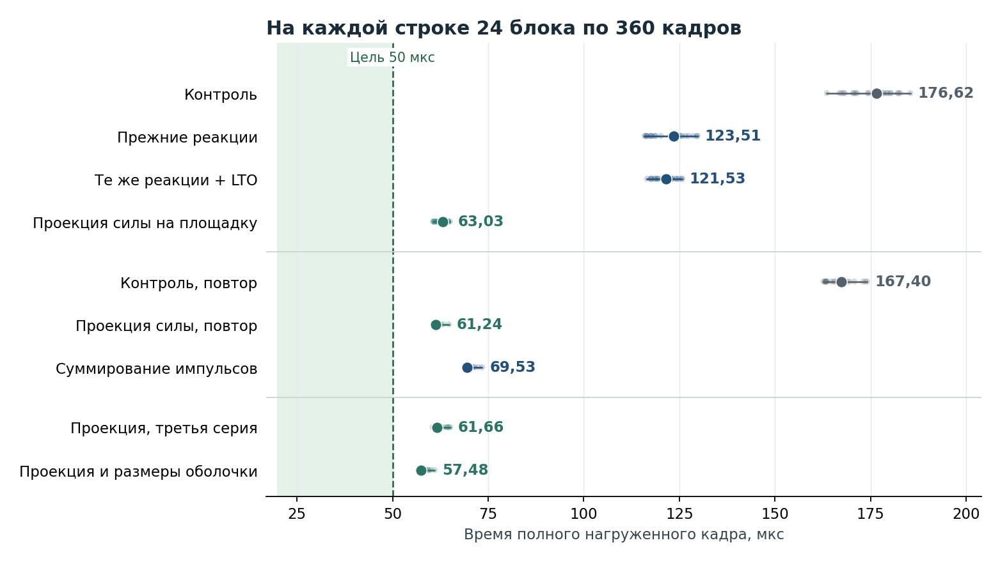

| Три опыта на одном Xeon | Медиана, мкс | Худший блок, мкс | Сдвиг, мм | Худшая ошибка одной губки, Н | Зачёт |
|---|---:|---:|---:|---:|---:|
| A · контроль | 176,62 | 185,40 | 0,043403 | 0,000000000384 | 33/36 |
| A · пробный баланс прежних реакций | 123,51 | 129,64 | 0,043403 | 0,000000191 | 33/36 |
| A · тот же алгоритм, LTO и инструкции Haswell | 121,53 | 125,66 | 0,043403 | 0,000000191 | 33/36 |
| A · перенос касательной силы с проекцией и упрощённый перенос позы | **63,03** | **65,01** | **0,043403** | 0,000000191 | 33/36 |
| Б · контроль | 167,40 | 174,08 | 0,043403 | 0,000000000384 | 33/36 |
| Б · повтор проекции, тот же исполняемый файл | **61,24** | **64,72** | **0,043403** | 0,000000191 | 33/36 |
| Б · суммирование линейных и угловых импульсов | 69,53 | 73,39 | 0,043403 | 0,000000249 | 33/36 |
| В · предыдущий прототип с проекцией | 61,66 | 65,09 | 0,043403 | 0,000000191 | 33/36 |
| В · размеры оболочки сохраняются при создании | **57,48** | **61,00** | **0,043403** | 0,000000191 | **33/36** |

В серии В парная медиана времени улучшилась на **6,68%**, все 24 пары в пользу новой сборки. Сверка CSV на 36 входах дала полное совпадение всех напечатанных физических показаний. [Сырые времена серии В](data/engine-anatomy-2026-11-22/raw-collision/residual-budget/bounds/timing.csv) · [Физические измерения](data/engine-anatomy-2026-11-22/raw-collision/residual-budget/bounds/accuracy.csv)

Каждая точка на графике — среднее за 360 нагруженных кадров. Крупная точка — медиана 24 блоков, длина линии — диапазон между лучшим и худшим блоком. Запись отдельных длительностей кадров для оценки p99 здесь не велась. Хэш контрольного файла и модель процессора совпали после перехода на `192.168.1.4`. [Физика по 36 входам](data/engine-anatomy-2026-11-22/raw-collision/residual-budget/projection/accuracy.csv) · [Хэши программ](data/engine-anatomy-2026-11-22/raw-collision/residual-budget/projection/inputs.json) · [Хэши повтора](data/engine-anatomy-2026-11-22/raw-collision/residual-budget/momentum/inputs.json)

### Как повторно использовать контакт под нагрузкой

При положении центра $x$ и повороте $R$ локальная координата точки равна $q=R^T(p-x)$. На следующем шаге её положение в мире даёт $p'=x'+R'q$. Для плоской опоры с единичной нормалью $n$ предыдущую силу трения $f$ переносим в нынешнюю касательную плоскость и ограничиваем диском Кулона. При $u=0$ кандидат равен нулю.

$$
u=f-(f\cdot n)n,\qquad f_t=u\min\!\left(1,\frac{\mu N}{\lVert u\rVert}\right),
\qquad J_t=h f_t .
$$

Здесь $N$ измеряется в ньютонах, $h=1/480$ с в замере, $J_t$ — в Н·с. В старом пробном шаге в нагруженной фазе только 58 раз из 120 прежняя реакция сразу устроила решатель. Ещё 47 раз отказ зарегистрирован в совмещённой проверке диска, момента и направления силы. Новый вариант строит допустимую касательную силу, затем проверяет пробное движение тел. При успехе он обновляет и позы, и импульсы. Разрыв контакта, скольжение и нарушение баланса возвращают задачу обычному решателю. Выигрыш 121,53 → 63,03 мкс включает также упрощение переноса позы. [Причины отказов по каждому шагу](data/engine-anatomy-2026-11-22/raw-collision/residual-budget/probe/steps.csv) · [Код опыта](data/engine-anatomy-2026-11-22/raw-collision/residual-budget/projected.inc)

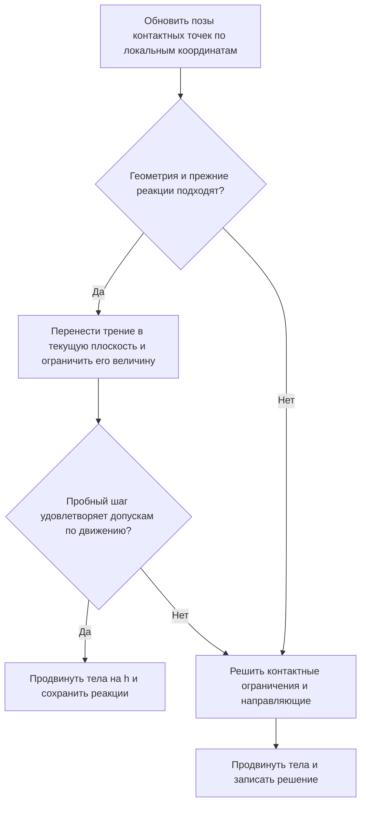

**Сравнение с другими движками.** В отдельной общей серии при том же допуске 0,5 мм RP3D прошёл за 48,54 мкс со сдвигом 0,2792 мм, Bullet в double с восемью итерациями — за 72,10 мкс со сдвигом 0,4786 мм. Box3D дал 49,20 мкс и сдвиг 2,9092 мм. Для него время при выполнении этого допуска остаётся открытым. [Времена всех движков](data/engine-anatomy-2026-11-22/raw-collision/bullet-budget/timing.csv) · [Допуски и реакции губок](data/engine-anatomy-2026-11-22/raw-collision/bullet-budget/accuracy.csv)

## Сколько стоят копирование и повторное решение

| Вариант Kinetica, double | Полный кадр, мкс | Парная медиана изменения | Сдвиг при 10 Н, мм | Зачёт |
|---|---:|---:|---:|---:|
| Контроль второй серии | 180,50 | — | 0,04340278 | 33/36 |
| Построение площадки сразу в конечном массиве | 172,56 | −4,03% | 0,04340278 | 33/36 |
| Та же запись и проверка невязки нормальных сил | 135,03 | −25,29% | 0,04340280 | 33/36 |
| Дополнительно пробный шаг с проверкой баланса сил | 123,00 | −31,18% | 0,04340282 | 33/36 |

В первом опыте устранение промежуточного списка дало 171,51 мкс против 181,55 мкс в контроле. Обе серии содержат по 24 блока со всеми перестановками четырёх вариантов. Для вариантов, меняющих только путь записи площадок, полностью совпали выходы шести приборов. Проверка невязки меняет порядок округления. У пробного шага на 36 входах максимальное изменение ошибки пути относительно контроля составило $1{,}45\cdot10^{-7}$ мм, ошибки силы губки — $1{,}03\cdot10^{-5}$ Н. Серия не устанавливает границу ошибки для длительного контакта. [Первая серия](data/engine-anatomy-2026-11-22/raw-collision/residual-budget/timing.csv) · [Вторая серия](data/engine-anatomy-2026-11-22/raw-collision/residual-budget/inplace/timing.csv) · [Приборы](data/engine-anatomy-2026-11-22/raw-collision/residual-budget/inplace/parity.csv) · [Сетка точности](data/engine-anatomy-2026-11-22/raw-collision/residual-budget/inplace/accuracy.csv)

VTune отдельно собирал образцы в 1 000 интервалах по 15 нагруженных кадров. Из 0,568 с образцов в исполняемом файле движка 0,0407 с пришлось на выдачу рабочей памяти `StepMemory::take`, 0,0188 с — на добавление строки в разложение Холецкого и 0,0186 с — на построение матрицы контактного отклика. В таблице есть также работа инструмента и системных библиотек. При расчёте времени кадра использованы отдельные запуски обычных программ. [Сэмплы функций VTune](data/engine-anatomy-2026-11-22/raw-collision/residual-budget/vtune/functions.csv) · [Границы интервалов](data/engine-anatomy-2026-11-22/raw-collision/residual-budget/vtune/inputs.json)

## Сколько стоит тот же захват в Bullet

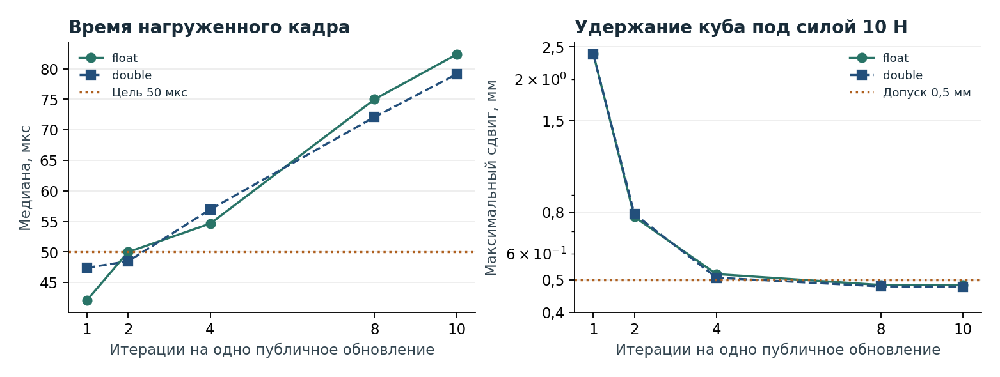

| Движок и режим | Медиана кадра, мкс | Максимальный сдвиг при 10 Н, мм | Допуск 0,5 мм и силы | Пройдено из 36 |
|---|---:|---:|:---:|---:|
| Kinetica, контроль до опытной проекции, double | 180,15 | 0,0434 | Да | 33 |
| RP3D, double, по 1 итерации скорости и положения | 48,54 | 0,2792 | Да | 27 |
| Box3D, float, штатный тёплый старт | 49,20 | 2,9092 | Нет | 23 |
| Bullet, float, 1 итерация | 42,13 | 2,3852 | Нет | 9 |
| Bullet, float, 4 итерации | 54,66 | 0,5210 | Нет | 30 |
| Bullet, float, 8 итераций | 75,00 | 0,4833 | Да | 30 |
| Bullet, float, 10 итераций | 82,36 | 0,4828 | Да | 33 |
| Bullet, double, 1 итерация | 47,42 | 2,3767 | Нет | 12 |
| Bullet, double, 4 итерации | 56,97 | 0,5084 | Нет | 30 |
| Bullet, double, 8 итераций | 72,10 | 0,4786 | Да | 30 |
| Bullet, double, 10 итераций | 79,13 | 0,4780 | Да | 32 |

Для Bullet проверены 1, 2, 4, 8 и 10 итераций при каждой разрядности. При двух итерациях сдвиг составил 0,7735 мм в float и 0,7889 мм в double. Из этих пяти бюджетов восемь — первый с удержанием в допуске. Число итераций одного движка не определяет объём работы другого. В опыте используется штатный коэффициент тёплого старта Bullet 0,85. Для каждой разрядности отдельно собраны адаптер и все три библиотеки. [Адаптер Bullet](../../validation/engines/grip_bullet.cpp) · [Хэши и порядок запусков](data/engine-anatomy-2026-11-22/raw-collision/bullet-budget/inputs.json) · [Настройки решателя Bullet](https://github.com/bulletphysics/bullet3/blob/d3afe76132fc76b0f9b2359cbaef47a3766e7fbb/src/BulletDynamics/ConstraintSolver/btContactSolverInfo.h)

## Где уже используются локальные точки

Для плоской площадки Kinetica сохраняет опорную плоскость в координатах одной детали, а точки противоположной поверхности в координатах другой. После переноса в мир зазор получается проекцией на нынешнюю нормаль. При удержании 10 Н счётчик зарегистрировал **240 попаданий из 240** за 120 нагруженных шагов. При скольжении под нагрузкой 12 Н попаданий было **30 из 240**. Изменение набора вершин у края грани требует нового поиска. Обновление плеч, скоростей, реакций и направляющих остаётся работой решателя даже при попадании. [Счётчик по фазам](data/engine-anatomy-2026-11-22/raw-collision/grip-cache-hits/summary.csv) · [Перенос площадки в коде](../../src/collision/ManifoldMemory.cpp)

**Проверка AVX2 на том же захвате.** Штатная сборка дала 180,89 мкс, включение AVX2 компилятору для матрицы контактов — 173,72 мкс, ручная обработка четырёх столбцов — 193,64 мкс. Парные медианы изменения составили −3,27% и +9,14%. Все 36 строк физики и коэффициенты контрольных матриц совпали. Ни один вариант не достиг заданного для переноса выигрыша 5%. [Времена 12 блоков](data/engine-anatomy-2026-11-22/raw-collision/grip-budget/simd-time.csv) · [Сверка физики и матриц](data/engine-anatomy-2026-11-22/raw-collision/grip-budget/simd-inputs.json)

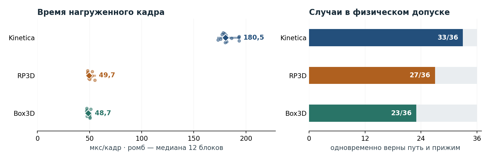

## Что показала проверка сна островов

**Все три тела захвата впервые заснули вместе на 241-м шаге, через 0,50208 с.** На предыдущем шаге у каждой губки и груза уже накопилось 240 тихих обновлений. Проверка сравнивает накопленное время с порогом 0,5 с. Шаг равен 1/480 с. Короткая серия заканчивалась ровно на 240-м обновлении каждого захвата, что объясняет ноль спящих в её 17 280 нагруженных обновлениях. [Короткая серия](data/engine-anatomy-2026-11-22/raw-collision/grip-budget/results.csv) · [Трёхсекундные прогоны](data/engine-anatomy-2026-11-22/raw-collision/grip-budget/sleep-trace.csv) · [Накопление времени покоя](../../src/world/IslandSleep.cpp)

При непрерывном прижиме за три секунды счётчик спящих тел изменился десять раз. В конце оба варианта захвата были полностью активны. Контрольная пара, соединённая жёстко и оставленная в покое, также заснула на 241-м шаге. Сила 1 Н, приложенная к одному телу, разбудила оба за один шаг. В основном сравнении движков сон был выключен. [Проверка пробуждения](data/engine-anatomy-2026-11-22/raw-collision/grip-budget/passive-weld.txt) · [Прибор и условия](data/engine-anatomy-2026-11-22/raw-collision/grip-budget/sleep-trace.cpp)

## Какие сцены можно открыть

| № | Сцена в просмотрщике | Что проверено на Windows |
|---:|---|---|
| 34 | Сплайны — вагонетка на кольце и груз на спирали | Ключ `rail` и номер 34 выбирают одну сцену. Вагонетка идёт с приводом, груз спускается под действием тяжести. |
| 39 | Плавучесть куба в спокойной воде | Осадка равновесия 10 см. Измеренный период 0,634405 с, расчётный 0,634374 с. При проверке движения в точном режиме просмотрщика на интервале 2 с максимальная ошибка осадки достигла **5,61 мм** при допуске **1 мм**. |
| 40 | Шестерни на валах, 20 и 40 зубьев | В отдельном примере за первую секунду получены **+90,000° и −45,000°** в точном режиме, **+90,1875° и −45,09375°** в быстром. |

Проверка выбора сцен по имени и номеру прошла. В проверке движения окна первой шла вода. Её ошибка осадки остановила этот прогон до следующих сцен. [Числа консольных примеров](data/verification-2026-11-23/playable-examples.txt) · [Журнал проверки окна](data/verification-2026-11-23/playable-water.txt) · [Порядок проверок и допуски](data/verification-2026-11-23/playable-check.cpp)

## Что остаётся открытым после ревью

Ревью дало **13 замечаний, из них два приоритета P1**. Первое касается контакта шара сразу с полом и стеной. Импульс трения пола может вернуть шару скорость внутрь стены после того, как решатель уже обработал нормали. Проверяемая величина — нормальная относительная скорость у стены после применения трения. Для принятия исправления нужен отдельный регрессионный тест с этим случаем. Второе замечание касается интерфейса `ConvexHull`: по подсчёту ревью в нём 14 публичных методов при лимите CI в 12. В сохранённом прогоне прошли 22 теста Windows CTest. Результат полного CI для текущего снимка открыт. [Применение импульсов трения](../../src/dynamics/time_stepping/CoupledFriction.cpp) · [Интерфейс оболочки](../../include/collision/shapes/ConvexHull.h) · [Правило CI](../../validation/code_metrics.py) · [Журнал CTest](data/engine-anatomy-2026-11-22/raw-collision/memory-cpu/accepted-rows/ctest.log)

## Откуда берутся 922 698 инструкций

Callgrind учёл **332 171 544 исполнения машинных инструкций за 360 нагруженных кадров**. Деление даёт 922 699 с округлением до целого (922 698 при усечении), или около 115 337 за одно из восьми обновлений. Цикл, который двадцать раз выполняет одну и ту же команду, даёт счётчику двадцать исполнений. В собственном коде `World::step` набралось 676 800 исполнений без дочерних функций, ровно **1 880 на кадр**. Предложенные 100 инструкций на весь кадр дают 12,5 на обновление и требуют уменьшить объём исполнения примерно в 9 227 раз. Эти числа характеризуют измеренную реализацию. Математическая нижняя граница для всех возможных решателей здесь не установлена. [Сырой счётчик](data/engine-anatomy-2026-11-22/raw-collision/memory-cpu/kinetica-coupled/self.txt) · [Границы измерения](data/engine-anatomy-2026-11-22/raw-collision/memory-cpu/range.json)

| Работа за нагруженный кадр | Исполненных инструкций, приближённо |
|---|---:|
| Контактные нормали перед переносом тел | 280 000 |
| Совместное решение трения | 123 000 |
| Сборка матрицы направляющих по прямым вызовам | 111 000 |
| Запись строк сочленений | 64 000 |
| Остальные вычисления и управление | 345 000 |

Векторная команда AVX `vaddpd` складывает до четырёх пар `double` в регистре YMM. Так можно получить сразу три координаты суммы. Произведение матрицы 3×3 на вектор дополнительно требует умножений и суммирования произведений. В нашей Windows-сборке у функции совместного трения насчитано **111 статических мест** упакованной арифметики. Отключение автовекторизации в двух файлах замедлило захват на 3,01% в парном опыте. У Box3D в этом захвате четыре полосы дали 41,45 мкс против 48,09 мкс при восьми. На пирамиде из 140 тел восемь полос дали 780 мкс против 975 при четырёх. [Инструкции Intel](https://www.intel.com/content/www/us/en/docs/intrinsics-guide/index.html) · [Наш дизассемблер и счётчики](data/engine-anatomy-2026-11-22/raw-collision/memory-cpu/assembly.csv) · [Оба опыта Box3D](engine-anatomy-2026-11-22.md)

В отдельном диагностическом приборе медиана шести замеров составила 175,03 мкс с выключенным сном и 181,59 мкс с включённым. Оба режима дали смещение 0,043403 мм. [Каждый блок и ошибки силы](data/engine-anatomy-2026-11-22/raw-collision/grip-budget/results.csv) · [Хэши и параметры](data/engine-anatomy-2026-11-22/raw-collision/grip-budget/inputs.json)

**Где RP3D точнее.** При 240 Гц, коэффициенте трения 0,5 и прижиме 10 Н на каждую губку нагрузка 12 Н вверх дала ошибку пути **0,132921 мм** у Kinetica и **0,099936 мм** у RP3D. Оба результата прошли допуск. Три отказа Kinetica относятся к одной другой ситуации при 60 Гц — свободному ускорению груза при нулевом трении, нулевом прижиме или раскрытых губках. За 0,25 с расчёт дал 315,104 мм при эталоне 312,500 мм. Для ускорения 10 м/с² и подшага 1/480 с ошибка полунеявного Эйлера равна `a T h / 2`, или **2,604 мм**. Допуск составлял 2 мм. [Попарные результаты](data/engine-anatomy-2026-11-22/raw-collision/sparse-guides/competitors/paired-accuracy.csv) · [Траектории и силы Kinetica](data/engine-anatomy-2026-11-22/raw-collision/memory-cpu/f64-grip.csv)

## Почему исходная сборка отставала примерно в 3,7 раза

Профиль, дизассемблирование и проверки памяти ниже относятся к версии **до** последней правки резервирования. Именно по этому профилю выбран эксперимент. Его результат и отдельное сравнение принятой версии приведены в разделе «Опыт с хранением строк нормального контакта» и в таблице трёх движков.

В одном нагруженном кадре **Kinetica исполняет 923 тыс. инструкций, RP3D — 334 тыс., Box3D — 247 тыс.** Только решение нормальных сил перед переносом тел занимает у Kinetica **280 тыс. инструкций на кадр**. Один этот участок выполняет больше машинных инструкций, чем весь шаг Box3D в том же опыте. Нормальная сила здесь удерживает поверхность куба у губки, а сила трения удерживает его от падения. [Исходные счётчики](data/engine-anatomy-2026-11-22/raw-collision/memory-cpu/events.csv) · [Ветви вызовов](data/engine-anatomy-2026-11-22/raw-collision/memory-cpu/phase-tree.csv)

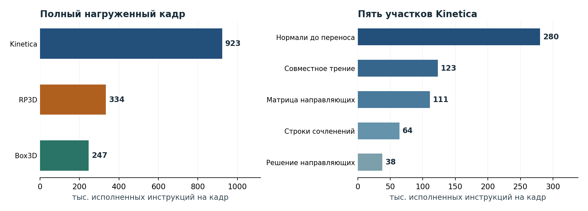

| Величина за нагруженный кадр | Kinetica, double | RP3D, double | Box3D, float |
|---|---:|---:|---:|
| Время на Windows, мкс | 179,14 | 48,35 | 47,57 |
| Инструкции в Callgrind | 922 698 | 334 049 | 247 038 |
| Чтения данных в Callgrind | 260 044 | 101 720 | 64 899 |
| Записи данных в Callgrind | 112 643 | 46 746 | 29 901 |

Время снято на Windows со сборок Clang 23.1.6. Инструкции посчитал Callgrind в WSL на том же Xeon, со сборок GCC 15.2. Во всех трёх адаптерах счётчик включался на 15 нагруженных кадров каждого из 24 захватов. Создание мира, прижим, прогрев и уничтожение исключены из этой области. Движки получали по восемь обновлений на кадр, каждый реализует собственный алгоритм решения. Отношения счётчиков равны **3,74× к Box3D и 2,76× к RP3D**. Перевести их в точные доли микросекунд каждой Windows-функции по этим данным нельзя. Счётчики промахов Callgrind описывают модель кэша. [Границы диапазона](data/engine-anatomy-2026-11-22/raw-collision/memory-cpu/range.json) · [Нативные парные времена](data/engine-anatomy-2026-11-22/raw-collision/sparse-guides/competitors/paired-time.csv) · [Метод Callgrind](https://valgrind.org/docs/manual/cl-manual.html)

### Из чего складывается работа Kinetica

Код сначала строит ограничения направляющих в текущих позах, решает контакт по нормали и переносит тела. Затем он пересобирает ограничения для новых поз и решает трение под действием направляющих. По дереву вызовов **91,37%** инструкций публичного шага приходится на `SoftStep::step`, **7,33%** — на сбор пар столкновений. В пересчёте на полный нагруженный кадр решение нормалей **до переноса** даёт 30,35%, совместное трение — 13,34%, непосредственные вызовы сборки матрицы направляющих — 12,01%, записи строк сочленений — 6,96%. В этих четырёх долях нет двойного счёта вложенных вызовов. Отключение только совместного трения оставило 828 тыс. инструкций на кадр. [Порядок шага](../../src/dynamics/time_stepping/SoftStep.cpp) · [Дерево со всеми дочерними функциями](data/engine-anatomy-2026-11-22/raw-collision/memory-cpu/phase-tree.csv) · [Собственная стоимость функций](data/engine-anatomy-2026-11-22/raw-collision/memory-cpu/kinetica-coupled/self.txt)

| Гипотеза | Результат опыта |
|---|---|
| Память теряется при уничтожении мира | **Не обнаружено в этой сцене.** За 27 миров Memcheck зарегистрировал 57 163 выделения и 57 161 освобождение. Потеряно 0 байт во всех трёх категориях, ошибок доступа 0. Два достижимых блока, 72 и 8 байт, ведут к регистрации временной памяти рабочего потока. В отдельном нативном процессе после каждого из 128 миров временный буфер вернулся к 0 занятых байт. Частная память процесса с 18-го по 128-й мир держалась на 5 230 592 байтах. [Memcheck](data/engine-anatomy-2026-11-22/raw-collision/memory-cpu/memcheck.log) · [128 циклов на Windows](data/engine-anatomy-2026-11-22/raw-collision/memory-cpu/world-lifetime.csv) |
| Куча вызывается в установившемся захвате | **Да.** На кадр — 64 вызова C++ `new`, из них 40 при росте массива строк в `DirectJoints::add` и 8 при подготовке строк в `JointRows::build`. Остальные 16 делят решатели нормалей и трения. Временная арена отдельно выдала 1 744 участка на кадр и ни разу не пополнилась под нагрузкой. Она запрашивает у кучи блок 4 МиБ при первом предварительном прижиме. [Счётчик кучи](data/engine-anatomy-2026-11-22/raw-collision/memory-cpu/plain-global-new.csv) · [Стеки всех 960 запросов за 15 кадров](data/engine-anatomy-2026-11-22/raw-collision/memory-cpu/heap-resolved.csv) |
| Скрытые байты в `Vector3` объясняют разрыв | **Нет для проверенного типа.** Три `double` занимают ровно 24 байта. Принудительное выравнивание до 16 байт дало шаг массива 32 байта и замедлило захват на 2,88% в отдельном опыте. У арены есть собственные расходы. На кадр выдано 176 160 байт полезных данных, суммарно занято 208 896 байт с заголовками и округлением. Пиковая одновременная занятость под нагрузкой — 26 112 байт. [Опыт с выравниванием](data/engine-anatomy-2026-11-22/raw-collision/inline-layout/summary.csv) · [Счётчик арены](data/engine-anatomy-2026-11-22/raw-collision/memory-cpu/world-lifetime.csv) |
| Компилятор переносит значения регистров в стек | **Да.** В `CoupledFriction::solve` Clang пометил 61 место сохранения и 86 мест чтения сохранённых значений. В итоговом Windows-файле есть 441 инструкция с явным адресом от `rsp` и 111 арифметических инструкций, работающих сразу с несколькими числами. Это статические места в функции. По ним нельзя вычислить время ожидания стека. [Дизассемблирование](data/engine-anatomy-2026-11-22/raw-collision/memory-cpu/assembly.csv) · [Комментарии компилятора](data/engine-anatomy-2026-11-22/raw-collision/memory-cpu/compiler-spills.csv) |

Например, `mulpd %xmm1, %xmm2` умножает две пары чисел `double` параллельно. В той же функции `addsd 592(%rsp), %xmm0` читает из стека один операнд сложения. В профиле VTune всей программы именованные `malloc_base` и `free_base` вместе получили 5,87% процессорного времени, `memcpy` — 3,44%. Сэмплирование включает прогрев и создание миров. [Машинный код измеренного файла](data/engine-anatomy-2026-11-22/raw-collision/memory-cpu/linked-kernels.asm.gz) · [Отсчёты VTune](data/engine-anatomy-2026-11-22/raw-collision/sparse-guides/vtune/functions.csv)

### Какие изменения действительно повлияли на время

В новой серии 24 блока покрывают все порядки запуска четырёх вариантов. Изменение времени — медиана **отношений внутри блоков**. Исходный машинный код секции `.text` воспроизвёлся после контрольной перекомпиляции и линковки. [Порядок, флаги и хэши](data/engine-anatomy-2026-11-22/raw-collision/memory-cpu/counterfactual-method.json) · [Все 96 времён](data/engine-anatomy-2026-11-22/raw-collision/memory-cpu/counterfactual-time.csv)

| Вариант | Медиана, мкс/кадр | Изменение к double, парно | Кадр быстрее в блоках |
|---|---:|---:|---:|
| Нынешний `double` | 177,48 | — | — |
| Сразу зарезервировать 10 строк для двух ползунов | 175,33 | −1,01% | 15/24 |
| Отключить автовекторизацию двух файлов направляющих и трения | 182,32 | +3,01% | 6/24 |
| Пересобрать Kinetica с `Real = float`, обычный режим IEEE | 299,85 | +67,06% | 0/24 |

При резервировании число запросов к куче упало с **64 до 32 на кадр**. На этой сцене такая экономия дала около 1% по медиане. Резервирование и отключение автовекторизации воспроизвели все 36 численных строк обычной сборки побайтно. Размер массива 10 использовался как контрольный опыт для двух ползунов. [Измеренные выделения](data/engine-anatomy-2026-11-22/raw-collision/memory-cpu/reserve10-counts.csv) · [Рецепт эксперимента](data/engine-anatomy-2026-11-22/raw-collision/memory-cpu/counterfactual.py)

**Почему оказался медленным `float`.** Ещё 24 блока сравнили для каждой точности один и тот же Windows-файл в двух режимах регистра MXCSR. В обычном режиме у `float` процессор зарегистрировал работу с субнормальным операндом. Когда входные субнормальные числа и очень малые результаты приводились к нулю (DAZ и FTZ), время снизилось **с 304,78 до 141,17 мкс**, парная медиана **−53,53%, выигрыш в 24/24 блоках**. У `double` флаг субнормального операнда остался нулевым, времена — 179,58 и 178,34 мкс. Для каждой точности переключение сохранило все 36 строк физического оракула побайтно. Граничный сдвиг у `float` — 0,0434110 мм, у `double` — 0,0434028 мм. В обоих режимах `float` также выставлен флаг недопустимой операции MXCSR. Место этой операции пока не локализовано. Эксперимент меняет обработку очень малых величин и сам по себе не обосновывает смену рабочего режима для робототехники. [Оба режима и состояние MXCSR](data/engine-anatomy-2026-11-22/raw-collision/memory-cpu/fp-method.json) · [96 парных наблюдений по блокам](data/engine-anatomy-2026-11-22/raw-collision/memory-cpu/fp-time.csv)

**Куда направить следующую оптимизацию.** Сначала стоит исследовать построение матрицы отклика нормальных контактов $A=JM^{-1}J^T$. В отдельном учёте только собственные инструкции `ContactSystem::responseMatrix` дают 9,35% нагруженной работы Kinetica. Проверяемая гипотеза — повторно использовать соответствие «тело → строки контакта» на соседних решениях с тем же составом и порядком строк, пересчитывая коэффициенты при изменении поз. При смене пары или числа контактных точек соответствие потребуется построить заново. Для такой правки критерии приёмки — совпадение численных строк, сохранение допуска на усилие каждой губки и сокращение времени полного кадра в парном опыте. [Построение матрицы](../../src/dynamics/event_driven/ContactSystem.cpp) · [Вызов из решателя нормалей](../../src/dynamics/time_stepping/IslandNormals.cpp) · [Отдельный учёт инструкций](data/engine-anatomy-2026-11-22/raw-collision/memory-cpu/kinetica-coupled/self.txt)

### Опыт с хранением строк нормального контакта

В каждом из 24 блоков измерялись четыре сборки с одинаковой арифметикой `double`. Первая правка хранит индексы строк всех тел в одном массиве со смещениями. Вторая заранее считает активные строки и один раз резервирует семь временных массивов точно под их число. В исходной версии эти массивы растут при добавлении элементов в цикле. [Критерии до запуска](data/engine-anatomy-2026-11-22/raw-collision/memory-cpu/matrix-protocol.md) · [Все 192 строки времени](data/engine-anatomy-2026-11-22/raw-collision/memory-cpu/matrix-time.csv)

| Хранение | Захват, мкс | Изменение, парно | Быстрее в захвате | Пирамида, парно |
|---|---:|---:|---:|---:|
| Исходная версия | 179,38 | — | — | — |
| Общий массив индексов тел | 177,33 | −1,26% | 13/24 | −1,67% |
| Место ровно под активные строки | **173,53** | **−3,00%** | **23/24** | **−0,93%** |
| Оба изменения | 173,78 | −2,40% | 18/24 | −0,16% |

**В ядро вошёл вариант с точным резервированием.** Численный вывод 17 наборов, 3 539 строк на сборку, совпал побайтно. Все 52 контрольных хэша короткого прогона и сцены с общей опорой при затирании арены также совпали. Повторная полная сборка воспроизвела секцию машинного кода обоих измеренных исполняемых файлов. В сравнении с Box3D медиана парного отношения на принятой версии составила 3,74×. Чтобы сравняться с ним по времени на этом стенде, требуется сократить оставшееся время кадра примерно на **73%**. Малый парный выигрыш внутри Kinetica установлен, сужение междвижкового разрыва между двумя сериями пока не установлено. [Изменённая функция](../../src/dynamics/time_stepping/IslandNormals.cpp) · [Сверка физических наборов](data/engine-anatomy-2026-11-22/raw-collision/memory-cpu/accepted-rows/verification/parity.csv) · [Хэши проверенной сборки](data/engine-anatomy-2026-11-22/raw-collision/memory-cpu/accepted-rows/input.json)

Самый быстрый вариант в захвате потребовал изменения одной функции. Матрица осталась побитно прежней в шести проверках, включая повёрнутые тела, плотности от $10^{-4}$ до $10^4$, повторные связи и общую неподвижную опору. Независимая проверка равенства $\lambda^T A\lambda=2E$ для заданных импульсов строк и кинетической энергии тел из покоя дала максимальную относительную невязку $4{,}64\times10^{-15}$. [Код оракула](data/engine-anatomy-2026-11-22/raw-collision/memory-cpu/matrix-oracle.cpp) · [Измеренные невязки](data/engine-anatomy-2026-11-22/raw-collision/memory-cpu/matrix-energy-reserve.csv) · [Коэффициенты матриц](data/engine-anatomy-2026-11-22/raw-collision/memory-cpu/matrix-coefficients-reserve.csv)

**Отдельная цель по точности.** Три оставшихся отказа сетки захвата приходятся на 60 Гц при нулевом трении, выключенном прижиме или раскрытых губках. Груз массой 1 кг под нагрузкой 10 Н свободно ускоряется вниз. Через 0,25 с аналитический путь равен 312,500 мм, в движке — 315,104 мм. Из обновлений $v_{k+1}=v_k+ah$, $x_{k+1}=x_k+h v_{k+1}$ при постоянном ускорении следует

$$
x_N-x(T)=\tfrac12 aTh=\tfrac12\cdot10\cdot0{,}25\cdot\tfrac1{480}\;\mathrm{м}
=2{,}60417\;\mathrm{мм}.
$$

Во всех трёх опытах превышение допуска 2 мм впервые зарегистрировано на кадре 12, а силы губок укладываются в допуск. Это задаёт проверку следующей схемы переноса. Она должна одновременно воспроизвести свободное падение и удержание теми же губками на пороге трения. [Все 36 траекторных результатов](data/engine-anatomy-2026-11-22/raw-collision/memory-cpu/f64-grip.csv) · [Почему опыт с двумя полуимпульсами ухудшил удержание](data/engine-anatomy-2026-11-22/raw-collision/split-force/physical-summary.csv)

### Когда одну систему можно решить как две меньшие

**Блочно-диагональное разбиение.** Если две группы ограничений не передают друг другу импульс через подвижные тела, перестановка $P$ группирует строки и столбцы так, что

$$
PAP^T=\begin{bmatrix} A_1&0\\0&A_2\end{bmatrix}.
$$

Тогда решаем две независимые задачи. Размер каждой меньше, а ранг всей матрицы равен сумме рангов блоков. Так можно отдельно решать два механизма, прикреплённые к одной неподвижной раме. Обе губки нашего захвата действуют на **один подвижный куб**. Разделение по принципу «левая губка отдельно, правая отдельно» отбросило бы их взаимодействие. [Разделение ограничений на острова](../../src/dynamics/time_stepping/FrictionIslands.cpp)

**Дополнение Шура.** Для связанной системы с невырожденным блоком $D$ исключение его неизвестных даёт меньшую матрицу $S$:

$$
A=\begin{bmatrix}D&B\\B^T&C\end{bmatrix},\qquad S=C-B^T D^{-1}B.
$$

В программе разлагаем $D$ и решаем системы с несколькими правыми частями. Это позволяет учесть направляющие в четырёх касательных строках двух контактов. При зависимых строках требуется отдельно определить решение в разрешённом подпространстве. Если подразумевается хранение двух прямоугольных множителей с внутренней размерностью $r$, это **низкоранговая факторизация**. Усечение ненулевых сингулярных чисел уже изменяет матрицу и требует оценки физической ошибки. [Исключение направляющих в Kinetica](../../src/dynamics/time_stepping/CoupledFriction.cpp) · [Сингулярное разложение в LAPACK](https://netlib.org/lapack/lug/node53.html)

### Какой интервал применять к результатам «да» и «нет»

**Для независимых попыток с общей вероятностью успеха выбираем 95%-й интервал Уилсона.** У обычного интервала Вальда оценка стандартной ошибки равна нулю после серии сплошных успехов. При 24 успехах в 24 случайных испытаниях Вальд выдаёт от 100% до 100%, Уилсон — **от 86,2% до 100%**. В общем виде для $k$ успехов из $n$, $\hat p=k/n$ и $z=1{,}96$ границы Уилсона равны

$$
\frac{\hat p+z^2/(2n)\;\pm\;z\sqrt{\hat p(1-\hat p)/n+z^2/(4n^2)}}{1+z^2/n}.
$$

Наши **33/36** — точная доля на фиксированной сетке физических условий. Повтор одной детерминированной сцены не добавляет независимую геометрию. Для вывода о будущих захватах требуется случайно выбирать независимые сцены из заранее заданного распределения. При сравнении быстродействия одного и того же захвата сохраняем пары и считаем отношения времён в микросекундах. Вопрос «как часто вариант быстрее» и величина его ускорения имеют разные единицы. [Исследование фактического покрытия интервалов](https://doi.org/10.1214/ss/1009213286)

## 1. Что именно измерялось

Две губки на ползунах сжимают куб массой 1 кг. Первые 0,25 с задают прижим, следующие 0,25 с к кубу приложена вертикальная нагрузка. Силу каждой губки восстанавливаем независимо из изменения её импульса и известной приложенной силы. Положение куба измеряем относительно средней высоты губок. Этим проверяются одновременно удержание груза и правильность усилия захвата. [Прибор и исходный аналитический оракул](../../validation/studies/GripLimit.h)

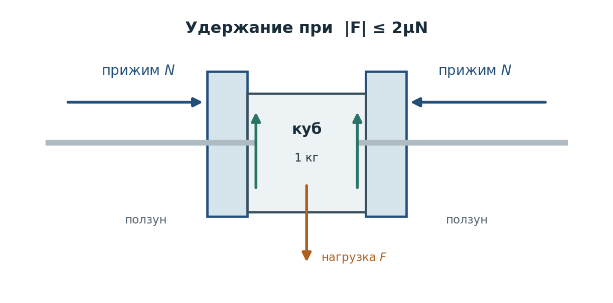

Для симметричного захвата при одинаковом коэффициенте трения покоя и скольжения предельная вертикальная сила равна $2\mu N$. Здесь $N$ — прижим **одной** губки. При начальной скорости ноль ожидаемое ускорение и путь вниз равны

$$
a=\frac{\operatorname{sgn}(F)}{m}\max\!\left(|F|-2\mu N,\,0\right),
\qquad s(t)=\tfrac12 a t^2 .
$$

При $\mu=0{,}5$ и $N=10$ Н нагрузка 10 Н должна удерживаться. При 10,2 Н остаток 0,2 Н разгоняет груз, и за 0,25 с он должен пройти **6,25 мм**. Направление нагрузки, нулевое трение, нулевой прижим и раскрытые губки также входят в набор.

| Инвариант | Наблюдаемая величина | Условие «да» |
|---|---|---|
| Правильная реакция обеих губок | Худшая ошибка по любому нагруженному кадру, Н | Не более 0,2 Н на каждой губке |
| Удержание или правильное скольжение | Худшая ошибка пути, мм | Удержание в пределах 0,5 мм, скольжение в пределах 2 мм |
| Ускорение без изменения физики | Сырые численные строки и хэши поз, ориентаций и импульсов | Равенство контрольной и ускоренной сборок на одинаковых входах |

Время измерялось на одном логическом процессоре с маской `0x100`, в одном потоке решателя, с выключенным сном. У всех движков восемь публичных обновлений на кадр. Для времени выбраны 60 Гц, по 10 Н на губку и 10 Н нагрузки. За один замер таймер охватывает 360 нагруженных кадров после прогрева. В 12 блоках все шесть порядков запуска движков встречаются дважды. Сетки точности дополнительно включают 120 и 240 Гц. Kinetica использует `double` и совместное решение трения, RP3D — `double` и по одной итерации скорости и положения на обновление, Box3D — `float` и штатный тёплый старт. Равный публичный шаг допускает разное число внутренних операций. [Настройки, границы таймера и условия точности](data/engine-anatomy-2026-11-22/raw-collision/sparse-guides/competitors/method.json) · [Типы и хэши программ](data/engine-anatomy-2026-11-22/raw-collision/sparse-guides/competitors/executables.csv)

## 2. Архивный замер трёх движков до опыта с проекцией

| Движок | Медиана, мкс/кадр | Смещение при 10 Н, 60 Гц | Допуск на удержание и силу в замеренном захвате | Прошли всю проверку, из 36 |
|---|---:|---:|:---:|---:|
| Kinetica того сравнения, без опытной проекции | 180,51 | 0,0434 мм | Да | 33 |
| ReactPhysics3D | 49,67 | 0,2792 мм | Да | 27 |
| Box3D | 48,69 | 2,9092 мм | Нет | 23 |

**При выполнении допуска** парное отношение времени Kinetica к RP3D равно **3,64×**. Для Box3D отношение сырых времён равно **3,74×**. Для оценки скорости Box3D при том же качестве нужен замер конфигурации, в которой эта сцена проходит допуски на удержание и силу.

Отношение времени — медиана частных внутри блоков. На всех 12 блоках оба соперника были быстрее. При сравнении ошибок пути на входах, где оба движка выдержали допуск прижима, Kinetica опередила Box3D в **33 из 36**, Box3D — в трёх. С RP3D таких входов было 33. Kinetica дала меньшую ошибку в **20**, RP3D — в **одном**, ещё **12** совпали с допуском сравнения $10^{-6}$ мм. [Свежие времена по каждому блоку](data/engine-anatomy-2026-11-22/raw-collision/memory-cpu/accepted-rows/competitors.csv) · [Сводка пар по точности](data/engine-anatomy-2026-11-22/raw-collision/sparse-guides/competitors/summary.csv) · [Каждая пара по точности](data/engine-anatomy-2026-11-22/raw-collision/sparse-guides/competitors/paired-accuracy.csv)

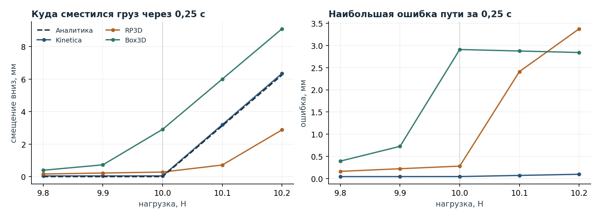

Слева показано конечное смещение, справа — максимальная ошибка за все нагруженные кадры. Точки — отдельные прогоны при пяти нагрузках. Линии соединяют измерения. Наклон кривой сам по себе скрывает постоянное смещение и ошибку в момент начала скольжения. [Kinetica](data/engine-anatomy-2026-11-22/raw-collision/sparse-guides/competitors/kinetica-grip.csv) · [RP3D](data/engine-anatomy-2026-11-22/raw-collision/sparse-guides/competitors/rp3d-grip.csv) · [Box3D](data/engine-anatomy-2026-11-22/raw-collision/sparse-guides/competitors/box3d-grip.csv)

## 3. Архивный опыт с разреженным откликом направляющих

Для одной касательной к контакту единичный импульс напрямую меняет скорости двух тел. Движение остальных передаётся через уравнения связей. Раньше при построении каждого столбца решатель обнулял пробные скорости копии массива. Для острова он также создавал локальные номера тел и переносил скорости обратно в мир.

Теперь отклик хранит две пары приращений линейной и угловой скорости. Для любого другого номера тела он возвращает ноль. Губки, куб и направляющие используют мировые номера. Когда острову принадлежат все направляющие, он сразу использует готовую матрицу. Для подмножества собираются именно его строки, в прежнем порядке. В пяти файлах правка добавила 61 и убрала 90 строк. [Изменение ядра](data/engine-anatomy-2026-11-22/raw-collision/sparse-guides/sparse.patch) · [Решатель трения](../../src/dynamics/time_stepping/CoupledFriction.cpp) · [Разбиение на острова](../../src/dynamics/time_stepping/FrictionIslands.cpp)

$$
\Delta v = M^{-1}J_j^{\mathsf T}\Delta\lambda,\qquad
A_{ij}=J_i M^{-1}J_j^{\mathsf T}.
$$

Здесь $J_j$ задаёт направление и плечи одного импульса, а $A_{ij}$ — изменение скорости вдоль строки $i$ от единичного импульса в строке $j$. Изменилось представление промежуточного вектора $\Delta v$. Уравнения, порядок строк, тёплый старт и физический шаг сохранились.

Опыт сравнивал две сборки до появления решателя с проекцией трения. Значение **189,80 мкс** принадлежит исходной сборке именно этой пары. [Исходные A/B-замеры](data/engine-anatomy-2026-11-22/raw-collision/sparse-guides/timings.csv) · [Время опытного решателя](grip-cpu-status.md)

| Сцена · 24 парных блока | Исходная сборка того опыта | С разреженным откликом | Медиана изменения внутри пары | Пар быстрее |
|---|---:|---:|---:|---:|
| Захват с направляющими | 189,80 мкс | 178,75 мкс | **−6,04%** | **23/24** |
| Пирамида из 140 кубов | 6,185 мс | 6,255 мс | +0,33% | 9/24 |

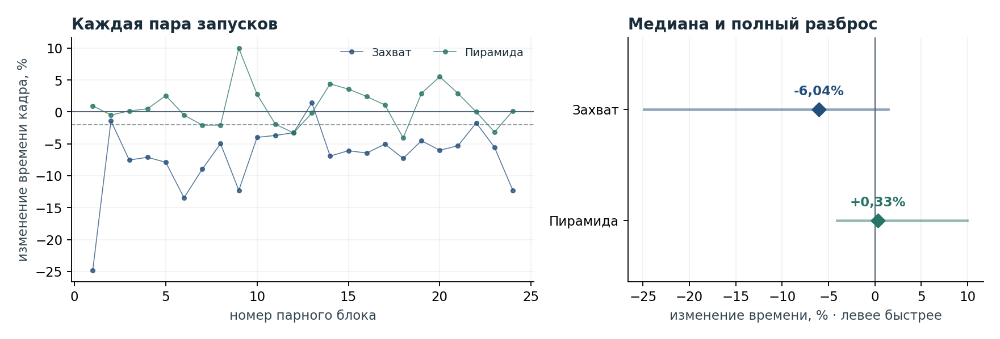

В этой таблице сравниваются только две сборки Kinetica. В таблице трёх движков выше использован отдельный повтор. В 22 из 22 тестов Windows результат положительный. Побайтно совпали выходы 17 наборов, по **3 539 строк** у каждой сборки. На коротком прогоне с затиранием арены совпали **52 хэша** — 25 для точного и 27 для быстрого шага. [Парные времена](data/engine-anatomy-2026-11-22/raw-collision/sparse-guides/timings.csv) · [Сверка 17 наборов](data/engine-anatomy-2026-11-22/raw-collision/sparse-guides/verification/parity.csv) · [CTest](data/engine-anatomy-2026-11-22/raw-collision/sparse-guides/ctest.log) · [Нативный профиль VTune на 15 000 кадрах](data/engine-anatomy-2026-11-22/raw-collision/sparse-guides/vtune/client.txt)

## 4. Помогли ли встраивание и выравнивание

Отдельный опыт с предыдущей сборкой изолировал две причины. Clang уже встроил короткие операции `Vector3`. Принудительное встраивание убрало 11 оставшихся мест вызова `push` и `twist`. Пирамида стала быстрее в 23/24 парах, на захвате время выросло на 0,85% по медиане. Обычный `Vector3` состоит из трёх `double` и занимает ровно 24 байта. С `alignas(16)` он занимает 32 байта, а тело решателя вырастает со 184 до 240 байт. Выравнивание замедлило обе сцены. [Размеры типов](data/engine-anatomy-2026-11-22/raw-collision/inline-layout/align-layout.csv) · [Машинный код](data/engine-anatomy-2026-11-22/raw-collision/inline-layout/assembly.csv) · [Все варианты](data/engine-anatomy-2026-11-22/raw-collision/inline-layout/summary.csv)

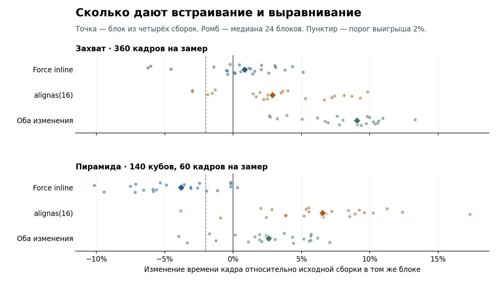

Проверили и ветку для пропуска нулевого импульса. В совместном захвате ровно нулевыми оказались **675 из 259 200** приложений, всего **0,26%**. Ещё 245 511 имели ненулевой модуль меньше $10^{-12}$ в числовых единицах своей строки. Для поступательных и вращательных строк у импульса разные физические единицы. При прямой проверке ненулевой поступательный импульс $2^{-400}$ Н·с дал ожидаемое изменение скорости. Ветка проверки замедлила захват на **2,85%** и в двух синтетических случаях изменила знак нуля. Её оставили в эксперименте. [Счётчики](data/engine-anatomy-2026-11-22/raw-collision/guide-impulses/counts-1.csv) · [Проверка малых импульсов](data/engine-anatomy-2026-11-22/raw-collision/guide-impulses/zero-witness.csv) · [Парные результаты](data/engine-anatomy-2026-11-22/raw-collision/guide-impulses/summary.csv)

## 5. Почему улучшение свободного полёта сломало захват

На свободном кубе с постоянным ускорением $a=10$ м/с² исходный быстрый шаг сначала обновляет скорость, затем переносит центр масс по конечной скорости. Суммарная ошибка пути через время $T$ равна $aTh/2$. При $T=0{,}25$ с и $h=1/480$ с получаем **2,60417 мм**. При удвоении частоты ошибка уменьшается вдвое. Все три отказа базовой сетки захвата относятся к режимам при 60 Гц с такой ошибкой — нулевому трению, нулевому прижиму и раскрытым губкам.

В опытной сборке разбили только непрерывную поступательную силу на два полуимпульса $hF/2$, до и после переноса. Проверили 24 варианта свободного движения с двумя массами, разными направлениями силы, полем тяжести и взаимной компенсацией ускорений. Максимальная ошибка положения по всем шагам стала **$2{,}40\cdot10^{-14}$ м**. Однако при удержании на границе 10 Н груз вместо смещения **0,0434 мм вниз** ушёл **2,5608 мм вверх**. Впервые он вышел из допуска на четвёртом нагруженном кадре. Средняя сила каждой губки в обеих сборках составляла 10 Н. [Свободное движение](data/engine-anatomy-2026-11-22/raw-collision/split-force/split-free.csv) · [Удержание в опытной схеме](data/engine-anatomy-2026-11-22/raw-collision/split-force/shared8-1-split.csv)

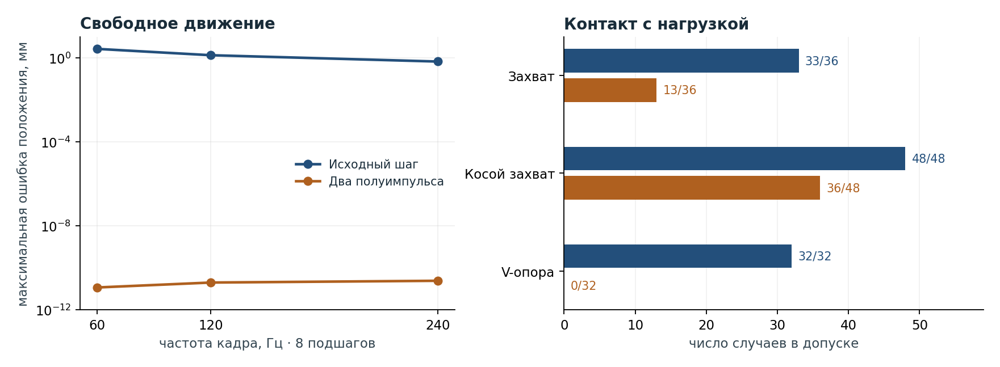

| Совместный решатель | Исходная схема | Два полуимпульса | Новые успехи / потерянные успехи |
|---|---:|---:|---:|
| Захват, 36 случаев | 33 | 13 | +2 / −22 |
| Косой захват, 48 случаев | 48 | 36 | +0 / −12 |
| Косой захват после длительного прижима, 48 | 48 | 36 | +0 / −12 |
| V-образная опора, 32 случая | 32 | 0 | +0 / −32 |
| Отложенный набор V-опоры, 32 | 32 | 0 | +0 / −32 |

**Решение — отклонить изменение порядка сил.** Оно исправило свободную траекторию, одновременно нарушив согласование переноса с импульсом в удерживаемом контакте. Из 22 зарегистрированных тестов опытной сборки восемь завершились отказом. Рабочая сборка использует прежний порядок сил. [Сводка физических сеток](data/engine-anatomy-2026-11-22/raw-collision/split-force/physical-summary.csv) · [Журнал отказов CTest](data/engine-anatomy-2026-11-22/raw-collision/split-force/ctest.log)

## 6. Что физически исправлено и где остаётся риск

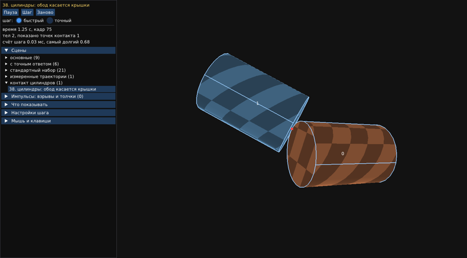

При касании наклонного торца построитель площадки раньше принимал опорную точку в **26,896 мм** от физической поверхности цилиндра. Возникало ложное проникновение **0,633 мм** и самопроизвольное смещение до **3,530 мм**. После проверки точки в плоскости настоящего диска в восьми опытах за 480 шагов смещение и кинетическая энергия остались нулевыми. Для строгих наборов сложных пар в версии с проверкой торца ещё остаются 28 и 26 поз за допуском из 1 440 в каждом. [Геометрия, рисунки и исходные координаты](cylinder-contact-2026-11-22.md) · [Восемь траекторий после исправления](data/engine-anatomy-2026-11-22/raw-collision/caps-at-rest/after-final.csv)

**Открытый контрпример — удар внутри подшага.** Для шара радиуса 0,125 м с начальной скоростью 3 м/с и расчётным моментом упругого удара $t=1/36$ с обе проверенные схемы переноса дали максимальную ошибку положения **666,666 мм** при 60 Гц и **1,042 мм** при 240 Гц. При ударе точно в начале подшага тот же прибор прошёл допуск на обеих частотах. Следующий опыт по точности должен фиксировать первый момент расхождения — обнаружение удара, скорость сразу после него и остаток подшага. Это существенное ограничение для робототехники. [Исходная траектория и скорости до и после удара](data/engine-anatomy-2026-11-22/raw-collision/split-force/stock-transport.csv) · [Аналитический опыт](../../validation/studies/anatomy/transport_oracles.cpp)

**⚠️ Стресс-тест.** По захвату ответ «да» для ускорения без потери проверенных траекторий и «нет» для превосходства в каждом случае. Испытаны смена направления нагрузки, нулевое трение, активное скольжение, общая неподвижная опора и раздельные острова. Времена относятся к одному процессору и двум сценам. Миллион тел, произвольную геометрию и ошибку реального робота этот набор не измеряет.
