# От падающего куба до подвески

Поставьте ладонь под книгу. До касания она падает, после касания остаётся на месте. В программе между этими двумя наблюдениями спрятаны три разных вопроса. **Где книга?** Это геометрия. **Как быстро она движется?** Это кинематика. **Что изменит её движение?** Это динамика. Построим такой опыт с кубом и дойдём до механизмов, где ответ уже трудно угадать на глаз.

| Хочу разобраться | С чего начать |
|---|---|
| Почему куб останавливается на высоте 0,5001 м | [Падение](#падение), затем [контакт](#контакт) |
| Как движок находит пол и переносит точки контакта | [Геометрия](#геометрия) |
| Почему губки удерживают куб до определённой нагрузки | [Трение](#трение) |
| Как шаг времени превращается в ошибку угла | [Время](#время) и [передачи](#передачи) |
| Как одна формула становится подвеской или поплавком | [Подвеска и плавучесть](#механизмы) |
| Как отличить настоящую опору от дрожания | [Проверка](#проверка) |

Для первых двух опытов достаточно уметь запустить пример на C++. Дальше каждую новую формулу можно разобрать в три приёма. Сначала предскажите знак или порядок величины. Затем посмотрите число. Если прогноз расходится с наблюдением, ссылка рядом откроет именно те строки движка, где вычисляется величина. Сборка библиотеки и просмотрщика описана в [README](../README.md).

## Падение

**Опыт.** Нижняя грань куба будет лежать на полу. Какую высоту тогда должен показывать датчик положения тела? В Kinetica `position` — центр масс. В `Body::box` передают **полуразмеры**. Аргумент `{0.5, 0.5, 0.5}` задаёт куб со стороной 1 м. Поверхность пола в нашем опыте лежит на $y=0$. Значит, в покое геометрический ответ для центра равен **0,5 м**. При плотности 1000 кг/м³ масса этого куба равна 1000 кг. Нулевая плотность пола задаёт опору с нулевой обратной массой. [Создание коробки](https://github.com/Kinetica-Labs/kinetica-physics/blob/4c26d196fbe330cd32190a7d71de9fee4cae1894/include/body/Body.h#L78-L84) · [Поля тела](https://github.com/Kinetica-Labs/kinetica-physics/blob/4c26d196fbe330cd32190a7d71de9fee4cae1894/include/body/Body.h#L39-L44)

Пока куб летит без контактов и сопротивления, его ускорение постоянно. Выберем ось $y$ вверх, $g=9{,}81$ м/с², начальную высоту $y_0=3$ м и нулевую начальную скорость. Тогда

$$
v_y(t)=-gt,\qquad y(t)=y_0-\tfrac12gt^2,\qquad
t_*=\sqrt{\frac{2(y_0-0{,}5\,\mathrm m)}{g}}\approx0{,}714\,\mathrm s.
$$

Здесь $t_*$ — расчётное время первого геометрического касания. Уже через полсекунды можно проверить знак и величину перемещения. Центр должен оказаться на $3-9{,}81\cdot0{,}5^2/2=1{,}77375$ м. В программе каждый вызов `step` продвигает физическое время на $1/60$ с.

```cpp
#include <world/World.h>
#include <cstdio>

int main() {
    kp::World world;
    world.addBody(kp::Body::box({10, 0.5, 10}, 0, {0, -0.5, 0}));
    const auto cube = world.addBody(kp::Body::box({0.5, 0.5, 0.5}, 1000, {0, 3, 0}));

    for (int frame = 1; frame <= 120; ++frame) {
        world.step(kp::Real(1) / 60);
        if (frame == 30 || frame == 120)
            std::printf("%d %.6f\n", frame, double(world.body(cube).position.y));
    }
}
```

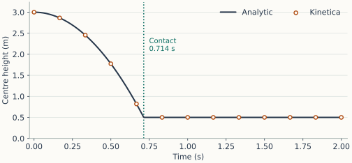

Сплошная линия — расчёт для свободного падения и идеально неупругой остановки. Кружки — 13 отсчётов Windows-примера через каждые десять кадров. Для оси времени взят номер кадра, делённый на 60. Исходный пример округляет высоту до 0,0001 м. В конце он печатает **0,5001 м**. Разность с геометрической высотой положительна и сопоставима с полосой обнаружения контакта $10^{-4}$ м. По записи с таким округлением нельзя восстановить меньшую ошибку или точное время касания. [Пример FallingBox](https://github.com/Kinetica-Labs/kinetica-physics/blob/4c26d196fbe330cd32190a7d71de9fee4cae1894/examples/05_world/FallingBox.cpp#L9-L20) · [Допуск в метрах](https://github.com/Kinetica-Labs/kinetica-physics/blob/4c26d196fbe330cd32190a7d71de9fee4cae1894/include/collision/ContactPair.h#L14) · [Исходные отсчёты Windows](https://github.com/Kinetica-Labs/kinetica-physics/blob/ae7004ec8f032ed1f4b4d432568789a68e2aa19e/docs/reports/data/falling-box-windows-2026-11-24.txt)

Фрагмент выше печатает на два знака больше. На Windows он дал `30 1.773750` и `120 0.500055`. В покое нижняя грань оказалась примерно в **55 мкм над плоскостью**. Так можно отделить измеренную величину от ширины полосы контакта и от округления в старом выводе.

**Что хранится между кадрами?** Кроме положения $\mathbf x$ и ориентации $q$, у тела есть линейный импульс $\mathbf p$ и момент импульса $\mathbf L$ относительно центра масс. Для движущегося тела $\mathbf v=\mathbf p/m$. Угловую скорость $\boldsymbol\omega$ движок получает из $\mathbf L$ и тензора инерции. Он поворачивает момент в главные оси тела, умножает компоненты на обратные моменты инерции и поворачивает ответ обратно. Поэтому вытянутый брусок труднее раскрутить поперёк, чем вокруг его длинной оси. [Линейная и угловая скорости](https://github.com/Kinetica-Labs/kinetica-physics/blob/4c26d196fbe330cd32190a7d71de9fee4cae1894/include/body/Body.h#L138-L139)

| Что измеряем | Обозначение | Единица |
|---|---|---|
| Положение, скорость центра масс | $\mathbf x,\ \mathbf v$ | м, м/с |
| Угол, угловая скорость | $\theta,\ \boldsymbol\omega$ | рад, рад/с |
| Сила, импульс силы за интервал | $\mathbf F,\ \mathbf J=\int \mathbf F\,dt$ | Н, Н·с |
| Момент силы, момент импульса | $\boldsymbol\tau,\ \mathbf L$ | Н·м, кг·м²/с |

## Геометрия

**Как среди тысячи тел найти две поверхности, которые могут встретиться?** У тысячи тел 499 500 неупорядоченных пар ещё до проверки первой грани. Сначала движок заключает формы в прямоугольные объёмы с рёбрами вдоль мировых осей (AABB). Он оценивает, куда тело может дотянуться за шаг, и собирает кандидатов. Пересечение двух таких объёмов означает только, что пару стоит рассмотреть подробнее. Длинные тонкие бруски могут лежать по разные стороны друг от друга внутри пересекающихся коробок. [Получение кандидатов](https://github.com/Kinetica-Labs/kinetica-physics/blob/4c26d196fbe330cd32190a7d71de9fee4cae1894/src/collision/PairFinder.cpp#L49-L62) · [От кандидата к точкам](https://github.com/Kinetica-Labs/kinetica-physics/blob/4c26d196fbe330cd32190a7d71de9fee4cae1894/src/collision/PairFinder.cpp#L98-L107)

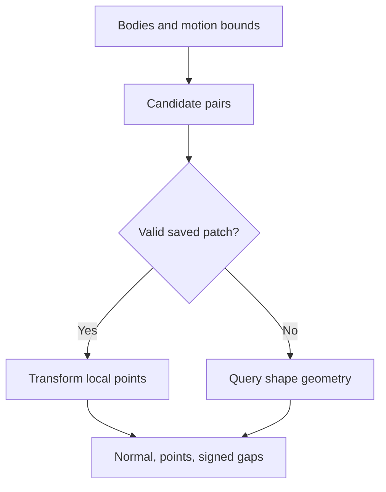

Для выпуклой формы удобно спросить, какая её точка дальше всего в данном направлении. Для коробки ответом станет одна из вершин. Алгоритм **GJK** задаёт этот вопрос обеим формам. Если из каждой точки $A$ мысленно вычесть каждую точку $B$, получится выпуклое множество $A-B$. Расстояние между раздельными формами равно расстоянию от нуля до этого множества. Реализация приближается к нулю по отрезку, треугольнику или тетраэдру из нескольких опорных точек. Из весов ближайшей точки она восстанавливает две точки уже на самих телах. [Контракт GJK](https://github.com/Kinetica-Labs/kinetica-physics/blob/4c26d196fbe330cd32190a7d71de9fee4cae1894/include/collision/narrowphase/Gjk.h#L19-L36) · [Реализация closestPoints](https://github.com/Kinetica-Labs/kinetica-physics/blob/4c26d196fbe330cd32190a7d71de9fee4cae1894/src/collision/narrowphase/Gjk.cpp#L248-L265)

**Опыт без силы и времени.** Брусок занимает $x\in[-1,1]$, $y,z\in[-0{,}5,0{,}5]$ м. Шар радиуса 0,5 м стоит центром в $(3,2,0)$ м. Ближайшая точка бруска к центру лежит в $(1,0{,}5,0)$ м. До центра шара $\sqrt{2^2+1{,}5^2}=2{,}5$ м. Вычитаем радиус и получаем **2 м**. На рисунке показано сечение $z=0$. Пунктир идёт к центру шара, зелёный отрезок заканчивается на его поверхности.

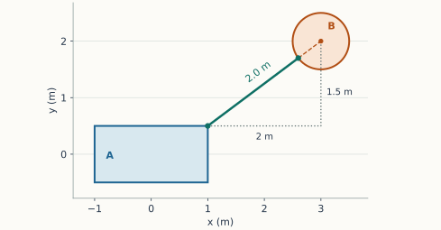

```cpp
#include <collision/narrowphase/Gjk.h>
#include <collision/shapes/ConvexHull.h>
#include <collision/shapes/Sphere.h>
#include <cstdio>

int main() {
    const auto bar = kp::ConvexHull::box({1, 0.5, 0.5});
    const kp::Sphere ball(0.5);
    const kp::Transform barPose{}, ballPose{{3, 2, 0}, {}};
    const auto hit = kp::closestPoints(bar, barPose, ball, ballPose);
    std::printf("%.9f\n", double(hit.distance));
}
```

На Windows программа напечатала `2.000000000`. Если переместить обе формы на один и тот же вектор, их взаимное расстояние по геометрии останется равным 2 м.

У близких многогранников есть ещё один инструмент. Спроецируйте оба тела на прямую. Если проекции разделены, то разделены и тела. **SAT**, теорема о разделяющей оси, подсказывает, какие направления достаточно проверить для выпуклых многогранников. Это нормали к граням и направления векторных произведений рёбер двух тел. У почти параллельных рёбер такое произведение мало. Выбор устойчивой оси и построение точек площадки становятся отдельными задачами. Для площадки «грань о грань» движок обрезает контактный многоугольник по границам опорной грани. Для шаров и других круглых форм диспетчер выбирает соответствующую реализацию. [Выбор алгоритма](https://github.com/Kinetica-Labs/kinetica-physics/blob/4c26d196fbe330cd32190a7d71de9fee4cae1894/src/collision/narrowphase/NarrowPhaseAlgorithm.cpp#L9-L17) · [Поиск оси SAT](https://github.com/Kinetica-Labs/kinetica-physics/blob/4c26d196fbe330cd32190a7d71de9fee4cae1894/src/collision/narrowphase/Sat.cpp#L124-L134) · [Обрезка площадки](https://github.com/Kinetica-Labs/kinetica-physics/blob/4c26d196fbe330cd32190a7d71de9fee4cae1894/src/collision/narrowphase/HullVsHullAlgorithm.cpp#L95-L117)

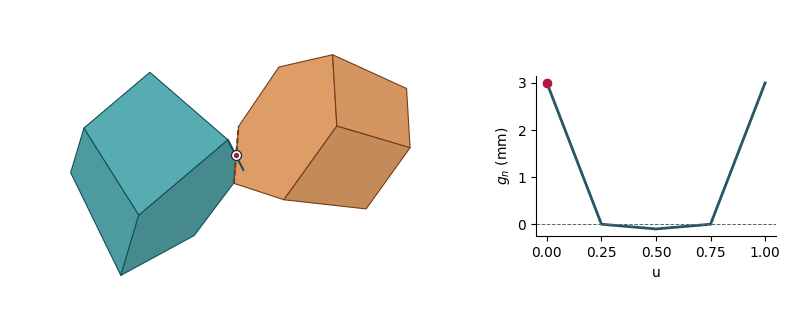

В сцене `hull-events` позы заданы записью. Поставьте её на паузу у касания рёбер. Что сохранится при малом повороте тела? Материальная точка останется на том же месте **в осях тела**, а точка ближайшего касания может перейти на соседнее ребро. Это различие объясняет правило переиспользования площадки. [Регистрация записи в просмотрщике](https://github.com/Kinetica-Labs/kinetica-physics/blob/4c26d196fbe330cd32190a7d71de9fee4cae1894/viewer/Scenes.cpp#L232)

Пусть $R$ поворачивает из осей формы в мир, а $\mathbf x$ — мировая позиция начала этих осей. Тогда материальную точку можно сохранить и вернуть двумя выражениями

$$
\mathbf a=R^\mathsf T(\mathbf p-\mathbf x),\qquad
\mathbf p'=\mathbf x'+R'\mathbf a.
$$

Чтобы получить локальные координаты, сначала вычитают положение начала, затем поворачивают разность. Направление вроде нормали достаточно повернуть. Для подходящей площадки двух многогранников Kinetica запоминает точки одного тела и плоскость грани другого. При переносе она восстанавливает новые мировые точки и проецирует их на эту плоскость. Ключ включает обе части и обе формы. Поворот меньшей формы на $\theta$ способен сместить её точку на хорду длиной до $2r\sin(\theta/2)$. Движок складывает эту оценку с относительным сдвигом и приростом дальности поиска. Когда сумма превышает допуск, он снова обращается к геометрии. Так стоит различать сохранённую **точку тела**, **площадку** и накопленный **импульс**. [Преобразование координат](https://github.com/Kinetica-Labs/kinetica-physics/blob/4c26d196fbe330cd32190a7d71de9fee4cae1894/include/math/Transform.h#L13-L19) · [Что запоминается](https://github.com/Kinetica-Labs/kinetica-physics/blob/4c26d196fbe330cd32190a7d71de9fee4cae1894/src/collision/ManifoldMemory.cpp#L17-L27) · [Проверка допуска](https://github.com/Kinetica-Labs/kinetica-physics/blob/4c26d196fbe330cd32190a7d71de9fee4cae1894/src/collision/ManifoldMemory.cpp#L39-L44) · [Новые точки](https://github.com/Kinetica-Labs/kinetica-physics/blob/4c26d196fbe330cd32190a7d71de9fee4cae1894/src/collision/ManifoldMemory.cpp#L55-L72)

## Контакт

Положите книгу плашмя, а затем уприте в стол одним углом. В первом положении опора может распределить нагрузку по нескольким точкам. Во втором даже вертикальная реакция стола создаёт момент относительно центра масс. Поэтому решателю нужны нормаль, положения точек и их знаковые зазоры. Одного булева ответа «столкнулись» недостаточно.

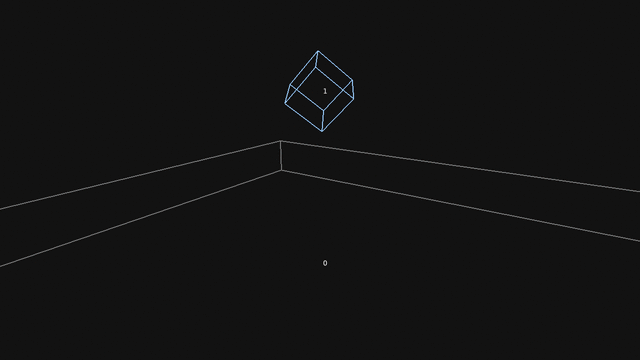

Договоримся, что единичная нормаль $\mathbf n$ направлена от тела $A$ к телу $B$. Пусть $\mathbf p_A,\mathbf p_B$ — соответствующие точки поверхностей. Тогда $s=\mathbf n\cdot(\mathbf p_B-\mathbf p_A)$ в метрах. Положительный $s$ означает зазор, отрицательный — перекрытие вдоль выбранной нормали. В точке на плече $\mathbf r$ от центра мгновенная скорость равна $\mathbf u=\mathbf v+\boldsymbol\omega\times\mathbf r$. Вращающийся куб способен двигать угол вниз даже при неподвижном центре. Величина $u_n=\mathbf n\cdot(\mathbf u_B-\mathbf u_A)$ в м/с показывает сближение, когда она отрицательна. [Зазор и точки в коде](https://github.com/Kinetica-Labs/kinetica-physics/blob/4c26d196fbe330cd32190a7d71de9fee4cae1894/src/collision/ManifoldMemory.cpp#L55-L72) · [Скорость точки](https://github.com/Kinetica-Labs/kinetica-physics/blob/4c26d196fbe330cd32190a7d71de9fee4cae1894/include/body/Body.h#L158)

**Сколько импульса нужно при ударе?** Возьмём центральный удар по неподвижному полу, тело массой $m=2$ кг и $u_n^-=-3$ м/с. После неупругого удара требуется $u_n^+=0$. За малое время удара пренебрежём импульсом тяжести. Тогда $J_n=m(u_n^+-u_n^-)=6$ Н·с вверх. Импульс на полу равен по модулю и направлен вниз. Кинетическая энергия тела уменьшается на $mu^2/2=9$ Дж. Для удара в угол ответ меняется, поскольку часть действия импульса идёт на вращение. Для тела $B$ это записывается так

$$
\Delta\mathbf p_B=\mathbf J,\qquad
\Delta\mathbf L_B=\mathbf r_B\times\mathbf J .
$$

У покоящейся опоры возникает другой вопрос. Куб массы 2 кг за $h=1/60$ с получил бы от тяжести импульс вниз величиной $mgh=0{,}327$ Н·с. Опора должна компенсировать его за тот же интервал. Её средняя сила равна $J_n/h=19{,}62$ Н. Так из импульса за конкретный шаг получается показание датчика силы. Если куб отрывается от свободной опоры, её нормальная реакция должна стать нулевой. [Приложение импульса и силы](https://github.com/Kinetica-Labs/kinetica-physics/blob/4c26d196fbe330cd32190a7d71de9fee4cae1894/include/body/Body.h#L160-L172) · [Сборка системы контактных ограничений](https://github.com/Kinetica-Labs/kinetica-physics/blob/4c26d196fbe330cd32190a7d71de9fee4cae1894/src/dynamics/event_driven/ContactAssembly.cpp#L76-L94)

## Трение

**Удержат ли две губки куб?** Представьте куб массой 1 кг между двумя вертикальными губками. Каждая прижимает его горизонтально с силой $N=10$ Н. Коэффициент трения $\mu=0{,}5$. На одной губке модуль касательной силы может достигать $\mu N=5$ Н. Для симметричного захвата без вращения и с одинаковой нагрузкой на обеих губках предел удержания равен **10 Н вниз**. При меньшей нагрузке трение приспосабливается к требуемой силе. В импульсной форме тот же предел за один интервал имеет вид $\lVert\mathbf J_t\rVert\le\mu J_n$. В коде полезно найти место, которое ограничивает длину уже вычисленного касательного вектора. [Размеры куба и губок](https://github.com/Kinetica-Labs/kinetica-physics/blob/4c26d196fbe330cd32190a7d71de9fee4cae1894/examples/scenes/GripGeometry.h#L8-L14) · [Ограничение касательного импульса](https://github.com/Kinetica-Labs/kinetica-physics/blob/4c26d196fbe330cd32190a7d71de9fee4cae1894/src/dynamics/time_stepping/CentreFriction.cpp#L30-L35)

В опыте нагрузку $F$ задают отдельно, тяжесть отключена, длительность действия $T=0{,}25$ с. Для закрытых неподвижных по вертикали губок, положительной нагрузки вниз, старта из покоя и постоянного $N$ простейшая модель даёт

$$
d_\text{ideal}(T)=\frac{T^2}{2m}\max(0,F-2\mu N).
$$

Попробуйте подставить **10,1 Н**. Лишние 0,1 Н сообщают ускорение 0,1 м/с². За четверть секунды куб пройдёт **3,125 мм** вниз. Теперь можно сравнивать движок с предсказанием до запуска. В таблице $d$ — **конечное** смещение куба, положительное вниз. Максимальная ошибка за весь путь — отдельный столбец исходного опыта. [Как прикладывается нагрузка](https://github.com/Kinetica-Labs/kinetica-physics/blob/4c26d196fbe330cd32190a7d71de9fee4cae1894/tests/regression/GripLimit.cpp#L32-L46)

| Нагрузка вниз, Н | Расчёт $d$, мм | Kinetica $d$, мм |
|---:|---:|---:|
| 8,0 | 0 | 0,03472 |
| 10,0 | 0 | 0,04340 |
| 10,1 | 3,125 | 3,19444 |
| 12,0 | 62,500 | 63,06424 |

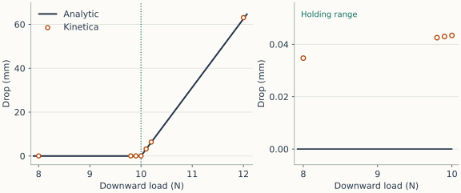

Точки взяты из одного Windows-прогона `kinetica-shared8-coupled` при 60 кадрах/с, восьми вызовах шага на кадр и одном подшаге на вызов. Слева виден переход к скольжению, справа увеличен диапазон удержания. Обе вертикальные оси подписаны в миллиметрах, но имеют разный масштаб. Архив содержит также смену знака, разомкнутые губки и нулевое трение. Для контроля с $\mu=0$ при $F=10$ Н получены 315,104 мм при расчётных 312,500 мм. Ошибка 2,604 мм превышает допуск опыта на скольжение 2 мм. Один и тот же замер позволяет ответить «да» для удержания в пределах 0,5 мм при 10 Н и «нет» для этого контроля скольжения. [Исходные CSV и условия Windows-опыта](https://github.com/Kinetica-Labs/kinetica-physics/blob/ae7004ec8f032ed1f4b4d432568789a68e2aa19e/docs/reports/data/dev-ablation-2026-11-24/grip.tar.gz)

## Время

Вызов `world.step(dt)` задаёт, сколько **физического времени** должно пройти. Видеокарта может нарисовать результат позже. Новый `World` по умолчанию выбирает событийный шаг. Если выставить `realtime = true`, он разделит кадр на подшаги. Пути сходятся в наблюдаемом результате — новых положениях и импульсах тел. [Выбор режима в World::step](https://github.com/Kinetica-Labs/kinetica-physics/blob/4c26d196fbe330cd32190a7d71de9fee4cae1894/src/world/World.cpp#L18-L50)

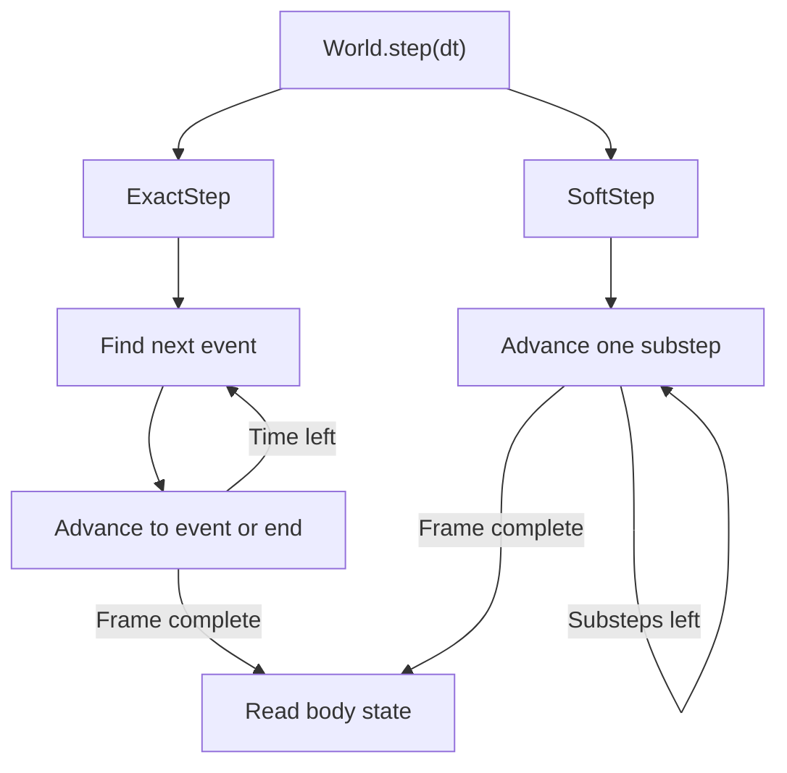

**Событийный шаг.** Если мяч летит к стене, интересен момент, когда изменятся условия движения. Алгоритм ищет ближайшее событие в оставшемся интервале, продвигает тела и обрабатывает новые условия. На отрезке постоянной силы схема «половина импульса — перенос — половина импульса» воспроизводит параболу переноса центра масс. При вращении несимметричного тела и при смене контакта возникают другие источники ошибки. Для проверки завершения шага в трудной сцене смотрите `report().unfinished` и `report().stalled`. [Цикл по событиям](https://github.com/Kinetica-Labs/kinetica-physics/blob/4c26d196fbe330cd32190a7d71de9fee4cae1894/src/dynamics/event_driven/ExactStep.cpp#L41-L57) · [Поиск первого удара](https://github.com/Kinetica-Labs/kinetica-physics/blob/4c26d196fbe330cd32190a7d71de9fee4cae1894/src/dynamics/event_driven/EventSearch.cpp#L286-L297) · [Продвижение тела](https://github.com/Kinetica-Labs/kinetica-physics/blob/4c26d196fbe330cd32190a7d71de9fee4cae1894/include/dynamics/Integrator.h#L106-L111)

**Шаг с подшагами.** Для обычного кадра при настройке в восемь подшагов и частоте 60 Гц один подшаг занимает $h=1/480$ с. Подшаг продвигает физические часы. Повтор решения ограничений при фиксированном времени уточняет скорости и импульсы. Обновление геометрии — третья операция со своей периодичностью. «Тёплый старт» использует сохранённый импульс как начальную оценку следующего решения. Сохранённую геометрию мы уже видели в главе о точках контакта. Эти два вида памяти можно проверять отдельно. [Параметры SoftStep](https://github.com/Kinetica-Labs/kinetica-physics/blob/4c26d196fbe330cd32190a7d71de9fee4cae1894/include/dynamics/time_stepping/SoftStep.h#L38-L48) · [Порядок решения и тёплый старт](https://github.com/Kinetica-Labs/kinetica-physics/blob/4c26d196fbe330cd32190a7d71de9fee4cae1894/src/dynamics/time_stepping/SoftStep.cpp#L296-L309)

**Откуда берётся ошибка, если скорость выглядит правильной?** Пусть угловое ускорение $\alpha$ постоянно, стартовая скорость нулевая. Если каждый раз сначала обновлять скорость, затем угол, последняя скорость интервала получит вес целого шага. На времени $T=nh$ сумма арифметической прогрессии даёт

$$
\theta_n=\sum_{k=1}^{n}(\alpha k h)h
=\tfrac12\alpha T^2+\tfrac12\alpha Th.
$$

Последнее слагаемое — систематическое опережение угла в этой модели. При $\alpha=\pi$ рад/с², $T=1$ с и $h=1/480$ с оно равно **3,2725 мрад**, хотя конечная скорость уже равна $\pi$ рад/с. Проверим этот вывод на двух шестернях.

## Передачи

Одно свободное твёрдое тело в трёхмерном пространстве имеет шесть степеней свободы — три независимых перемещения и три поворота. Степени свободы удобнее всего считать руками. У двери на идеальной петле остаётся один поворот. У ящика на идеальной прямой направляющей остаётся один ход. Запись желаемого движения между телами называется **ограничением**. Решатель вычисляет реакции, которые это условие поддерживают. [Строка ограничения Bond](https://github.com/Kinetica-Labs/kinetica-physics/blob/4c26d196fbe330cd32190a7d71de9fee4cae1894/include/joints/Bond.h#L15-L29) · [Строки шарнира](https://github.com/Kinetica-Labs/kinetica-physics/blob/4c26d196fbe330cd32190a7d71de9fee4cae1894/src/joints/HingeJoint.cpp#L21-L27)

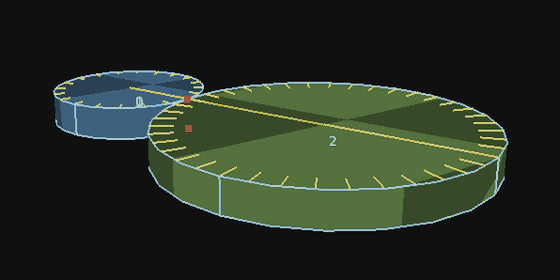

**Шестерни.** Выберем положительное направление обеих осей одинаково и начальные углы равными нулю. При внешнем зацеплении идеальных колёс число пройденных зубьев одинаково, направления противоположны. Для $Z_A=20$ и $Z_B=40$

$$
Z_A\theta_A+Z_B\theta_B=0,\qquad
\omega_B=-\frac{Z_A}{Z_B}\omega_A=-\tfrac12\omega_A.
$$

Чтобы ведомая шестерня держалась на месте в пространстве, ей ещё нужен подшипник. В сцене это два шарнира, по одному на вал, и отдельная связь между углами. Привод задаёт момент так, чтобы первую секунду ведущее колесо разгонялось с $\alpha=\pi$ рад/с². Эталон через секунду равен $+90^\circ$ и $-45^\circ$. [Сборка и момент привода](https://github.com/Kinetica-Labs/kinetica-physics/blob/4c26d196fbe330cd32190a7d71de9fee4cae1894/examples/scenes/GearTrain.h#L13-L37) · [Уравнение GearJoint](https://github.com/Kinetica-Labs/kinetica-physics/blob/4c26d196fbe330cd32190a7d71de9fee4cae1894/src/joints/GearJoint.cpp#L32-L42)

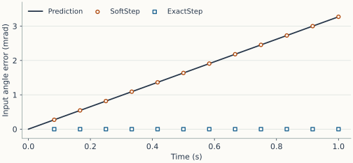

Для графика из угла ведущего вала в каждом кадре вычтен $\pi t^2/2$. Отклонение от нуля видно лучше, чем на двух почти совпадающих траекториях. Данные `GearTrain --csv` дают при $T=1$ с в быстром режиме $\theta_A=1{,}574069$ рад против расчётных $1{,}570796$ рад. При этом отношение углов колёс сохраняется с гораздо меньшей ошибкой. Здесь есть две разные проверки — точность передаточного отношения и точность движения во времени. [Пример с выводом CSV](https://github.com/Kinetica-Labs/kinetica-physics/blob/4c26d196fbe330cd32190a7d71de9fee4cae1894/examples/05_world/GearTrain.cpp#L14-L43) · [Исходные траектории](https://github.com/Kinetica-Labs/kinetica-physics/blob/ae7004ec8f032ed1f4b4d432568789a68e2aa19e/docs/reports/data/sieve-2026-11-22/gear-trajectory.csv)

**Рейка.** Обод шестерни и прямая рейка должны пройти одинаковый путь вдоль касательной. Для осей, выбранных в `rack-pinion`, $x=r\theta$. Один оборот соответствует $2\pi r$, четверть оборота при $r=20$ мм — **31,416 мм**. Угол в эту формулу подставляется в радианах. У направляющей по кривой следующий уровень сложности — задавать местную касательную по мере движения. В примере `Rail` привод требует скорость 1 м/с вдоль пути, а положение вагона описывается уже тремя мировыми координатами. [Сборка рейки](https://github.com/Kinetica-Labs/kinetica-physics/blob/4c26d196fbe330cd32190a7d71de9fee4cae1894/examples/scenes/RackDrive.h#L6-L20) · [Связь рейки и шестерни](https://github.com/Kinetica-Labs/kinetica-physics/blob/4c26d196fbe330cd32190a7d71de9fee4cae1894/src/joints/RackAndPinionJoint.cpp#L36-L45) · [Привод вдоль пути](https://github.com/Kinetica-Labs/kinetica-physics/blob/4c26d196fbe330cd32190a7d71de9fee4cae1894/examples/05_world/Rail.cpp#L17-L21)

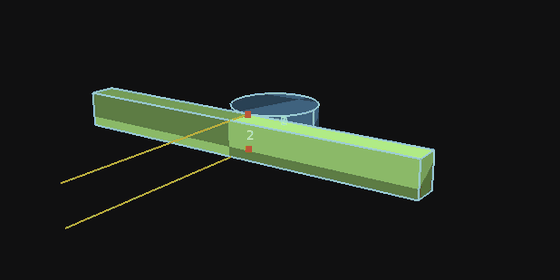

## Механизмы

**Почему машина проседает на 21,8 мм?** В `vehicle` жёсткое шасси массой 80 кг опирается на четыре одинаковых виртуальных колеса. Из каждого крепления вдоль оси подвески идёт луч. Попадание в дорогу даёт расстояние и нормаль. Разница свободной и текущей длины даёт сжатие $\delta$ в метрах. При контакте модель вычисляет нагрузку $N=\max(0,k\delta+c\dot\delta)$, где $k$ измерен в Н/м, $c$ — в Н·с/м, положительная $\dot\delta$ означает сжатие. При вывешенном колесе нагрузка исчезает. [От луча до опоры](https://github.com/Kinetica-Labs/kinetica-physics/blob/4c26d196fbe330cd32190a7d71de9fee4cae1894/src/world/VehicleConstraint.cpp#L18-L46) · [Силы колеса](https://github.com/Kinetica-Labs/kinetica-physics/blob/4c26d196fbe330cd32190a7d71de9fee4cae1894/src/dynamics/WheelContact.cpp#L14-L28)

На плоской горизонтальной дороге в симметричном покое вес делится поровну. Получаем **196,2 Н на колесо** и $\delta=mg/(4k)=80\cdot9{,}81/(4\cdot9000)=0{,}0218$ м. В примере начальная высота шасси выбрана по этому расчёту. При торможении или крене нагрузки на колёса уже могут отличаться. Возьмите в просмотрщике ту же сцену и поверните на ходу. По деформации подвески можно поставить вопрос о перераспределении нагрузки, а для численного ответа нужно прочитать реакции четырёх колёс. [Параметры и начальная высота](https://github.com/Kinetica-Labs/kinetica-physics/blob/4c26d196fbe330cd32190a7d71de9fee4cae1894/examples/scenes/Vehicle.h#L8-L24)

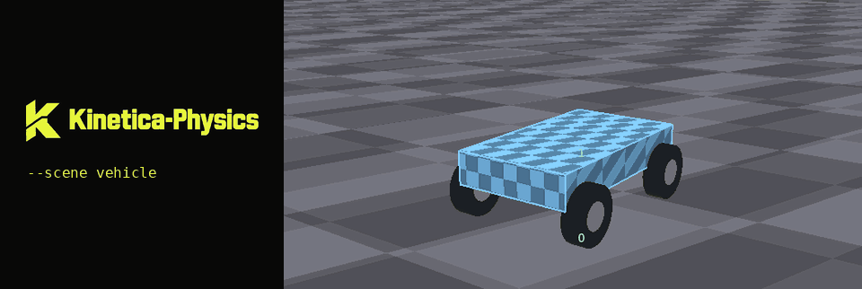

**Почему куб плавает наполовину?** В сцене `floating-box` вертикальная направляющая удерживает куб со стороной $a=0{,}20$ м. Поверхность воды — плоскость $y=0$. Плотность куба 500 кг/м³, воды — 1000 кг/м³. При осадке $d$ между нулём и $a$ объём погружённой части равен $a^2d$. Подъёмная сила $F_\mathrm{up}=\rho_\mathrm{water}g a^2d$. Приравняем её к весу куба. Получим **$d=0{,}100$ м**, массу 4 кг и силу Архимеда 39,24 Н. Полное погружение даёт 78,48 Н. Это модель спокойной воды с заданным уровнем и вертикального движения ориентированного куба. [Глубина погружения и сила](https://github.com/Kinetica-Labs/kinetica-physics/blob/4c26d196fbe330cd32190a7d71de9fee4cae1894/examples/scenes/FloatingBox.h#L8-L20)

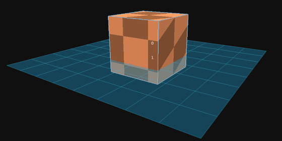

Есть более строгая проверка, чем равенство сил в покое. Поднимем куб на 1 см и отпустим. Подъём уменьшает вытесненный объём, сила Архимеда падает, куб получает ускорение вниз. Пока он остаётся погружён частично и без сопротивления воды, отклонение $z$ от равновесия подчиняется уравнению $m\ddot z=-\rho_\mathrm{water}g a^2z$. Период равен $2\pi\sqrt{d/g}=0{,}63437398$ с. Пример `FloatingBox` при шаге $1/480$ с измерил на Windows **0,63440492 с** между двумя пересечениями равновесия в одном направлении. Разность составляет около **31 мкс периода**. Это погрешность физического периода в моделируемом времени. Время выполнения процессорного шага измеряется другим опытом. [Как измеряется период](https://github.com/Kinetica-Labs/kinetica-physics/blob/4c26d196fbe330cd32190a7d71de9fee4cae1894/examples/05_world/FloatingBox.cpp#L13-L33)

## Проверка

**Пирамида действительно держится или просто замерла?** В `pyramid1000` нижний слой состоит из $16^2$ кубов, верхний — из одного. Квадраты размеров всех десяти слоёв в сумме дают ровно 1000. Часть слоёв получает начальную скорость наружу, поэтому опыт проверяет и распад стопки. Один кадр с неподвижными телами мало о чём говорит. Потяните мышью верхний куб вбок во время симуляции и отпустите. Наблюдайте, может ли он провернуться, когда меняется опора. [Геометрия и начальные скорости пирамиды](https://github.com/Kinetica-Labs/kinetica-physics/blob/4c26d196fbe330cd32190a7d71de9fee4cae1894/examples/scenes/CubeLayout.h#L6-L20)

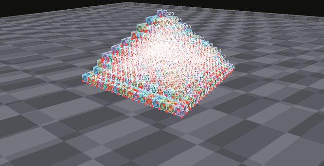

В стопке нагрузка передаётся через несколько слоёв. Проход по опорам (`shockPropagation`) использует направление тяжести, чтобы выбрать порядок обхода связей. Контактная поправка действует по нормали конкретной пары. Если грань наклонена, у нормали есть горизонтальная составляющая. Поэтому «всегда толкать строго вверх» дало бы другое уравнение. Засыпание острова — ещё один отдельный механизм. Группа связанных покоящихся тел может заснуть, а при внешнем воздействии должна проснуться. У нового `World` настройка `sleeping` по умолчанию выключена. В исследовании стопки полезно записать фактические флаги конкретной сцены. [Порядок обхода опор](https://github.com/Kinetica-Labs/kinetica-physics/blob/4c26d196fbe330cd32190a7d71de9fee4cae1894/src/dynamics/SupportGraph.h#L59-L70) · [Направление коррекции](https://github.com/Kinetica-Labs/kinetica-physics/blob/4c26d196fbe330cd32190a7d71de9fee4cae1894/src/dynamics/event_driven/ShockPropagation.cpp#L6-L18) · [Пробуждение](https://github.com/Kinetica-Labs/kinetica-physics/blob/4c26d196fbe330cd32190a7d71de9fee4cae1894/src/world/IslandSleep.cpp#L47-L65) · [Условия сна](https://github.com/Kinetica-Labs/kinetica-physics/blob/4c26d196fbe330cd32190a7d71de9fee4cae1894/src/world/IslandSleep.cpp#L78-L90)

Чтобы ответить, появилась ли «энергия из ниоткуда», сначала выпишите границу системы. Для изолированного твёрдого тела в однородном поле тяжести можно наблюдать

$$
E=\tfrac12 m\lVert\mathbf v\rVert^2+
\tfrac12\boldsymbol\omega\cdot\mathbf L+mgy .
$$

В свободном полёте без потерь эта сумма постоянна. При неупругом ударе и трении механическая энергия может уменьшаться, при захвате мышью внешний привод совершает работу. Для стопки суммируют энергию всех тел и сопоставляют её изменение с работой внешних воздействий и потерями. Сравните два одинаковых запуска с включённым и выключенным проходом по опорам. Снимите максимальное перекрытие в мм, движение после установления покоя, смещение под одинаковым внешним усилием и время кадра. Равный хэш двух прогонов показывает их повторяемость. Физическая точность требует эталона в физических единицах. [Как устроены проверки движка](testing.md)

### Три опыта с ответами

Сначала закройте последний столбец и предскажите результат. Меняйте одну величину за раз.

| Что изменить | Что измерить | Предсказание и условия |
|---|---|---|
| В свободном падении удвоить плотность куба при прежних размерах | $y$ через 0,5 с | **1,77375 м.** Ускорение от тяжести одинаково при обеих массах. Инерция проявится, если задать одинаковую внешнюю силу в ньютонах. |
| Для шестерён сократить $h$ вдвое при прежних $\alpha$ и $T$ | Опережение угла быстрого шага через 1 с | **Около 1,636 мрад** по модели $\alpha Th/2$. Это предсказание для нового размера шага. |
| Открыть губки так, чтобы они не касались куба весь опыт, и приложить вниз 10 Н к 1 кг | Падение за 0,25 с при старте из покоя | **312,5 мм** по баллистике. При отсутствии контакта вклад опорных импульсов должен исчезнуть. |

### Воспроизведение

В корне собранного проекта первый пример можно запустить как `./build/examples/FallingBox`. Геометрический опыт соответствует примеру `Distance`, который также сохраняет иллюстрацию в HTML. Для двух самостоятельных фрагментов C++ в этой книге создайте цель C++17 и подключите библиотеку `kinetica-physics`, как в README. Для одноконфигурационной сборки из README на Windows к именам программ добавляется `.exe`. [Инструкции сборки](../README.md) · [Пример Distance в репозитории](https://github.com/Kinetica-Labs/kinetica-physics/blob/4c26d196fbe330cd32190a7d71de9fee4cae1894/examples/02_geometry/Distance.cpp#L8-L23)

```sh
./build/examples/FallingBox
./build/examples/GearTrain --csv
./build/examples/FloatingBox
./build/viewer/viewer --scene pyramid1000
```

Ссылки на функции закреплены за публичной ревизией `4c26d19`. Графики сопровождаются ссылками на исходные снимки данных. Для самостоятельного чтения геометрии подойдут рисунки Эрина Катто о симплексе и ближайших точках. Для перехода от петли двери к уравнениям полезна его лекция о строках ограничений. [Computing Distance using GJK, 2010](https://box2d.org/files/ErinCatto_GJK_GDC2010.pdf) · [Understanding Constraints, 2014](https://box2d.org/files/ErinCatto_UnderstandingConstraints_GDC2014.pdf)

**⚠️ Стресс-тест.** У куба различайте касание плоскости и округлённую координату центра. Для захвата проверьте нагрузку ниже, на и выше предела трения, затем повторите с разомкнутыми губками. Для зубчатой пары измеряйте одновременно отношение углов и отклонение от заданной траектории. Тысяча кубов в анимации показывает одну конфигурацию и один характер движения. Непроникновение для любых форм, поворотов и скоростей и стоимость миллиона тел остаются открытыми вопросами.
