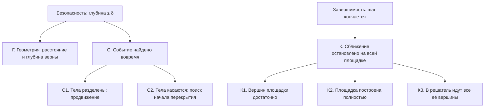

# Что доказано о контакте и что нет

Цель: строго показать, что тела не проваливаются друг в друга, а шаг кончается, — при двух
допущениях: движение тел на отрезке шага вычислено точно (ошибка интегрирования) и арифметика
точна (ошибка округления). Леммы проверяет решатель Z3: `proofs/check.sh`, тест
`contact-patch-lemmas`.

Состояние на 17.11.2026: **цель не достигнута.** Доказаны 25 лемм; Z3 же показал две дыры в самом
алгоритме (задачи в `counterexamples/` выполнимы), и ещё три найдены в логике шага.

## Две теоремы

**Безопасность.** После каждого отрезка шага глубина перекрытия любой пары тел не больше допуска
$\delta = 1$ мкм.

**Завершимость.** Шаг делится на конечное число отрезков.

Безопасность держится на поиске событий: отрезок обязан кончиться не позже момента, когда глубина
достигнет $\delta$. Завершимость держится на контакте: удар и силы обязаны остановить сближение на
всей площадке — иначе событие наступает снова в тот же момент, и шаг не кончается.

## Состояние звеньев

| Звено | Утверждение | Состояние | Чем закрыто |
|---|---|---|---|
| С1 | тела на расстоянии $d$, сближающиеся не быстрее $c$, не коснутся раньше $d/c$ | доказано | леммы 5, 6, 7 |
| С2 | у касающихся тел начало перекрытия находится | доказано при границе на ускорения | лемма 11; сама граница (`gapCurvature`) не записана |
| К1 | сближение, остановленное в вершинах площадки, остановлено на всей площадке | доказано | леммы 8а, 8б |
| К2 | опорный элемент цилиндра — точка, отрезок или круг | доказано | леммы 2а–2г |
| К2 | плоскость элемента не дальше истинного расстояния | доказано | лемма 1 |
| К2 | точки пересечения контура с границей элемента верны | доказано | леммы 3, 4, 10 |
| К2 | опорный элемент многогранника — грань, ребро или вершина | не записано | — |
| К3 | в решатель идут все вершины многоугольной площадки | выполнено в коде | дыра А закрыта: точки больше не отбрасываются |
| К3 | четырёх точек окружности хватает для круга торца | **опровергнуто** | дыра Б |
| К3 | для круга торца хватает одного условия-конуса в центре | доказано, в коде нет | лемма 9 |
| Г | расстояние (GJK) и ось наименьшего перекрытия (SAT) верны | не записано | проверяется прибором `study-geometry-errors` |

## Леммы

| № | Файл | Утверждение |
|---|---|---|
| 1 | `plane_gap_bounds_distance` | зазор плоскости не больше расстояния между телами: $g \le d$ |
| 2а | `cylinder_support_value` | опорная функция цилиндра $h(\mathbf d) = R\sqrt{d_x^2 + d_z^2} + H\lvert d_y\rvert$ |
| 2б | `cylinder_support_is_point` | наклонно к оси цилиндр упирается единственной точкой |
| 2в | `cylinder_support_is_segment` | поперёк оси — образующей |
| 2г | `cylinder_support_is_disc` | вдоль оси — кругом торца |
| 3 | `segment_crosses_circle` | формула пересечения отрезка с окружностью |
| 4 | `circle_crosses_side` | формула пересечения окружности со стороной грани |
| 5 | `lagrange_identity` | $(\mathbf a\cdot\mathbf b)^2 + \lvert\mathbf a\times\mathbf b\rvert^2 = \lvert\mathbf a\rvert^2\lvert\mathbf b\rvert^2$ |
| 6 | `point_speed_bound` | $\lvert\mathbf v + \boldsymbol\omega\times\mathbf r\rvert \le \lvert\mathbf v\rvert + \lvert\boldsymbol\omega\rvert\lvert\mathbf r\rvert$ |
| 7 | `advance_is_safe` | после взаимного смещения не больше $r$ точки, разделённые на $D$, разделены не меньше чем на $D - r$ |
| 8а | `closing_speed_is_affine` | скорость сближения линейна по положению точки |
| 8б | `vertices_bound_patch` | неотрицательная в вершинах — неотрицательна на всём треугольнике |
| 9 | `disc_cone_bounds_rim` | на круге: $\alpha \ge R\sqrt{\beta^2 + \gamma^2}$ даёт $f \ge 0$ всюду |
| 10 | `clipped_point_is_on_both` | точка отсечения лежит на отрезке и на стороне грани |
| 11 | `sag_bound` | функция со второй производной не больше $M$ опускается ниже меньшего из концов не больше чем на $M\Delta^2/8$ |
| 12 | `bond_conserves_momenta` | связь сочленения не меняет импульс и момент импульса пары |
| 13 | `travel_bond_is_derivative` | линия связи перемещения — производная её нарушения |
| 14 | `hinge_bond_is_derivative` | линия связи шарнира — производная её нарушения |
| 15 | `two_locks_leave_one_freedom` | две запертые оси из трёх оставляют одну свободу (на координатных осях) |
| 16 | `friction_ignores_tangent_choice` | импульс трения не зависит от выбора касательных направлений |
| 17 | `hinge_angle_rate` | скорость угла шарнира — разность угловых скоростей тел вдоль его оси: привод скорости держит именно координату `coordinateOf` |
| 18 | `hinge_angle_acceleration` | вторая производная угла шарнира: слагаемое от поворота оси — $(\omega_a\times e)\cdot\omega_b$; из него граница для поиска момента предела хода |
| 19 | `body_space_solution` | решение системы в пространстве тел (тождество Вудбери) — решение исходной системы в пространстве линий |
| 20 | `descent_step_lowers_energy` | шаг спуска по активному набору не увеличивает минимизируемую функцию: наборы не повторяются |
| 21 | `implicit_spring_loses_energy` | пружина с демпфером в сочленении, посчитанные неявно, не добавляют энергии при любой жёсткости и любом шаге |

Леммы 6 и 7 — скалярные выводы: неравенство Коши — Буняковского входит в них посылкой, а само
оно — следствие леммы 5. Эта подстановка сделана вручную; остальное проверяет Z3.

## Дыры

| | Дыра | Как найдена | Что нужно |
|---|---|---|---|
| А | четыре точки не покрывают площадку с пятью вершинами | Z3: `closed/four_points_miss_a_fifth_vertex` выполнима | закрыта 17.11.2026: решателю отдаются все вершины; на число шагов без конца это не повлияло |
| Б | четыре точки окружности не покрывают круг торца | Z3: `four_points_miss_the_rim` выполнима | условие-конус в центре круга (лемма 9) |
| В | поиск начала перекрытия делит отрезок пополам и предполагает, что порог пересекается один раз | чтение `overlapStart` | поиск с доказанной границей на изменение глубины |
| Г | если тела уже перекрыты глубже допуска, поиск отключается, и отрезок идёт до конца | разбор пробы: два бруска на 100 м/с вошли на 36 см | не идти в углубление перекрытия |
| Д | если перекрытие начинается сразу, поиск возвращает весь отрезок | чтение `overlapStart` | то же |

Дыры В–Д закрыты 17.11.2026: поиск идёт участками, каждый заверен леммой 11; в углубление
перекрытия отрезок не идёт; удар — жёсткая граница отрезка. Цена — завершимость: там, где
контакт не видит места сближения (дыры А и Б), шаг теперь не проваливает тело, а не кончается —
817 клеток таблицы вместо 91.

## Теорема о причёсывании ежа

На сфере нет непрерывного поля ненулевых касательных векторов. Для движка это запрет: нельзя по
одной лишь нормали непрерывно выбрать касательные направления. Правило `tangents`
(ContactSolver.cpp) делает скачок при \|n_x\| = 0,57 — и любое другое сделало бы его где-то.
Саму теорему решатель не докажет: она топологическая, а не арифметическая. Но из неё следует, что
доказывать надо независимость ответа от выбора касательных, — это лемма 16. Там, где направление
в плоскости нужно непрерывным (четыре точки окружности торца), оно берётся не по нормали, а по
осям самого тела: тело несёт свой репер, и запрет теоремы его не касается.

## Чего Z3 не докажет

- **Код.** Леммы — о вещественных числах и формулах. Программа считает с плавающей точкой; там,
  где ответ зависит от знака малой величины, округление может его изменить. Обе первые ошибки,
  найденные таблицей случаев, были именно в допусках.
- **Произвольный многогранник.** Утверждение «для любого числа вершин» требует индукции, которой
  у решателя нет. Такие леммы доказываются для одной вершины или одной стороны, а переход ко всем
  остаётся рассуждением.
- **Программу целиком.** Что код делает именно то, что описывает лемма, проверяет таблица случаев
  (`docs/reports/case-table.md`), а не решатель.
