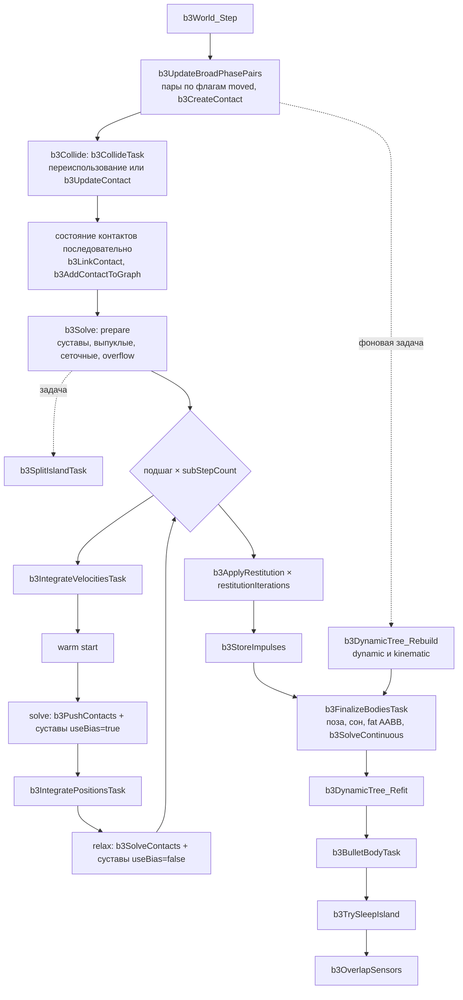

# Box3D

Клон: `refs/box3d` @ `be8c73189` (2026-11-13). Факты: `data/facts/box3d.jsonl`.

Автор — Erin Catto, C17, MIT, в документации назван «v0.1 engine … still maturing»
(`refs/box3d/docs/loose_ends.md:129`). В `CMakeLists.txt:4` стоит версия 0.1.0, а `b3GetVersion`
возвращает 0.2.0 (`refs/box3d/src/core.c:108`). Ничего не собиралось и не запускалось: всё ниже —
чтение кода.

## В одном абзаце

Игровой движок «для больших куч тел» (`refs/box3d/README.md:8`, `:40`). Всё определяет одно решение:
столкновения считаются **один раз за шаг**, а решатель делает внутри шага несколько подшагов по
схеме Soft Step — на каждом подшаге один проход с мягким выталкиванием и один «расслабляющий» проход
без него. Под эту схему выстроено остальное: контакт хранит неподвижные якоря и пересчитывает
разделение из приращений позы; граф ограничений раскрашен постоянно, чтобы каждый цвет решался
широким SIMD-кодом в несколько потоков; острова нужны только для сна. Заплачено за это тем, что
схема ничего не делает специально для длинных цепей и больших отношений масс (итерация одна, вся
сходимость — от warm start и числа подшагов), что контакт податлив и что сетки, карты высот и
compound бывают только статическими.

## Конвейер шага



1. `b3World_Step` — `refs/box3d/src/physics_world.c:1040`. Число подшагов — аргумент, не меньше 1 (`:1110`);
   `h = timeStep / subStepCount` (`:1115`).
2. `b3UpdateBroadPhasePairs` — `refs/box3d/src/broad_phase.c:649`. Работает по флагам, оставленным
   прошлым шагом; в конце ставит в очередь перестройку деревьев (`:708`) и последовательно создаёт
   контакты из отсортированных ключей (`:744`–`:772`).
3. `b3Collide` — `refs/box3d/src/physics_world.c:824`; параллельное тело — `b3CollideTask` (`:584`).
   Затем один поток применяет смены состояния по битовому множеству (`:940`–`:1031`): уничтожение
   контакта, слияние островов, перенос контакта в цвет графа или из него.
4. `b3Solve` — `refs/box3d/src/solver.c:1453`. Раздаёт стадии; ведущий поток — `b3SolverTask` (`:1170`),
   диспетчер стадии — `b3ExecuteBlock` (`:987`).
   - подготовка: `b3PrepareJointsTask` (`:226`), `b3PrepareContacts_Convex`, `b3PrepareContacts_MeshWide`
     (`refs/box3d/src/contact_solver_wide.inl:888`, `:953`), overflow — `b3PrepareContacts_Mesh`
     (`refs/box3d/src/contact_solver.c:32`);
   - цикл подшагов — `refs/box3d/src/solver.c:1251`–`:1328`;
   - восстановление — `:1334`–`:1353`; запись импульсов — `:1357`–`:1368`.
5. `b3FinalizeBodiesTask` — `refs/box3d/src/solver.c:693` (вызов `:1980`); внутри для быстрых тел
   `b3SolveContinuous` (`:490`, вызов `:809`).
6. `b3DynamicTree_Refit` — `refs/box3d/src/dynamic_tree.c:2373` (вызов `solver.c:2171`).
7. `b3BulletBodyTask` — `refs/box3d/src/solver.c:1434` (вызов `:2189`).
8. `b3TrySleepIsland` — `refs/box3d/src/solver_set.c:178` (вызов `solver.c:2330`).
9. `b3OverlapSensors` — `refs/box3d/src/sensor.c:281` (вызов `physics_world.c:1163`).

## Поиск пар (broadphase, midphase)

**Три дерева** по типу тела — static, kinematic, dynamic (`refs/box3d/src/broad_phase.c:25`–`:36`).
Пары ищутся только там, где участвует динамическое тело: dynamic×dynamic, dynamic×static,
dynamic×kinematic (`:671`–`:698`).

**Узел дерева** — 32 байта: AABB, слово `flagIndex` (бит листа, бит moved, 30 бит индекса) и высота
либо индекс формы. Братья лежат парой в соседних ячейках, так что пара занимает одну кэш-линию;
корень всегда в индексе 0 (`refs/box3d/include/box3d/types.h:1784`–`:1804`). Родители вынесены в
отдельный массив `parents` (`refs/box3d/src/dynamic_tree.c:2171`).

**Обновление** состоит из трёх разнесённых во времени частей.

- В `b3FinalizeBodiesTask` точный AABB формы сравнивается с её fat AABB; если вышел — fat AABB
  пересчитывается и лист дерева переписывается на месте, а предки атомарно помечаются флагом moved
  (`refs/box3d/src/solver.c:864`–`:875`, `refs/box3d/src/dynamic_tree.c:2185`–`:2222`). Подъём
  обрывается на первом уже помеченном предке.
- После решателя `b3DynamicTree_Refit` одним проходом по массиву от конца к началу подгоняет боксы
  помеченных внутренних узлов — без стека и с условной записью вместо ветвления
  (`refs/box3d/src/dynamic_tree.c:2389`–`:2413`). Это возможно, потому что дерево лежит в DFS-порядке.
- На следующем шаге, сразу после поиска пар, `b3DynamicTree_Rebuild` перестраивает только помеченные
  поддеревья, непомеченные переносит целиком как «листья сборки» и заодно возвращает DFS-порядок
  (`:2035`–`:2163`). Идёт фоновой задачей, пока работает узкая фаза; решатель дожидается её перед
  финализацией (`refs/box3d/src/solver.c:1968`–`:1975`). Разбиение — по медиане, SAH выключен макросом
  (`refs/box3d/src/dynamic_tree.c:1497`–`:1498`).

**Запас.** fat AABB = точный AABB + `B3_SPECULATIVE_DISTANCE` (20 мм) + запас формы
`min(B3_MAX_AABB_MARGIN = 50 мм, 0.125 × радиус формы)`; у статических форм запас равен
спекулятивному (`refs/box3d/include/box3d/constants.h:90`–`:97`, `refs/box3d/src/shape.c:27`–`:90`).

**Поиск пар — обход «дерево на дерево», а не запрос по каждому двинувшемуся прокси.** По
dynamic-дереву собираются пары братьев, где хотя бы один помечен moved (`b3GatherMovedSiblings`,
`refs/box3d/src/broad_phase.c:84`), и для каждой пары поддеревья сталкиваются друг с другом
(`b3CollideCrossPairs`, `:461`); пара узлов отбрасывается, если ни один не двигался (`b3TestPair`,
`:357`). Для static и kinematic серийный обход в ширину набирает до 64 затравок, дальше параллельно
(`:515`, `:582`). Автор отмечает, что это линейно по числу двинувшихся узлов и так делают Bepu и
Rapier (`:456`–`:460`). Документация клона описывает прежнюю схему с запросом по каждой форме
(`refs/box3d/docs/simulation.md:1915`) — она отстала от кода.

**Хранение пар.** Списка пар нет. Есть хэш-множество `pairSet` ключей пар, у которых уже есть
`b3Contact` (`refs/box3d/src/broad_phase.h:21`–`:35`); ключ — 22 бита на форму дважды и 20 бит на
ребёнка compound (`refs/box3d/include/box3d/constants.h:135`–`:139`). Кандидаты проверяются пачками
по 32 с предвыборкой ячеек хэша и форм (`refs/box3d/src/broad_phase.c:256`–`:341`). Контакт
уничтожается в узкой фазе, когда fat AABB двух форм перестали пересекаться
(`refs/box3d/src/physics_world.c:624`–`:633`). Ключи от всех рабочих сливаются и **сортируются**
(`refs/box3d/src/broad_phase.c:710`–`:744`), поэтому порядок создания контактов не зависит от формы
дерева.

**Фильтр** (`b3ShouldCreatePair`, `:144`): одно тело, сенсоры, `categoryBits/maskBits/groupIndex`
(`refs/box3d/src/shape.h:213`), сустав с `collideConnected == false` (`refs/box3d/src/body.c:2639`),
пользовательский `b3CustomFilterFcn`.

**Средняя фаза.**

| Форма | Структура | Где |
|---|---|---|
| mesh | бинарный BVH `b3MeshNode`, сборка по SAH или по медиане (`useMedianSplit`), до 4 треугольников на лист | `refs/box3d/include/box3d/types.h:2296`, `refs/box3d/src/mesh.c:24`, `:971` |
| height field | сетка; запрос по диапазону ячеек, заброс — DDA | `refs/box3d/src/height_field.c:1363`, `:857`–`:869` |
| compound | неизменяемый блоб с внутренним AABB-деревом; широкая фаза создаёт **отдельный контакт на каждого пересечённого ребёнка** | `refs/box3d/src/broad_phase.c:219`–`:254`, `refs/box3d/docs/compound.md:3` |

У контакта с сеткой есть кэш треугольников с расширенной областью запроса: пока AABB формы не вышел
за неё, BVH не опрашивается вовсе (`b3RefreshCache`, `refs/box3d/src/mesh_contact.c:62`–`:153`).
Кэш отсортирован по индексу треугольника, чтобы переносить SAT- и GJK-кэши каждого треугольника.

## Точки контакта (narrowphase, manifold)

Выбор алгоритма: таблица `s_registers` хранит лишь «поддержано» и «кто форма A»
(`refs/box3d/src/contact.c:96`–`:142`), сам алгоритм выбирается цепочкой `if` в
`b3ComputeConvexManifold` (`:482`–`:537`).

| Пара форм | Функция | Алгоритм | Точек |
|---|---|---|---|
| sphere × sphere | `b3CollideSpheres`, `convex_manifold.c:208` | формула | 1 |
| capsule × sphere | `b3CollideCapsuleAndSphere`, `:253` | точка–отрезок | 1 |
| capsule × capsule | `b3CollideCapsules`, `:401` | отрезок–отрезок; при почти параллельных осях отсечение отрезка | 1 или 2 |
| hull × sphere | `b3CollideHullAndSphere`, `:303` | GJK по ядрам; при пересечении ядра — лучшая плоскость грани | 1 |
| hull × capsule | `b3CollideHullAndCapsule`, `:647` | GJK; при пересечении ядра — SAT граней и рёбер; у грани отсечение отрезка | 1 или 2 |
| hull × hull | `b3CollideHullsAtWidth`, `:1271` | SAT (грани A, грани B, пары рёбер) + отсечение грани + редукция | 1 (рёбра) или до 4 |
| mesh / height field × sphere | `b3CollideTriangleAndSphere`, `triangle_manifold.c:55` | ближайшая точка треугольника | 1 на треугольник |
| mesh / height field × capsule | `b3CollideTriangleAndCapsule`, `:367` | SAT + отсечение | до 2 на треугольник |
| mesh / height field × hull | `b3CollideTriangleAndHull`, `:978` | SAT + отсечение | до 32 на треугольник, затем кластер ≤ 4 |
| compound × выпуклая | те же функции на ребёнка | — | контакт на ребёнка |
| mesh × mesh, compound × compound | не поддержано | `contact.c:152`, `broad_phase.c:280` | — |

Пути в таблице — относительно `refs/box3d/src/`.

**SAT hull×hull** (`b3ComputeSeparatingAxis`, `refs/box3d/src/convex_manifold_wide.inl:253`)
векторизован по 4 или 8: опорные точки ищутся по SoA-массивам вершин с индексом, зашитым в младшие
биты мантиссы (`:54`–`:67`); кандидаты отсекаются оценкой сверху через вписанные сферы (`:301`–`:307`);
пары рёбер проходят тест дуг на карте Гаусса (`:742`) и тест «вписанных сфер» (`:128`). Есть
отдельная чисто скалярная ветка, обязанная давать тот же результат (`:618`–`:620`).
**SAT-кэш** (`b3SATCache`: тип оси и два индекса) сначала проверяет прошлую ось: если она всё ещё
разделяет — выход; если нет — пробует построить контакт на прошлых признаках и принимает его, когда
разделение изменилось меньше чем на `B3_LINEAR_SLOP` (`refs/box3d/src/convex_manifold.c:1293`–`:1454`).
EPA и MPR в коде нет вовсе.

**GJK** (`b3ShapeDistance`, `refs/box3d/src/distance.c:713`): до 32 итераций, барицентрические
подзадачи, старт из симплекса прошлого шага. Используется только по ядрам и только до касания.

**Выпуклого радиуса нет**: hull входит в GJK с радиусом 0 (`refs/box3d/src/convex_manifold.c:320`),
скругление есть только у сферы и капсулы.

**Построение многообразия hull×hull.** Инцидентная грань выбирается через ближайшую вершину и
наименее наклонное ребро (`b3FindIncidentFace`, `refs/box3d/src/manifold.c:18`), отсекается боковыми
плоскостями опорной грани (`b3ClipPolygon`, `:131`), точка ставится **посередине между гранями** —
чтобы не прыгать при смене опорной грани (`refs/box3d/src/convex_manifold.c:1119`–`:1120`). Рёберный
контакт заменяет гранный, только если его разделение больше на `B3_LINEAR_SLOP` (`:1562`–`:1571`).

**Редукция до 4 точек** (`b3ReduceManifoldPoints`, `:792`–`:952`):

1. самая глубокая и крайняя вдоль произвольного перпендикуляра к нормали: `score = -separation + dot(searchDirection, point)`;
2. самая дальняя в плоскости: `score = distanceSquared + 4 * separation²`;
3. наибольшая площадь треугольника;
4. наибольшая добавочная площадь снаружи треугольника.

Каждое сравнение идёт как `bias * score > bestScore` с `bias = 0.95` — кандидат должен быть лучше на
5 %, иначе остаётся прежний по порядку перебора. Автор: «very important for contact point consistency
across time steps» (`:815`–`:817`).

**Идентичность точки.** `b3FeaturePair` — два ребра: входящее и исходящее, у каждого владелец A или
B и индекс в 8 бит (`refs/box3d/include/box3d/types.h:2905`–`:2921`); `featureId` — эти 4 байта
(`refs/box3d/src/manifold.h:70`). При отсечении у новой вершины заменяется одно ребро из пары
(`refs/box3d/src/manifold.c:151`–`:186`). `b3FlipPair` устроен так, что выбор опорной грани A или B
даёт один и тот же id (`:82`–`:97`). Индексы 8-битные, отсюда предел hull: 128 вершин, граней и рёбер
(`refs/box3d/src/hull.c:32`, `refs/box3d/include/box3d/constants.h:120`–`:127`).

**Как точки переживают кадр.** Многообразие строится заново каждый шаг, старые точки копируются на
стек, и по совпадению `featureId` переносится **только `normalImpulse`**; новая точка получает ноль
(`refs/box3d/src/contact.c:589`–`:616`). Трение, кручение и качение хранятся на многообразии как
мировые векторы (`b3Manifold::frictionImpulse`, `twistImpulse`, `rollingImpulse`) и переносятся без
сопоставления точек. Для сетки многообразия сопоставляются по нормали (`dot > 0.995`), а точки — по
`featureId` и `triangleIndex` (`refs/box3d/src/mesh_contact.c:1768`–`:1840`).

**Переиспользование контакта (contact recycling)** — `refs/box3d/src/physics_world.c:654`–`:738`.
Контакт хранит относительную позу и повороты тел на момент последнего расчёта. Если оба тела
повернулись меньше чем на 10° и сдвиг плюс дуга от поворота
(`distance + 2·|modified_cross(|qr.v|, maxExtent)|`) меньше `contactRecycleDistance = 10·slop = 50 мм`
(для некасающихся — не больше спекулятивного запаса), узкая фаза **пропускается**: сохранённые якоря
и импульсы остаются как были, а разделение пересчитывается по якорям, повёрнутым на приращение
поворота: `mp->separation = mp->baseSeparation + dot(dp, normal)` — тем же способом, что и внутри
подшагов. Материалы контакта при этом тоже не обновляются (`:733`–`:735`). Для быстрых тел (`b3_isFast`) и при выключенных спекулятивных точках
отключено. Комментарий автора: «This eliminates jitter» (`:714`).

**Спекулятивный запас** — `B3_SPECULATIVE_DISTANCE = 4·B3_LINEAR_SLOP = 20 мм`
(`refs/box3d/include/box3d/constants.h:72`–`:75`): точки с разделением меньше запаса входят в
многообразие, решатель даёт им смещение `s * inv_h`.

**Сетка и внутренние рёбра** (`b3CollideMeshTriangles`, `refs/box3d/src/mesh_contact.c:1155`).

- Отсев треугольников по AABB — по 4 сразу (`:1220`–`:1297`).
- Контакт с обратной стороны отбрасывается (`refs/box3d/src/triangle_manifold.c:68`–`:73`).
- Если нормаль пришла не от грани треугольника, она проверяется по областям Вороного соседей
  (`b3TestNeighbors`, `:751`; для грани hull — `b3TestHullFaceNeighbors`, `:939`, по самой глубокой
  точке). Исходы (`:622`–`:632`): **admit** — плоское ребро; **skip** — выпуклое ребро, контакт
  оставляют соседу; **snap** — вогнутое, контакт перестраивается с нормалью треугольника; **drop** —
  обрыв. При глубоком проникновении (глубже 2·slop) skip заменяется на snap — кроме сферы, для
  которой нормаль не привязывается (`:1408`–`:1448`).
- Данные для проверки запечены в сетку: флаги рёбер concave / inverse concave / flat
  (`refs/box3d/include/box3d/types.h:2258`–`:2276`), 8-битные углы между соседями и кольца
  направлений рёбер у вершин (`refs/box3d/src/mesh.c:2019`).
- Многообразия треугольников склеиваются в кластеры по нормали контакта и нормали треугольника
  (`cos > 0.996`, `:1595`–`:1643`); кластер сокращается до 4 точек с сохранением самой глубокой
  (`b3ReduceCluster`, `:558`). У пары с сеткой получается несколько многообразий — по одному на кластер.
- Из разделения вычитается `B3_MESH_REST_OFFSET = 5 мм` (`:1816`): решатель держит тело над сеткой
  с зазором. Автор: это улучшает качество контакта и помогает после события TOI (`:1169`–`:1174`).
- На быстром теле кэшированный рёберный SAT сбрасывается: вокруг ребра hull может провернуться и
  пройти сквозь треугольник (`:1365`–`:1370`).

## Модель контакта и трения

Постановка — последовательные импульсы на уровне скоростей: нормальный импульс точки зажат снизу
нулём, трение — один двумерный импульс на многообразие, зажатый **кругом**. Формулы взяты из
скалярного кода overflow (`refs/box3d/src/contact_solver.c`); широкий код делает то же по дорожкам.

**Подготовка** (`b3PrepareContacts_Mesh`, `:32`–`:295`):

```
cp->baseSeparation = mp->separation - dot(cp->rB - cp->rA, normal)        // :201
kNormal = mA + mB + dot(rnA, iA*rnA) + dot(rnB, iB*rnB);  cp->normalMass = 1 / kNormal   // :211
weight = clamp(2 - s * invTau, B3_MIN_FRICTION_WEIGHT, 1),  invTau = 1 / B3_SPECULATIVE_DISTANCE   // :239
centerA, centerB = взвешенные центры якорей;  cp->leverArm = |cp->rA - centerA|   // :245-255
constraint->tangentMass = inverse 2x2 в точках centerA, centerB           // :262-268
constraint->twistMass = 1 / dot(normal, (iA + iB) * normal)               // :274
contactConstraint->rollingMass = inverse(iA + iB)                         // :133
```

«Центр трения» плавно теряет вес точек, которые разошлись дальше спекулятивного запаса; автор
пишет, что это нужно против дрейфа волчка, и отвергает взвешивание по импульсу как источник
предельного цикла (`:230`–`:239`).

**Разделение на подшаге** считается без узкой фазы, из приращений позы тел (`:440`–`:443`):

```
ds = dp + rot(dqB, rB) - rot(dqA, rA);    s = dot(ds, normal) + cp->baseSeparation
```

Якоря `rA`, `rB` для якобиана **не поворачиваются** — автор: у контактов поворот якорей ухудшает
устойчивость, у суставов улучшает (`refs/box3d/src/body.h:156`–`:159`).

**Push — мягкая нормаль, без трения** (`b3PushContacts_Mesh`, `:382`–`:498`):

```
if s > 0:  velocityBias = s * inv_h;  massScale = 1;  impulseScale = 0
else:      velocityBias = max(softness.massScale * softness.biasRate * s, -contactSpeed)
           massScale = softness.massScale;  impulseScale = softness.impulseScale
deltaImpulse = -cp->normalMass * (massScale * vn + velocityBias) - impulseScale * cp->normalImpulse
newImpulse   = max(cp->normalImpulse + deltaImpulse, 0)
```

**Relax — жёсткая нормаль и всё трение** (`b3SolveContacts_Mesh`, `:501`–`:688`):

```
velocityBias = s > 0 ? s * inv_h : 0
deltaImpulse = -cp->normalMass * (vn + velocityBias);   newImpulse = max(cp->normalImpulse + deltaImpulse, 0)
cp->totalNormalImpulse += newImpulse;  totalNormalImpulse += newImpulse;  totalTwistLimit += cp->leverArm * newImpulse
кручение:  deltaImpulse = -twistMass * dot(normal, wB - wA),   |twistImpulse| <= friction * totalTwistLimit
качение:   deltaImpulse = -rollingMass * (wB - wA),            |rollingImpulse| <= rollingResistance * totalNormalImpulse
трение:    vt = (dot(vr, tangent1) - tangentVelocity1, dot(vr, tangent2) - tangentVelocity2)
           newImpulse = frictionImpulse - tangentMass * vt,    |newImpulse| <= friction * totalNormalImpulse
```

**Мягкость** (`b3MakeSoft`, `refs/box3d/src/solver.h:272`–`:313`):

```
omega = 2π * hertz;  a1 = 2 * zeta + h * omega;  a2 = h * omega * a1;  a3 = 1 / (1 + a2)
biasRate = omega / a1;  massScale = a2 * a3;  impulseScale = a3        // massScale + impulseScale == 1
```

Значения по умолчанию: `contactHertz = 30`, `contactDampingRatio = 10`, `contactSpeed = 3 м/с`
(`refs/box3d/src/types.c:21`–`:23`). Частота режется по длине подшага: `min(contactHertz, 0.125 * inv_h)`;
контакт со статикой — `2 * hertz` и `0.5 * zeta` (`refs/box3d/src/physics_world.c:1128`–`:1131`).
Арифметика по этим формулам (не из кода) для 60 Гц и 4 подшагов: `biasRate ≈ 9.1 1/с`,
`massScale ≈ 0.94`, `impulseScale ≈ 0.06` — проникновение в 1 см выталкивается со скоростью около
8.5 см/с. `B3_LINEAR_SLOP` в формулу смещения не входит: целевое разделение — ноль.

**Смешивание.** Трение `sqrt(fA * fB)`, восстановление `max(rA, rB)`, оба заменяются обратными
вызовами (`refs/box3d/src/physics_world.c:155`–`:165`). У сетки с материалами по треугольникам
значения усредняются по точкам (`refs/box3d/src/mesh_contact.c:1849`–`:1906`). Материал может задать
`tangentVelocity` (конвейер).

**Восстановление** — отдельная стадия после всех подшагов (`b3ApplyRestitution_Mesh`, `:690`–`:815`),
по умолчанию 2 прохода:

```
compressionImpulse = cp->totalNormalImpulse - cp->restitutionImpulse
armed = restitution > 0 && cp->relativeVelocity < -threshold && compressionImpulse > 0
velocityBias = armed ? restitution * cp->relativeVelocity : max(s * inv_h, 0)
impulse = -cp->normalMass * (vn + velocityBias),  с зажимом накопленного >= 0
approachImpulse = min(max(-cp->normalMass * vn, 0), max(impulse, 0))
if armed: impulse = min(impulse, approachImpulse + max(restitution * (compressionImpulse + approachImpulse) - cp->restitutionImpulse, 0))
```

`relativeVelocity` снята до решения, порог — 1 м/с. Ограничение по Пуассону автор описывает как
гарантию отсутствия прироста энергии (`:783`). С `enableRestitutionPropagation` (по умолчанию
выключено) в проходе участвуют и невзведённые контакты.

## Решатель

**Что решается.** Суставы и контакты вместе, в скоростях, с накоплением импульсов. Постановка
одна на все ограничения: мягкая строка с `massScale`/`impulseScale` в проходе solve и жёсткая в
проходе relax.

**Порядок внутри шага** (`refs/box3d/src/solver.c:1203`–`:1376`):

1. Подготовка — один раз на шаг, не на подшаг: суставы, широкие выпуклые контакты, широкие сеточные
   контакты (три параллельные стадии), затем overflow одним потоком.
2. Подшаг, `subStepCount` раз:
   1. `b3IntegrateVelocitiesTask` — гравитация, силы, демпфирование, гироскопический член;
   2. warm start: к скоростям прикладываются накопленные импульсы — на первом подшаге с прошлого
      кадра, дальше с предыдущего подшага;
   3. solve, `ITERATIONS = 1`: суставы с `useBias = true`, контакты — push (только нормали);
   4. `b3IntegratePositionsTask` — блокировки осей, ограничение скорости, `deltaPosition += h * v`,
      `deltaRotation = b3IntegrateRotation(...)`;
   5. relax, `RELAX_ITERATIONS = 1`: суставы с `useBias = false`, контакты — нормали без выталкивания,
      качение, кручение, трение.
3. Восстановление — `restitutionIterations` проходов, только если хоть у одного контакта оно ненулевое.
4. Запись импульсов в `b3Manifold` и сбор событий удара.

Итого на подшаг приходится **ровно два прохода Гаусса–Зейделя**, и число итераций отдельно не
настраивается — только число подшагов. `ITERATIONS` и `RELAX_ITERATIONS` — макросы «для
экспериментов с решателем» (`:28`–`:30`).

**Что делает relax.** После интегрирования поз скорости ещё содержат добавку, которой push
выталкивал проникновение. Relax решает те же нормальные строки с нулевым смещением для
проникающих точек (`velocityBias = 0` при `s ≤ 0`), то есть приводит скорость сближения к нулю и
тем самым снимает выталкивающую добавку; спекулятивное смещение `s * inv_h` для разошедшихся точек
остаётся. Позиционная коррекция уже «осела» в позах, в скоростях её не остаётся. Трение считается
только здесь — по нормальным импульсам, уже очищенным от добавки. Над функцией push остался
комментарий «Merged normal and friction loops. This is much more stable for the Jenga stack»
(`refs/box3d/src/contact_solver.c:380`), хотя трения в ней нет — следующая строка говорит «No friction
and no restitution»; к какой версии относится первая фраза, по клону не установить.

**Порядок обхода.** В каждой стадии сначала overflow (суставы, потом контакты), затем активные цвета
по возрастанию индекса; внутри цвета блоки суставов, выпуклых и сеточных контактов решаются
одновременно, без барьера (`refs/box3d/src/solver.h:34`–`:45`). Внутри многообразия в широком коде:
нормали → качение → кручение → трение («Friction goes last to improve stacking stability»,
`refs/box3d/src/contact_solver_wide.inl:1272`–`:1319`). В скалярном коде overflow порядок другой:
нормали → кручение → качение → трение (`refs/box3d/src/contact_solver.c:595`–`:628`) — расхождение
двух реализаций одной стадии.

**Раскраска** (`b3AddContactToGraph`, `refs/box3d/src/constraint_graph.c:78`–`:169`). 24 цвета, у
каждого битовое множество занятых тел. Цвет назначается один раз, когда контакт начал касаться, и
снимается, когда перестал; всё это в последовательном коде между узкой фазой и решателем.

- динамика×динамика: первый цвет от 0 до `B3_DYNAMIC_COLOR_COUNT − 1 = 19`, где свободны оба тела;
- динамика×не-динамика: первый свободный цвет **с конца**, от 22 до 1; занимает только динамическое
  тело. Такие ограничения решаются позже и потому «побеждают» — автор: «reduces tunneling due to
  push through» (`refs/box3d/src/constraint_graph.h:24`–`:26`);
- не нашлось цвета — **overflow**, цвет 23: решается одним потоком скалярным кодом **раньше** цветов
  («Overflow constraints have lower priority», `refs/box3d/src/solver.c:1285`). По комментарию — это
  случай, когда одно динамическое тело касается многих (`refs/box3d/src/constraint_graph.h:20`–`:21`).

Комментарий в начале файла говорит, что кинематические тела раскрашиваются как динамические
(`refs/box3d/src/constraint_graph.c:18`–`:21`), но код проверяет `type == b3_dynamicBody` (`:96`,
`:113`) — кинематическое тело цвет не занимает. Запись в него из нескольких потоков исключена
проверкой `b3_dynamicFlag` при scatter (`refs/box3d/src/contact_solver_wide.inl:337`–`:342`).

**Блочного решения нормалей нет.** Точки многообразия решаются по одной. Блоки есть у трения (2×2),
у точечной связи сустава (3×3, `b3SolvePointConstraint`, `refs/box3d/src/joint.h:465`; матрица
пересчитывается каждый подшаг) и у соосности revolute (2×2, `refs/box3d/src/revolute_joint.c:536`).

**Warm start.** Нормальные импульсы — по `featureId`; трение, кручение, качение — мировым вектором
на многообразие, перепроецируются на новые касательные
(`refs/box3d/src/contact_solver.c:269`–`:280`). Масштаб — 1 или 0 (`enableWarmStarting`), затухания
нет. Импульсы суставов живут в `b3JointSim`. В `b3ManifoldPoint` после шага лежат `normalImpulse`
(накопленный на последнем подшаге) и `totalNormalImpulse` (сумма по подшагам и восстановлению).

**Длинные цепи и отношения масс.** Специального ничего нет: в `src` нет ни shock propagation, ни
масштабирования масс, ни прямого решателя цепочки, ни обобщённых координат. Работает только
сочетание подшагов, warm start на каждом подшаге и мягкости. Информация вдоль цепи проходит по
одному звену за проход, проходов два на подшаг. Частота сустава режется до `0.25 * inv_h`, «to reduce
jitter» (`refs/box3d/src/joint.c:1608`). Автор признаёт обе слабости прямо: растяжение суставов при
экстремальных отношениях масс (`refs/box3d/docs/loose_ends.md:133`) и прогиб длинных цепочек weld
(`refs/box3d/include/box3d/box3d.h:1775`).

**Распараллеливание** (`refs/box3d/src/solver.h:4`–`:47`, `refs/box3d/src/solver.c:884`–`:1432`).

- Работа каждой стадии режется на блоки: не меньше 4 широких ограничений или 32 тел, не больше
  4 блоков на рабочего (`:1497`–`:1505`, `b3ComputeBlockCount`, `:901`).
- У блока свой атомарный `syncIndex`. Рабочий начинает со «своего» диапазона (`GetWorkerStartIndex`,
  `:1083`) и идёт по кольцу, захватывая блоки CAS `(prev, prev + 1)` (`b3ExecuteStage`, `:1097`).
  Индекс растёт монотонно между подшагами, поэтому ведущий поток не трогает блоки между
  итерациями, а каждый рабочий раз за разом попадает на одни и те же данные.
- Ведущий поток объявляет стадию одним атомарным словом `atomicSyncBits` (индекс стадии + индекс
  синхронизации), работает сам и ждёт счётчика завершения (`b3ExecuteMainStage`, `:1135`).
- Рабочие между стадиями **крутятся в ожидании** (`:1379`–`:1411`); автор: «This can waste
  significant time overall, but it is necessary for parallel simulation with graph coloring».
- Слот ведущего разыгрывается через CAS, и вызывающий поток тоже входит в `b3SolverTask` — шаг
  завершится, даже если внешняя система задач исполнит всё последовательно (`:1179`–`:1196`).
- Подготовка и запись импульсов идут плоским parallel-for по всем цветам сразу; цвет блока
  восстанавливается по таблице диапазонов (`:1564`–`:1569`).

## Сочленения

Максимальные координаты: `b3JointSim` с массами двух тел, решается в тех же цветах, **скалярно**
(`refs/box3d/src/joint.h:342`–`:381`). Типы (`refs/box3d/include/box3d/types.h:641`–`:654`):
parallel, distance, filter (только отключает столкновение), motor, prismatic, revolute, spherical,
weld, wheel, mover, pogo.

На примере revolute (`refs/box3d/src/revolute_joint.c:383`–`:607`), порядок: пружина → мотор →
пределы → соосность → точка.

- Пружина — мягкая строка `b3MakeSoft(hertz, dampingRatio, h)` (`:321`, `:424`–`:440`).
- Мотор — скоростная строка, импульс зажат `maxMotorTorque * h` (`:442`–`:452`).
- Предел — односторонняя строка: до предела спекулятивное смещение `c * inv_h`, за пределом мягкое
  смещение, и только при `useBias` (`:460`–`:476`).
- Жёсткие строки сустава мягкие по умолчанию: `constraintHertz = 60`, `constraintDampingRatio = 2`
  (`refs/box3d/src/joint.c:30`–`:31`).
- Якоря сустава поворачиваются на `deltaRotation` каждый подшаг (`:565`–`:566`), ошибка положения
  считается от приращений позы (`:575`–`:578`).

Замкнутые цепи не выделяются: это обычные парные ограничения. Тросов, шкивов, зубчатых связей нет.
У суставов есть пороги события по силе и моменту (`refs/box3d/src/solver.c:296`–`:308`).

## Интегратор, CCD, острова и сон

**Интегратор** — полунеявный Эйлер на подшаге (`refs/box3d/src/solver.c:66`–`:224`). Демпфирование —
приближение Паде `1 / (1 + h * c)`. Гироскопический момент — неявно: уравнение
`I·(w2 − w1) + h·cross(w2, I·w2) = 0` решается одной итерацией Ньютона в локальных осях (`:105`–`:164`),
и только у тел с заметно неизотропной инерцией (`refs/box3d/src/body.c:908`–`:921`, допуск 0.2).
Скорость ограничена 400 м/с, поворот за шаг — π/4 (`refs/box3d/include/box3d/constants.h:67`–`:70`).
Абсолютная поза обновляется один раз за шаг в `b3FinalizeBodiesTask` (`:738`–`:739`); в решателе
живут только `deltaPosition` и `deltaRotation`.

**CCD** — два слоя.

- Спекулятивные контакты у всех пар.
- Время удара для «быстрых» тел: `maxMotion > safetyFactor * minExtent`, `safetyFactor = 0.5`
  (`refs/box3d/src/solver.c:793`–`:811`). Обычное быстрое тело проверяется только против статики,
  прямо внутри параллельной финализации; тело с `isBullet` — ещё против kinematic и dynamic, отдельным
  проходом после подгонки дерева, но не против других bullet (`:565`–`:572`, `:382`–`:386`).
- Алгоритм — `b3TimeOfImpact` (`refs/box3d/src/distance.c:1682`): GJK, разделяющая ось, поиск корня;
  цель — зазор `max(slop, totalRadius − slop)`.
- Реакция — тело ставится в позу удара, остаток шага **теряется**; компенсируется только
  потерянная гравитация (`refs/box3d/src/solver.c:577`–`:602`).
- Нет: dynamic×dynamic в общем случае, распространения через суставы, CCD для форм-сеток.

**Острова** постоянные и нужны только для сна (`refs/box3d/src/constraint_graph.c:14`).

- Слияние — сразу при начале касания: меньший остров целиком переносится в больший
  (`b3MergeIslands`, `refs/box3d/src/island.c:81`–`:171`).
- При потере касания только растёт `constraintRemoveCount` (`:258`).
- Расщепление — union-find по телам острова (`b3SplitIsland`, `:388`), **один остров за шаг**,
  задачей параллельно с решателем (`refs/box3d/src/solver.c:1798`–`:1817`). Кандидат — остров с
  удалёнными связями, где есть самое «сонное» тело; ничья решается по id острова (`:839`–`:851`,
  `:2289`–`:2308`).
- Остров хранит копии пар тел для каждой связи, чтобы union-find не трогал `b3Contact`
  (`refs/box3d/src/island.h:14`–`:31`).

**Сон.** `sleepVelocity = max(|v| + скорость дальней точки, 0.5 * inv_dt * перемещение за шаг)` —
учитывается и позиционная коррекция (`refs/box3d/src/solver.c:741`–`:753`). Порог 0.05 м/с, время
0.5 с. Остров засыпает, когда ни одно тело не держит его бодрствующим и нет отложенного расщепления
(`refs/box3d/src/solver_set.c:183`). Спящий остров переезжает в собственный `b3SolverSet`; будит его
начало касания с бодрствующим телом (`refs/box3d/src/island.c:206`–`:216`).

## Производительность и детерминизм

**Раскладка данных.**

- Наборы решателя (`refs/box3d/src/solver_set.h:22`–`:55`): static, disabled, awake и по набору на
  каждый спящий остров. В awake тела лежат плотно двумя параллельными массивами: `b3BodySim`
  (поза, масса, инерция) и `b3BodyState`.
- `b3BodyState` — ровно 64 байта: скорость, угловая скорость, `deltaPosition`, флаги,
  `deltaRotation` (`refs/box3d/src/body.h:161`–`:180`). Раскладка зафиксирована `_Static_assert`,
  потому что gather читает её как четыре вектора по 16 байт и транспонирует
  (`refs/box3d/src/contact_solver_wide.inl:296`–`:327`).
- Статическое тело состояния не имеет: вместо него подставляется нулевое, индекс 0 значит «нет тела»
  (`:307`–`:315`). В статические и кинематические тела решатель не пишет.
- Контакт в покое и контакт в решателе — разные структуры: `b3Contact` лежит в разреженном массиве
  по id, а широкие ограничения собираются заново на арене шага.

**SIMD.** Ширина 4 (SSE2, NEON, скалярная эмуляция) или 8 (AVX2). Один файл
`contact_solver_wide.inl` компилируется дважды — `wide4.c` и `wide8.c`, имена различаются макросом
`B3_WIDE`; ширина выбирается в рантайме по cpuid (`refs/box3d/src/simd.c:79`–`:98`).

| Стадия | Векторизована |
|---|---|
| подготовка, warm start, push, relax, восстановление — выпуклые контакты | да, контакт на дорожку |
| то же — сеточные контакты | да; контакты отсортированы по числу многообразий, чтобы дорожки были полны (`solver.c:1577`) |
| запись импульсов | нет, разбор по дорожкам |
| суставы, overflow, интегрирование тел | нет |
| SAT hull×hull, отсев треугольников, подгонка и пересечение узлов дерева | да |

Мягкость «контакт со статикой или нет» выбирается по дорожке маской из нулевого индекса тела, а не
хранится в ограничении (`refs/box3d/src/contact_solver_wide.inl:1104`–`:1123`).

**Потоки.** Задачи отдаются внешней системе через `enqueueTask`/`finishTask`, либо встроенному
планировщику (потоки и семафор), либо исполняются на месте (`refs/box3d/src/physics_world.c:367`–`:393`).
Не больше 32 рабочих и 256 задач на шаг. Остальные parallel-for режут диапазон на 32 блока на
рабочего с общим атомарным счётчиком (`refs/box3d/src/parallel_for.c:77`–`:84`).

**Память.** `b3Stack` — LIFO-арена шага; по `b3Arena` на рабочего для узкой фазы — передаётся по
значению, поэтому откатывается сама при выходе из функции, а переполнение уходит в кучу и учитывается
при следующем шаге (`refs/box3d/src/arena_allocator.h:21`–`:66`); блочный аллокатор многообразий на
каждое их число, под мьютексом (`refs/box3d/src/physics_world.h:349`–`:372`).

**Детерминизм** заявлен между числом потоков и между платформами. Средства:

- `-ffp-contract=off` (`refs/box3d/CMakeLists.txt:76`–`:87`); `b3MulAdd` во всех SIMD-бэкендах —
  умножение и сложение, без FMA (`refs/box3d/src/simd_neon.h:76`); нет `rsqrt`
  (`refs/box3d/src/contact_solver_wide.inl:1290`); маскирование через blend, чтобы не получить −0 (`:1294`);
- свои `b3Atan2` и `b3ComputeCosSin` (`refs/box3d/src/math_functions.c:169`);
- порядок: ключи пар сортируются, смены состояния собираются в битовые множества по id и
  применяются одним потоком, ничьи решаются по id (`refs/box3d/src/contact.c:17`–`:34`);
- проверка: эталонный хэш состояния в тесте (`refs/box3d/test/test_determinism.c:136`–`:162`).

По устройству результат не должен зависеть от ширины SIMD — внутри цвета ограничения не делят
динамических тел; это моё заключение, прямого утверждения в коде нет. Снимок мира между сборками с
разной шириной не переносится (`refs/box3d/docs/recording.md:176`–`:180`).

## Прочее: производные, запросы, форматы, API

- **Производные, обратная динамика** — нет.
- **Запросы** (`refs/box3d/include/box3d/box3d.h:83`–`:156`): overlap AABB и формы, ray cast (с
  обратным вызовом и «ближайший»), shape cast, варианты только по статике, запросы персонажа
  (`b3World_CastMover`, `b3World_CollideMover`), запросы по одному телу и одной форме, сенсоры.
- **Форматы.** Моделей (URDF, MJCF, SDF) нет. Свои: запись сессии (снимок мира + журнал вызовов API,
  с покадровым хэшем состояния) и запечённые блобы геометрии.
- **Снимок** существует только как часть записи: сырой образ структур с хэшем раскладки
  (`refs/box3d/src/world_snapshot.c:35`–`:43`).
- **API** — плоский C: непрозрачные id с поколением, структуры-описания с `b3Default*Def()`,
  события массивами после шага. Снаружи не потокобезопасен, кроме запросов на чтение.
- **Большие миры** — `BOX3D_DOUBLE_PRECISION`: double только у мировых позиций, всё остальное float
  (`refs/box3d/docs/large_worlds.md:8`–`:12`).

## Родословная

Box3D и Box2D v3 (`refs/box2d` @ `dd8bd3fb5`, 2026-10-29) сейчас — два варианта одной архитектуры;
ниже только то, что видно в обоих клонах.

**Общее с Box2D v3:**

- тот же список стадий решателя (`refs/box2d/src/solver.h:68`–`:76`); в Box3D стадий подготовки
  контактов и записи импульсов по две — для выпуклых и для сеточных контактов;
- то же разделение push / solve: `b2PushContacts_Wide` в стадии solve, `b2SolveContacts_Wide` в relax
  (`refs/box2d/src/solver.c:886`–`:912`), с тем же комментарием «No friction and no restitution»
  (`refs/box2d/src/contact_solver.c:265`);
- та же `b2MakeSoft` (`refs/box2d/src/solver.h:242`) и те же значения по умолчанию
  (`refs/box2d/src/types.c:19`–`:23`);
- те же 24 цвета, overflow и тот же резерв старших цветов под контакты со статикой
  (`refs/box2d/include/box2d/constants.h:37`, `refs/box2d/src/constraint_graph.h:20`–`:24`);
- та же широкая фаза «дерево на дерево» (`refs/box2d/src/broad_phase.c:361`), то же переиспользование
  контакта (`refs/box2d/src/physics_world.c:479`–`:534`), то же ограничение восстановления по Пуассону
  (`refs/box2d/src/contact_solver.c:658`).

**Отличия Box3D:**

- многообразие до 4 точек с 32-битным `featureId` из пары рёбер против 2 точек с 16-битным id в 2D
  (`refs/box2d/include/box2d/collision.h:616`, `refs/box2d/src/manifold.c:18`);
- трение одно на многообразие, в центре трения, плюс кручение и качение; в Box2D касательный импульс
  хранится у каждой точки (`refs/box2d/include/box2d/collision.h:583`);
- всё, что связано с сеткой: кэш треугольников, кластеры, проверка соседей.

**solver2d** (`refs/solver2d` @ `1e0492d81`) — стенд, где сравниваются десять решателей
(`refs/solver2d/src/solvers.h:70`–`:79`): Jacobi, PGS, PGS_NGS, PGS_NGS_Block, PGS_Soft, TGS_Soft,
TGS_Sticky, TGS_NGS, XPBD и SoftStep. Вариант SoftStep там — прямой предок: warm start и relax внутри
цикла подшагов (`refs/solver2d/src/solve_soft_step.c:181`, `:264`–`:299`). Отличие от Box3D: на стенде
оба прохода зовут одну функцию с флагом `useBias`, и трение решается в обоих (`:152`–`:161`); в
Box3D и в клоне Box2D проходы разделены на «push без трения» и «solve с трением».

## Сверка с разбором PhysRealFlow

Прежний разбор делался по `9f998c8` (0.1.0). Клон `--depth 1`, истории нет, поэтому для расхождений
нельзя сказать, когда именно изменился код.

| Утверждение прежнего разбора | Сейчас в клоне |
|---|---|
| импульсы сопоставляются по `featureId`, новая точка получает ноль (`contact.c:575–614`) | совпадает, строки `:589`–`:616` |
| подшаг: скорости и warm start → мягкий проход → позы → relax; по одному проходу | совпадает, `solver.c:1251`–`:1328` |
| формула нормали, коэффициенты `b3MakeSoft` | совпадает дословно |
| трение считается только в relax | совпадает |
| relax сохраняет спекулятивное смещение | совпадает, `contact_solver.c:568` |
| лимит 256 half-edges | совпадает: 128 полных рёбер |
| переиспользование контакта | совпадает, `physics_world.c:654`–`:738` |
| SAH при перестройке дерева выключен | совпадает, `dynamic_tree.c:1498` |
| внутренние контакты «колыбели» не взводятся | по клону так же: взвод требует `relativeVelocity < -threshold` (`contact_solver.c:755`) |
| многопроходное восстановление с передачей через опоры — новинка Box2D v3 (PR 1113) | в клоне Box3D оно тоже есть: `restitutionIterations = 2`, `enableRestitutionPropagation`, ограничение по Пуассону |

В четырёх просмотренных документах прежнего разбора не упомянуто, а в клоне есть: сеточные контакты
решаются широким кодом (скалярный остался только для overflow, `contact_solver.c:20`); рантайм-выбор
AVX2; обход «дерево на дерево» в широкой фазе; встроенный планировщик; запись и воспроизведение;
режим double для позиций. Числа прежнего разбора (время пирамиды, ускорение от SIMD, осадка
мягкого контакта) чтением кода не проверяются.

## Слабости

Только признанное в документации и комментариях клона.

- Экстремальные отношения масс между связанными телами — растяжение суставов и перекрытие контактов
  (`refs/box3d/docs/loose_ends.md:133`).
- Мягкие ограничения допускают прогиб (`:135`); длинные цепочки weld гнутся
  (`refs/box3d/include/box3d/box3d.h:1775`).
- Нет общего CCD динамика×динамика; CCD не проходит через суставы (`loose_ends.md:137`–`:141`); при
  ударе теряется остаток шага (`refs/box3d/src/solver.c:594`).
- Mesh, height field и compound — только статические (`loose_ends.md:148`–`:150`).
- Нет цилиндра (`refs/box3d/docs/faq.md:126`); hull не больше 128 вершин, граней и рёбер.
- Overflow решается одним потоком скалярным кодом; у бенчмарка compound barrel он возникает и при
  24 цветах (`refs/box3d/include/box3d/constants.h:35`–`:38`).
- Рабочие потоки решателя ждут активным ожиданием (`refs/box3d/src/solver.c:1384`–`:1386`, «todo
  improve this spinner»).
- Стек обхода дерева фиксирован, 512 элементов; в release при переполнении «bad stuff will happen»
  (`refs/box3d/src/dynamic_tree.c:2125`, `:2263`).
- `pairSet` после первого шага может остаться большим (`refs/box3d/src/broad_phase.h:33`).
- Засыпание островов не распараллелено с подгонкой дерева (`refs/box3d/src/solver.c:2283`).

Помечено как незавершённое или экспериментальное:

- character mover (`loose_ends.md:151`);
- отключение спекулятивных точек — «Experimental», действует только на hull×треугольник
  (`refs/box3d/include/box3d/types.h:559`);
- `contact_solver.c` — «todo clean this file up because it is only used for overflow now» (`:20`);
- оптимизация сеточных ограничений — открытый вопрос с несколькими вариантами
  (`refs/box3d/src/constraint_graph.h:28`–`:37`);
- в `joint.c` метки «todo probably wrong» (`:1198`) и пустой «todo» (`:1557`).

Видно в коде, но авторами не названо: разный порядок кручения и качения в скалярном и широком
решателе; устаревший комментарий о раскраске кинематических тел; устаревшее описание поиска пар в
`docs/simulation.md`; расхождение версии в CMake и `b3GetVersion`.

## Что взять

Наши проблемы: **Ц** — длинные цепи сходятся медленно; **Д** — джиттер и рост энергии от
split-impulse; **К** — кэш контактов возвращает устаревшую реакцию; **С** — на лёгкой сцене мы в ~18
раз медленнее Jolt; **В** — нет SIMD. Лицензия везде MIT (© Erin Catto), нужна строка в
`THIRD_PARTY_NOTICES`.

| Приём | Что закрывает | Где в коде | Лицензия | Цена внедрения |
|---|---|---|---|---|
| Soft Step: столкновения раз в шаг, подшаги «push мягко без трения → позы → relax жёстко с трением» | Д, С | `src/solver.c:1251`–`:1328`; `src/contact_solver.c:382`, `:501` | MIT | большая: меняется порядок стадий всего шага |
| Мягкость через `(hertz, zeta)`, частота режется по подшагу, статика вдвое жёстче | Д | `src/solver.h:272`; `src/physics_world.c:1128`–`:1131` | MIT | малая |
| Разделение на подшаге из приращений позы при неподвижных якорях (`baseSeparation`) | Д, С | `src/contact_solver.c:200`–`:201`, `:440`–`:443` | MIT | средняя |
| `featureId` из пары рёбер, не зависящий от опорной грани; по id переносится только нормаль | К | `src/manifold.c:82`–`:97`, `:131`–`:196`; `src/contact.c:589`–`:616` | MIT | средняя: нужны half-edge индексы у hull |
| Трение, кручение, качение — мировым вектором на многообразие, а не на точку | К | `src/contact_solver.c:269`–`:280`, `:877`–`:880` | MIT | малая |
| Переиспользование контакта при малом относительном сдвиге | К, С | `src/physics_world.c:654`–`:738` | MIT (автор просит ссылаться) | малая–средняя |
| Редукция до 4 точек с `bias = 0.95`; точка посередине между гранями | К | `src/convex_manifold.c:792`–`:952`, `:1119` | MIT | малая |
| Центр трения с плавным весом по разделению | Д | `src/contact_solver.c:230`–`:255` | MIT | малая |
| Восстановление отдельной стадией с ограничением по Пуассону | Д | `src/contact_solver.c:753`–`:790` | MIT | малая |
| Постоянная раскраска: приоритет статики, overflow-цвет | С | `src/constraint_graph.c:78`–`:169` | MIT | средняя |
| Широкие AoSoA-ограничения из одного `.inl` на 4 и 8 дорожек, рантайм-выбор AVX2 | В | `src/contact_solver_wide.inl:124`–`:201`, `:1095`–`:1381`; `src/wide8.c`; `src/simd.c:79` | MIT | большая |
| `b3BodyState` 64 байта, gather/scatter транспонированием, без записи в не-динамические тела | В, С | `src/body.h:161`–`:185`; `src/contact_solver_wide.inl:296`–`:366` | MIT | средняя |
| Стадии решателя: блоки с CAS, монотонный `syncIndex`, «домашние» диапазоны | С | `src/solver.h:4`–`:47`; `src/solver.c:1083`–`:1167` | MIT | средняя; активное ожидание — известная цена |
| Широкая фаза: флаги moved, обход «дерево на дерево», фоновая частичная перестройка, линейная подгонка | С | `src/broad_phase.c:449`–`:508`; `src/dynamic_tree.c:2038`, `:2185`, `:2373` | MIT | средняя |
| Наборы решателя: спящий остров в своём массиве, бодрствующие тела плотно | С | `src/solver_set.h:22`–`:55`; `src/solver_set.c:178` | MIT | большая: затрагивает хранение всего |
| SAT-кэш и симплекс-кэш на контакт, кэш треугольников на контакт с сеткой | С | `src/convex_manifold.c:1293`–`:1454`; `src/mesh_contact.c:62`–`:153` | MIT | средняя |
| Внутренние рёбра сетки: запечённые флаги и углы, admit/skip/snap/drop, кластеры, rest offset | вне списка: ложные столкновения на сетке | `src/mesh_contact.c:622`–`:851`, `:1595`–`:1643` | MIT | большая |
| Правила детерминизма: без FMA и rsqrt, свои тригонометрические функции, сортировка пар | вне списка | `CMakeLists.txt:76`–`:87`; `src/contact_solver_wide.inl:1290` | MIT | малая |
| — | **Ц: в Box3D нечего брать.** Автор сам называет цепи и отношения масс ограничением | `docs/loose_ends.md:133`; `include/box3d/box3d.h:1775` | — | — |

Пути в таблице — относительно `refs/box3d/`.

## Не выяснено

Все 73 ключа схемы заполнены, но часть — по неполному чтению. Что осталось неустановленным:

- **Что изменилось между `9f998c8` и клоном.** Клон без истории; сказать, были ли в 0.1.0 широкие
  сеточные контакты, рантайм-AVX2, обход «дерево на дерево» и многопроходное восстановление, по
  исходникам нельзя.
- **Любые числа производительности.** Ничего не запускалось; в `benchmark/` лежат CSV автора, они не
  читались и не проверялись.
- **Сходимость на длинной цепи в числах.** Есть только устройство решателя и признание автора.
- **`joints.drives`** проверен на revolute; prismatic, spherical, wheel, pogo, mover не читались.
- **`narrowphase.gjk_variant`**: подзадачи симплекса (`b3SolveSimplex3/4`) не разбирались, критерии
  останова взяты из основного цикла.
- **`midphase.heightfield`**: прочитаны только точки входа и комментарии.
- **`determinism.snapshot`, формат записи**: по заголовкам и документации клона, не по `recording.c`
  и `replay.c`.
- **Построение hull** (`hull.c`, 3300 строк) не читалось; известны только пределы и раскладка.
- **Сенсоры и character mover** — только точки входа.
