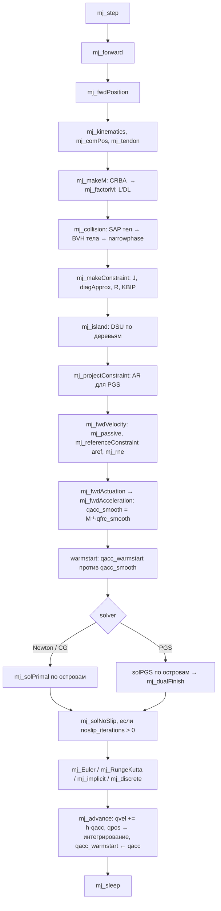

# MuJoCo

Клон: `refs/mujoco` @ `7252110fb` (2026-11-13), версия заголовка 4.0.2 (`mjVERSION_HEADER 4000002`).
Факты: `data/facts/mujoco.jsonl`. GPU-варианты: `refs/mujoco/mjx` (JAX) и `refs/mujoco_warp` @ `cafb631fb`.
Разбор сделан чтением кода, ничего не собиралось и не запускалось: все утверждения о скорости —
из структуры кода и документации клона, не из замеров.

Ссылки: первая в каждом пункте дана полностью (`refs/mujoco/src/engine/файл.c:строка`), дальше — сокращённо:
`engine_*.c:строка` означает `refs/mujoco/src/engine/engine_*.c`, `:строка` — тот же файл, что в предыдущей
ссылке; `mjtype.h`, `mjdata.h`, `mjbatch.h` — `refs/mujoco/include/mujoco/`; `doc/...` — `refs/mujoco/doc/...`;
пути вида `_src/...` в разделе о GPU — внутри `refs/mujoco/mjx/mujoco/mjx/` и `refs/mujoco_warp/mujoco_warp/`.

## В одном абзаце

MuJoCo — движок для сочленённых систем с контактом (робототехника, биомеханика, обучение с подкреплением).
Определяющее решение одно: **контакт и все остальные ограничения — не задача дополнительности, а выпуклая
оптимизация по ускорению `qacc` в обобщённых координатах** с мягкими (регуляризованными) строками. Отсюда
всё остальное: суставы дерева вообще не являются ограничениями (матрица инерции `M` собирается CRBA и
точно раскладывается), решатель по умолчанию — метод Ньютона с точным гессианом `M + JᵀDJ`, обратная
динамика аналитична, состояние компактно (нет кэша контактов — тёплый старт несёт один вектор `qacc`).
Плата: контакты принципиально мягкие (проникновение и остаточное проскальзывание заложены в модель),
столкновения только выпуклые, стоимость шага на «куче свободных тел» выше, чем у игровых движков
(гессиан размера `nv`, явная сборка якобиана), состав сцены в рантайме неизменен.

## Конвейер шага



- `mj_step` — `refs/mujoco/src/engine/engine_forward.c:2668`; проверки `mj_checkPos`/`mj_checkVel` (`:58`, `:76`),
  затем `mj_forward` и выбор интегратора.
- `mj_fwdPosition` — `engine_forward.c:133`: `mj_fwdKinematics` (`:121`) → `mj_makeM`, `mj_factorM`
  (`engine_core_smooth.c:1761`, `:1770`) → `mj_collision` (`engine_collision_driver.c:730`) → пробуждение по
  контактам (`mj_wakeCollision`, при срабатывании столкновения считаются второй раз) → `mj_makeConstraint`
  (`engine_core_constraint.c:2766`) → `mj_island` (`engine_island.c:581`) → `mj_projectConstraint`
  (`engine_core_constraint.c:3122`) → `mj_transmission` (`engine_core_smooth.c:1062`).
- `mj_fwdVelocity` — `engine_forward.c:183`: скорости сухожилий и приводов, `mj_comVel`, `mj_passive`,
  `mj_referenceConstraint` (`engine_core_constraint.c:3259`), `mj_rne` без ускорения (`engine_core_smooth.c:2153`).
- `mj_fwdActuation` — `engine_forward.c:366`; `mj_fwdAcceleration` — `:1011`.
- `mj_fwdConstraint` — `engine_forward.c:1303` → `fwdConstraint` (`:1206`): `efc_b = J·qacc_smooth − aref`,
  `warmstart` (`:1077`), решатель по островам через `mju_dispatch` (`:1236`–`:1269`) либо монолитно (`:1272`–`:1291`).
- Интеграторы — `mj_EulerSkip` (`:2039`), `mj_RungeKutta` (`:2173`), `mj_implicitSkip` (`:2448`), `mj_discrete` (`:2131`);
  общий хвост `advance` (`:1984`) и `mj_sleep` (`:1437`, сам критерий — `engine_sleep.c:718`).

Порядок стадий важен: столкновения считаются **в начале** шага по текущим позициям, после чего позиционная
стадия (включая `J` и раскладку арены) фиксирована; скоростная и стадия ускорений переиспользуют её
(`mj_forwardSkip`, `engine_forward.c:2603`) — на этом построены конечные разности и RK4.

## Поиск пар (broadphase, midphase)

**Единица широкой фазы — тело, а не geom.** `mj_broadphase` (`engine_collision_driver.c:1734`):

1. Мировое тело с geom и любое неподвижное тело с плоскостью сразу спариваются со всеми сталкиваемыми телами
   (`:1741`–`:1782`) — без боксов. Вся статика сцены, записанная в worldbody, — одно «тело».
2. Для остальных считается ковариация центров geom, её собственные векторы дают систему осей (`:1784`–`:1821`,
   `mju_eig3Tol`). В этой системе строятся AAMM тел (`makeAAMM`, `:1400`): пересечение проекции OBB и
   ограничивающей сферы каждого geom, расширенное на `geom_margin + geom_gap`.
3. `mj_SAP` (`:1601`): сортировка 2n концов по первой оси (`float`-ключи), проход с активным списком, отсев по
   двум другим осям. Активный список — линейный массив, удаление через `memmove` (`:1681`–`:1691`).
4. Фильтр пары тел `filterBodyPair` (`:392`): одно weld-тело, оба без dof, оба спят, спящее против мира,
   родитель–потомок. Затем битовые маски на уровне тела (`add_pair`, `:1518`), сортировка пар по сигнатуре (`:1892`).

Состояния между шагами нет вовсе: ни дерева, ни списка пар, ни «толстых» боксов. Буфер пар выделяется на
худший случай `nbodyflex·(nbodyflex−1)/2` (`:757`–`:758`), идентификаторы пар 16-битные (`mjPacked32`, `:513`),
`mj_SAP` отказывает при `n >= 0x10000` (`:1603`).

**Средняя фаза — BVH внутри тела.** У каждого тела статическое бинарное дерево AABB его geom в инерциальной
системе тела (`m->bvh_aabb`). `mj_collideTree` (`:1116`) спускается по двум деревьям одновременно с тестом
`mj_collideOBB` (`:1017`, шесть осей граней двух боксов с кэшем скалярных произведений), на листьях —
сфера (`mj_filterSphere`, `:330`), затем OBB самих geom и `filterCollisionPair` (`:682`). Пара тел с одним
geom у каждого идёт напрямую (`:829`–`:834`). BVH отключается флагом `mjDSBL_MIDPHASE` и для «быстрых» пар тел
под флагом speculative (`:837`–`:839`).

У flex (деформируемых) BVH динамическое (`mj_updateDynamicBVH`, `engine_core_smooth.c:496`), самостолкновения
— SAP по элементам или сетка ячеек; здесь не разбиралось.

Явные пары `<pair>` и исключения `<exclude>` сливаются с выдачей широкой фазы по отсортированным сигнатурам
(`:786`–`:819`); `mjcb_contactfilter` заменяет битовый тест на паре geom (`:704`–`:713`).

## Точки контакта (narrowphase, manifold)

Диспетчеризация — таблица `mjCOLLISIONFUNC[9][9]` (`engine_collision_driver.c:48`), пара упорядочена по типу
(`pushGeomGeom`, `:605`). Число точек — из `mj_maxContact` (`:68`).

| Пара форм | Алгоритм | Точек |
|---|---|---|
| plane – sphere / ellipsoid | `mjc_PlaneSphere`; эллипсоид — `mjc_PlaneConvex` (опорная точка) | 1 |
| plane – capsule | `mjc_PlaneCapsule` (`engine_collision_primitive.c:66`) | 2 |
| plane – cylinder / box | `mjc_PlaneCylinder` (`:101`), `mjc_PlaneBox` (`:210`) | до 4 |
| plane – mesh | `mjc_PlaneConvex` (`engine_collision_convex.c:1095`): опорная вершина + грань, наиболее встречная нормали, сокращённая `hull4f` | до 4 |
| sphere – sphere / capsule / cylinder / box | формулы (`engine_collision_primitive.c`, `engine_collision_box.c:91`) | 1 |
| capsule – capsule | `mjc_CapsuleCapsule` (`engine_collision_primitive.c:454`), две точки при параллельных осях | до 2 |
| capsule – box | `mjc_CapsuleBox` (`engine_collision_box.c:594`) | до 4 (буфер) |
| box – box | `mjraw_BoxBox` (`engine_collision_box.c:698`): SAT по 15 осям с приоритетом граней + отсечение Сазерленда–Ходжмена | до 8 |
| общая выпуклая (ellipsoid, cylinder, mesh и смешанные) | `mjc_Convex` (`engine_collision_convex.c:951`) → `mjc_ccd` (`engine_collision_gjk.c:2777`): GJK, затем inflate или EPA, затем `mjc_multicontact` | грань–грань 4, с капсулой 2, иначе 1 |
| hfield – выпуклая | `mjc_ConvexHField` (`engine_collision_convex.c:1240`): призмы подрешётки, каждая — общим выпуклым алгоритмом | до 50 |
| SDF – любая | `mjc_SDF` (`engine_collision_sdf.c:1069`): градиентный спуск из точек Халтона; mesh–SDF (`:993`) — BVH граней + farthest-point | до 50 |
| plane–plane, plane–hfield, hfield–hfield, hfield–SDF | нет функции / предупреждение | 0 |

**Общая выпуклая пара: два пути.** `mjc_penetration` (`engine_collision_convex.c:88`):

- **nativeccd — включён по умолчанию** (флаг `mjDSBL_NATIVECCD` его отключает). Собственные GJK+EPA
  (`engine_collision_gjk.c`). `mjc_ccd` сначала сжимает формы до ядра: сфера → точка, капсула → отрезок, любой
  geom с margin теряет запас (`:2790`–`:2821`), запускает `gjk` (`:215`) и, если ядра не пересеклись,
  получает контакт «надуванием» найденных ближайших точек на радиусы и margin/2 (`inflate`, `:2486`; ветка
  `:2833`–`:2851`) — без EPA. Только при глубоком проникновении GJK перезапускается на полных формах и идёт
  EPA (`:2861`–`:2921`, `epa` — `:1570`). GJK: подалгоритм signed volumes (`subdistance`, `:530`), останов по
  зазору Франка–Вульфа (`:281`–`:288`), для пары многогранников допуск нулевой (`:234`–`:236`).
- **libccd** (флаг nativeccd выключен): `ccdMPRPenetration` (`engine_collision_convex.c:72`), нормаль потом
  правится `mjc_fixNormal`. В документации назван legacy и «медленнее и менее надёжен».

**Многоточечный контакт.** В nativeccd — за один вызов: `mjc_multicontact` (`engine_collision_gjk.c:2524`) берёт
опорные вершины последнего симплекса обеих форм, перечисляет грани, содержащие их (`meshNormals`,
`boxNormals`, `cylinderNormals`), ищет пару почти встречных нормалей (`alignedFaces`, допуск
`mjFACE_TOL 0.996` ≈ 5°) либо ребро–грань, и отсекает одну грань по другой (`polygonClip`, `:1832`).
Многоугольник более чем из 4 вершин сокращается до четырёхугольника наибольшей площади (`hull4`, `:1751`).
В libccd-пути — четыре повторных запроса с поворотом обеих форм на ±1e-3 рад вокруг касательных осей
(`engine_collision_convex.c:976`–`:1034`), глубина новых точек приравнивается глубине первой (`:1022`).
Box–box не сокращается намеренно: комментарий `engine_collision_box.c:623`–`:629` — сокращение до 4 точек
на стопках пластин стоит «два–три порядка остаточного движения».

**Как точки переживают кадр: никак.** `mj_collision` начинает с `d->ncon = 0` и сброса арены
(`engine_collision_driver.c:737`–`:740`); у `mjContact` нет идентификатора признака; контакты упорядочены
детерминированно (пары отсортированы, `:1383`–`:1390`, заполнение «строго по префиксу», `:2485`), но не
сопоставляются. Тёплый старт решателю это не нужно — см. ниже.

**Запасы.** `margin` — сумма по двум geom; функции столкновения получают `margin + gap` как порог
обнаружения (`:2113`–`:2116`), строка в решателе создаётся при `dist < margin` (`mj_setContact`, `:1921`–`:1922`),
контакты в зоне gap хранятся неактивными. По умолчанию margin = 0: контакт появляется только при касании.
Слопа (допустимого проникновения) нет — проникновение определяется мягкостью строки.

## Модель контакта и трения

Строка ограничения описывается четвёркой `KBIP` и весом `D = 1/R` (`mj_makeImpedance`,
`engine_core_constraint.c:2030`):

```
imp   = getimpedance(solimp, pos, margin)            // d(r): dmin → dmax на ширине width, степенной сплайн
R     = max(mjMINVAL, (1-imp) * efc_diagA / imp)     // :2051
K     = 1 / (dmax² * timeconst² * dampratio²)        // :2068   (прямой формат: K = -solref[0] / dmax²)
B     = 2 / (dmax * timeconst)                       // :2077   (прямой формат: B = -solref[1] / dmax)
aref  = -B * efc_vel - K * imp * (efc_pos - efc_margin)   // mj_referenceConstraint, :3274
force = -D * (J*qacc - aref), затем проекция на допустимое множество   // mj_constraintUpdate_impl, :3318
```

`efc_diagA` — приближённая обратная инерция строки: для контакта `tran = Σ body_invweight0` двух тел
(`mj_diagApprox`, `:1641`, ветка контактов `:1794`–`:1840`), предвычисленная в `qpos0`; флаг `diagexact`
заменяет её точной диагональю `‖Y_i‖²`, `Y = J·M^{-1/2}` (`:2956`–`:2962`). Смысл: `R` пропорционален
собственной податливости строки, поэтому импеданс не зависит от масс. По умолчанию `solref = (0.02, 1)`,
`solimp = (0.9, 0.95, 0.001, 0.5, 2)` (`engine_init.c:32`); под Euler `refsafe` поднимает `timeconst` до
`2·timestep` (`engine_core_constraint.c:1896`–`:1902`).

**Параметры пары** (`mj_contactParam`, `:166`): при разном `priority` — параметры geom с большим приоритетом;
иначе трение — максимум по компонентам, `condim` — максимум, `solref`/`solimp` — взвешенно по `solmix`.

**Пирамида (по умолчанию).** На каждое направление трения `k` две строки `J_n ± μ_k·J_k`
(`mj_instantiateContact`, `:1604`–`:1615`), всего `2·(condim−1)` неотрицательных сил; нормальная сила — их
сумма. `R` всех рёбер одинаков: `Rpy = 2·mu²·R[0]` (`:2153`).

**Эллиптический конус.** Один блок размерности `condim`: нормаль + касательные (+ кручение, + качение).
`R[1] = R[0]/impratio`, остальные согласованы так, что `R[j]·μ_j² = R[1]·μ_1²` (`:2132`–`:2143`);
«главное» `mu = μ_1·sqrt(R[1]/R[0])` (`:2136`). Стоимость и сила в прямой задаче (`:3384`–`:3492`): в
масштабированных координатах `N = jar_n·mu`, `T = ‖jar_t·friction‖` три зоны — верхняя `N ≥ mu·T` (сила 0),
нижняя `mu·N + T ≤ 0` (обычная квадратичная по всем компонентам) и средняя со стоимостью
`0.5·Dm·(N − mu·T)²`, `Dm = D0/(mu²·(1+mu²))`, для которой тут же собирается гессиан конуса `con->H` (`:3444`–`:3482`).

`condim` 1/3/4/6 — без трения / касательное / + кручение / + качение (`mjdata.h:45`, `:57`). Коэффициента
восстановления нет: отскок — через `dampratio < 1` или прямой формат `solref` с нулевым демпфированием.
Есть скорость поверхности (`geom_surfacevel`, конвейер) и адгезия (сдвиг `aref`, `:3221`).

## Решатель

**Что решается.** Прямая задача (Newton, CG) — минимум по `qacc`:

```
cost(qacc) = 0.5 * (M*qacc - qfrc_smooth)·(qacc - qacc_smooth)  +  Σ s_i(J_i*qacc - aref_i)
```

(`PrimalUpdateConstraint`, `engine_solver.c:1515`–`:1548`), где `s_i` — кусочно-квадратичный штраф строки
(`mj_constraintUpdate_impl`, `engine_core_constraint.c:3301`): equality — `0.5·D·jar²`; сухое трение — функция
Хубера с линейными ветвями за `|jar| ≥ R·floss` (`:3332`–`:3361`); пределы и контакты — полуквадратичная
(`jar < 0`); эллиптический конус — три зоны. Двойственная (PGS) — минимум `0.5·fᵀ·AR·f + fᵀ·b` по силам,
`AR = J·M⁻¹·Jᵀ + diag(R)`, `b = J·qacc_smooth − aref` (`engine_forward.c:1223`, сборка `AR` — `mj_makeARNumeric`).

**Итерация Newton/CG** (`mj_solPrimal`, `engine_solver.c:3522`):

1. `grad = M·qacc − qfrc_smooth − qfrc_constraint` (`:1552`).
2. Сертификат: если `0.5·scale·gradᵀ·M⁻¹·grad < tolerance` (и для Newton — ещё норма градиента), выход с нулём
   итераций, гессиан не строится (`:3591`–`:3607`). `scale = 1/trace(M)` (`inertiaScale`, `:455`).
3. Newton: `H = M + Jᵀ·D·J` по строкам в состоянии QUADRATIC (`MakeHessian`, `:2877`; `FactorizeHessian`, `:3136`),
   разреженный Cholesky с заранее посчитанным шаблоном; `search = −H⁻¹·grad`. CG: `search = −M⁻¹·grad + β·search`,
   β по Hager–Zhang (`:3704`–`:3734`; Polak–Ribière-Plus остался под `#ifdef mjCG_PRP`).
4. Точный одномерный поиск `PrimalSearch` (`:2019`): стоимость вдоль луча — сумма квадратичных по строкам
   (`PrimalPrepare`, `:1618`), её первая и вторая производные считаются аналитически (`PrimalEval`, `:1815`);
   шаг Ньютона из нуля (`:2067`), односторонний поиск, затем деление отрезка с тремя кандидатами (`:2161`–`:2202`).
   Допуск `tolerance·ls_tolerance·‖search‖/scale`.
5. Обновление состояний строк; Newton — `HessianIncremental` (`:3396`): rank-1 обновление или понижение Cholesky
   для строк, сменивших состояние QUADRATIC, с выбором «обновлять или переразложить» по оценке операций
   (`:3433`–`:3435`) и принудительной пересборкой после `PRIMAL_MAX_DOWNDATE` (32) понижений (`:3424`–`:3428`);
   конусные вклады добавляются отдельным множителем `Lcone`.
6. Останов: улучшение `< tolerance`, либо норма градиента, либо декремент Ньютона `0.5·gᵀ·H⁻¹·g` (`:3692`–`:3697`).

**Итерация PGS** (`solPGS`, `:474`): экстраполяция Нестерова `β = (k−1)/(k+2)` с проекцией на допустимое
множество (`:525`–`:571`); перемешивание блоков (`:577`, PCG32 с фиксированным зерном `:515`); для каждого блока —
остаток `res = b + AR·f` (`:190`), скалярный шаг `f −= res/AR_ii` и зажим (сухое трение `±floss`, пределы и
пирамида `≥ 0`), а для эллиптического контакта — шаг вдоль луча из вершины конуса и затем QCQP по трению при
фиксированной нормали (`:622`–`:694`); откат блока, если стоимость выросла (`costChange`, `:219`); рестарт
Нестерова, когда поправка направлена против экстраполяции (`:711`–`:730`). После — `mj_dualFinish`:
`qacc = M⁻¹·Jᵀ·f + qacc_smooth` (`:73`–`:82`).

**NoSlip** (`solNoSlip`, `:784`): после основного решателя проходы Гаусса–Зейделя только по строкам сухого
трения и касательным компонентам контактов с вычтенным `R` (жёсткие), нормальные силы заморожены; для
пирамиды — пары встречных рёбер при фиксированной сумме (`:853`–`:901`). По умолчанию выключен; в документации
назван ad-hoc.

**Чем стабилизируется.** Позиционная ошибка входит только в `aref` — отдельного прохода коррекции, Baumgarte,
split impulse и проекции позиций нет (по `src/engine` ноль совпадений). Под интегратором `discrete` строка
делается неявной: пружина берётся в конце шага (`pos + h·vel`), `R ← R/f`, `aref ← aref/f`,
`f = 1 + h·B + h²·K·imp` (`engine_core_constraint.c:2023`, `:2089`–`:2116`, `:3268`–`:3289`).

**Что переносится между шагами.** Один вектор `qacc_warmstart` (`engine_forward.c:2005`). `warmstart` (`:1077`)
считает стоимость в нём и в `qacc_smooth` и берёт лучшую; для PGS силы получаются из него через
`mj_constraintUpdate` и обнуляются, если двойственная стоимость положительна (`:1096`–`:1115`). Поэтому
сопоставлять контакты между кадрами не нужно: тёплый старт живёт в пространстве суставов, где число
переменных постоянно.

**Параллелизм.** `mj_island` даёт блочно-диагональную задачу; острова раздаются `mju_dispatch(solveIslandTask)`
(`engine_forward.c:1236`–`:1255`); для Newton/CG входы собираются в островные массивы (`mju_gather`), для PGS —
список строк `efclist`. Раскраски графа нет. Без `mju_threadpool` всё в одном потоке.

**Длинная цепь.** Суставы цепи не порождают строк: цепь из n звеньев — это n dof в `M`, точно разложенной за
`O(Σ глубина²)` (`mj_factorI`, `engine_core_smooth.c:1807`). Итерации нужны только контактам, пределам и
замыканиям. Контакт на конце цепи для Newton — rank-1 поправки к разложению `M`, а не волна импульсов через
n суставов, как в PGS по максимальным координатам.

**Отношение масс.** Три механизма: `R ∝ diagA` (регуляризация строки в единицах её собственной податливости),
точный гессиан (Newton не видит обусловленности `J·M⁻¹·Jᵀ`), предобуславливание CG матрицей `M`. Оговорка
документации: приближение `diagA` заморожено в `qpos0`, изотропно и «can become significant for … long
kinematic chains», вплоть до расходимости (`doc/computation/index.rst:1635`–`:1640`); лечится `diagexact`.

## Сочленения

- **Координаты.** Четыре типа сустава: free (7 в `qpos` / 6 dof), ball (4/3), slide, hinge (`mjtype.h:97`).
  Несколько суставов на одном теле складываются последовательно (`mj_kinematics1`, `engine_core_smooth.c:41`,
  цикл `:108`–`:150`). Тел без суставов «приваривает» к родителю компилятор (weld-тело).
- **Матрица инерции.** `mj_crb` (`:1685`): обратный проход по телам копит составные инерции `crb`, прямой проход
  по dof с подъёмом по предкам заполняет разреженную `M` (только пары «dof – его предки», `:1753`–`:1756`);
  `dof_armature` идёт на диагональ (`:1746`), armature сухожилий — `M += armature·ten_Jᵀ·ten_J` (`:1662`).
  ABA не используется.
- **Разложение.** `mj_factorI` (`:1807`): `M = LᵀDL` обратным проходом по строкам — на дереве без заполнения;
  `mj_solveLD` (`:1849`). Неположительный диагональный элемент зажимается до `mjMINVAL` с предупреждением.
- **Смещение.** `mj_rne` (`:2153`) с `flg_acc = 0` даёт `qfrc_bias` (кориолисовы, центробежные, гравитация —
  через ускорение мира `−gravity`).
- **Equality (замкнутые цепи).** `mj_instantiateEquality` (`engine_core_constraint.c:498`): connect (3 строки,
  разность положений якорей), weld (6: положение + ось кватерниона ошибки, масштаб `torquescale`), joint и
  tendon (связь значений кубическим полиномом), flex. Те же `solref`/`solimp`, тот же решатель; для
  connect/weld в `aref` вычитается `J̇·v` (`:3278`–`:3281`). Замыкание мягкое по построению.
- **Пределы.** Односторонние строки, создаются только при `dist < margin` (`:1323`–`:1345`); для ball — предел угла.
- **Сухое трение** (`frictionloss`). Строка на dof или сухожилие с силой в `±floss`
  (`mj_instantiateFriction`, `:1189`; штраф Хубера `:3332`–`:3361`).
- **Сухожилия.** `mj_tendon` (`engine_core_smooth.c:724`): fixed — линейная комбинация координат; spatial — путь
  через site с огибанием сферы/цилиндра (`mju_wrap`, `:833`) и блоками (pulley). Даёт длину и разреженный
  `ten_J`; у сухожилия свои пределы, пружина, демпфер, сухое трение, armature.
- **Приводы.** `mj_fwdActuation` (`engine_forward.c:366`): `force = gain·ctrl + bias` по типам (`mjtype.h:256`–`:286`),
  `qfrc_actuator = momentᵀ·force` (`:980`), ограничение по диапазонам. Это силы, а не ограничения: серво позиции
  — жёсткая пружина, устойчивость которой зависит от интегратора (неявно по скорости — implicit/implicitfast,
  неявно по позиции — только discrete).
- **Пассивные силы.** Пружины и демпферы суставов и сухожилий, вязкость среды (`mj_passive`,
  `engine_passive.c:1190`).

## Интегратор, CCD, острова и сон

**Интеграторы** (`mjtype.h:186`): Euler (по умолчанию; полунеявный, демпфирование суставов неявно через
`qH = M + h·diag(B)`, `engine_forward.c:2073`–`:2112`), RK4 (с поправкой Рунге–Кутты–Мунте-Кааса для
кватернионов, `:2150`), implicit (`M − h·qDeriv`, несимметричное разреженное LU, включает производную RNE,
`:2470`–`:2479`), implicitfast (без производной RNE, симметрично; отдельным свободным телам гироскопическая
производная возвращается локальным решением 6×6, `:2539`–`:2557`) и **discrete** — новый: решатель ограничений
работает в метрике `M̂ = M + hD + h²K`, его `qacc` есть шаг `(v⁺ − v)/h` (`:2130`–`:2135`,
`doc/computation/index.rst:669`–`:741`). Позиции — `mj_integratePosInd` (`engine_support.c:713`), кватернионы —
экспоненциальным отображением (`mju_quatIntegrate`). Подшагов нет.

**CCD.** По умолчанию отсутствует. Флаг `mjENBL_SPECULATIVE` (требует nativeccd): для пары без активного
контакта, где смещение geom за шаг не меньше минимальной полутолщины AABB (`geomStepSweep`,
`engine_collision_driver.c:273`), `mjc_advanceGeomPair` (`engine_collision_continuous.c:1691`) выполняет
направленное консервативное продвижение на GJK-расстояниях (до 16 шагов, `:1742`), при исчерпании — линейную
экстраполяцию («non-conservative under rotation», `:1799`), проверяет заслонённость лучами и добавляет до
четырёх контактов с эффективной `dist`, подобранной так, чтобы решатель погасил долю `(1 − t)` нормальной
скорости. Широкая фаза расширяет боксы и сферы на смещение.

**Острова** (`engine_island.c`): каждый шаг DSU по кинематическим деревьям — строки ограничений связывают
деревья (`unionConstraintTrees`, `:378`), корень — меньший индекс, номера по возрастанию (`mj_dsuAssign`, `:109`);
затем dof и строки перенумеровываются подряд по островам (`:581` и далее), `J` становится блочно-диагональной.
Отключаются `mjDSBL_ISLAND`.

**Сон** (`engine_sleep.c`, выключен по умолчанию, `mjENBL_SLEEP`): дерево «готово спать», когда
`max|dof_length·qvel| < sleep_tolerance` (1e-3) и нет приложенных сил (`treeCanSleep`, `:125`), `mjMINAWAKE = 10`
шагов подряд (`:733`–`:742`); остров засыпает, когда готовы все его деревья (`:749`–`:775`), при этом `qvel`
обнуляется (`mj_sleepTrees`, `:673`). Спящие деревья связаны в цикл (`tree_asleep`) и будятся вместе
(`mj_wakeIsland`, `:210`) — контактом с бодрствующим деревом, сухожилием, equality. Спящие тела пропускаются в
кинематике, CRBA, RNE, широкой фазе.

## Производительность и детерминизм

- **Память.** Один буфер на `mjData` и одна арена: массивы шага (контакты, efc, острова) растут снизу
  (`mj_arenaAllocByte`, `engine_memory.c:107`), стек временных массивов — сверху (`mj_markStack`/`mj_freeStack`).
  `malloc` в шаге нет; под пулом потоков стек резервируется атомарно (`:216`–`:221`). Вся аллокация efc — на
  позиционной стадии, дальше повторные вычисления без аллокаций.
- **Раскладка.** SoA по полям в `mjData`; `M`, `J`, `AR`, гессиан — CSR; якобиан плотный при `nv < 60`
  (`mj_isSparse`, `engine_core_util.c:35`). Контакты — массив структур `mjContact` (в структуре лежит и
  гессиан конуса 6×6).
- **Потоки.** Свой пул (`engine_thread.cc:170`): чанки narrowphase (около 5 на поток,
  `engine_collision_driver.c:2413`), острова решателя, тактильные сенсоры. Широкая фаза, сборка `J`, CRBA —
  однопоточные. Отдельно `mjBatch` — много симуляций одной модели (`mjbatch.h`); документация называет
  именно параллелизм между симуляциями основным сценарием.
- **SIMD.** Только AVX в разреженных скалярных произведениях (`engine_util_sparse_avx.h`).
- **Лёгкие сцены.** Что работает на «мало тел, мало контактов»: выход решателя с нулём итераций по сертификату,
  отсутствие работы над неограниченными dof (они вне островов), пропуск BVH для одиночных geom, сон. Что
  мешает: якобиан и гессиан в полном пространстве `nv`, широкая фаза с ковариацией и полной сортировкой
  каждый шаг, буфер пар `O(n²)`.
- **Детерминизм.** Заявлено: конвейер детерминирован, точная воспроизводимость — в одной версии на одной
  архитектуре (`doc/computation/index.rst:2374`–`:2389`). Средства в коде: нет скрытого состояния кроме
  `qacc_warmstart`, пары отсортированы, потоки narrowphase пишут в заранее вычисленные слоты, номера островов
  канонические, перемешивание PGS — с фиксированным зерном. Специальных флагов компилятора для плавающей
  точки в cmake-файлах клона нет.
- **Снимок.** `mj_getState`/`mj_setState` по маске `mjtState`; `mjSTATE_INTEGRATION` — всё, что нужно для
  побитового продолжения (`mjtype.h:517`–`:545`).

## Прочее: производные, запросы, форматы, API

- **Производные.** Конечные разности по целому шагу — `mjd_transitionFD` (`engine_derivative_fd.c:610`) с
  переиспользованием позиционной стадии; аналитика — только производные гладких сил по скорости
  (`mjd_smooth_vel`, `engine_derivative.c:4564`) для неявных интеграторов.
- **Обратная динамика.** `mj_inverse` (`engine_inverse.c:332`) — без итераций: при известном `qacc` задача по
  силам диагональна в `R`. Флаг `fwdinv` сравнивает прямую и обратную каждый шаг — встроенная проверка
  сходимости решателя (`mj_compareFwdInv`, `:340`).
- **Запросы.** `mj_ray` (`engine_ray.c:1358`), `mj_multiRay` (`:1609`), `mj_geomDistance`
  (`engine_support.c:574`), сенсоры расстояния и контакта. Заметания формы и запроса перекрытия нет.
- **Форматы.** MJCF и URDF (`mj_loadXML`), двоичный MJB (`mj_loadModel`), программная сборка `mjSpec` →
  `mj_compile`, OpenUSD в `src/experimental/usd`.
- **API.** C, две структуры: `mjModel` (const для шага) и `mjData`; глобальные обратные вызовы `mjcb_*`,
  заменяемая таблица столкновений, плагины. Тела в рантайме не добавляются.

## MJX и mujoco_warp: отличия от C-ядра

Просмотрено поверхностно (типы, заголовки функций), без разбора.

| | C-ядро | MJX (`refs/mujoco/mjx`) | mujoco_warp (`refs/mujoco_warp`) |
|---|---|---|---|
| Решатели | Newton, CG, PGS, noslip | только CG и Newton (`_src/types.py:210`–`:220`) | только CG и Newton (`_src/types.py:580`–`:590`) |
| Гессиан Newton | разреженный Cholesky + rank-1 обновления | плотный `cho_factor` на каждой итерации (`_src/solver.py:417`–`:420`) | блочный/тайловый Cholesky, есть инкрементальный путь (`_src/solver.py:2225`, `:3130`) |
| Общая выпуклая пара | GJK + EPA + отсечение граней | SAT с картой Гаусса + отсечение (`_src/collision_convex.py:732`, `:875`) — формы статические, GJK нет | порт GJK/EPA и multicontact (`_src/collision_gjk.py:662`, `:1348`) |
| Широкая фаза | SAP по телам + BVH тела | таблица функций по типам пар; отбор `top_k` по расстоянию сфер при `max_geom_pairs` (`_src/collision_driver.py:420`–`:430`) | NXN либо SAP (тайловая или сегментная сортировка) по geom (`_src/types.py:137`–`:148`) |
| Размеры | арена, динамические | статические (число контактов задано формой массивов) | заранее заданные `naconmax`, `njmax` на пакет миров |
| Острова | DSU, по потокам | нет | есть (`_src/island.py`) |
| Детерминизм | по построению | — | опционально, битовая маска (`_src/types.py:273`–`:287`); на GPU без неё недетерминирован |

## Расхождения кода с расхожими представлениями

1. **PGS — не «классический»**: ускорение Нестерова с градиентным рестартом и случайный порядок блоков на
   каждом проходе (`engine_solver.c:484`–`:577`, `:711`–`:730`). В разделе документации о PGS этого нет, только
   в changelog.
2. **CG — Hager–Zhang**, а не Polak–Ribière (`engine_solver.c:3704`).
3. **gap работает наружу**: обнаружение на `margin + gap`, сила на `margin`
   (`engine_collision_driver.c:2116`, `:1922`); в старых версиях сила включалась на `margin − gap`.
4. **Box–box переписан**: SAT + отсечение без сокращения точек, вместо унаследованного кода; сопровождается
   редким в этом коде обоснованием с цифрами (`engine_collision_box.c:605`–`:629`).
5. **EPA запускается редко**: мелкое проникновение закрывается GJK по ядрам (`engine_collision_gjk.c:2833`).
6. **Есть сон, острова по потокам, спекулятивные контакты и пятый интегратор** (`discrete`) — «MuJoCo без
   сна и без CCD» больше неверно, хотя всё это, кроме островов, выключено по умолчанию.
7. **Широкая фаза — по телам**, со статикой вне SAP и буфером на все пары; это не «SAP по geom».

## Слабости

Только признанное в документации клона, в комментариях или прямо видное в коде.

- Мягкая выпуклая модель нарушает комплементарность; «the only way to initiate slip is to generate some
  motion in the normal direction» (`doc/computation/index.rst:52`–`:57`).
- Остаточное скольжение «inherent to soft-constraint models»; noslip — «ad-hoc correction that can
  occasionally cause instabilities» (`doc/computation/index.rst:1528`–`:1534`).
- Только выпуклые столкновения: mesh заменяется выпуклой оболочкой, невыпуклое — ручная декомпозиция или SDF
  (`doc/computation/index.rst:1823`–`:1828`).
- Пирамидальный конус (по умолчанию) задаёт другую мягкую динамику, чем эллиптический, и «made it difficult
  to achieve fine grasping behaviors» (`doc/computation/index.rst:1711`–`:1717`).
- `diagApprox` заморожена в `qpos0` и изотропна; на длинных цепях и анизотропной инерции ошибается, в тяжёлых
  случаях — расходимость (`doc/computation/index.rst:1635`–`:1640`).
- PGS — «first-order convergence»; Newton «better in every way» (`doc/computation/index.rst:1493`–`:1499`).
- Под Euler жёсткость строки ограничена: `timeconst ≥ 2·timestep` (`engine_core_constraint.c:1896`–`:1902`).
- Широкая фаза: буфер на `n(n−1)/2` пар тел (`engine_collision_driver.c:757`), отказ при 65536 объектах (`:1603`),
  линейное удаление из активного списка (`:1683`–`:1691`).
- CCD выключен по умолчанию; при исчерпании 16 шагов — неконсервативная экстраполяция
  (`engine_collision_continuous.c:1799`); «slower body gets a lever-arm error» (`:1836`).
- `J̇·v` для контактов опущен (`doc/computation/index.rst:1438`–`:1440`).
- hfield–SDF не поддержан (`engine_collision_sdf.c:986`); hfield–plane, plane–plane — пустые ячейки таблицы.
- Интегратор discrete — «new (September 2026), under active development»; PGS и noslip с flex под ним не
  работают (`doc/computation/index.rst:723`–`:741`).
- Воспроизводимость — только в пределах версии и архитектуры (`doc/computation/index.rst:2385`).

## Что взять

Проблемы нашего движка: **(Ц)** длинные цепи сходятся медленно; **(Д)** джиттер от позиционной коррекции;
**(Т)** квадратное приближение трения; **(Л)** низкая производительность на лёгких сценах.

| Приём | Что закрывает | Где в коде | Лицензия | Цена внедрения |
|---|---|---|---|---|
| Суставы дерева в обобщённых координатах: CRBA + `LᵀDL` без заполнения, смещение через RNE | Ц — цепь перестаёт быть итеративной задачей | `engine_core_smooth.c:1685`, `:1807`, `:2153` | Apache-2.0 | высокая: второе представление тел рядом с максимальным, якобианы контактов через цепочки dof |
| Newton по выпуклой задаче: `H = M + JᵀDJ`, разреженный Cholesky, rank-1 обновления при смене состояния строк | Ц, отношения масс | `engine_solver.c:2877`, `:3136`, `:3396` | Apache-2.0 | высокая: нужна выпуклая постановка и символьная фаза; на многих свободных телах гессиан дорог |
| Точный одномерный поиск по кусочно-квадратичной стоимости с аналитическими производными | сходимость любого прямого метода без подбора шага | `engine_solver.c:1618`, `:1815`, `:2019` | Apache-2.0 | средняя |
| Сертификат сходимости на тёплом старте: `0.5·gᵀM⁻¹g < tol` → ноль итераций | Л — покоящаяся сцена почти бесплатна | `engine_solver.c:3591`–`:3607` | Apache-2.0 | низкая при прямой постановке; в импульсной постановке — аналог через остаток |
| Тёплый старт одним вектором ускорений вместо импульсов контактов | Л, простота: не нужен кэш и сопоставление точек | `engine_forward.c:1077`–`:1156`, `:2005` | Apache-2.0 | низкая, но имеет смысл только с решателем в пространстве скоростей/ускорений |
| Мягкая строка: `aref = −B·v − K·d·(r − margin)`, `R = (1−d)/d·diagA` | Д — ошибка гасится пружиной–демпфером в самой задаче, без отдельной коррекции | `engine_core_constraint.c:2030`–`:2175`, `:3259` | Apache-2.0 | средняя: заменить Baumgarte/NGS на опорное ускорение и регуляризацию по обратной инерции строки |
| Неявная строка: пружина в конце шага, `R/f`, `aref/f`, `f = 1 + hB + h²K·d`; refsafe как «самая жёсткая без отскока» | Д — устойчивость при любой жёсткости и шаге | `engine_core_constraint.c:2023`, `:2089`–`:2116`, `:3268`–`:3289` | Apache-2.0 | низкая поверх мягкой строки; авторы называют интегратор новым |
| Эллиптический конус: три зоны с аналитической стоимостью, силой и гессианом | Т | `engine_core_constraint.c:3384`–`:3492` | Apache-2.0 | средняя (прямой решатель) |
| PGS по эллиптическому конусу: шаг вдоль луча + QCQP по трению при фиксированной нормали | Т — без перехода на прямой решатель | `engine_solver.c:622`–`:694`, `:404` | Apache-2.0 | средняя: блок контакта 3×3 и скалярный Ньютон по множителю |
| Согласование `R` по осям трения (`R[j]·μ_j² = const`) и `impratio` | Т, анизотропное трение, меньше проскальзывания | `engine_core_constraint.c:2123`–`:2163` | Apache-2.0 | низкая |
| PGS с ускорением Нестерова, градиентным рестартом и перемешиванием блоков | Ц — частично, если остаёмся на Гауссе–Зейделе | `engine_solver.c:484`–`:577`, `:711`–`:730` | Apache-2.0 | низкая |
| Одношаговый многоточечный контакт: грани из симплекса GJK/EPA → отсечение → четырёхугольник наибольшей площади | Д на стопках, цена narrowphase; не нужен накопительный кэш | `engine_collision_gjk.c:2524`, `:1832`, `:1751` | Apache-2.0 | средняя: нужны таблицы «вершина → грани» у mesh |
| Ядро + радиус в GJK (сфера = точка, капсула = отрезок, margin/2); EPA только при глубоком проникновении | Л — дешёвый частый случай | `engine_collision_gjk.c:2790`–`:2865` | Apache-2.0 | низкая |
| Box–box: SAT 15 осей с приоритетом граней, отсечение, все вершины многоугольника в контакт | Д на стопках пластин | `engine_collision_box.c:605`–`:1063` | Apache-2.0 | низкая |
| Широкая фаза без состояния: SAP по главной оси ковариации + статическое BVH на тело | Л — для десятков–сотен тел; не масштабируется | `engine_collision_driver.c:1601`, `:1734`, `:1116` | Apache-2.0 | низкая; буфер `O(n²)` не брать |
| Острова DSU по деревьям + сон островов + острова по потокам | Л | `engine_island.c:66`–`:130`, `engine_sleep.c:718`, `engine_forward.c:1236` | Apache-2.0 | средняя |
| Арена + стек в одном буфере, аллокация шага привязана к позиционной стадии | Л | `engine_memory.c:107`, `:210` | Apache-2.0 | низкая |
| Аналитическая обратная динамика как встроенная проверка решателя | диагностика сходимости | `engine_inverse.c:332`, `:340` | Apache-2.0 | низкая при мягкой постановке |

## Не выяснено

Все 73 ключа схемы заполнены, но часть — с оговорками:

- `narrowphase.mesh_edges` — для hfield утверждение «обработки нет» основано на чтении одной функции
  (`mjc_ConvexHField`); скрытой фильтрации дальше по конвейеру не искал.
- `determinism.level` — в словаре нет значения для «одна версия + одна архитектура»; взято `same-binary`.
  Независимость от числа потоков по коду правдоподобна (слоты narrowphase, непересекающиеся острова), но в
  документации не заявлена и не проверялась запуском.
- `queries.kinds` — отсутствие заметания формы и запросов перекрытия установлено шаблоном по `src/engine`,
  а не полным чтением API.
- `perf.*` — ничего не запускалось: чисел производительности нет, только структура.
- `perf.gpu` и раздел про MJX/mujoco_warp — по заголовкам и типам, без разбора алгоритмов.
- Не читались: `engine_metric.c` (эффективная метрика discrete, 3041 строка), `engine_ipc.c` (IPC-режим flex),
  `engine_collision_flex.c`, внутренности `mju_QCQP*`, упорядочение для уменьшения заполнения в гессиане Newton,
  компилятор моделей (`src/user`). Всё про discrete — по документации и по веткам `metric` в прочитанных функциях.
- Колонка «Цена внедрения» — моя оценка, не факт из кода.
